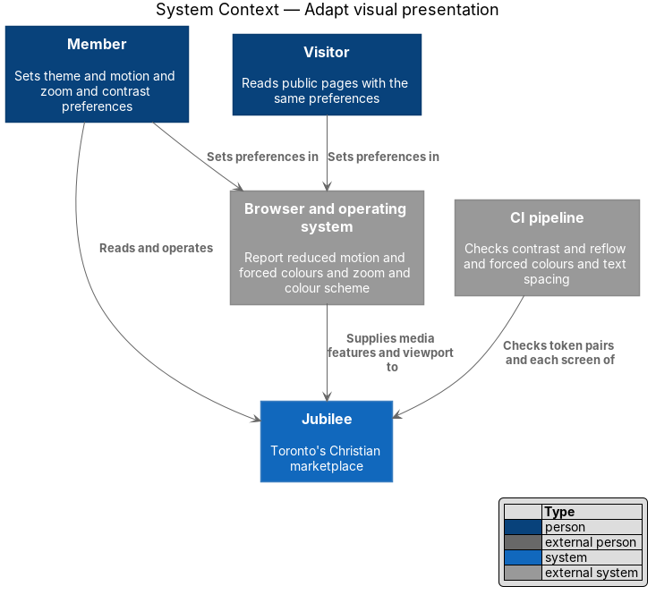
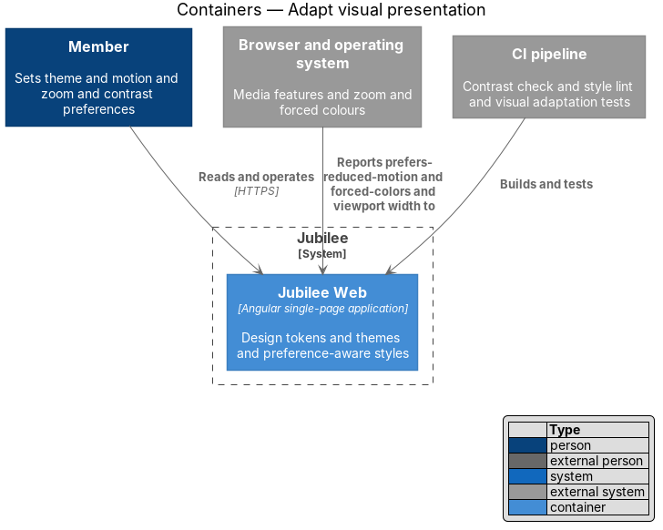
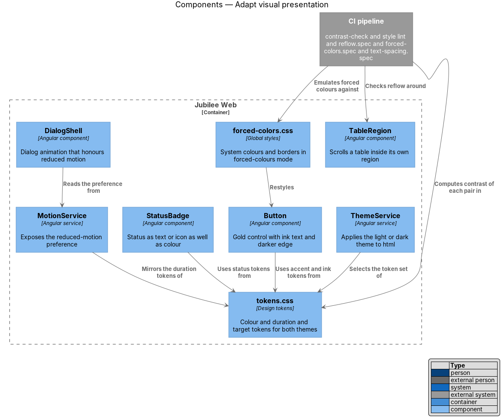
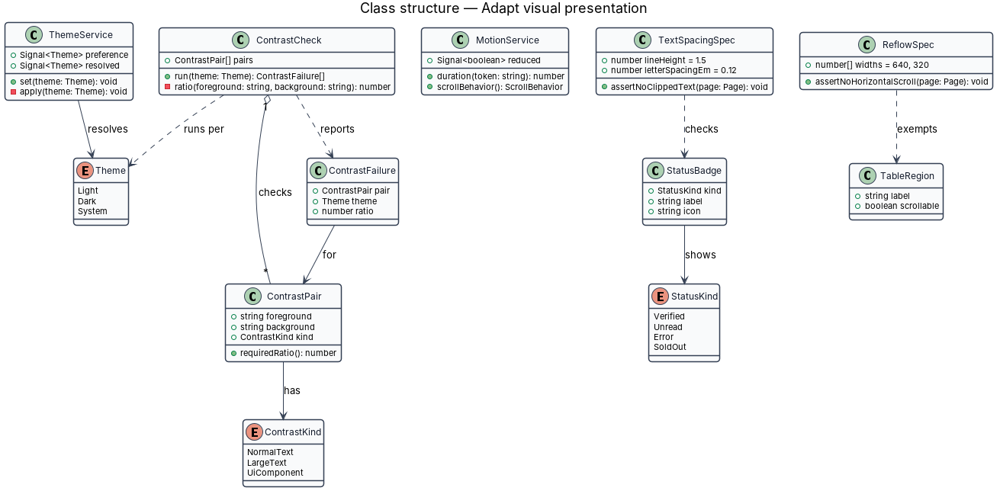
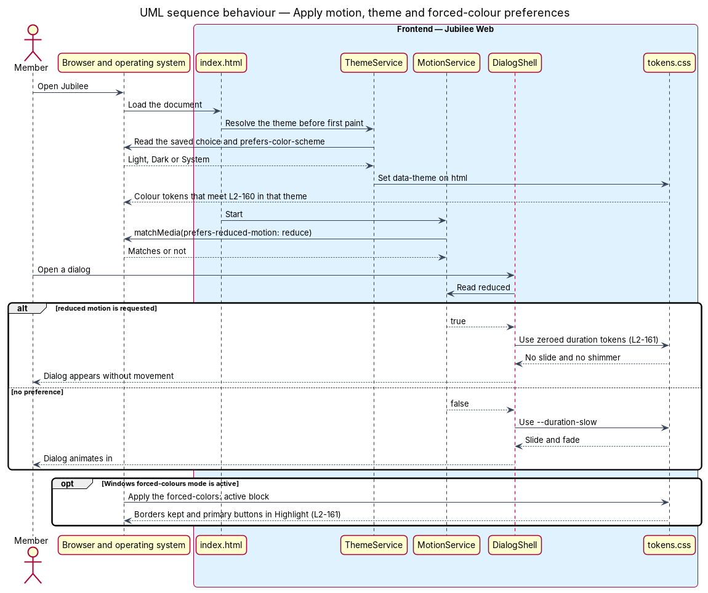
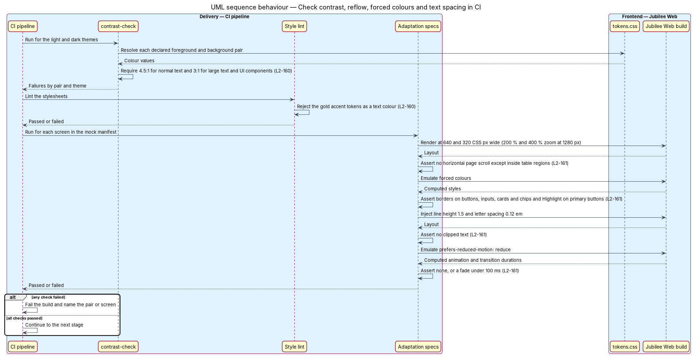

# Adapt visual presentation

## Overview

People read a screen under different conditions. Some need strong contrast or
cannot tell certain colours apart. Some become unwell when the interface
moves. Some enlarge the page to four times its size, replace the colours with
a high-contrast system palette, or widen the spacing of text to read it.
`L1-022` commits Jubilee to WCAG 2.2 Level AA; this feature covers the visual
side of that commitment, in both the light and the dark theme.

The design uses five local terms.

- **design token** — named CSS custom property that holds one colour, duration
  or size, such as `--color-accent`
- **contrast pair** — foreground token and background token that appear
  together, checked as one ratio
- **reduced motion** — user preference reported by the media feature
  `prefers-reduced-motion: reduce`
- **reflow** — rearrangement of content into one column so that a narrow
  viewport needs no horizontal scrolling
- **forced colours** — Windows mode in which the system palette replaces the
  colours of the page

`L2-160` sets the colour rules. Normal text meets 4.5:1 and large text and UI
components meet 3:1 in both themes. The gold accent is never a text colour;
gold controls carry ink text and the darker `--color-accent-border` edge. A
status is conveyed by text or icon as well as colour. `L2-161` sets the
adaptation rules: animation is removed or reduced to fades under 100 ms when
reduced motion is requested; content and functions remain available at 200 %
zoom and at 400 % zoom on a 1280 px display (320 CSS px), without horizontal
scrolling except inside tables; forced-colours mode keeps visible borders and
uses system Highlight colours on primary buttons; text spacing overrides clip
no text.

## Description

The slice consists of tokens and global styles, two small services, a few
shared components, and checks that run in the CI pipeline.

- **`tokens.css`** — the design tokens. Semantic colour tokens are defined
  once for the light theme and once for the dark theme; components read
  semantic tokens only and never a palette value.
- **`ThemeService`** — resolves `Theme` (`Light`, `Dark`, `System`) from the
  saved choice or `prefers-color-scheme` and sets `data-theme` on `html`
  before first paint. Every contrast rule holds in each resolved theme.
- **`contrast-pairs.json`** and **`contrast-check`** — the list of every
  `ContrastPair` used by the components, each tagged `NormalText`, `LargeText`
  or `UiComponent`, and the build script that computes the WCAG contrast ratio
  of each pair in both themes. A pair under 4.5:1 for normal text or under 3:1
  for large text or a UI component fails the build.
- **Gold accent rule** — `--color-accent` is a background token. `Button`
  renders its primary variant with `--color-accent` as background,
  `--color-fg-on-accent` (ink) as text and `--color-accent-border` as edge. A
  style lint rule rejects `--color-accent`, `--color-accent-hover` and
  `--color-accent-active` as the value of `color`.
- **`StatusBadge`** — component for verified, unread, error and sold out. Its
  `label` input is mandatory and it accepts an icon; colour is added on top.
  No status exists as a coloured dot alone.
- **Reduced-motion tokens** — under `prefers-reduced-motion: reduce`, the
  tokens `--duration-fast`, `--duration-base`, `--duration-slow` and
  `--duration-deliberate` collapse to `0.01ms`, and `html` sets
  `scroll-behavior: auto`. Dialogs, toasts and skeletons read these tokens, so
  slides and shimmer stop. Where a fade is kept, it lasts under 100 ms.
- **`MotionService`** — exposes the preference as the signal `reduced` from
  `matchMedia`. Code that animates or scrolls programmatically (dialog entry,
  scroll to the first error, scroll to the newest message) reads it and uses
  an instant change when `reduced` is true.
- **Reflow layout** — sizes are in `rem`, layouts are CSS grid and flex that
  collapse to one column, and no page region has a fixed width above 320 CSS
  px. Long words and URLs wrap with `overflow-wrap: anywhere`.
- **`TableRegion`** — wrapper for each data table. It scrolls horizontally
  inside its own focusable, labelled region, which is the one exception
  `L2-161` allows.
- **`forced-colors.css`** — rules under `@media (forced-colors: active)`.
  Buttons, inputs, cards and chips keep a `1px` solid border in a system
  colour; the primary button uses `Highlight` with `HighlightText`; the focus
  ring token becomes `Highlight`. Icons use `currentColor`.
- **Text spacing tolerance** — text containers use `min-height` and padding
  rather than fixed heights, and no text is truncated by a fixed line count
  without an accessible full value.
- **`reflow.spec`**, **`forced-colors.spec`**, **`text-spacing.spec`** and
  **`reduced-motion.spec`** — browser tests run for each screen in
  `docs/mocks/manifest.json`. They assert, in turn: no horizontal page scroll
  at 640 and 320 CSS px wide; borders and `Highlight` under emulated forced
  colours; no clipped text with line height 1.5 and letter spacing 0.12 em;
  and no animation, or a fade under 100 ms, under emulated reduced motion. The
  browser test framework is `<TO SUPPLY>`.

## Requirements

The feature realizes the following level-2 (L2) requirements. Each L2
requirement refines a level-1 (L1) requirement, cited by identifier.

| L2 ID | Refines (L1) | Requirement |
|-------|--------------|-------------|
| `L2-160` | `L1-022` | Every text and background pair in both themes shall meet 4.5:1 for normal text and 3:1 for large text and UI components. The gold accent shall never be used for text, gold controls shall carry ink text and the darker `--color-accent-border` edge, and every status (verified, unread, error, sold out) shall be conveyed by text or icon as well as colour. |
| `L2-161` | `L1-022` | Under `prefers-reduced-motion: reduce` the app shall remove animations or reduce them to fades under 100 ms. At 200 % browser zoom and at 400 % zoom at 1280 px (320 CSS px reflow) all content and functions shall remain available without horizontal scrolling, except tables, which scroll within their region; in Windows forced-colours mode buttons, inputs, cards and chips shall keep visible borders and primary buttons shall use system Highlight colours; and text spacing overrides (line height 1.5, letter spacing 0.12 em) shall clip no text. |
| `L2-170` | `L1-024` | The app shall follow `prefers-color-scheme` when no preference is saved, shall switch between Light, Dark and System without reload and before first paint, and both themes shall meet `L2-160`. |

## Diagrams

### System context

The browser and operating system report each person's preferences to Jubilee.
The CI pipeline checks the token pairs and each screen.

### Containers

The feature lives entirely in `Jubilee Web`: no server container takes part.
The browser supplies the media features and the CI pipeline builds and tests
the application.

### Components

`ThemeService` and `MotionService` connect user preferences to `tokens.css`.
`Button`, `StatusBadge`, `TableRegion` and `DialogShell` consume the tokens,
and `forced-colors.css` restyles controls in forced-colours mode.

### Class structure

`ContrastCheck` evaluates each `ContrastPair` per `Theme` and reports
`ContrastFailure` records. `StatusBadge` always carries a label, and
`ReflowSpec` and `TextSpacingSpec` hold the measured limits.

### Behaviour — apply motion, theme and forced-colour preferences

The theme is resolved before first paint. A dialog reads `MotionService` and
appears without movement when reduced motion is requested; forced-colours mode
applies the system palette through the stylesheet.

### Behaviour — check contrast, reflow, forced colours and text spacing in CI

The pipeline computes the contrast of every pair in both themes, lints the gold
accent rule, and runs the adaptation tests on each screen. Any failure fails
the build.

