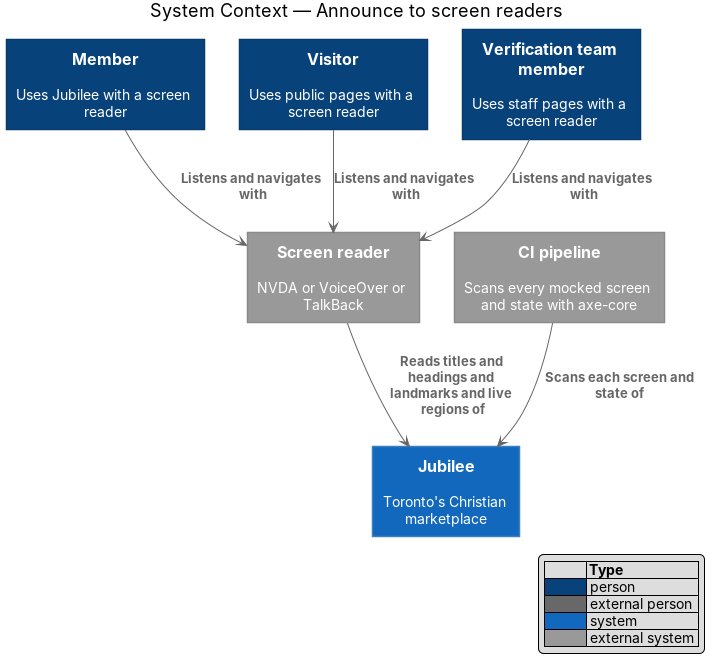
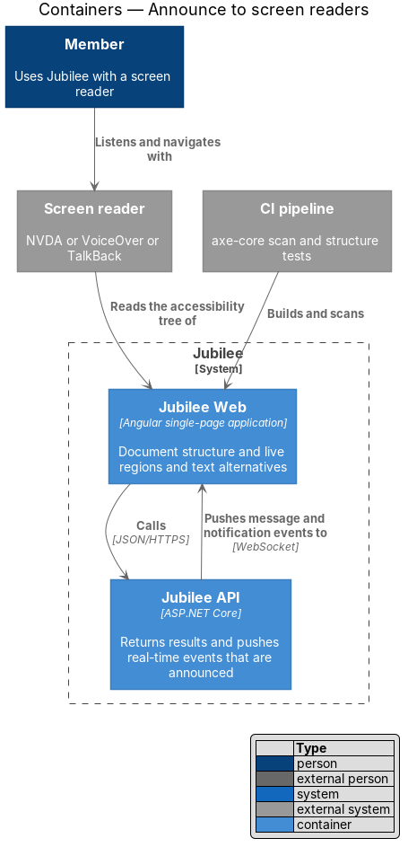
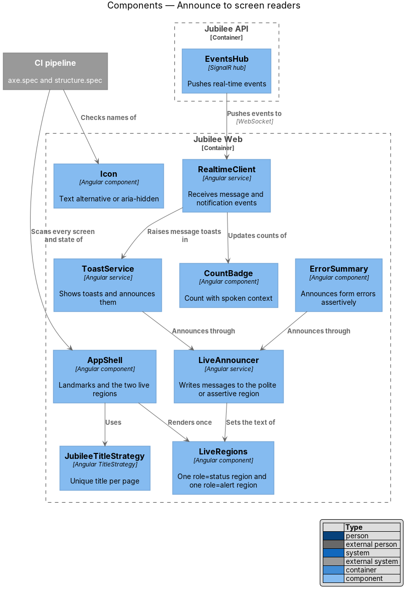
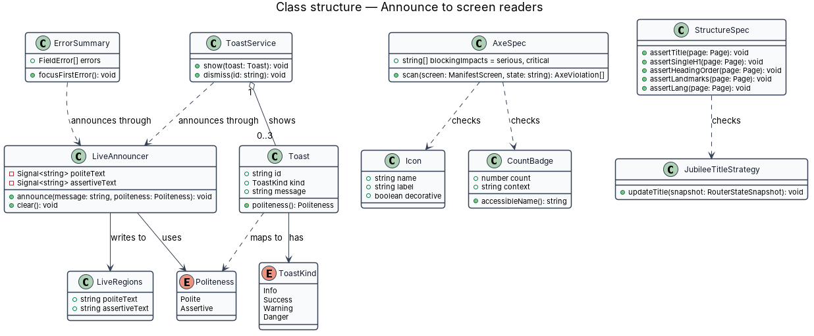
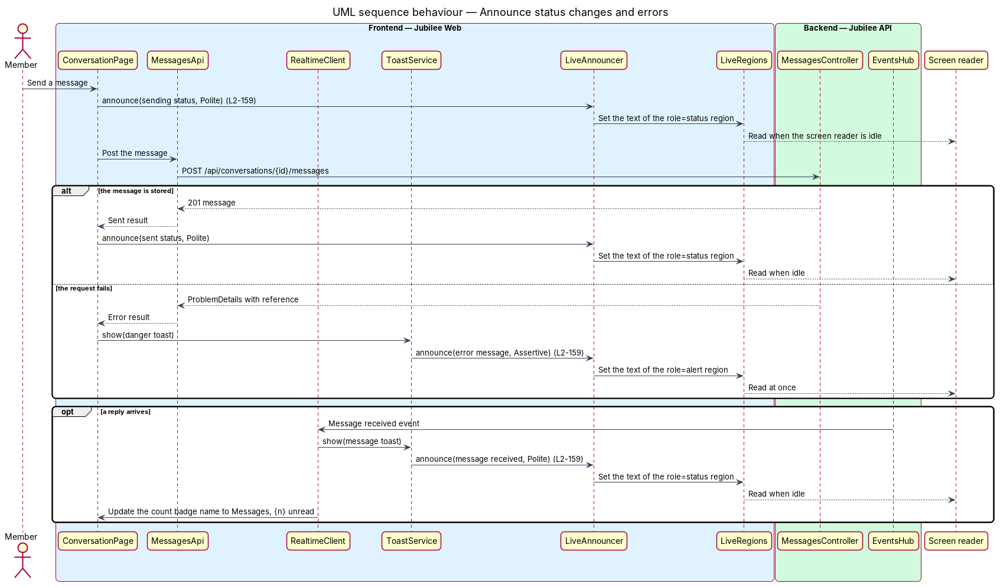
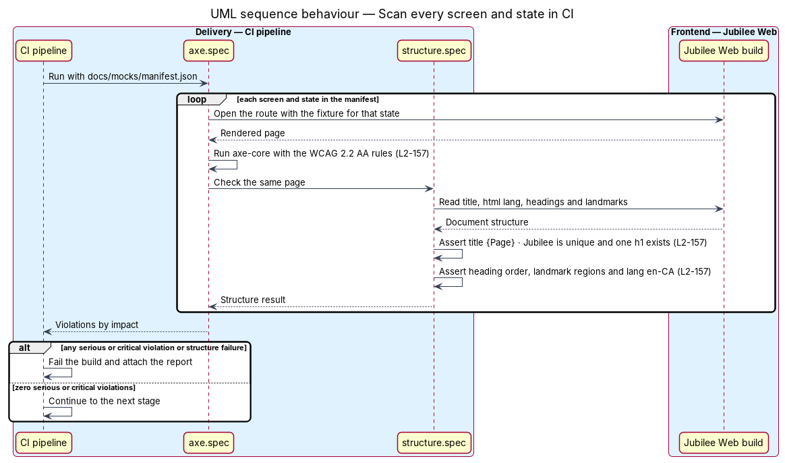

# Announce to screen readers

## Overview

A person who uses a screen reader does not see a toast appear, a spinner
start, or a gold check mark beside a business name. The page states these
things. `L1-022` commits Jubilee to WCAG 2.2 Level AA and to full use by
screen reader; this feature covers what the application exposes to assistive
technology: the structure of each document, the announcements of changes, and
the text behind icons and badges. It also covers how conformance is checked on
every change and before every release.

The design uses four local terms.

- **live region** — element whose text changes are read aloud by a screen
  reader without moving focus
- **polite announcement** — live-region message read when the screen reader
  finishes its current speech
- **assertive announcement** — live-region message read at once, interrupting
  current speech
- **text alternative** — text that conveys to assistive technology what an
  icon or badge conveys visually

`L2-157` requires zero serious or critical axe-core violations on every screen
and state in the mock manifest, a manual audit of each release with NVDA,
VoiceOver and TalkBack across the nine primary tasks, and a sound document
structure: a unique title "{Page} · Jubilee", one `h1`, a logical heading
order, landmark regions, and `lang="en-CA"` on `html`. `L2-159` requires
status changes to be announced politely and errors assertively, meaningful
icons to carry a text alternative while decorative icons are hidden, and count
badges to include their context, as in "Messages, 2 unread".

## Description

The slice is a set of shared pieces in `Jubilee Web` that every page uses, and
two test suites plus a release checklist that hold the pages to the rules.

- **`LiveRegions`** — component rendered once by `AppShell`, outside `main`.
  It holds two visually hidden elements: one with `role="status"` and
  `aria-live="polite"`, one with `role="alert"` and `aria-live="assertive"`.
  Both exist in the DOM from first render, so the first announcement is not
  lost.
- **`LiveAnnouncer`** — Angular service with
  `announce(message, politeness)`. It clears the target region and then sets
  its text, so that a repeated message is read again. Pages never write their
  own live regions.
- **`Politeness`** — `Polite` for status changes (saved, copied, sending,
  message received, loading) and `Assertive` for errors.
- **`ToastService`** — shows at most three toasts and announces each through
  `LiveAnnouncer`. `Toast.politeness()` returns `Assertive` for the `Danger`
  kind and `Polite` for `Info`, `Success` and `Warning` (`L2-066`).
- **`ErrorSummary`** — form error list. When a submission fails validation it
  announces assertively and links each error to its field.
- **Loading and busy states** — skeleton containers set `aria-busy="true"`
  and announce the loading status politely once per load; a busy button keeps
  its accessible name and announces its busy label politely.
- **`RealtimeClient`** — receives message and notification events from
  `EventsHub`. A received message raises a message toast, which is announced
  politely, and updates the unread counts.
- **`Icon`** — the only way to render an icon. Its inputs are a union: either
  `label`, which renders `role="img"` with that accessible name, or
  `decorative`, which renders `aria-hidden="true"`. A template that supplies
  neither does not compile. The verified mark, the unread marker and the sold
  out marker always take `label`.
- **`CountBadge`** — badge with `count` and `context` inputs. The visible
  digits are `aria-hidden`; `accessibleName()` returns the context and count
  together, for example "Messages, 2 unread" and "Notifications, 3 unread".
- **`JubileeTitleStrategy`** — sets `<title>` to "{Page} · Jubilee" from the
  route's title data. Detail pages resolve the business, product or request
  name into `{Page}`, which keeps titles unique.
- **`AppShell` landmarks** — `header`, `nav` labelled "Primary", `main` with
  `id="main"`, and `footer`. Each page component renders one `h1` and nests
  `h2` and `h3` without skipping a level. `index.html` declares
  `<html lang="en-CA">`.
- **`axe.spec`** — browser test that reads `docs/mocks/manifest.json`, opens
  each screen in each listed state against the built application with a data
  fixture for that state, and runs axe-core. Any violation of impact `serious`
  or `critical` fails the build. The browser test framework is `<TO SUPPLY>`.
- **`structure.spec`** — test run on the same pages. It asserts the title
  pattern and its uniqueness across screens, exactly one `h1`, an unbroken
  heading order, the four landmark regions, and `lang="en-CA"`.
- **Screen reader audit checklist** — release gate completed by hand. For
  each of the nine primary tasks (join, browse, search, message, book, quote,
  order, list a business, review a listing) it records
  completion with NVDA on Windows, VoiceOver on macOS and iOS, and TalkBack on
  Android. Where the completed checklist is stored is `<TO SUPPLY>`.

## Requirements

The feature realizes the following level-2 (L2) requirements. Each L2
requirement refines a level-1 (L1) requirement, cited by identifier.

| L2 ID | Refines (L1) | Requirement |
|-------|--------------|-------------|
| `L2-157` | `L1-022` | Every screen and state in the mock manifest shall show zero serious or critical violations when scanned with axe-core in CI, and every primary task shall be completable in a manual audit of each release with NVDA on Windows, VoiceOver on macOS and iOS, and TalkBack on Android. Every page shall have a unique, descriptive `<title>` ("{Page} · Jubilee"), one `h1`, a logical heading order and landmark regions, with `lang="en-CA"` set on `html`. |
| `L2-159` | `L1-022` | The system shall announce status changes (saved, copied, sending, message received, loading) through a polite live region and errors through an assertive one. Icons that carry meaning (verified, unread, sold out) shall have a text alternative, decorative icons shall be `aria-hidden`, and count badges shall include context ("Messages, 2 unread"). |
| `L2-066` | `L1-010` | An error (danger) toast shall be announced assertively (`role="alert"`) and shall never auto-dismiss; other toasts shall use a polite live region. |

## Diagrams

### System context

Members, visitors and verification team members reach Jubilee through a screen
reader, which reads the structure and live regions Jubilee exposes. The CI
pipeline scans each screen and state.

### Containers

The screen reader reads the accessibility tree of `Jubilee Web`. `Jubilee API`
supplies the results and real-time events whose arrival is announced.

### Components

`ToastService` and `ErrorSummary` announce through `LiveAnnouncer`, which
writes to the two `LiveRegions` rendered by `AppShell`. `RealtimeClient` turns
events from `EventsHub` into toasts and badge counts.

### Class structure

`LiveAnnouncer` writes to `LiveRegions` with a `Politeness`. A `Toast` maps its
`ToastKind` to a politeness, and `AxeSpec` and `StructureSpec` are the test
classes that check the components.

### Behaviour — announce status changes and errors

Sending a message announces the sending and sent statuses politely. A failure
raises a danger toast announced assertively, and a received reply is announced
politely while the badge name gains the new count.

### Behaviour — scan every screen and state in CI

The pipeline opens each manifest screen in each state, runs axe-core and the
structure checks, and fails the build on any serious or critical violation.

