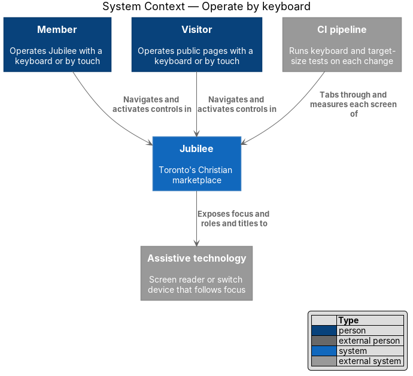
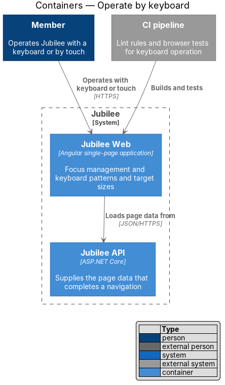
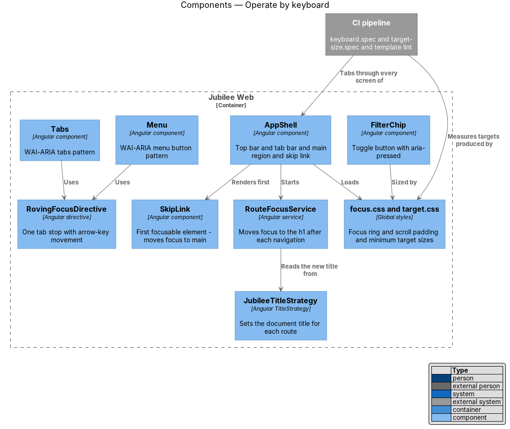
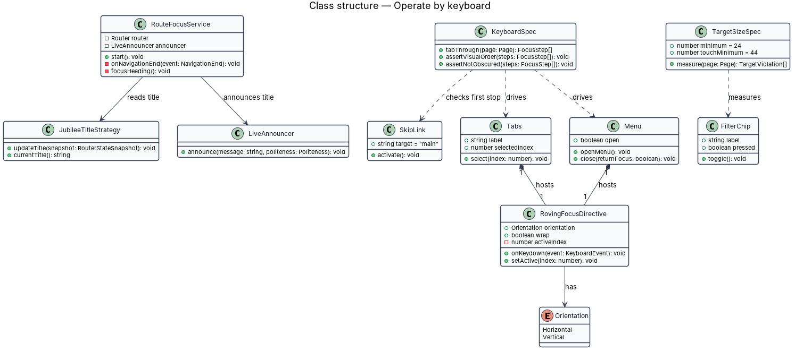
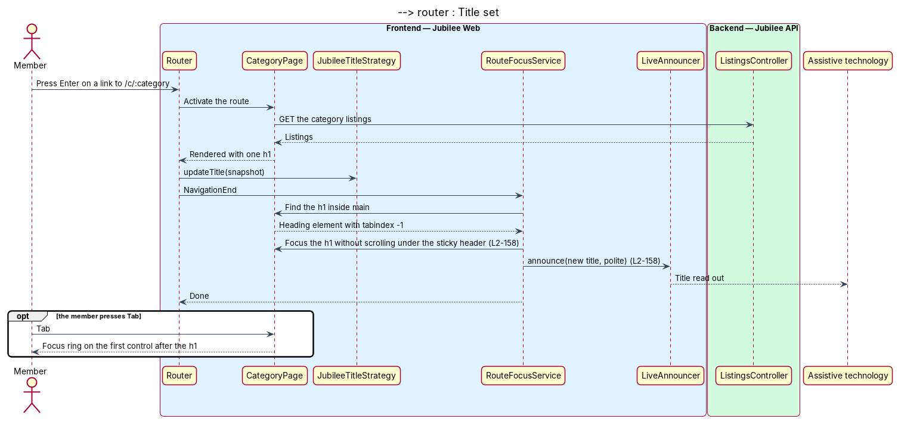
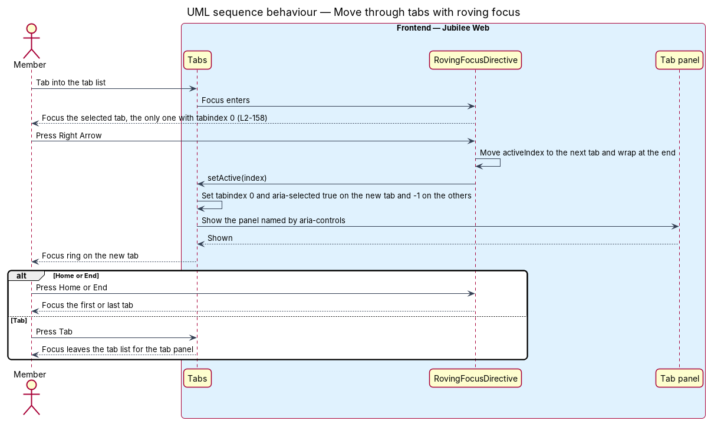
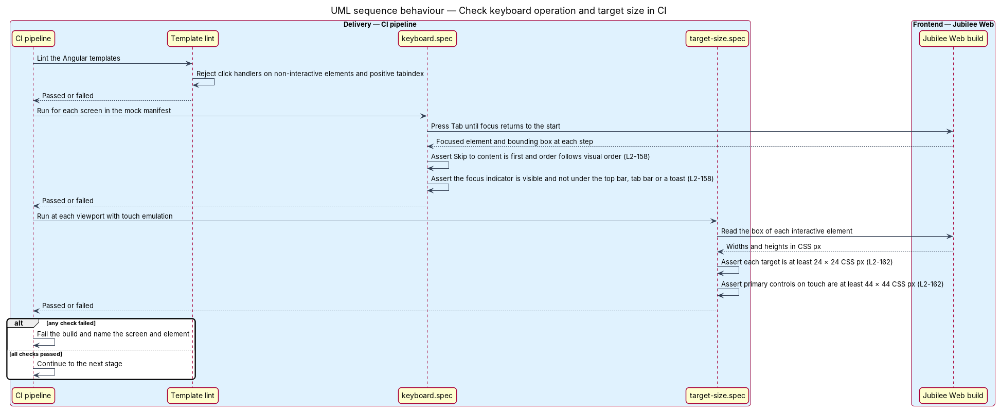

# Operate by keyboard

## Overview

Jubilee is used by people who do not use a mouse: people who navigate with a
keyboard, a switch device or a screen reader, and people who tap a phone with
limited precision. `L1-022` commits the product to WCAG 2.2 Level AA and to
full keyboard use. This feature is the part of that commitment that concerns
moving through the interface and activating its controls.

The design uses four local terms.

- **focus indicator** — visible outline around the element that receives
  keyboard input
- **roving focus** — keyboard pattern in which a group of controls is one tab
  stop and the arrow keys move between its members
- **target** — area of an interactive control that accepts a pointer or touch
- **primary control** — button, tab bar item, list row or chip

`L2-158` sets three rules. Every interactive control is reachable in visual
order, works with standard keys, and shows a focus indicator with at least 3:1
contrast that is never hidden by the sticky header, the tab bar or a toast.
After each route change in the single-page application, focus moves to the new
page's `h1` and the new title is announced. Chip filters, tabs and menus
follow the WAI-ARIA Authoring Practices patterns. `L2-162` sets the sizes: a
target measures at least 24 × 24 CSS px, and a primary control on a touch
device at least 44 × 44 CSS px.

The feature is cross-cutting. It lives in shared services, directives and
global styles of `Jubilee Web`, and in tests that run in the CI pipeline
against every screen in `docs/mocks/manifest.json`.

## Description

- **`SkipLink`** — "Skip to content" link rendered by `AppShell` as the first
  focusable element of every page. Activating it moves focus to `main`.
- **`RouteFocusService`** — Angular service started by `AppShell`. On each
  `NavigationEnd` it waits for the page to render, finds the `h1` inside
  `main`, gives it `tabindex="-1"` and focuses it, then passes the new title
  to `LiveAnnouncer` with polite priority. The next Tab press lands on the
  first control after the heading.
- **`JubileeTitleStrategy`** — Angular `TitleStrategy` that sets the document
  title to "{Page} · Jubilee" from route data before `RouteFocusService` reads
  it.
- **Focus ring styles (`focus.css`)** — one `:focus-visible` rule for every
  control: an outline `2px` wide, offset `2px`, coloured by
  `--color-focus-ring`. The token resolves to ink in the light theme and to a
  light gold in the dark theme, each at 3:1 or more against the adjacent
  surface. No component removes the outline.
- **Scroll padding** — `html` declares `scroll-padding-top` equal to the
  height of the sticky top bar and `scroll-padding-bottom` equal to the height
  of the tab bar plus the device safe area. A control that receives focus
  scrolls clear of both. The toast region sits above the tab bar and outside
  the page flow, and toasts follow page content in tab order.
- **`RovingFocusDirective`** — directive that keeps `tabindex="0"` on one item
  of a group and `-1` on the rest. Arrow keys move the active item along the
  configured `Orientation`, Home and End jump to the ends, and movement wraps.
- **`Tabs`** — component with `role="tablist"`, `role="tab"` and
  `role="tabpanel"`, `aria-selected` and `aria-controls`. It hosts
  `RovingFocusDirective` with horizontal orientation; the request tabs and the
  owner workspace tabs use it.
- **`Menu`** — component with `role="menu"` and `role="menuitem"`. Its trigger
  carries `aria-haspopup` and `aria-expanded`. It hosts `RovingFocusDirective`
  with vertical orientation; Escape closes the menu and returns focus to the
  trigger. The account menu and the sort menu use it.
- **`FilterChip`** — native `button` with `aria-pressed`, inside a group
  labelled "Filters". Each chip is a tab stop in visual order; Space and Enter
  toggle it.
- **Native elements first** — links are `a`, actions are `button`, fields are
  `input`, `select` or `textarea`. The Angular template lint rules
  `click-events-have-key-events`, `interactive-supports-focus` and
  `no-positive-tabindex` fail the build when a template breaks this rule, so
  DOM order stays the tab order.
- **Target size styles (`target.css`)** — the tokens `--target-min` (`1.5rem`,
  24 px) and `--target-comfortable` (`2.75rem`, 44 px). Every interactive
  element has a minimum width and height of `--target-min`; an icon smaller
  than that gains the area through padding. Under `@media (pointer: coarse)`
  buttons, tab bar items, list rows and chips take `--target-comfortable`.
- **`keyboard.spec`** — browser test that presses Tab through each screen. It
  asserts that the skip link is first, that the order follows visual order,
  that each focused element shows an outline, and that its box does not
  intersect the top bar, the tab bar or an open toast.
- **`target-size.spec`** — browser test that reads the box of each interactive
  element at each supported viewport, with touch emulation for the narrow
  ones, and fails below 24 × 24 CSS px or, for primary controls on touch,
  below 44 × 44 CSS px. The browser test framework is `<TO SUPPLY>`.

## Requirements

The feature realizes the following level-2 (L2) requirements. Each L2
requirement refines a level-1 (L1) requirement, cited by identifier.

| L2 ID | Refines (L1) | Requirement |
|-------|--------------|-------------|
| `L2-158` | `L1-022` | Every interactive control shall be reachable by keyboard in visual order, operable with standard keys, and shall show a visible focus indicator with at least 3:1 contrast that is never obscured by sticky headers, the tab bar or toasts. On completion of a route change, focus shall move to the new page's `h1` and the new title shall be announced; chip filters, tabs and menus shall follow the WAI-ARIA Authoring Practices patterns, with roving focus for tabs and menus. |
| `L2-162` | `L1-022` | Every interactive target shall measure at least 24 × 24 CSS px (WCAG 2.5.8), and primary controls on touch devices (buttons, tab bar items, list rows, chips) shall measure at least 44 × 44 CSS px. |
| `L2-112` | `L1-015` | Every page shall load with a "Skip to content" link as the first focusable element, which moves focus to `main`. |
| `L2-130` | `L1-018` | An open dialog shall take focus, cycle Tab within itself and make the page behind inert, and shall return focus to the control that opened it when it closes. |

## Diagrams

### System context

Members and visitors operate Jubilee by keyboard or touch. Jubilee exposes
focus, roles and titles to assistive technology, and the CI pipeline exercises
every screen.

### Containers

The behaviour lives in `Jubilee Web`. `Jubilee API` takes part only by
supplying the page data whose arrival completes a navigation.

### Components

`AppShell` renders `SkipLink` and starts `RouteFocusService`. `Tabs` and `Menu`
share `RovingFocusDirective`, and the global styles supply the focus ring and
the target sizes that the CI tests measure.

### Class structure

`RouteFocusService` depends on `JubileeTitleStrategy` and `LiveAnnouncer`.
`Tabs` and `Menu` each host one `RovingFocusDirective`; `KeyboardSpec` and
`TargetSizeSpec` are the test classes that hold the limits.

### Behaviour — move focus after a route change

When navigation ends, the title strategy sets the new title, and
`RouteFocusService` focuses the `h1` and announces the title.

### Behaviour — move through tabs with roving focus

The tab list is one tab stop. Arrow keys move the single `tabindex="0"` from
tab to tab, and Tab leaves the list for the panel.

### Behaviour — check keyboard operation and target size in CI

The pipeline lints the templates, tabs through each screen, and measures each
target. A failure names the screen and the element and fails the build.

