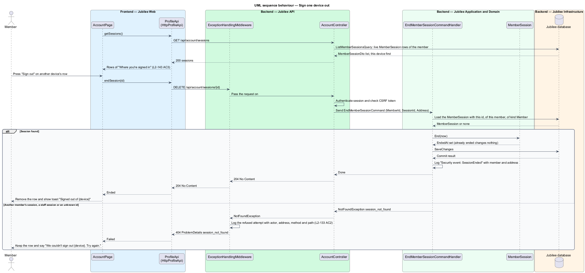

# Change credentials

## Overview

Jubilee is Toronto's Christian marketplace. A *member* signs in with an e-mail
address and a password, or with Google. The e-mail address and the password are
the member's *credentials*. This feature covers the two changes a signed-in
member makes to them from the account page at `/account`: changing the e-mail
address and changing the password.

A change of e-mail takes effect only after the new address is confirmed. The
member enters the new address and the current password. Jubilee sends a
*confirmation link* — single-purpose link valid for 24 hours that proves control
of the new address — to the new address, and a notice to the old address. The
old address stays in use until the link is opened. A link that is never opened
changes nothing.

A change of password happens under "Sign-in and security". The member enters the
current password and a new password twice. The new password is at least 10
characters long and is checked against a list of breached passwords. A
successful change ends every other session of the member and sends a security
e-mail. A member who joined only with Google has no password yet; the same
dialog offers "Set a password" without a current-password field.

Under "Sign-in and security" the member also sees where they are signed in:
each device with its approximate location and when it was last used, this
device first, and can sign any other device out on its own (`L2-143` AC3).

## Description

The feature is a vertical slice from two dialogs and the account page in
`Jubilee Web` to the `Jubilee database`, with e-mail sent by `Jubilee Worker`.
It is built (ADR 0028, ADR 0046, ADR 0065); the names below are the names the
code uses.

- **`AccountPage`** — Angular page at `/account`. Beside the e-mail field it
  shows "Confirmed." and the action "Change e-mail". Under "Sign-in and
  security" it shows "Password", "Changed {date}" and "Change password" (or
  "Set a password"), and the "Sign out" row with "Sign out of other devices".
  The next card, "Where you're signed in", lists the member's sessions.
- **"Where you're signed in"** — one `jb-rows` list on `AccountPage`, loaded on
  its own so a failure leaves the profile usable. Each row names the device
  ("Safari on iPhone") and says "This device · Network 203.0.113.x" or "Last
  active {when} · Network 198.51.100.x" (`lastActive`: "just now", "5 minutes
  ago", "2 hours ago", "on Mon 9 Nov"). Every row but this device's has "Sign
  out", whose accessible name is "Sign out of {device}". It signs that device
  out without a dialog, removes the row and says "Signed out of {device}"; a
  failure keeps the row and says "We couldn't sign out {device}. Try again."
  With no other session the card says "No other devices are signed in." While
  loading it shows `jb-row-list-skeleton` and "Loading where you're signed in…"
  to assistive technology; a failed load says "We couldn't load where you're
  signed in" with `JB-ACC-526` and "Try again". "Sign out of other devices"
  loads the list again.
- **`ChangeEmailDialog`** — CDK dialog that collects the new address and the
  current password (none for a member without a password) and calls
  `ProfileApi.requestEmailChange()`. A refused address shows "An account
  already uses this e-mail." under the field. The dialog follows the shared
  dialog rules for focus, busy state and failed submissions.
- **`ChangePasswordDialog`** — CDK dialog with the fields current password, new
  password and repeat new password. For a member whose `hasPassword` is false
  it is titled "Set a password" and omits the current-password field. A wrong
  current password shows "That isn't your current password." Password fields
  are cleared after a validation error; no other field loses its value
  (L2-126).
- **`ConfirmEmailChangePage`** — Angular page at `/confirm-email-change/:token`
  that the link opens. It needs no session, reads the token, removes it from
  the address bar and calls `ProfileApi.confirmEmailChange()`, then says the
  outcome: `confirmed`, `expired` or `email-in-use`.
- **`ProfileApi`** — the contract behind `PROFILE_API`, implemented by
  `HttpProfileApi`: `requestEmailChange()` (`POST /api/account/email-change`),
  `confirmEmailChange()` (`POST /api/account/email-change/confirm`),
  `changePassword()` (`PUT /api/account/password`), `getSessions()`
  (`GET /api/account/sessions`) and `endSession(id)`
  (`DELETE /api/account/sessions/{id}`).
- **`AccountController`** — ASP.NET Core controller in `Jubilee.Api`. Every
  endpoint but the confirmation acts on the member of the current session only
  and passes the caller's address to the command for the security log.
- **`RequestEmailChangeCommand`** and its handler — verify the current password
  when the member has one, refuse an address that belongs to another account
  with HTTP `422` and code `EMAIL_IN_USE`, supersede any earlier unused
  `ChangeEmail` token of the member, issue a new `LinkToken`, and write two
  outbox messages: the confirmation link to the new address and a notice to
  the old address. A member who joined with Google has no password and is not
  asked for one.
- **`ConfirmEmailChangeCommand`** and its handler — hash the presented token
  with SHA-256, load the matching `LinkToken`, check again that no other
  account took the address in the meantime, and call `Member.ChangeEmail()`.
  The new address replaces the old one and is marked confirmed. An unknown,
  used or expired token leaves the member unchanged.
- **`ChangePasswordCommand`** and its handler — verify the current password when
  the member has one; the new password is 10 to 128 characters with no
  composition rules, matches its repetition and passes
  `IBreachedPasswordChecker`. The handler calls `Member.ChangePassword()`, ends
  every other `MemberSession` of the member, supersedes outstanding
  password-reset tokens and writes the security e-mail to the outbox. A wrong
  current password returns HTTP `422` with code `CURRENT_PASSWORD_INCORRECT` and
  changes nothing. The controller starts this session again, so it goes on.
- **`ListMemberSessionsQuery`** and its handler — the member's live sessions
  (not ended, not expired, never a staff session), this device first, then the
  most recently active, as `MemberSessionDto` (`Id`, `Device`, `Network`,
  `LastActiveAt`, `Current`).
- **`EndMemberSessionCommand`** and its handler — end one session of the member
  at once (`MemberSession.End`) and answer `204`; one already ended answers
  `204` again. Another member's session, a staff session or an unknown id
  throws `NotFoundException` with `session_not_found`, which answers `404` and
  is logged with the actor, the address, the method and the path (L2-133 AC2).
- **`MemberSession`** — the server-side session (ADR 0046). It records, when it
  starts, `Device` and `Network`, which `DatabaseTicketStore` takes from the
  request through `SessionOrigin`: the browser and system from the
  `User-Agent` ("Unknown browser" when neither is recognised) and the address
  with its last part hidden (`203.0.113.x`; the first three IPv6 groups and
  `::`). The full address is not kept with the session.
- **`LinkToken`** — entity for an e-mailed link. For `LinkTokenPurpose.ChangeEmail`
  it holds the `TargetEmail`, expires 24 hours after creation and is single-use.
  The token has at least 128 bits of randomness and only its SHA-256 hash is
  stored (L2-140).
- **`IPasswordHasher`** — application service implemented with Argon2id (memory
  at least `19 MiB`, at least 2 iterations, unique salt). Plain passwords do not
  reach logs (L2-134).
- **`IBreachedPasswordChecker`** — adapter to the `Breached-password service`.
  It sends only a hash prefix (k-anonymity range query) and compares the
  returned suffixes locally.
- **`OutboxDispatcherJob`** — hosted job in `Jubilee.Worker` that sends the
  confirmation link, the notice and the security e-mail through `IEmailSender`.
  Security e-mails ignore the member's notification settings.

Each password change, e-mail change request and e-mail change is written to
the security log by `SecurityLog.Credential` as `Security event: {Event}
{Outcome} for member {MemberId} from {Address}`, with the outcome `succeeded`,
or `refused` when the current password was wrong (`L2-143` AC1). Signing a
session out is logged as `Security event: SessionEnded`. No password, new
address or token reaches the log.

## Requirements

The feature realizes the following level-2 (L2) requirements. Each L2
requirement refines a level-1 (L1) requirement, cited by identifier.

| L2 ID | Refines (L1) | Requirement |
|-------|--------------|-------------|
| `L2-014` | `L1-002` | The system shall let a member change their e-mail. The new address shall be confirmed before it replaces the old one. |
| `L2-015` | `L1-002` | The system shall let a signed-in member change their password from "Sign-in and security". |
| `L2-134` | `L1-019` | The system shall hash each password with Argon2id and a unique salt, shall accept a password of 10 to 128 characters only when it is absent from a breached-password list, and shall invalidate every other session and every outstanding reset link when the password changes. |
| `L2-140` | `L1-019` | Each e-mailed link token shall have at least 128 bits of randomness, shall be stored only as a SHA-256 hash, shall have a single purpose, and shall expire as specified (24 hours for a change of e-mail). |
| `L2-143` | `L1-019` | The system shall log password changes and e-mail changes with time, actor, IP and outcome, and shall show the member their active sessions (device, approximate location, last active) and let them end any of them. |
| `L2-133` | `L1-019` | Another member's session shall be answered as not found, and the attempt logged. |
| `L2-126` | `L1-018` | A dialog form with errors shall show each message under its field, shall move focus to the first invalid field, and shall keep typed values except password fields. |

## Diagrams

### System context

A member changes credentials in Jubilee. Jubilee sends the confirmation link,
the notice and the security e-mail through the `E-mail provider` and checks a
new password against the `Breached-password service`.

### Containers

`Jubilee Web` calls `Jubilee API`, which writes the member, the `LinkToken`,
the outbox and the sessions in the `Jubilee database`.
`Jubilee Worker` dispatches the outbox to the `E-mail provider`.

### Components

The account page, the two dialogs and the confirmation page call
`ProfileApi`. `AccountController` dispatches the three commands, the session
list and the end of one session; their handlers use `Member`, `MemberSession`,
`LinkToken`, `IPasswordHasher`, `IBreachedPasswordChecker` and `SecurityLog`.
`DatabaseTicketStore` records each session's device and network.

### Class structure

`Member` owns `ChangeEmail()` and `ChangePassword()`. A `LinkToken` of purpose
`ChangeEmail` carries the target address. `MemberSession` keeps `Device` and
`Network`, which `SessionOrigin` derives. The handlers depend on the hashing
and breach-check services and end `MemberSession` rows themselves.

### Behaviour — request an e-mail change

The handler verifies the current password and refuses an address in use with
`EMAIL_IN_USE`. Otherwise it stores a 24-hour `LinkToken` and two outbox
messages in one transaction, and `Jubilee Worker` sends both e-mails.

### Behaviour — confirm the new e-mail

Opening the link within 24 hours replaces the old address and marks the new one
confirmed. An expired, used or unknown token leaves the old address in use.

### Behaviour — sign one device out

The account page lists the member's sessions, this device first. "Sign out"
on another device's row ends that session at once and logs it; a session that
is not the member's answers `404` and the attempt is logged.

### Behaviour — change the password

A wrong current password changes nothing. A valid new password is hashed and
saved, every other session ends, and a security e-mail is queued.

