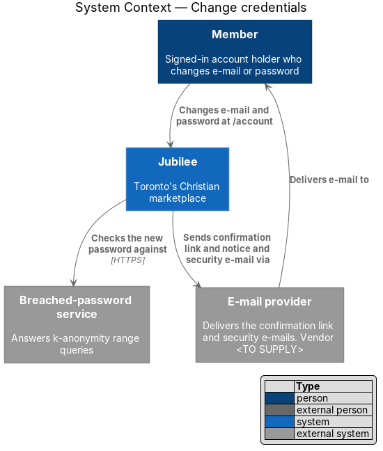
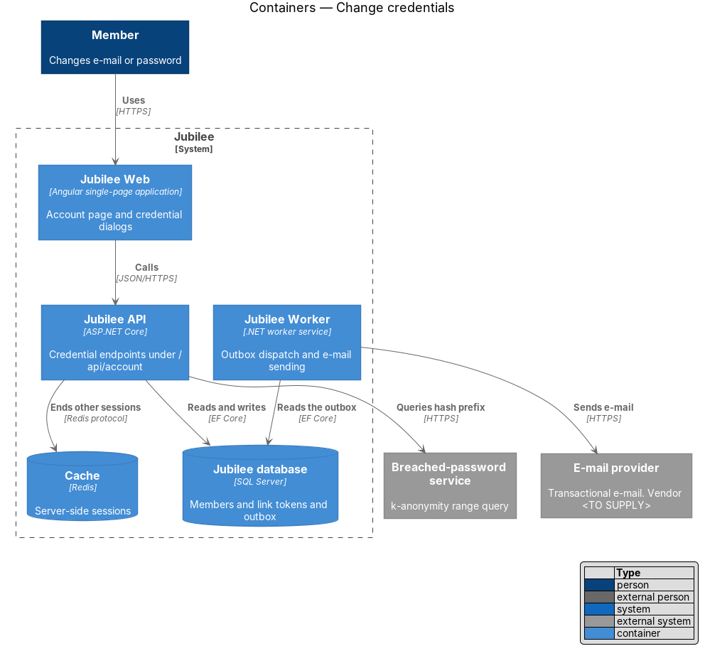
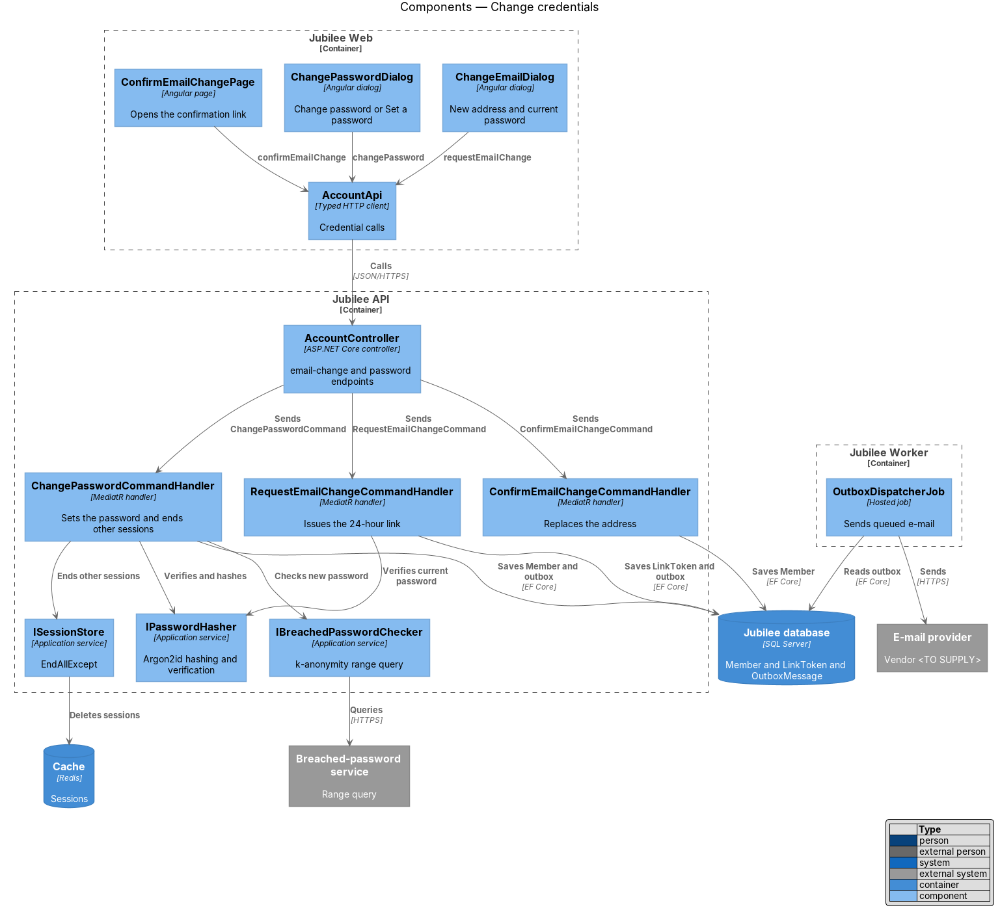
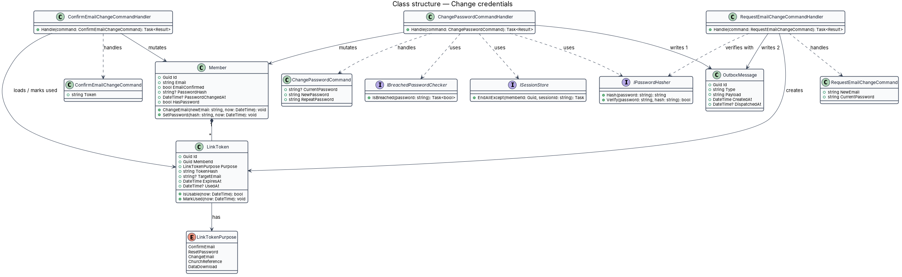
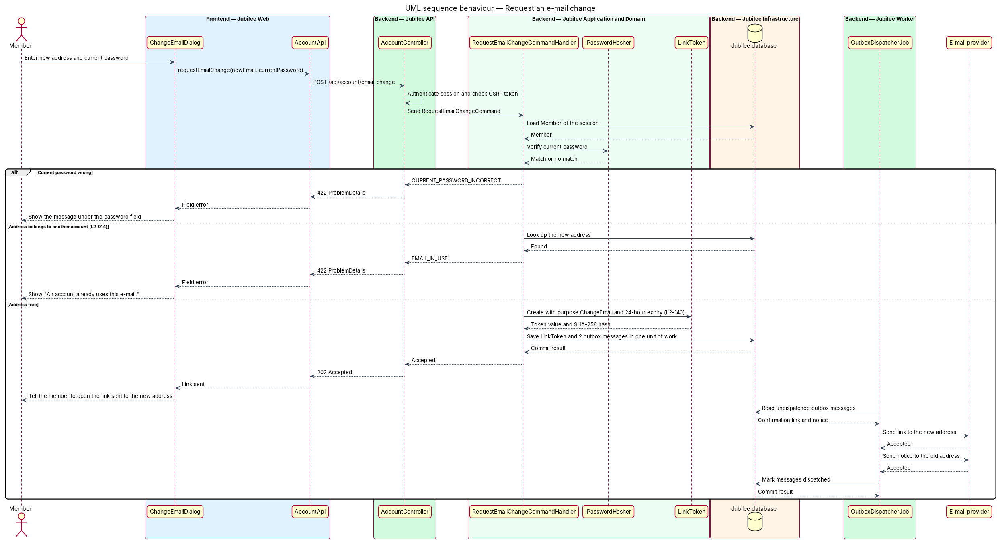
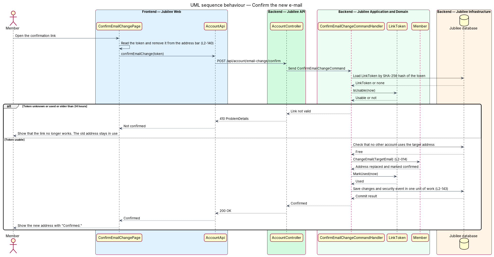
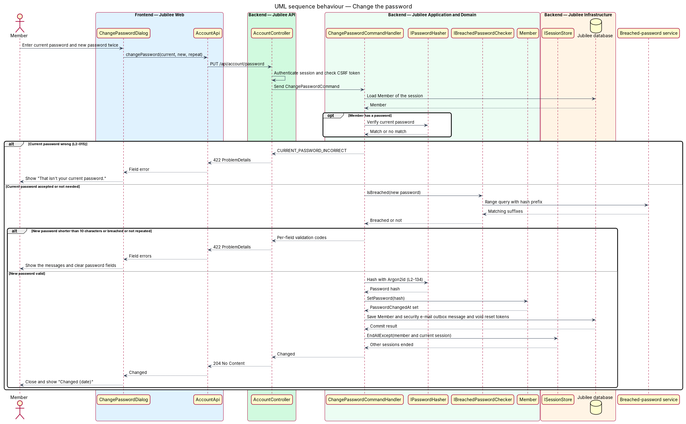

# Change credentials

## Overview

Jubilee is Toronto's Christian marketplace. A *member* signs in with an e-mail
address and a password, or with Google. The e-mail address and the password are
the member's *credentials*. This feature covers the two changes a signed-in
member makes to them from the account page at `/account`: changing the e-mail
address and changing the password.

A change of e-mail takes effect only after the new address is confirmed. The
member enters the new address and the current password. Jubilee sends a
*confirmation link* — single-purpose link valid for 24 hours that proves control
of the new address — to the new address, and a notice to the old address. The
old address stays in use until the link is opened. A link that is never opened
changes nothing.

A change of password happens under "Sign-in and security". The member enters the
current password and a new password twice. The new password is at least 10
characters long and is checked against a list of breached passwords. A
successful change ends every other session of the member and sends a security
e-mail. A member who joined only with Google has no password yet; the same
dialog offers "Set a password" without a current-password field.

## Description

The feature is a vertical slice from two dialogs in `Jubilee Web` to the
`Jubilee database`, with e-mail sent by `Jubilee Worker`. Nothing is built yet;
the names below are the names the design introduces.

- **`AccountPage`** — Angular page at `/account`. Beside the e-mail field it
  shows "Confirmed." and the action "Change e-mail". Under "Sign-in and
  security" it shows "Password", "Changed {date}" and the action "Change
  password".
- **`ChangeEmailDialog`** — Angular dialog that collects the new address and the
  current password and calls `AccountApi.requestEmailChange()`. A refused
  address shows "An account already uses this e-mail." under the field. The
  dialog follows the shared dialog rules for focus, busy state and failed
  submissions.
- **`ChangePasswordDialog`** — Angular dialog with the fields current password,
  new password and repeat new password. For a member whose `HasPassword` is
  false it is titled "Set a password" and omits the current-password field. A
  wrong current password shows "That isn't your current password." Password
  fields are cleared after a validation error; no other field loses its value
  (L2-126).
- **`ConfirmEmailChangePage`** — Angular page that the confirmation link opens.
  It reads the token, removes it from the address bar, and calls
  `AccountApi.confirmEmailChange()`. The route of this page is `<TO SUPPLY>`.
- **`AccountApi`** — typed Angular HTTP client with `requestEmailChange()`
  (`POST /api/account/email-change`), `confirmEmailChange()`
  (`POST /api/account/email-change/confirm`) and `changePassword()`
  (`PUT /api/account/password`).
- **`AccountController`** — ASP.NET Core controller in `Jubilee.Api`. The two
  authenticated endpoints act on the member of the current session only.
- **`RequestEmailChangeCommand`** and its handler — verify the current password,
  refuse an address that belongs to another account with HTTP `422` and code
  `EMAIL_IN_USE`, cancel any earlier unused `ChangeEmail` token of the member,
  create a new `LinkToken`, and write two outbox messages: the confirmation
  link to the new address and a notice to the old address.
- **`ConfirmEmailChangeCommand`** and its handler — hash the presented token
  with SHA-256, load the matching `LinkToken`, and call `Member.ChangeEmail()`.
  The new address replaces the old one and is marked confirmed. An unknown,
  used or expired token leaves the member unchanged. The handler checks again
  that no other account took the address in the meantime.
- **`ChangePasswordCommand`** and its handler — verify the current password when
  the member has one, validate the new password, call `Member.SetPassword()`,
  end every other session through `ISessionStore.EndAllExcept()`, invalidate
  outstanding password-reset tokens, and write the security e-mail to the
  outbox. A wrong current password returns HTTP `422` with code
  `CURRENT_PASSWORD_INCORRECT` and changes nothing.
- **`ChangePasswordCommandValidator`** — FluentValidation validator. The new
  password is 10 to 128 characters with no composition rules, matches its
  repetition, and passes `IBreachedPasswordChecker`.
- **`LinkToken`** — entity for an e-mailed link. For `LinkTokenPurpose.ChangeEmail`
  it holds the `TargetEmail`, expires 24 hours after creation and is single-use.
  The token has at least 128 bits of randomness and only its SHA-256 hash is
  stored (L2-140).
- **`IPasswordHasher`** — application service implemented with Argon2id (memory
  at least `19 MiB`, at least 2 iterations, unique salt). Plain passwords do not
  reach logs (L2-134).
- **`IBreachedPasswordChecker`** — adapter to the `Breached-password service`.
  It sends only a hash prefix (k-anonymity range query) and compares the
  returned suffixes locally.
- **`ISessionStore`** — Redis-backed store of server-side sessions.
  `EndAllExcept(memberId, sessionId)` removes each other session of the member.
- **`OutboxDispatcherJob`** — hosted job in `Jubilee.Worker` that sends the
  confirmation link, the notice and the security e-mail through `IEmailSender`.
  Security e-mails ignore the member's notification settings.

Each e-mail change and password change is written to the security event log
with time, actor, IP address and outcome (L2-143). The rule for a Google-only
member who has no current password and requests an e-mail change is
`<TO SUPPLY>`.

## Requirements

The feature realizes the following level-2 (L2) requirements. Each L2
requirement refines a level-1 (L1) requirement, cited by identifier.

| L2 ID | Refines (L1) | Requirement |
|-------|--------------|-------------|
| `L2-014` | `L1-002` | The system shall let a member change their e-mail. The new address shall be confirmed before it replaces the old one. |
| `L2-015` | `L1-002` | The system shall let a signed-in member change their password from "Sign-in and security". |
| `L2-134` | `L1-019` | The system shall hash each password with Argon2id and a unique salt, shall accept a password of 10 to 128 characters only when it is absent from a breached-password list, and shall invalidate every other session and every outstanding reset link when the password changes. |
| `L2-140` | `L1-019` | Each e-mailed link token shall have at least 128 bits of randomness, shall be stored only as a SHA-256 hash, shall have a single purpose, and shall expire as specified (24 hours for a change of e-mail). |
| `L2-143` | `L1-019` | The system shall log password changes and e-mail changes with time, actor, IP and outcome. |
| `L2-126` | `L1-018` | A dialog form with errors shall show each message under its field, shall move focus to the first invalid field, and shall keep typed values except password fields. |

## Diagrams

### System context

A member changes credentials in Jubilee. Jubilee sends the confirmation link,
the notice and the security e-mail through the `E-mail provider` and checks a
new password against the `Breached-password service`.

### Containers

`Jubilee Web` calls `Jubilee API`, which writes the member, the `LinkToken` and
the outbox in the `Jubilee database` and ends sessions in the `Cache`.
`Jubilee Worker` dispatches the outbox to the `E-mail provider`.

### Components

The two dialogs and the confirmation page call `AccountApi`. `AccountController`
dispatches the three commands; their handlers use `Member`, `LinkToken`,
`IPasswordHasher`, `IBreachedPasswordChecker` and `ISessionStore`.

### Class structure

`Member` owns `ChangeEmail()` and `SetPassword()`. A `LinkToken` of purpose
`ChangeEmail` carries the target address. The three command handlers depend on
the hashing, breach-check and session services.

### Behaviour — request an e-mail change

The handler verifies the current password and refuses an address in use with
`EMAIL_IN_USE`. Otherwise it stores a 24-hour `LinkToken` and two outbox
messages in one transaction, and `Jubilee Worker` sends both e-mails.

### Behaviour — confirm the new e-mail

Opening the link within 24 hours replaces the old address and marks the new one
confirmed. An expired, used or unknown token leaves the old address in use.

### Behaviour — change the password

A wrong current password changes nothing. A valid new password is hashed and
saved, every other session ends, and a security e-mail is queued.

