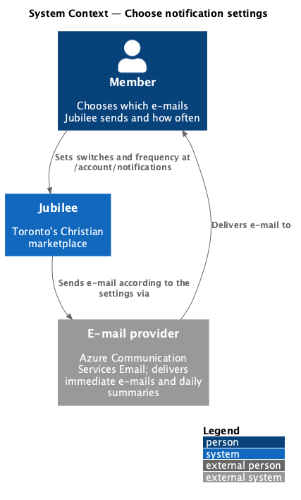
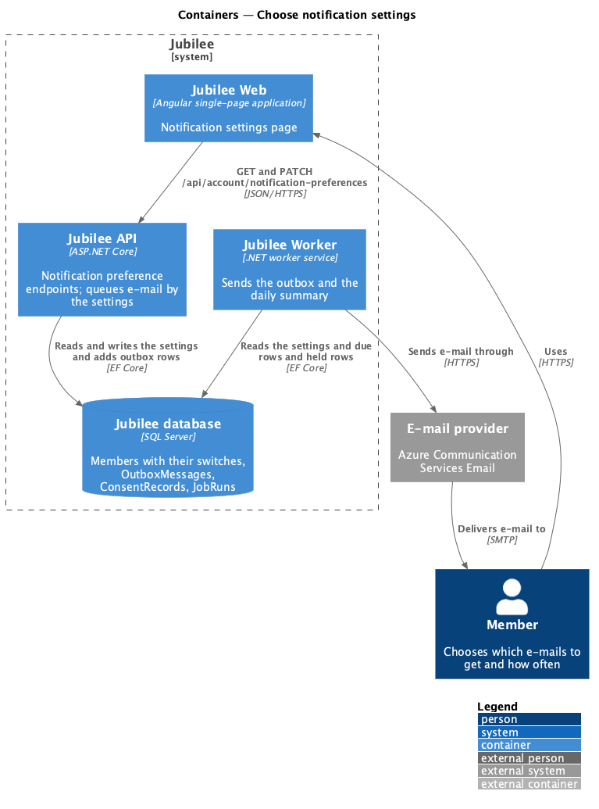
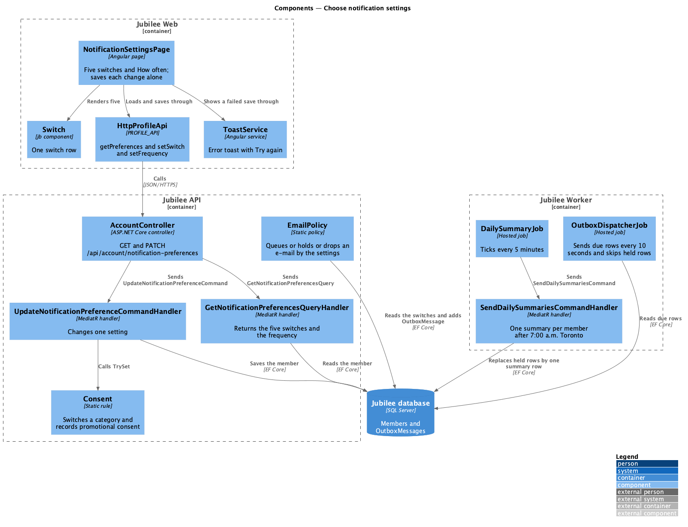
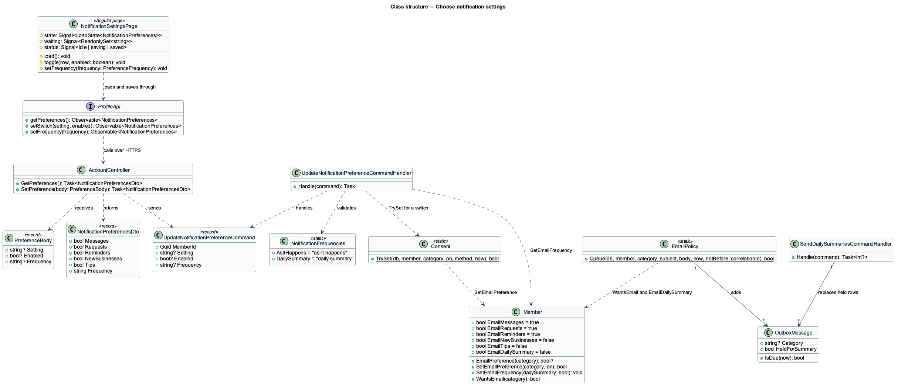
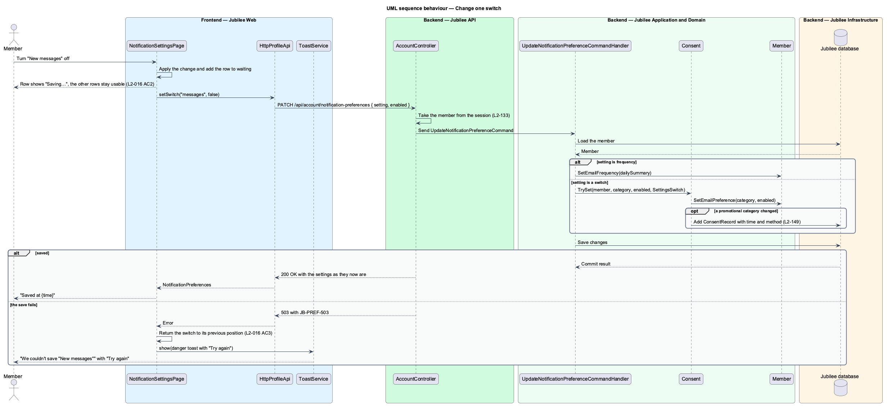
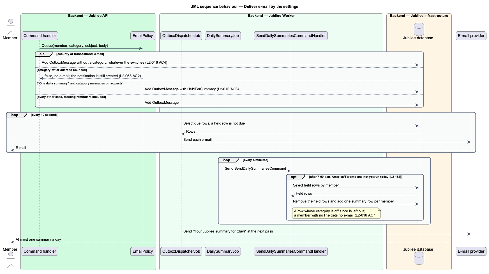

# Choose notification settings

## Overview

Jubilee is Toronto's Christian marketplace. It tells members and owners about
events such as a new message, a confirmed request or an upcoming meeting, in the
application and by e-mail. *Notification settings* are the member's choices
about which of those e-mails Jubilee sends and how often. This feature covers
the page at `/account/notifications` where a member makes those choices, and the
rules the e-mail pipeline applies when it reads them.

The page has five switches, one per *e-mail category*: "New messages", "Request
updates", "Meeting reminders", "New businesses" and "Tips for business owners".
Below them, "How often" offers two frequencies: "As it happens" and "One daily
summary". There is no save button. Each switch saves on its own as soon as it
changes, and the rest of the page stays usable while it does.

Two rules hold whatever the member chooses. Security e-mails about sign-in and
the account are always sent. A *daily summary* — single e-mail that says, one
line each, the e-mails of "New messages" and "Request updates" held since the
last summary — is sent at most once per day, at 7:00 a.m. Toronto time; meeting
reminders, security e-mails and the two promotional e-mails are never held
back for it.

The settings govern e-mail only. An event whose e-mail is turned off still
creates its in-app notification.

## Description

The feature is a vertical slice from the settings page in `Jubilee Web` to the
`Jubilee database`, and on to the e-mail pipeline in `Jubilee Worker`. The
settings are columns of `Member`; no separate preferences entity exists.

- **`NotificationSettingsPage`** — Angular page at `/account/notifications`,
  behind `memberGuard`. It renders the five switches with their descriptions,
  the "How often" choice, and the statement "We always e-mail you about sign-in
  and security, whatever you choose here." A failed load shows the error state
  with the reference `JB-PREF-503` and "Try again" (L2-118).
- **Saving one change** — `NotificationSettingsPage.change` applies the change
  to the page at once, adds its key to the `waiting` set so only the changed
  row is busy, and shows "Saving…"; on success it shows "Saved at {time}".
  When the save fails it returns the switch to its previous position and asks
  `ToastService` for a `danger` toast with "Try again", which repeats the same
  change.
- **`Switch`** and **`Select`** — components of the `components` library for
  one switch row and for "How often".
- **`ProfileApi`** and **`HttpProfileApi`** — contract behind the token
  `PROFILE_API` and its HTTP implementation. `getPreferences()` calls
  `GET /api/account/notification-preferences`; `setSwitch(setting, enabled)`
  and `setFrequency(frequency)` call
  `PATCH /api/account/notification-preferences` with one setting per request.
- **`AccountController`** — ASP.NET Core controller in `Jubilee.Api`.
  `GetPreferences` and `SetPreference` act on the member of the current
  session only (L2-133). `SetPreference` takes a `PreferenceBody` (`Setting`,
  `Enabled`, `Frequency`) and answers the settings as they now are.
- **`GetNotificationPreferencesQueryHandler`** — returns a
  `NotificationPreferencesDto`: the five switch values and the frequency.
- **`UpdateNotificationPreferenceCommandHandler`** — the command carries one
  setting: one of `messages`, `requests`, `reminders`, `new-businesses` or
  `tips` with a boolean, or `frequency` with `as-it-happens` or
  `daily-summary` (`NotificationFrequencies`). The handler calls
  `Consent.TrySet` or `Member.SetEmailFrequency` and saves in one unit of
  work. The command names a single setting, so two switches changed in quick
  succession do not overwrite each other. An unknown setting fails validation
  with `SETTING_UNKNOWN`, an unknown frequency with `FREQUENCY_UNKNOWN`.
- **`Member`** — holds `EmailMessages`, `EmailRequests` and `EmailReminders`,
  on for a new account; `EmailNewBusinesses` and `EmailTips`, off for a new
  account; and `EmailDailySummary`, off for a new account, which is the
  frequency "As it happens".
- **`Consent`** — the one place a category is switched. A change of
  `new-businesses` or `tips` appends a `ConsentRecord` with the time and the
  method `SettingsSwitch` (L2-149; `manage-email-consent`).
- **`EmailCategories`** — the category constants. A transactional or security
  e-mail has no category and no switch.
- **`EmailPolicy`** — static policy that each e-mail a member can turn off
  passes through. `Queue` adds no outbox row when the category is off or the
  address bounced. It marks the row `OutboxMessage.HeldForSummary` when the
  member chose "One daily summary" and the category is `messages` or
  `requests`. Each other row is sent as it becomes due.
- **`OutboxDispatcher`** — sends the due rows of the outbox and skips a held
  row. `OutboxDispatcherJob` runs it every `10 seconds`.
- **`SendDailySummariesCommandHandler`** and **`DailySummaryJob`** — the job
  ticks every `5 minutes`. After 7:00 a.m. `America/Toronto`, computed by
  `TorontoClock.At` and correct across daylight saving changes, the handler
  turns each member's held rows into one e-mail, "Your Jubilee summary for
  {day}", and deletes the rows. A row whose category the member has turned off
  since is left out. A member who went back to "As it happens" gets what was
  held in one last summary. `ScheduledJobs.RunOnceAtAsync` runs the work at
  most once per day across instances and records its success (L2-182). The
  design `send-email-notifications` describes the e-mail itself.

## Requirements

The feature realizes the following level-2 (L2) requirements. Each L2
requirement refines a level-1 (L1) requirement, cited by identifier.

| L2 ID | Refines (L1) | Requirement |
|-------|--------------|-------------|
| `L2-016` | `L1-002` | The system shall let a member choose at `/account/notifications` which e-mails they get and how often. Each switch shall save on its own as soon as it changes. With "One daily summary" the member shall get at most one summary e-mail a day, sent at 7:00 a.m. Toronto time, for the e-mails of "New messages" and "Request updates". |
| `L2-068` | `L1-010` | The system shall send an e-mail within 2 minutes for an event the member has e-mail turned on for, or include it in the next daily summary if chosen, and shall send no e-mail for an event the member has turned off while still creating the in-app notification. |
| `L2-182` | `L1-025` | Each scheduled job shall be idempotent, shall run at most once per schedule across instances, and shall compute reminder and summary times in America/Toronto. |
| `L2-149` | `L1-020` | Promotional e-mails ("New businesses", "Tips for business owners") shall go only to members who opted in, and the system shall record the time and method when consent is given or withdrawn. |
| `L2-118` | `L1-016` | Each load-error state shall show a reference that the user can quote to support. |

## Diagrams

### System context

A member chooses notification settings in Jubilee. Jubilee applies them to each
e-mail it sends to that member through the `E-mail provider`.

### Containers

`Jubilee Web` reads and patches the settings through `Jubilee API`, which stores
them on the member in the `Jubilee database`. `Jubilee API` and
`Jubilee Worker` read the settings when they queue e-mail, and
`Jubilee Worker` builds the daily summary.

### Components

`NotificationSettingsPage` saves each change through `HttpProfileApi`.
`AccountController` dispatches the query and the command. `EmailPolicy` reads
the settings for each e-mail; in `Jubilee Worker`, `OutboxDispatcherJob` sends
what is not held and `DailySummaryJob` sends the summary.

### Class structure

`Member` holds five switch values and the frequency.
`UpdateNotificationPreferenceCommandHandler` changes one of them through
`Consent` or `SetEmailFrequency`. `EmailPolicy` maps the member and a category
to no row, a row to send, or a held `OutboxMessage`.

### Behaviour — change one switch

The row shows "Saving…" while the `PATCH` is in flight. On success it shows
"Saved at {time}"; on failure the switch returns to its previous position and
an error toast offers "Try again".

### Behaviour — deliver e-mail by the settings

`EmailPolicy` queues, holds or drops each e-mail according to the settings.
`OutboxDispatcher` sends what is due, and `SendDailySummariesCommandHandler`
sends at most one summary per member a day, after 7:00 a.m. Toronto time.

