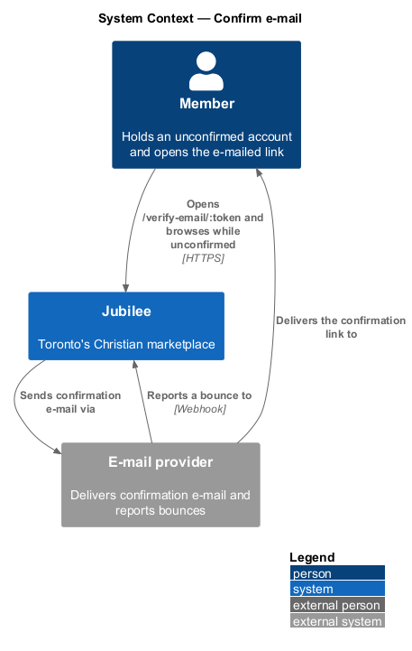
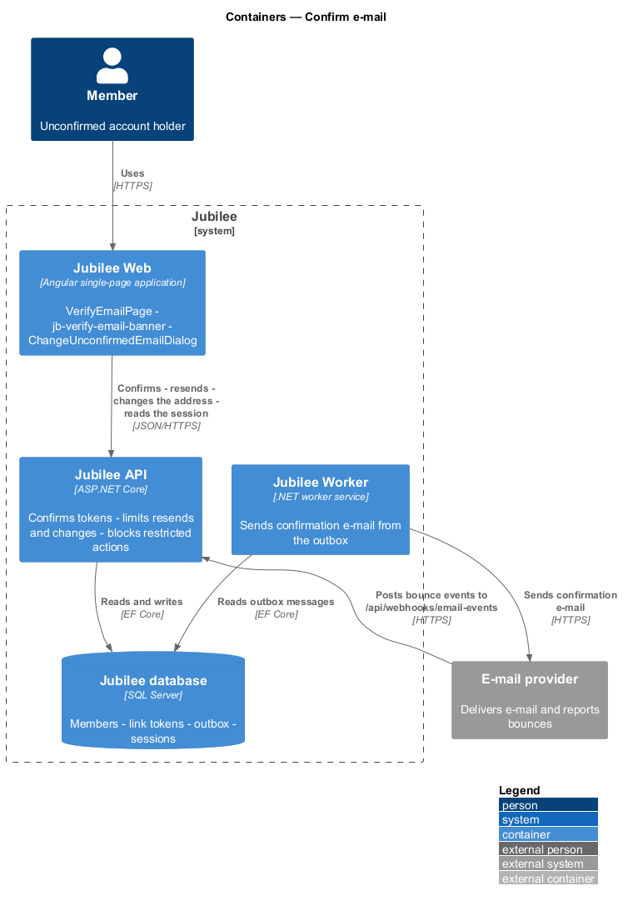
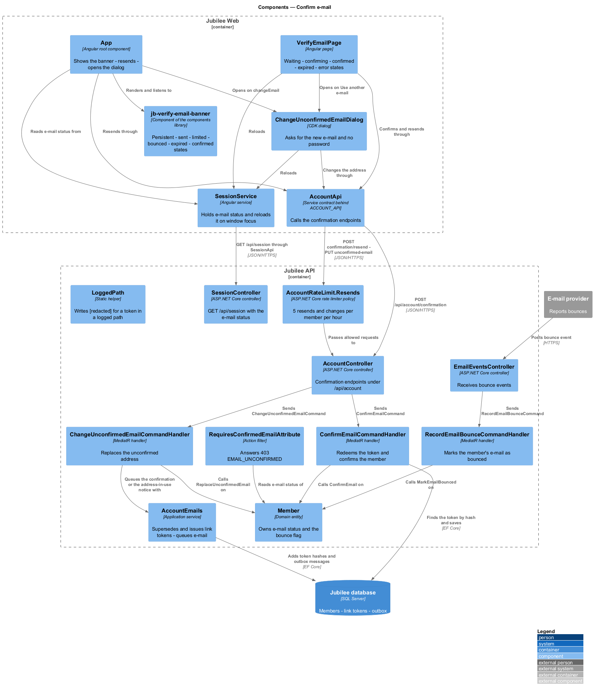
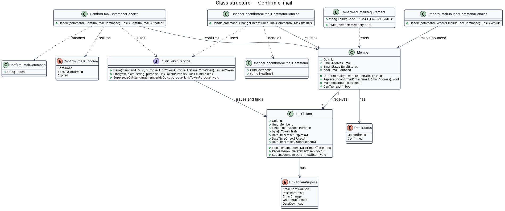
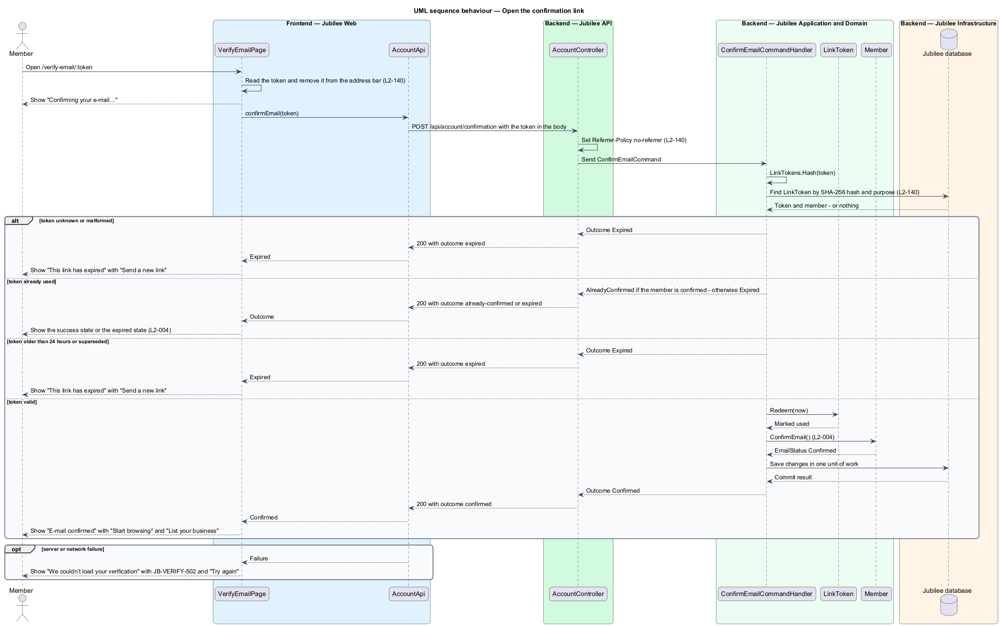
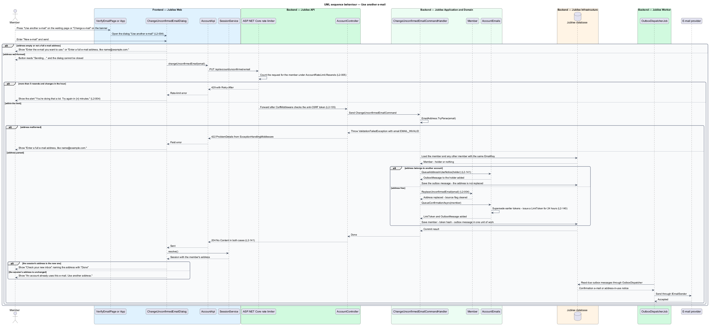
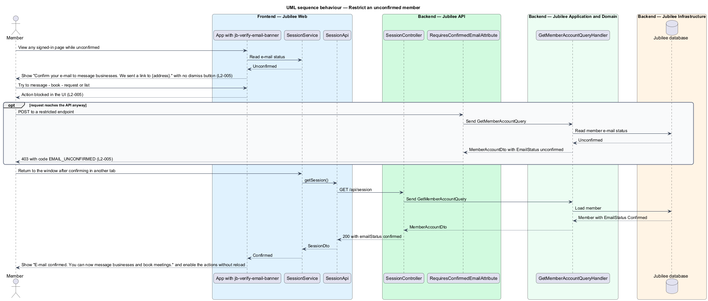
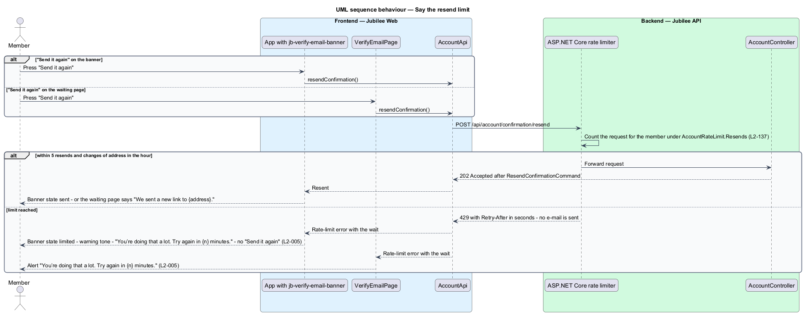

# Confirm e-mail

## Overview

Jubilee is Toronto's Christian marketplace. A member who joins with an e-mail
and password starts *unconfirmed* — e-mail status of an account whose address
has not yet been proven. A *confirmation link* is an e-mailed address of the
form `/verify-email/:token` that proves the address when opened. The link works
once, for 24 hours.

Until the e-mail is confirmed, a member may browse, search and save, and shall
not message, book, request or list a business. A persistent banner on every
signed-in page explains the restriction and offers "Send it again" and "Change
e-mail". The restriction exists so that every business receives requests only
from people whose address is reachable.

This feature covers opening the link and its expired, used and failed states,
replacing a mistyped address before confirmation in the dialog "Use another
e-mail", the reaction to a bounced confirmation e-mail, the limit on resends
and changes of address, and the enforcement of the restriction in `Jubilee
Web` and in `Jubilee API`. Creating the account and issuing the first link
belong to the join with e-mail feature (`L2-001`).

## Description

The feature is a vertical slice from the verification page, the banner and the
dialog to the `Jubilee database`.

- **`VerifyEmailPage`** — Angular page with two routes. `/verify-email` is the
  waiting page "Confirm your e-mail" with "Send it again", the button "Use
  another e-mail", which opens `ChangeUnconfirmedEmailDialog`, and "Sign out".
  A resend answered `429` shows the alert "You’re doing that a lot. Try again
  in {n} minutes." (`L2-005`). `/verify-email/:token` reads the token, removes
  it from the address bar with `history.replaceState`, shows "Confirming your
  e-mail…" and then one of three states: "E-mail confirmed" with "Start
  browsing" and "List your business"; "This link has expired" with "Send a new
  link"; or "We couldn’t load your verification" with error reference
  `JB-VERIFY-502` and "Try again".
- **`jb-verify-email-banner`** (`VerifyEmailBanner`) — component of the
  `components` library with the states `persistent`, `sent`, `limited`,
  `bounced`, `expired` and `confirmed`. The persistent state shows "Confirm
  your e-mail to message businesses. We sent a link to {address}." with "Send
  it again" and "Change e-mail" and has no dismiss button. "Change e-mail" is
  a `button` and raises the output `changeEmail`; "Send it again" raises
  `resend`. The `limited` state has the warning tone, shows "You’re doing that
  a lot. Try again in {n} minutes." and offers no "Send it again"; it is not
  remembered across a reload (ADR 0047). The bounced state has the danger tone
  and shows "We couldn’t deliver e-mail to {address}. Check the address for a
  typo." with "Change e-mail". The confirmed state shows "E-mail confirmed.
  You can now message businesses and book meetings." and can be dismissed.
- **`App`** — root component of `Jubilee Web`. It renders the banner on every
  page of the `app` shell while `SessionService` reports an unconfirmed
  e-mail, and picks the state of the banner. On `resend` it calls
  `AccountApi.resendConfirmation()`; a `429` sets the `limited` state with the
  minutes of `Retry-After`. On `changeEmail` it opens
  `ChangeUnconfirmedEmailDialog`.
- **`ChangeUnconfirmedEmailDialog`** (`jb-change-unconfirmed-email-dialog`) —
  CDK dialog titled "Use another e-mail", in
  `frontend/projects/jubilee/src/app/dialogs/change-unconfirmed-email/`. It
  asks for "New e-mail" and no password (ADR 0047). An empty field shows
  "Enter the e-mail you want to use."; a malformed address, found in the
  browser or answered `422` with `EMAIL_INVALID`, shows "Enter a full e-mail
  address, like name@example.com." While the address is being sent the button
  reads "Sending…" and the dialog cannot be closed. It calls
  `AccountApi.changeUnconfirmedEmail(email)` and, after the `204`, reloads the
  session with `SessionService.resolve()`. When the address of the session is
  the new one, the dialog shows "Check your new inbox" with "We sent a link to
  {address}. It works for 24 hours. The earlier link no longer works." and
  "Done". When it is not, the field shows "An account already uses this
  e-mail. Use another address." A `429` shows the alert "You’re doing that a
  lot. Try again in {n} minutes." with the minutes of `Retry-After`; any other
  failure shows the alert "We couldn’t send that". Its mocks are
  `docs/mocks/dialogs/change-email/unconfirmed.html`,
  `unconfirmed-invalid.html`, `unconfirmed-taken.html`,
  `unconfirmed-busy.html`, `unconfirmed-sent.html` and
  `unconfirmed-limit.html`.
- **`SessionService`** — Angular service holding the member's address and
  e-mail status. `resolve()` calls `GET /api/session` through `SessionApi`. It
  calls `resolve()` again when the window regains focus while the member is
  unconfirmed, so a confirmation in another tab changes the banner and enables
  the blocked actions without a reload.
- **`AccountApi`** — service contract of the `api` library behind the
  `ACCOUNT_API` token: `confirmEmail(token)` sends
  `POST /api/account/confirmation` with the token in the body,
  `resendConfirmation()` sends `POST /api/account/confirmation/resend`, and
  `changeUnconfirmedEmail(email)` sends `PUT /api/account/unconfirmed-email`.
- **`AccountController`** — ASP.NET Core controller for these endpoints. The
  confirmation endpoint needs no session, because the link may be opened on
  another device; its response carries `Referrer-Policy: no-referrer` and
  `Cache-Control: private, no-store`. The resend answers `202`. The change of
  an unconfirmed address answers `204` whether or not the address belongs to
  an account (`L2-141`).
- **`AccountRateLimit.Resends`** — policy of ASP.NET Core's rate limiter on
  the resend and on the change of an unconfirmed address. The two endpoints
  share 5 requests per member per hour. A further request changes nothing and
  sends no e-mail; the limiter answers `429` with `Retry-After`. The feature
  has no rate-limit middleware of its own.
- **`ConfirmEmailCommandHandler`** — MediatR handler. It hashes the token with
  `LinkTokens.Hash`, finds the `LinkToken` by hash and the purpose
  `EmailConfirmation`, and returns a `ConfirmEmailResult` holding a
  `ConfirmEmailOutcome`. A valid token is redeemed and the member confirmed in
  one unit of work. A used token changes nothing and yields `AlreadyConfirmed`
  when the member is confirmed, otherwise `Expired`. An unknown, malformed,
  superseded or older-than-24-hours token yields `Expired` with no account data.
- **`LinkToken`** — domain entity with `TokenHash`, `Purpose`, `ExpiresAt`,
  `UsedAt` and `SupersededAt`. `IsRedeemable(now)` is true only for an unused,
  unsuperseded, unexpired token; `Redeem(now)` sets `UsedAt`.
- **`ChangeUnconfirmedEmailCommandHandler`** — handles the change of an
  unconfirmed address. It parses the address with `EmailAddress.TryParse` and
  throws `ValidationFailedException` with `EMAIL_INVALID` for a malformed one,
  which `ExceptionHandlingMiddleware` maps to `422`. A confirmed member is
  refused with `409` and the code `email_already_confirmed`. When another
  account holds the address, the handler calls
  `AccountEmails.QueueAddressInUseNotice` for the holder and replaces nothing.
  Otherwise it calls `Member.ReplaceUnconfirmedEmail` and
  `AccountEmails.QueueConfirmationAsync`.
- **`AccountEmails`** and **`LinkTokens`** — `QueueConfirmationAsync`
  supersedes the outstanding confirmation tokens, issues a 24-hour `LinkToken`
  from `LinkTokens.NewValue()` and `LinkTokens.Hash()`, and queues the e-mail
  to the member's address in the outbox. `QueueAddressInUseNotice` queues the
  notice to the holder of an address.
- **`Member`** — domain entity. `ConfirmEmail()` sets `EmailStatus` to
  `Confirmed`. `MarkEmailBounced()` sets `EmailBounced`, which the session
  answer exposes to the banner; `ConfirmEmail()` and
  `ReplaceUnconfirmedEmail()` clear it. `CanTransact()` is true only for a
  confirmed member who has accepted the agreement.
- **`RequiresConfirmedEmailAttribute`** — action filter on the endpoints that
  send a message, a booking, a quote or an order request, and that submit a
  listing. It reads the member through `GetMemberAccountQuery` and answers an
  unconfirmed member `403` with code `EMAIL_UNCONFIRMED`. The save endpoints
  do not carry it, so saving succeeds.
- **`SessionController`** and **`GetMemberAccountQueryHandler`** — answer
  `GET /api/session`. The e-mail status is read from the `Jubilee database` on
  every request.
- **`EmailEventsController`** and **`RecordEmailBounceCommandHandler`** —
  receive the `E-mail provider` bounce event at
  `POST /api/webhooks/email-events` and mark the member. The webhook is
  authenticated by a shared secret in `X-Webhook-Secret` (ADR 0012).
- **`LoggedPath`** — static helper in `Jubilee.Api`
  (`Middleware/LoggedPath.cs`). Every log line that names the request path
  writes `LoggedPath.Of(context)`: `RequestLoggingMiddleware`,
  `ExceptionHandlingMiddleware`, and the failed-authorization lines of
  `StaffSession` and `StaffNetworkMiddleware`. The value of a route parameter
  named `token` is written as `[redacted]`; on an unmatched route any path
  segment of 40 characters or more is. The confirmation token travels in the
  request body, and request bodies, query strings and the session cookie are
  never logged (`L2-140`, ADR 0047).
- **Session cookie** — the authenticated endpoints of the slice read the
  member from the cookie `__Host-jubilee.session` (`Secure`, `HttpOnly`,
  `SameSite=Lax`, `Path=/`), named and configured by `MemberSessionCookie`;
  only the Development environment issues it as `jubilee.session`, without
  the prefix (`L2-135`, ADR 0046). `CsrfMiddleware` checks the
  anti-CSRF token of the resend and of the change of address.

## Requirements

The feature realizes the following level-2 (L2) requirements. Each L2
requirement refines a level-1 (L1) requirement, cited by identifier.

| L2 ID | Refines (L1) | Requirement |
|-------|--------------|-------------|
| `L2-004` | `L1-001` | A confirmation link at `/verify-email/:token` shall confirm the member's e-mail. The link shall work once, for 24 hours. When the member presses "Use another e-mail" on the waiting page or "Change e-mail" on the banner, a dialog titled "Use another e-mail" shall ask for the new address and no password; when it is sent, the address shall replace the unconfirmed one, earlier links shall stop working, a new link shall go to the new address, the dialog shall show "Check your new inbox" naming it, and the page and the banner shall name the new address. When the address is empty or is not a full e-mail address, nothing shall be sent and the field shall say "Enter the e-mail you want to use." or "Enter a full e-mail address, like name@example.com."; while the address is being sent the button shall read "Sending…" and the dialog shall not be closable. When the new address already belongs to another account, the API shall answer as it does for any other address, the unconfirmed address shall not be replaced, the holder shall be told by e-mail that someone tried to use their address, and the field shall show "An account already uses this e-mail. Use another address." When the member has reached the limit that changes of address and resends share, nothing shall change and the dialog shall say "You’re doing that a lot. Try again in {n} minutes." |
| `L2-005` | `L1-001` | Until the e-mail is confirmed, a member may browse, search and save, and shall not message, book, request or list a business. When an unconfirmed member presses "Send it again" more than 5 times in an hour, the API shall answer `429` with `Retry-After`, no e-mail shall be sent, and the banner or the waiting page shall say "You’re doing that a lot. Try again in {n} minutes." with the wait the API named. |
| `L2-140` | `L1-019` | An e-mail confirmation token shall have at least 128 bits of randomness, shall be stored only as a SHA-256 hash, shall have a single purpose, shall expire after 24 hours, and shall be single-use. A token page shall set `Referrer-Policy: no-referrer`, and the token shall be removed from the address bar after it is read. The token value shall be redacted from logs: a token in a request path shall be written as `[redacted]` in the request log and in every log line that names the path, and no confirmation, reset, download or session token value shall appear in any log line. |
| `L2-137` | `L1-019` | The server shall respond `429` with `Retry-After` when e-mail confirmation resends exceed 5 per hour. |
| `L2-141` | `L1-019` | The e-mail-change endpoints shall answer with the same status, body shape and timing for an existing and a non-existing e-mail. |
| `L2-135` | `L1-019` | A session shall be an opaque random identifier of at least 128 bits in a cookie with `Secure`, `HttpOnly`, `SameSite=Lax`, `Path=/` and the `__Host-` prefix, `__Host-jubilee.session`; only the Development environment shall issue it as `jubilee.session` without the prefix. A state-changing request that carries a session cookie shall carry the matching anti-CSRF token or be rejected with `403`. |
| `L2-118` | `L1-016` | An unexpected failure shall be reported in the standard failure layout with an error reference, here `JB-VERIFY-502`, that leads to the request's correlation ID in the logs. |

## Diagrams

### System context

The member opens the link delivered by the e-mail provider. The provider also
reports a bounced confirmation e-mail back to Jubilee.

### Containers

`Jubilee Web` calls `Jubilee API` to confirm, resend, change the address and
read the session. `Jubilee API` keeps the members, the link tokens, the outbox
and the sessions in the `Jubilee database`. `Jubilee Worker` sends the e-mail
from the outbox, and the `E-mail provider` posts bounce events to the API.

### Components

`VerifyEmailPage`, `App` with `jb-verify-email-banner`, and
`ChangeUnconfirmedEmailDialog` work through `AccountApi` and `SessionService`.
In the API the resend and the change of address pass the
`AccountRateLimit.Resends` policy. Two handlers change the `Member`;
`ChangeUnconfirmedEmailCommandHandler` queues e-mail through `AccountEmails`.
`RequiresConfirmedEmailAttribute` guards the restricted endpoints, and
`LoggedPath` keeps a token out of each logged path.

### Class structure

`Member` holds an `EmailStatus` and receives `LinkToken` records.
`ConfirmEmailCommandHandler` returns a `ConfirmEmailResult` with a
`ConfirmEmailOutcome`. `ChangeUnconfirmedEmailCommandHandler` uses
`AccountEmails`, which issues tokens with `LinkTokens`.
`RequiresConfirmedEmailAttribute` asks `GetMemberAccountQueryHandler` for the
e-mail status to decide `EMAIL_UNCONFIRMED`. `ChangeUnconfirmedEmailDialog`
depends on `AccountApi` and `SessionService`.

### Behaviour — open the confirmation link

The page removes the token from the address bar (`L2-140`) and posts it. The
handler answers with one outcome per case of `L2-004`: confirmed, already
confirmed, or expired, and reveals nothing for an unknown token.

### Behaviour — use another e-mail

An unconfirmed member replaces the address in `ChangeUnconfirmedEmailDialog`.
For a free address, earlier links stop working and a new 24-hour link goes to
the new address through the outbox. For an address that belongs to another
account, the handler queues the address-in-use notice to the holder and
replaces nothing. The API answers `204` in both cases (`L2-141`); the dialog
reloads the session and reads the outcome from the address the session holds.
A request over the shared limit is answered `429` by the rate limiter and
changes nothing.

### Behaviour — restrict an unconfirmed member

The banner blocks the restricted actions in the UI, and
`RequiresConfirmedEmailAttribute` refuses them with `403` and
`EMAIL_UNCONFIRMED` (`L2-005`). When the window regains focus, `SessionService`
reloads the session and the banner changes to its success state.

### Behaviour — say the resend limit

"Send it again" on the banner and on the waiting page reach the same endpoint.
Above 5 resends and changes of address per member per hour the rate limiter
answers `429` with `Retry-After` and no e-mail is sent. The banner changes to
its `limited` state and the waiting page shows an alert; both name the wait in
minutes (`L2-005`). The mock of the banner state is
`docs/mocks/notifications/verify-email-banner/limit.html`.

