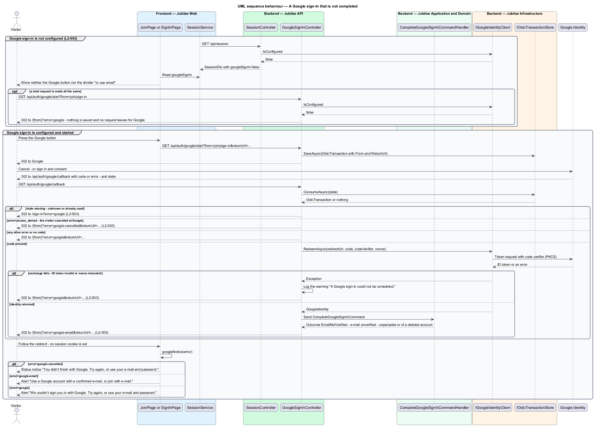

# Continue with Google

## Overview

Jubilee is Toronto's Christian marketplace. A visitor can create an account or
sign in with a Google account as an alternative to an e-mail and password. The
`/join` page, the Sign up screen, offers "Sign up with Google" and the
`/sign-in` page, the Log in screen, offers "Continue with Google"; both start
the same flow. When Google sign-in is configured, the Google button comes
first on each page, above the form, and a divider reading "or use email"
separates it from the form (`L2-003`).

The flow uses *OpenID Connect* — identity layer on OAuth 2.0 in which the
provider returns a signed *ID token* describing the signed-in person. `Jubilee
API` runs the authorization code flow as a confidential client and protects it
with three values: `state` — random value that ties the callback to the browser
that started the flow; `nonce` — random value that ties the ID token to that
same start; and *PKCE* (Proof Key for Code Exchange) — a code verifier that only
the starting party can present when the code is exchanged.

The callback has three accepted outcomes. A member whose account is already
linked to the Google identity is signed in. A member who joined with e-mail and
confirmed it, and whose Google e-mail is the same verified address, has the
Google identity linked to the existing account and is signed in. A visitor with
no account receives a new account built from the Google name and verified
e-mail, with e-mail status "confirmed"; that account is not usable until the
visitor accepts the statement-of-faith and terms agreement.

A sign-in that is not completed returns the visitor to the page it started on,
`/join` or `/sign-in`, with the place the visitor was going to. The page tells
three cases apart: the visitor cancelled at Google, Google has not verified the
e-mail of the account, or the sign-in failed. When Google sign-in is not
configured, neither page shows a Google button.

## Description

The feature is a vertical slice from the Google buttons to the `Jubilee
database`, with `Google Identity` as the external identity provider.

- **`JoinPage`** and **`SignInPage`** — Angular pages at `/join` and
  `/sign-in`. When `SessionService.googleSignIn` is true, each page shows its
  Google button first, above the form: "Sign up with Google" on `/join` and
  "Continue with Google" on `/sign-in`. The button is a `jb-button` that
  carries `jb-google-mark`, Google's "G", to the left of its label. The
  `jb-divider-text` "or use email" separates the button from the form. The
  Google button navigates the browser to `GET /api/auth/google/start` with the
  sanitised return path; `JoinPage` adds `from=join`, and a start without
  `from` counts as `sign-in`. When the browser returns with an `error` query
  parameter, `googleNotice` gives the page its words: "You didn’t finish with
  Google. Try again, or use your e-mail and password." for `google-cancelled`,
  "Use a Google account with a confirmed e-mail, or join with e-mail." for
  `google-email`, and "We couldn’t sign you in with Google. Try again, or use
  your e-mail and password." for `google`. The notice of a cancellation has
  the role `status`; the other two have the role `alert`.
- **`SessionService`** and **`SessionController`** — `GET /api/session`
  carries `googleSignIn`, the value of `IGoogleIdentityClient.IsConfigured`,
  for a visitor and for a member. `SessionService.googleSignIn` exposes it to
  the two pages, and `SessionService.member()` carries `agreementRequired`.
- **`GoogleSignInController`** — ASP.NET Core controller in `Jubilee.Api` with
  two anonymous endpoints. `Start` at `GET /api/auth/google/start` creates the
  `OidcTransaction`, saves it, and redirects to Google with `state`, `nonce`
  and the PKCE code challenge (method `S256`). `Callback` at
  `GET /api/auth/google/callback` consumes the transaction, redeems the code,
  sends `CompleteGoogleSignInCommand`, starts the session with
  `SignInMemberAsync`, and redirects. `Failure` builds the redirect of a
  sign-in that is not completed: `/{from}?error={error}` followed by the
  return URL when it is not `/`. `RedirectUri` is `App:PublicBaseUrl` followed
  by `/api/auth/google/callback`; it is never built from the request
  (ADR 0037).
- **`OidcTransaction`** and **`IOidcTransactionStore`** — pending sign-in
  record holding `State`, `Nonce`, `CodeVerifier`, `ReturnUrl` and `From`, the
  page the sign-in started on (`join` or `sign-in`). `CacheOidcTransactionStore`
  keeps it in the `Cache` keyed by `state`. `ConsumeAsync` reads and deletes,
  so a callback can be used once. A pending transaction lives 10 minutes
  (ADR 0012).
- **`IGoogleIdentityClient`** — infrastructure adapter implemented by
  `GoogleIdentityClient`. `IsConfigured` is true when `Google:ClientId` and
  `Google:ClientSecret` are both set. `BuildAuthorizationUrl` builds the
  address at Google with the scopes `openid email profile`. `RedeemAsync`
  exchanges the code with the code verifier, validates the ID token signature,
  issuer, audience, expiry and `nonce`, and returns a `GoogleIdentity`; any
  failure is an exception.
- **`GoogleIdentity`** — record with `Subject`, `Email`, `EmailVerified`,
  `GivenName` and `FamilyName`.
- **`CompleteGoogleSignInCommandHandler`** — MediatR handler. It refuses an
  identity with `EmailVerified` false or an e-mail that is not an address. It
  looks up the `Member` by `GoogleSubject`, then by `EmailKey`, applies one of
  the three accepted outcomes, saves, and returns a `GoogleSignInResult` with
  the outcome and the member. An address that belongs to a deleted account is
  refused with the same outcome as an unverified e-mail. The handler does not
  start the session; the controller does.
- **`Member`** — domain entity. `JoinWithGoogle` creates a member with
  `EmailStatus` `Confirmed`, no password hash and `AgreementAcceptedAt` unset.
  `LinkGoogle` records the Google subject on an e-mail account. `IsUsable()`
  is false until `AcceptAgreement` runs.
- **`GoogleSignInOutcome`** — enumeration: `SignedIn`, `Linked`,
  `CreatedAwaitingAgreement`, `EmailNotVerified`.
- **`ReturnUrl`** — static helper of `Jubilee.Domain`. `Parse` accepts only a
  same-origin relative path and returns `/` for any other value (`L2-012`).
- **Session cookie** — `SignInMemberAsync` stores a new `MemberSession`
  through `DatabaseTicketStore` and sets the cookie `__Host-jubilee.session` (`Secure`, `HttpOnly`,
  `SameSite=Lax`, `Path=/`), named and configured by `MemberSessionCookie`;
  only the Development environment issues it as `jubilee.session`, without
  the prefix (`L2-135`, ADR 0046). A
  sign-in that is not completed sets no session cookie.
- **`JoinAgreementPage`** — Angular page at `/join/agreement`, headed "One
  more step". It shows the agreement checkbox with links to
  `/statement-of-faith` and `/terms`, and the error "Agree to the statement of
  faith to join." when the box is not ticked. The root component `App`
  navigates a member whose session says `agreementRequired` to this page from
  every other route, with the return URL.
- **`AcceptAgreementCommandHandler`** — handles `POST /api/account/agreement`
  of `AccountController`. It calls `Member.AcceptAgreement`. Until then
  `AgreementRequiredMiddleware` refuses every other authenticated request with
  `403` and code `AGREEMENT_REQUIRED`, except `/api/session`, `/api/health`
  and the paths under `/api/auth/`.

No sign-in that is not completed issues a session. The controller answers each
case with a redirect:

- A callback whose `state` is missing, unknown or already used goes to
  `/sign-in?error=google`, because nothing is known about where it started.
- `error=access_denied` from Google means the visitor cancelled; the redirect
  carries `?error=google-cancelled`, and the page words it calmly.
- Any other `error` from Google, or a callback without a `code`, carries
  `?error=google`.
- A failed code exchange, an invalid ID token and a mismatch of `nonce` are
  exceptions of `RedeemAsync`. The controller logs the warning "A Google
  sign-in could not be completed." and the redirect carries `?error=google`.
- The outcome `EmailNotVerified` carries `?error=google-email`.

Without `Google:ClientId` and `Google:ClientSecret` the session answer carries
`googleSignIn: false`, and the join and sign-in pages show neither the Google
button nor the "or use email" divider. A start request made all the same saves
nothing, sends nothing to Google, and is redirected with `?error=google` to the
page named by `from` (ADR 0037). The place and the words of the Google button
on the two pages follow ADR 0038, which leaves the flow as ADR 0037 defines it.
A Google sign-in whose verified e-mail matches an account that is still
unconfirmed is linked, and `LinkGoogle` removes the password of the account and
confirms its e-mail (ADR 0012); `L2-003` defines linking for a confirmed
account.

## Requirements

The feature realizes the following level-2 (L2) requirements. Each L2
requirement refines a level-1 (L1) requirement, cited by identifier.

| L2 ID | Refines (L1) | Requirement |
|-------|--------------|-------------|
| `L2-003` | `L1-001` | The system shall let visitors join or sign in with Google using OpenID Connect. When Google sign-in is not configured, "Sign up with Google" and "Continue with Google" shall not be shown, nor the "or use email" divider under them, and no request shall leave for Google; a request to start a Google sign-in all the same shall return the visitor to where they started with the sign-in error state. A visitor who cancels at Google shall be back on the page they started from (`/join` or `/sign-in`) with "You didn’t finish with Google. Try again, or use your e-mail and password.", and the place they were going to shall be kept. A Google sign-in started from `/join` that fails or is refused shall show its message on `/join`, not on `/sign-in`. |
| `L2-010` | `L1-001` | Sessions shall be server-side, and a new session identifier shall be issued when a member signs in. |
| `L2-012` | `L1-001` | A return URL used after sign-in shall be accepted only when it is a same-origin relative path; any other value shall fall back to `/`. |
| `L2-135` | `L1-019` | A session shall be an opaque random identifier of at least 128 bits in a cookie with `Secure`, `HttpOnly`, `SameSite=Lax`, `Path=/` and the `__Host-` prefix, `__Host-jubilee.session`; only the Development environment shall issue it as `jubilee.session` without the prefix. A state-changing request that carries a session cookie shall carry the matching anti-CSRF token or be rejected with `403`. |

## Diagrams

### System context

The visitor starts in Jubilee, signs in and consents at `Google Identity`, and
returns to Jubilee, which exchanges the code with Google.

### Containers

`Jubilee API` runs the flow. It keeps the pending transaction in the `Cache`,
and the member and the session in the `Jubilee database`. `Jubilee Web` reads
`googleSignIn`, starts the flow, shows the notice of a sign-in that is not
completed, and collects the agreement.

### Components

`JoinPage` and `SignInPage` read `googleSignIn` from `SessionService`, which
`SessionController` fills from `IGoogleIdentityClient`.
`GoogleSignInController` uses `IOidcTransactionStore` and
`IGoogleIdentityClient`, sends the command to
`CompleteGoogleSignInCommandHandler`, and starts the session through
`DatabaseTicketStore` or redirects back to the page with an error. `App` sends
a member who has not agreed to `JoinAgreementPage`, which completes a new
account through `AcceptAgreementCommandHandler`; until then
`AgreementRequiredMiddleware` refuses other requests.

### Class structure

`OidcTransaction` holds the return URL that `ReturnUrl.Parse` accepted and the
page the sign-in started on. `IGoogleIdentityClient` returns a
`GoogleIdentity`, which the command carries to the handler; the handler creates
or links a `Member` and returns a `GoogleSignInResult` with a
`GoogleSignInOutcome`. `SessionController` reads `IsConfigured` into
`SessionDto.GoogleSignIn`.

### Behaviour — join or sign in with Google

The controller stores `state`, `nonce` and the code verifier, and verifies all
three on the callback (`L2-003`). An accepted identity signs in, links, or
creates a member awaiting the agreement. The controller then starts the session
and redirects to the return URL, or to `/join/agreement` for a member who has
not agreed.

### Behaviour — a Google sign-in that is not completed

When Google sign-in is not configured, the pages show no Google button, and a
start request is redirected with `?error=google`. When it is configured, a
callback with an unknown `state` goes to `/sign-in?error=google`. A
cancellation, a failure and an unverified e-mail return the visitor to the
page the sign-in started on with `?error=google-cancelled`, `?error=google` or
`?error=google-email` and the return URL (`L2-003`). The page words the notice
with `googleNotice`; no session cookie is set.

### Behaviour — accept the agreement after joining with Google

`App` holds a new Google member on `/join/agreement` until
`AcceptAgreementCommandHandler` records the agreement and the account becomes
usable.

