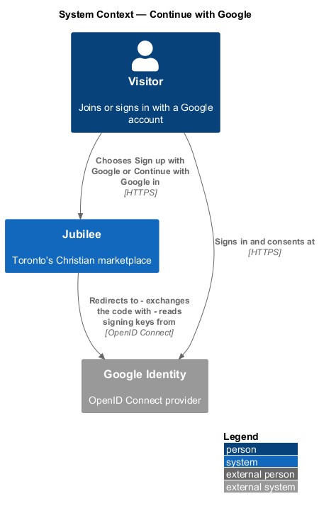
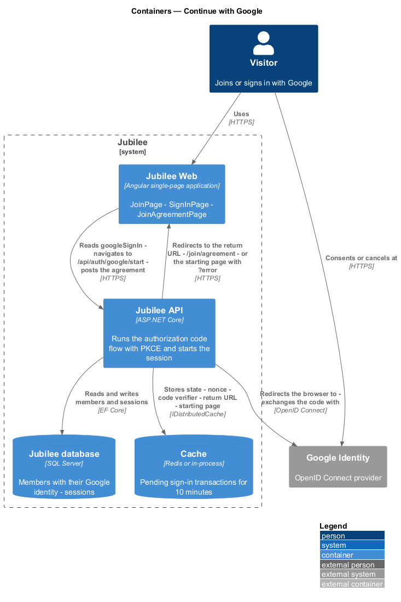
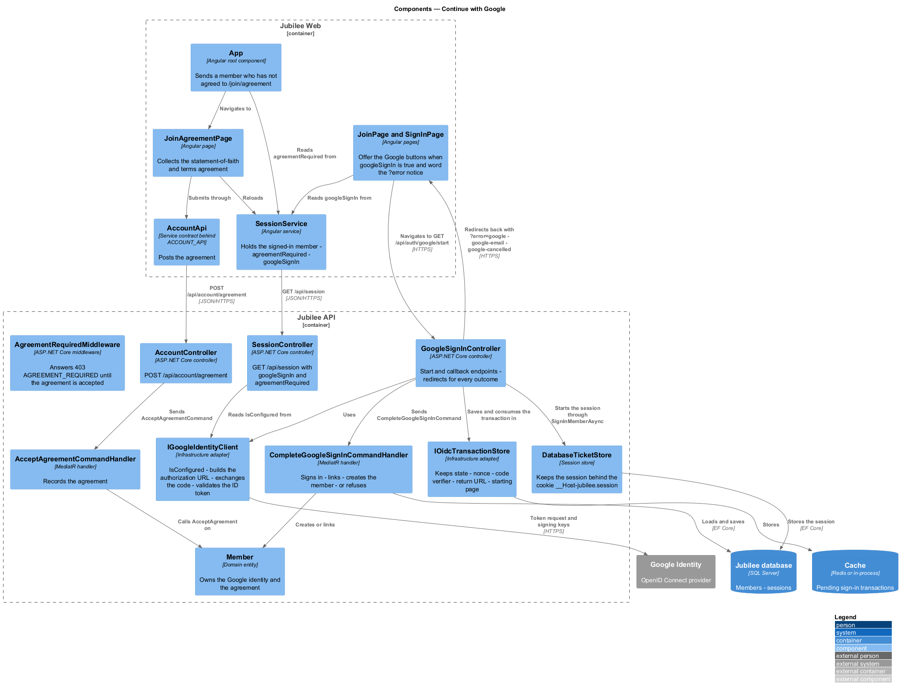
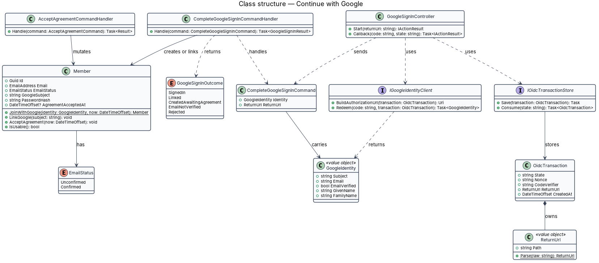
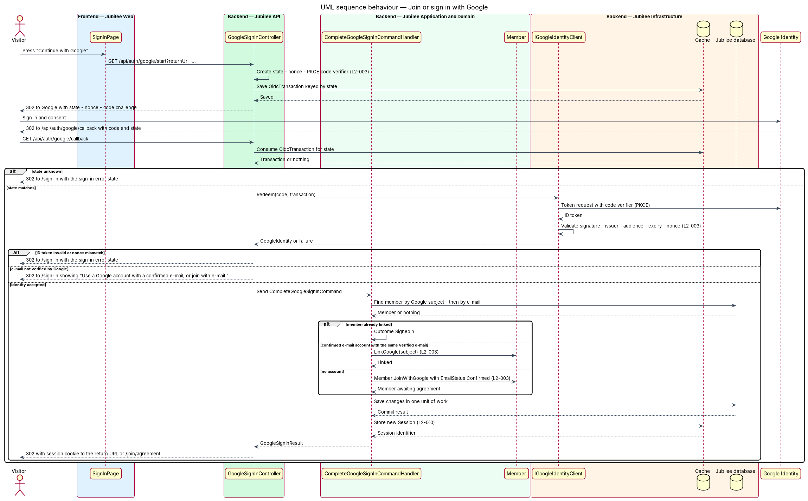
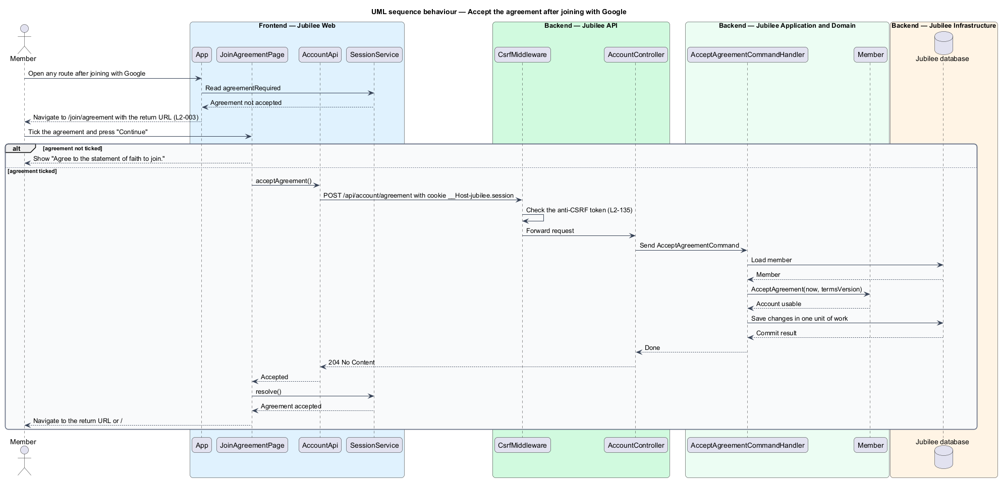

# Continue with Google

## Overview

Jubilee is Toronto's Christian marketplace. A visitor can create an account or
sign in with a Google account as an alternative to an e-mail and password. The
`/join` page offers "Join with Google" and the `/sign-in` page offers "Continue
with Google"; both start the same flow.

The flow uses *OpenID Connect* — identity layer on OAuth 2.0 in which the
provider returns a signed *ID token* describing the signed-in person. `Jubilee
API` runs the authorization code flow as a confidential client and protects it
with three values: `state` — random value that ties the callback to the browser
that started the flow; `nonce` — random value that ties the ID token to that
same start; and *PKCE* (Proof Key for Code Exchange) — a code verifier that only
the starting party can present when the code is exchanged.

The callback has three accepted outcomes. A member whose account is already
linked to the Google identity is signed in. A member who joined with e-mail and
confirmed it, and whose Google e-mail is the same verified address, has the
Google identity linked to the existing account and is signed in. A visitor with
no account receives a new account built from the Google name and verified
e-mail, with e-mail status "confirmed"; that account is not usable until the
visitor accepts the statement-of-faith and terms agreement. A Google account
whose e-mail Google has not verified is refused.

## Description

The feature is a vertical slice from the Google buttons to the `Jubilee
database`, with `Google Identity` as the external identity provider.

- **`JoinPage`** and **`SignInPage`** — Angular pages. The Google button
  navigates the browser to `GET /api/auth/google/start` with the sanitised
  return path. On a refused sign-in `SignInPage` shows the sign-in error state,
  or the message "Use a Google account with a confirmed e-mail, or join with
  e-mail." for the outcome `EmailNotVerified`.
- **`GoogleSignInController`** — ASP.NET Core controller in `Jubilee.Api` with
  two endpoints. `Start` creates the `OidcTransaction` and redirects to Google
  with `state`, `nonce` and the PKCE code challenge (method `S256`).
  `Callback` at `GET /api/auth/google/callback` consumes the transaction,
  redeems the code, and sends `CompleteGoogleSignInCommand`.
- **`OidcTransaction`** and **`IOidcTransactionStore`** — pending sign-in record
  holding `State`, `Nonce`, `CodeVerifier` and `ReturnUrl`, kept in the `Cache`
  keyed by `state`. `Consume` reads and deletes in one step, so a callback can
  be used once. A pending transaction lives 10 minutes (ADR 0012).
- **`IGoogleIdentityClient`** — infrastructure adapter. `Redeem` exchanges the
  code with the code verifier, validates the ID token signature, issuer,
  audience, expiry and `nonce`, and returns a `GoogleIdentity`.
- **`GoogleIdentity`** — value object with `Subject`, `Email`, `EmailVerified`,
  `GivenName` and `FamilyName`.
- **`CompleteGoogleSignInCommandHandler`** — MediatR handler. It refuses an
  identity with `EmailVerified` false. It looks up the `Member` by
  `GoogleSubject`, then by normalised e-mail, applies one of the three outcomes,
  saves in one unit of work, and issues a new `Session` through `ISessionStore`.
- **`Member`** — domain entity. `JoinWithGoogle` creates a member with
  `EmailStatus` `Confirmed`, no password hash and `AgreementAcceptedAt` unset.
  `LinkGoogle` records the Google subject on a confirmed e-mail account.
  `IsUsable()` is false until `AcceptAgreement` runs.
- **`GoogleSignInOutcome`** — enumeration: `SignedIn`, `Linked`,
  `CreatedAwaitingAgreement`, `EmailNotVerified`, `Rejected`.
- **`ReturnUrl`** — value object. `Parse` accepts only a same-origin relative
  path and falls back to `/` for any other value (`L2-012`).
- **`GoogleAgreementPage`** — Angular page at `/join/agreement`, a route this
  design introduces. It shows the agreement checkbox with links to
  `/statement-of-faith` and `/terms`, and the error "Agree to the statement of
  faith to join." when the box is not ticked. `AgreementGuard` sends a member
  whose account is not yet usable to this page from every other route.
- **`AcceptAgreementCommandHandler`** — handles `POST /api/account/agreement`.
  It calls `Member.AcceptAgreement(now)`. Until then an authorization
  requirement refuses every other authenticated endpoint with `403` and code
  `AGREEMENT_REQUIRED`.

A mismatch of `state` or `nonce`, a failed code exchange and an invalid ID
token all end in a redirect to `/sign-in` with the sign-in error state; no
session is issued. The rule for a Google sign-in whose verified e-mail matches
an account that is still unconfirmed is: link it and remove the account's password (ADR 0012); `L2-003`
defines linking for a confirmed account.

## Requirements

The feature realizes the following level-2 (L2) requirements. Each L2
requirement refines a level-1 (L1) requirement, cited by identifier.

| L2 ID | Refines (L1) | Requirement |
|-------|--------------|-------------|
| `L2-003` | `L1-001` | The system shall let visitors join or sign in with Google using OpenID Connect. |
| `L2-010` | `L1-001` | Sessions shall be server-side, and a new session identifier shall be issued when a member signs in. |
| `L2-012` | `L1-001` | A return URL used after sign-in shall be accepted only when it is a same-origin relative path; any other value shall fall back to `/`. |
| `L2-135` | `L1-019` | A session shall be an opaque random identifier of at least 128 bits in a `Secure`, `HttpOnly`, `SameSite=Lax` cookie with the `__Host-` prefix, and a state-changing request shall carry a valid anti-CSRF token bound to the session. |

## Diagrams

### System context

The visitor starts in Jubilee, signs in and consents at `Google Identity`, and
returns to Jubilee, which exchanges the code with Google.

### Containers

`Jubilee API` runs the flow. It keeps the pending transaction and the session in
the `Cache` and the member in the `Jubilee database`; `Jubilee Web` only starts
the flow and collects the agreement.

### Components

`GoogleSignInController` uses `IOidcTransactionStore` and
`IGoogleIdentityClient`, then sends the command to
`CompleteGoogleSignInCommandHandler`. `GoogleAgreementPage` completes a new
account through `AcceptAgreementCommandHandler`.

### Class structure

`OidcTransaction` owns a `ReturnUrl`. `IGoogleIdentityClient` returns a
`GoogleIdentity`, which the command carries to the handler; the handler creates
or links a `Member` and reports a `GoogleSignInOutcome`.

### Behaviour — join or sign in with Google

The controller stores `state`, `nonce` and the code verifier, and verifies all
three on the callback (`L2-003`). An unverified Google e-mail is refused; an
accepted identity signs in, links, or creates a member awaiting the agreement.

### Behaviour — accept the agreement after joining with Google

`AgreementGuard` holds a new Google member on `/join/agreement` until
`AcceptAgreementCommandHandler` records the agreement and the account becomes
usable.

