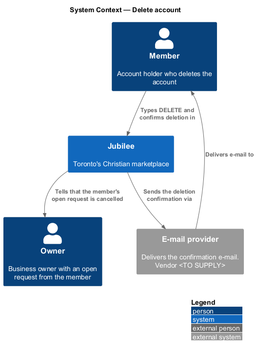
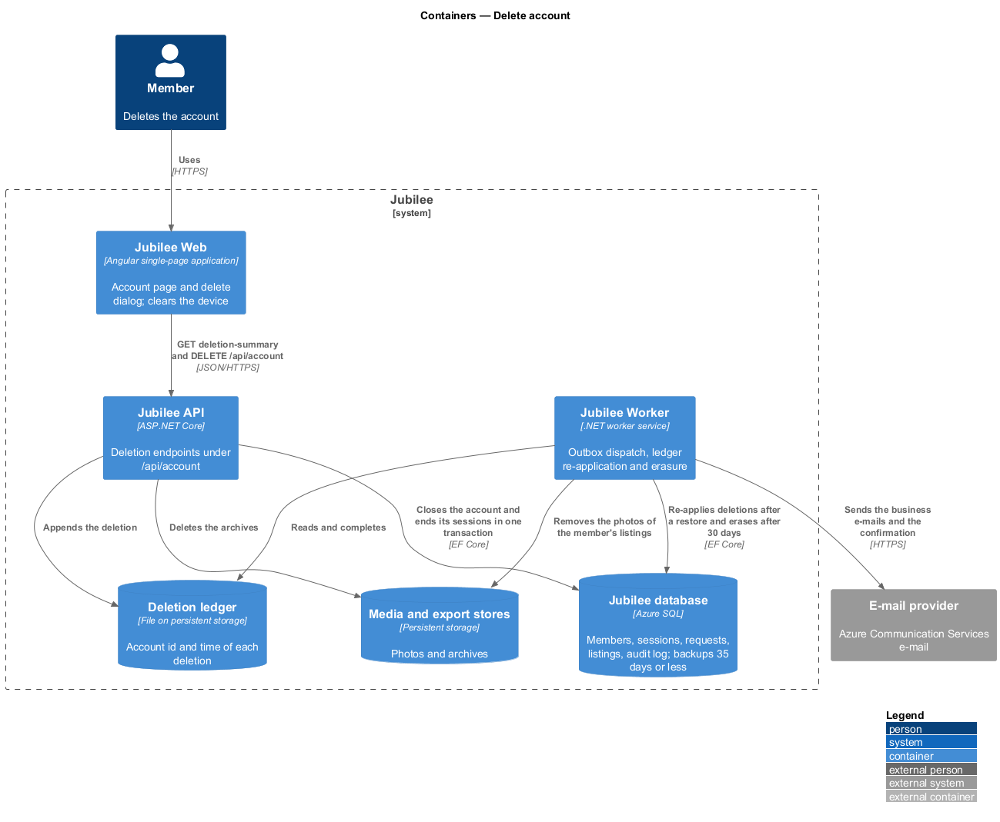
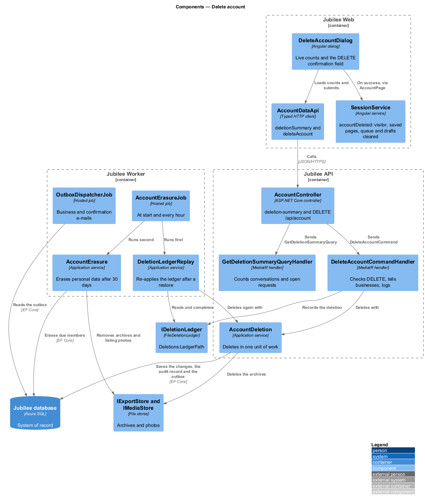
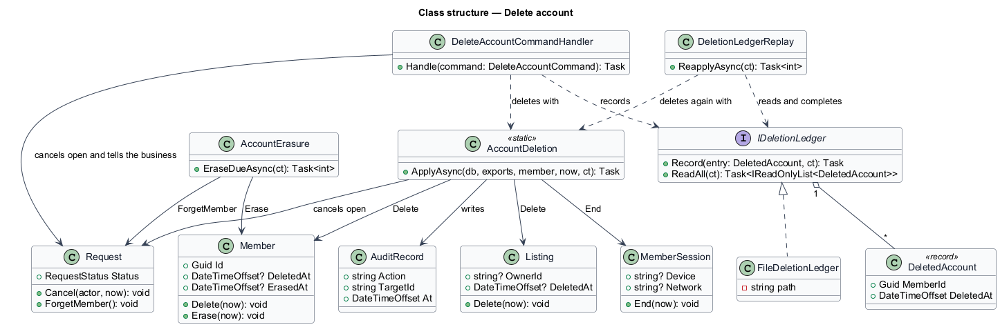
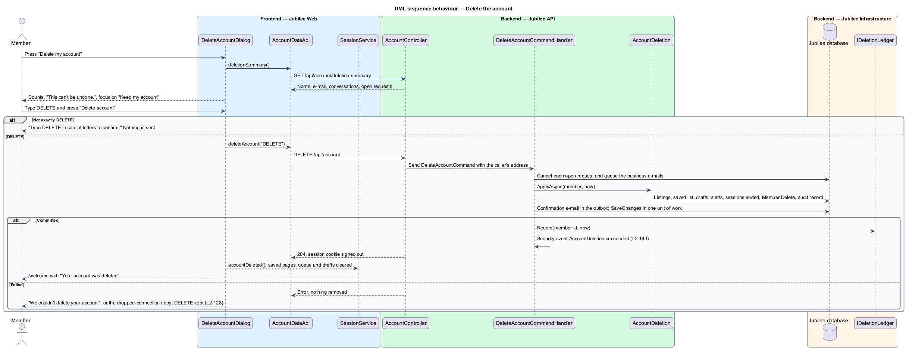
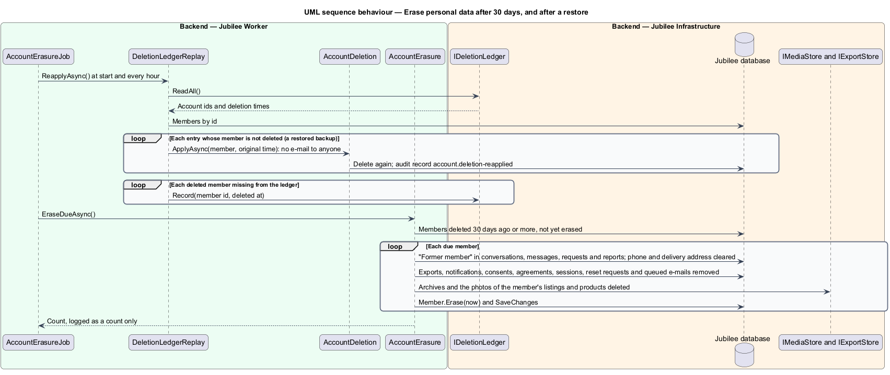

# Delete account

## Overview

Jubilee is Toronto's Christian marketplace. A *member* is a signed-in account
holder who can save businesses, message them and send them requests; an *owner*
is a member who also owns a business listing. This feature lets a member
permanently delete the account from the account page at `/account`.

Deletion is consequential and cannot be undone, so it is guarded by a
confirmation dialog. The dialog names the account and states the consequences
with live counts: how many conversations are deleted and how many open requests
are cancelled. An *open request* is a booking, quote or order request in status
`new` or `confirmed`. The member confirms by typing the word DELETE in capital
letters.

Deletion happens in two stages. The first stage is immediate: the account is
closed, every session ends, open requests are cancelled and their businesses are
told, an owned listing is unpublished and leaves browse and search, a
confirmation e-mail is sent, and nothing the member saw or wrote stays on the
device. The deletion is also written to the *deletion ledger*, a record kept
outside the database of which accounts were deleted and when. The second stage
is *erasure* — permanent removal of the account's personal data from primary
storage — which runs 30 days after deletion. Backups of the database are kept
35 days or less, and a database restored from a backup re-applies the deletions
in the ledger, so a deleted account stays deleted and no backup holds its data
later than 35 days after deletion. Messages the member sent stay visible to the
business, attributed to "Former member".

## Description

The feature is a vertical slice from a dialog in `Jubilee Web` through
`Jubilee API` to the `Jubilee database`, with follow-up work in
`Jubilee Worker`. The names below are the names of the code (ADR 0034,
ADR 0069).

- **`AccountPage`** — Angular page at `/account`. Its "Delete account" section
  carries the action "Delete my account", which opens the dialog. After a
  deletion it asks `SessionService` to forget the account on the device,
  navigates to `/welcome` and shows the toast "Your account was deleted" with
  "We sent you an e-mail to confirm. Your personal data is erased within 30
  days."
- **`DeleteAccountDialog`** — Angular dialog titled "Delete your account?". It
  loads the summary, shows the member's name and e-mail, the lines "Your
  profile, saved list and {n} conversations are deleted.", "Your {n} open
  requests are cancelled and the businesses are told." and "This can’t be
  undone.", the field "Type DELETE to confirm", and the buttons "Keep my
  account" and "Delete account". "Keep my account" has the initial focus
  (L2-129). A value other than exactly `DELETE` shows "Type DELETE in capital
  letters to confirm." and sends nothing. A failed submission shows "We couldn’t
  delete your account" with "Nothing was removed. Try again, or write to
  help@jubilee.example."; a dropped connection shows "Your connection dropped
  before it reached us. Nothing was sent and what you typed is still here. Try
  again." (L2-128, mock `dialogs/delete-account`, states `failed` and
  `offline`). Both keep the typed confirmation.
- **`AccountDataApi`** (`ACCOUNT_DATA_API`) — typed Angular HTTP client.
  `deletionSummary()` calls `GET /api/account/deletion-summary`;
  `deleteAccount(confirmation)` calls `DELETE /api/account` with
  `{confirmation}`.
- **`SessionService`** — Angular service. `accountDeleted()` makes the user a
  visitor and clears the device as a sign-out does (ADR 0068) — the saved pages
  and the outgoing queue — and, because the account is gone, the member's drafts
  (`DraftStore.forget`).
- **`AccountController`** — ASP.NET Core controller in `Jubilee.Api`. Both
  endpoints act on the member of the current session only. After the deletion it
  signs the session cookie out.
- **`GetDeletionSummaryQuery`** and its handler — count the member's
  conversations and open requests and return a `DeletionSummaryDto` for the
  dialog copy.
- **`DeleteAccountCommand`** and its handler — carry the typed confirmation and
  the caller's address. Any value other than exactly `DELETE` returns HTTP `422`
  with `CONFIRMATION_MISMATCH` and deletes nothing. In one unit of work the
  handler cancels each open `Request` and tells its business by notification and
  e-mail, and `AccountDeletion` then deletes the member's listings, feedback,
  reviews, saved list, recent searches, notifications, link tokens, listing
  drafts and back-in-stock alerts, expires the exports and deletes their archives
  from `IExportStore`, ends every `MemberSession` and calls
  `Member.Delete(now)`. It writes the audit record `account.deleted` (L2-180)
  and queues the confirmation e-mail "Your Jubilee account was deleted", which
  is sent whatever the notification settings say and carries no unsubscribe
  link. After the commit it writes the deletion to `IDeletionLedger` and the
  security event "AccountDeletion succeeded for member {id} from {address}"
  (L2-143); a mismatch is logged as "refused". Any failure before the commit
  rolls the whole unit of work back, so nothing is removed.
- **`Member`** — domain entity. `Delete(now)` records `DeletedAt` and clears the
  password and the Google link, so nothing can sign in. `Erase(now)` clears
  every personal field and records `ErasedAt`.
- **`Request`** — domain entity. `Cancel(actor, now)` moves a `new` or
  `confirmed` request to `cancelled` and records the transition.
  `ForgetMember()` names the member "Former member" and clears the phone and the
  delivery address.
- **`Listing`** — domain entity. `Delete(now)` takes the listing out of every
  public list in the same transaction. Search reads the listings themselves
  (L2-182, ADR 0011), so the listing leaves search at once; there is no index to
  update.
- **`IDeletionLedger`** — the deletion ledger, outside the database. Each entry
  is a `DeletedAccount`: the account's id and the time of deletion, nothing
  else. `FileDeletionLedger` appends one JSON line per entry to
  `Deletions:LedgerPath` on the app's persistent storage, which a database
  restore does not touch.
- **`DeletionLedgerReplay`** — application service. For each ledger entry whose
  account the database holds and does not show as deleted, it deletes the
  account again with the original time, through `AccountDeletion`, without
  telling the businesses or e-mailing the member again, and writes the audit
  record `account.deletion-reapplied`. A deleted account the ledger is missing
  is written to it.
- **`AccountErasure`** — application service. For each member deleted 30 days
  ago or more it forgets the member in conversations, messages, requests and
  listing reports ("Former member"), deletes the exports and their archives, the
  notifications, consents, statement-of-faith agreements, sessions,
  password-reset requests and queued e-mails, removes the photos of the member's
  listings and products from the media store, and calls `Member.Erase(now)`.
  Messages, and the photos sent in them, stay for the business.
- **`AccountErasureJob`** — hosted job in `Jubilee.Worker` that runs when the
  worker starts and every hour: first `DeletionLedgerReplay`, then
  `AccountErasure`. Both are idempotent and log counts only.
- **`OutboxDispatcherJob`** — hosted job in `Jubilee.Worker` that delivers the
  business e-mails and the confirmation e-mail.

The database's backups are kept 7 days (Azure SQL point-in-time restore on the
Basic tier) with no long-term retention; keeping them at 35 days or less is the
owner's (`eng/azure/README.md`). The re-application of the ledger is code and is
tested.

## Requirements

The feature realizes the following level-2 (L2) requirements. Each L2
requirement refines a level-1 (L1) requirement, cited by identifier.

| L2 ID | Refines (L1) | Requirement |
|-------|--------------|-------------|
| `L2-017` | `L1-002` | The system shall let a member permanently delete their account after typing DELETE, erase its personal data after 30 days, and re-apply the deletion after a restore from backup. |
| `L2-129` | `L1-018` | An action that deletes data or notifies another person shall be confirmed in a dialog that states the consequence with real counts and names, with the safe choice as the default focused button. The dialog for an irreversible action shall say "This can't be undone." |
| `L2-128` | `L1-018` | A failed dialog submission shall show an error alert at the top of the dialog that says what did not happen, shall keep everything typed, and shall tell a dropped connection apart. |
| `L2-180` | `L1-025` | The system shall store an append-only audit record of actor, action, target, time, before and after values, and reason for each sensitive action, including account deletions. |
| `L2-143` | `L1-019` | The system shall log each account deletion with time, actor, IP and outcome. |

## Diagrams

### System context

A member deletes the account in Jubilee. Jubilee tells the owners of the
cancelled requests and sends the confirmation e-mail through the
`E-mail provider`.

### Containers

`Jubilee API` closes the account in the `Jubilee database` and writes the
deletion to the `Deletion ledger`. `Jubilee Worker` dispatches the e-mails,
re-applies the ledger after a restore, and erases the personal data after 30
days.

### Components

`DeleteAccountDialog` calls `AccountDataApi`. `AccountController` sends the
summary query and the delete command; the handler changes `Member`, `Request`
and `Listing` together through `AccountDeletion`. `AccountErasureJob` runs
`DeletionLedgerReplay` and `AccountErasure` in `Jubilee Worker`.

### Class structure

`DeleteAccountCommandHandler` and `DeletionLedgerReplay` share
`AccountDeletion`, which changes `Member`, its open `Request` rows and its
`Listing` rows. `IDeletionLedger` keeps a `DeletedAccount` per deletion.

### Behaviour — delete the account

The dialog loads live counts, checks the typed confirmation, and submits. The
handler commits every change in one unit of work; a failure removes nothing and
the dialog keeps the typed confirmation.

### Behaviour — erase personal data after 30 days, and after a restore

`AccountErasureJob` re-applies the ledger, so a restored database deletes the
account again with its original time, then erases each account deleted 30 days
earlier, leaving the member's sent messages attributed to "Former member".

