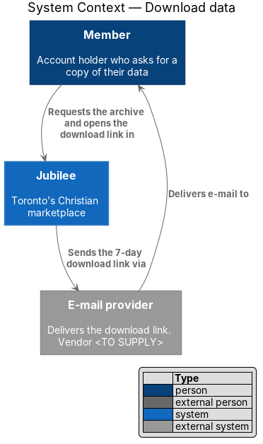
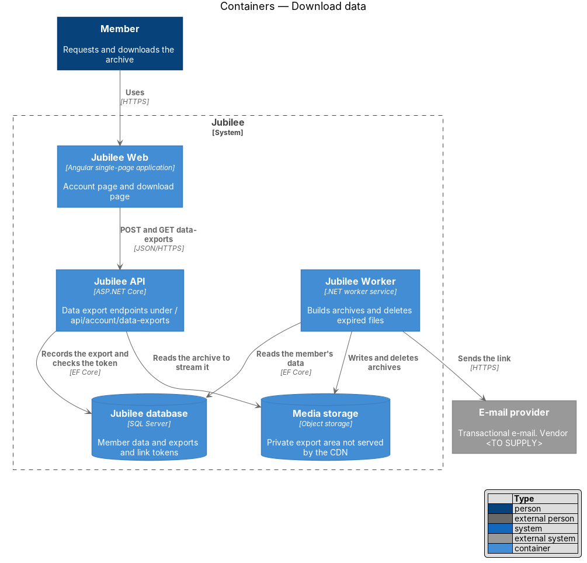
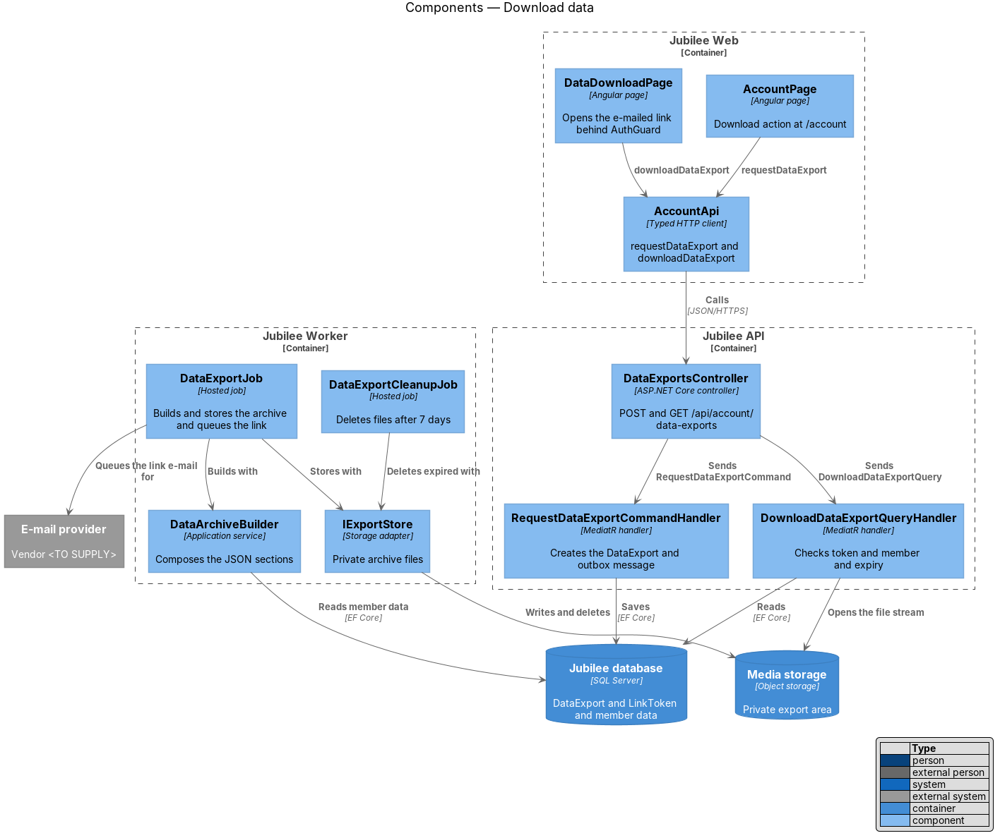
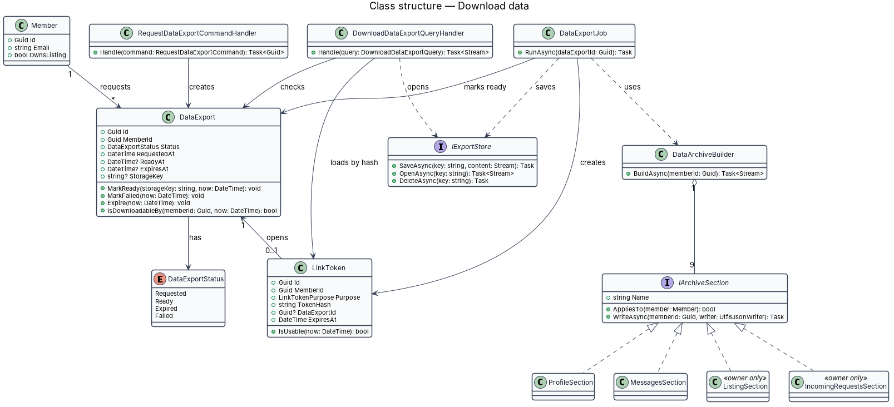
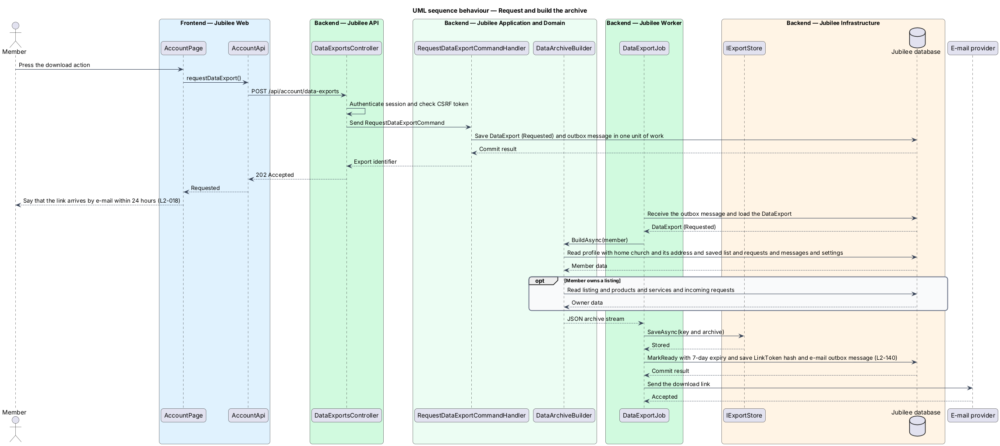
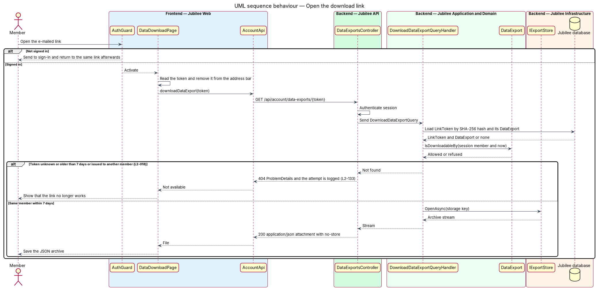

# Download data

## Overview

Jubilee is Toronto's Christian marketplace. Its privacy page states that a
member can download their data. This feature delivers that promise: a member
asks for a download on the account page at `/account`, and within 24 hours
receives an e-mail with a link to an archive.

A *data archive* is a machine-readable JSON file that holds what Jubilee stores
about one member: the profile, the saved list, the requests the member sent, the
messages, and the notification settings. For an *owner* — member who owns a
business listing — the archive also holds the listing, its products and
services, and the requests customers sent to the business. The profile part
includes the home church and the home church address.

The archive is built in the background, not while the member waits. The
*download link* in the e-mail works for 7 days. It opens only for a visitor who
is signed in as the same account that asked for it. After 7 days the link stops
working and the archive file is deleted.

## Description

The feature is a vertical slice from the account page in `Jubilee Web` through
`Jubilee API` to a background job in `Jubilee Worker`. Nothing is built yet; the
names below are the names the design introduces.

- **`AccountPage`** — Angular page at `/account`. It carries the download
  action and, after a request, a notice that the link arrives by e-mail within
  24 hours. The action is the button "Download my data" in a "Your data" card (mock `pages/account`, states `data-requested` and `data-failed`).
- **`DataDownloadPage`** — Angular page that the e-mailed link opens, behind
  `AuthGuard`. A visitor who is not signed in signs in first and returns to the
  same link. The page removes the token from the address bar and starts the file
  download through `AccountApi`. The route of this page is `/account/data/:token` (mock `pages/data-download`).
- **`AccountApi`** — typed Angular HTTP client. `requestDataExport()` calls
  `POST /api/account/data-exports`; `downloadDataExport(token)` calls
  `GET /api/account/data-exports/{token}`.
- **`DataExportsController`** — ASP.NET Core controller in `Jubilee.Api`. The
  `POST` returns HTTP `202`. The `GET` streams the archive as
  `application/json` with `Content-Disposition: attachment`, `Cache-Control:
  no-store` and `Referrer-Policy: no-referrer`.
- **`RequestDataExportCommand`** and its handler — create a `DataExport` in
  status `Requested` for the member of the session and write an outbox message
  that starts the build. A member who already has an export in status
  `Requested` gets that export back; no second build starts.
- **`DataExport`** — domain entity that tracks one export: member, status,
  `RequestedAt`, `ReadyAt`, `ExpiresAt` and the storage key of the file.
  `MarkReady(now)` sets `ExpiresAt` to 7 days later; `IsDownloadableBy(memberId,
  now)` holds the access rule.
- **`DataExportStatus`** — enumeration `Requested`, `Ready`, `Expired`,
  `Failed`.
- **`DataExportJob`** — hosted job in `Jubilee.Worker`, started by the outbox
  message. It builds the archive, stores it, marks the export `Ready`, creates
  the `LinkToken`, and queues the e-mail with the link. The job is idempotent
  and retried up to 5 times with back-off (L2-182); an export that still fails
  is marked `Failed`.
- **`DataArchiveBuilder`** — application service that assembles the JSON
  document from a fixed list of `IArchiveSection` implementations:
  `ProfileSection`, `SavedListSection`, `SentRequestsSection`,
  `MessagesSection` and `NotificationSettingsSection` for each member, plus
  `ListingSection`, `ProductsSection`, `ServicesSection` and
  `IncomingRequestsSection` for an owner. `ProfileSection` includes the home
  church and the home church address (`L2-196`).
- **`IExportStore`** — storage adapter for archive files. It writes to a private
  area of object storage that the CDN does not serve; the file is reachable only
  through `DataExportsController`. Files are encrypted at rest. Until object storage is added, the archive is kept in a private column of `DataExport` that only the download endpoint reads (ADR 0034).
- **`LinkToken`** — entity for the e-mailed link, with
  `LinkTokenPurpose.DataDownload` and a 7-day expiry. The token has at least 128
  bits of randomness and only its SHA-256 hash is stored (L2-140). The link may
  be opened more than once within the 7 days.
- **`DownloadDataExportQuery`** and its handler — hash the presented token, load
  the `LinkToken` and its `DataExport`, and apply `IsDownloadableBy()`. A token
  that is unknown, expired or issued to a different member than the session
  returns HTTP `404`, and the attempt is logged (L2-133).
- **`DataExportCleanupJob`** — hosted job in `Jubilee.Worker` that runs daily.
  It deletes the file of each export whose `ExpiresAt` has passed and sets the
  status to `Expired`.

A member may request an export 3 times in 24 hours; a fourth is refused with 429 (ADR 0034).

## Requirements

The feature realizes the following level-2 (L2) requirements. Each L2
requirement refines a level-1 (L1) requirement, cited by identifier.

| L2 ID | Refines (L1) | Requirement |
|-------|--------------|-------------|
| `L2-018` | `L1-002` | The system shall let a member download their data, as stated on the privacy page. |
| `L2-140` | `L1-019` | Each e-mailed link token shall have at least 128 bits of randomness, shall be stored only as a SHA-256 hash, shall have a single purpose, and shall expire as specified (7 days for a data download). |
| `L2-196` | `L1-002` | A member's data download shall contain the home church and the home church address. |
| `L2-133` | `L1-019` | The server shall check the caller's role and ownership of the specific object on each API endpoint, and shall return 404 and log the attempt when a member requests another member's object. |
| `L2-182` | `L1-025` | Each background job shall be idempotent, and a failed job shall be retried up to 5 times with back-off and then moved to a dead-letter queue that alerts on-call. |

## Diagrams

### System context

A member asks Jubilee for a data archive. Jubilee e-mails the download link
through the `E-mail provider`, and the member opens it while signed in.

### Containers

`Jubilee API` records the export in the `Jubilee database`. `Jubilee Worker`
builds the archive, stores it in a private area of `Media storage`, and sends
the link. `Jubilee API` later streams the file to the signed-in member.

### Components

`AccountPage` and `DataDownloadPage` call `AccountApi`. `DataExportsController`
dispatches the request command and the download query. In `Jubilee Worker`,
`DataExportJob` uses `DataArchiveBuilder` and `IExportStore`, and
`DataExportCleanupJob` deletes expired files.

### Class structure

A `DataExport` belongs to one `Member` and is reached through one `LinkToken`.
`DataArchiveBuilder` composes `IArchiveSection` implementations; the owner
sections are added only when the member owns a listing.

### Behaviour — request and build the archive

The request returns HTTP `202` at once. `DataExportJob` builds the JSON archive,
stores it, and e-mails a link within 24
hours.

### Behaviour — open the download link

The link works for 7 days and only for the same signed-in account. Any other
case returns HTTP `404`.

