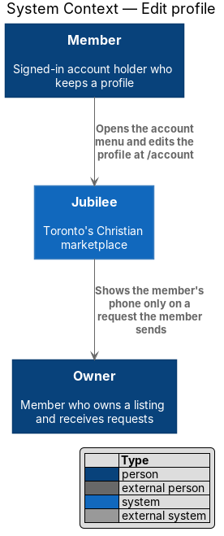
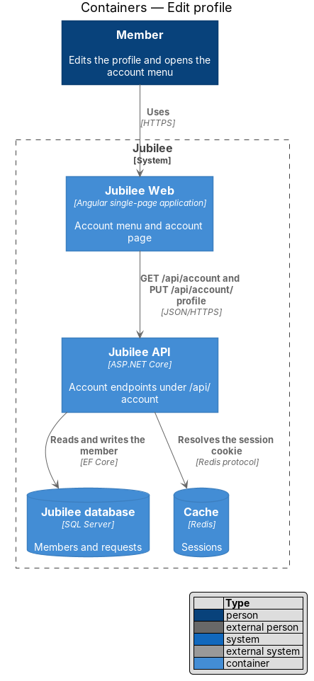
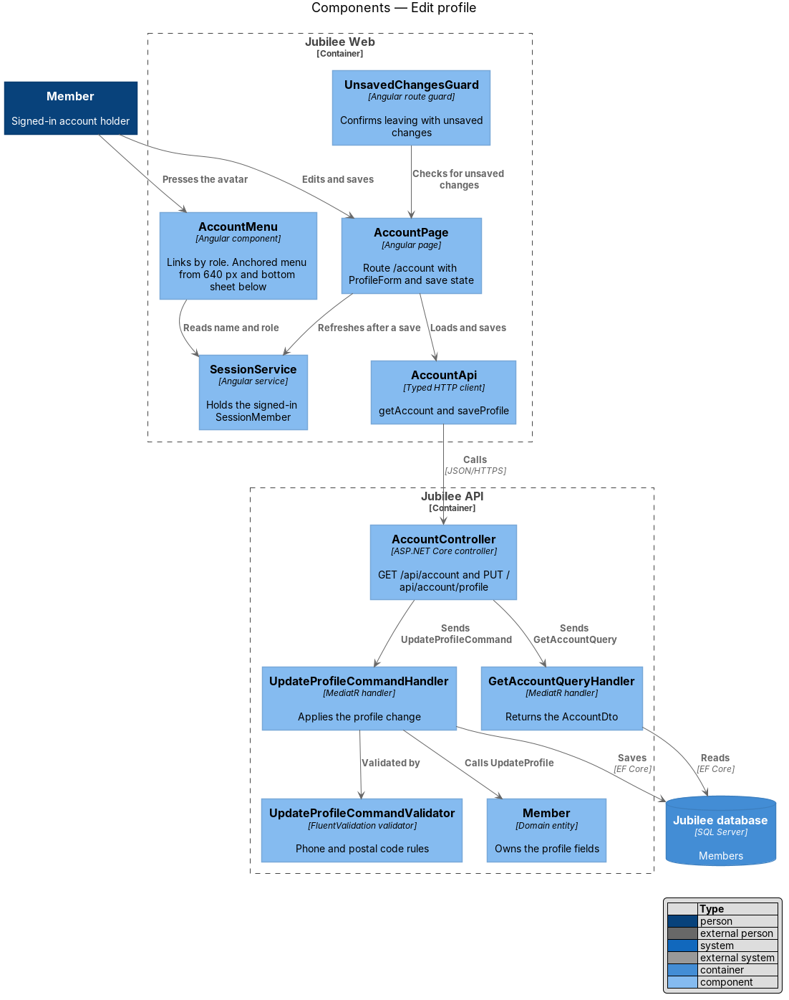
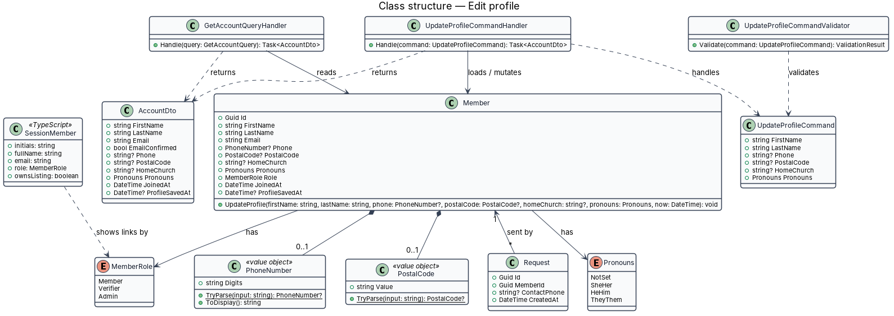
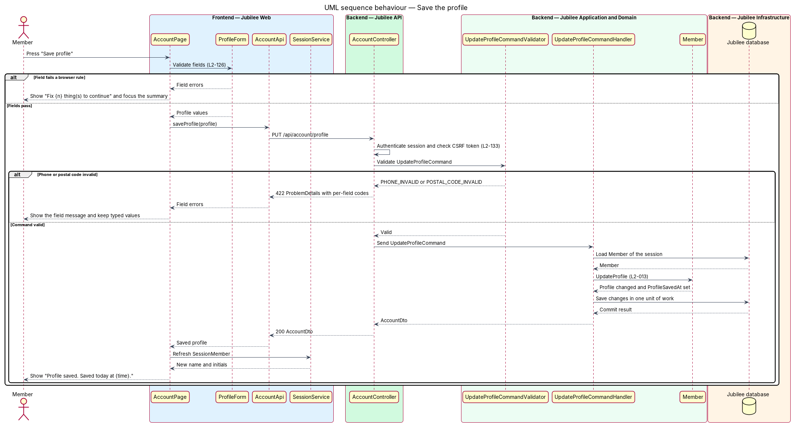
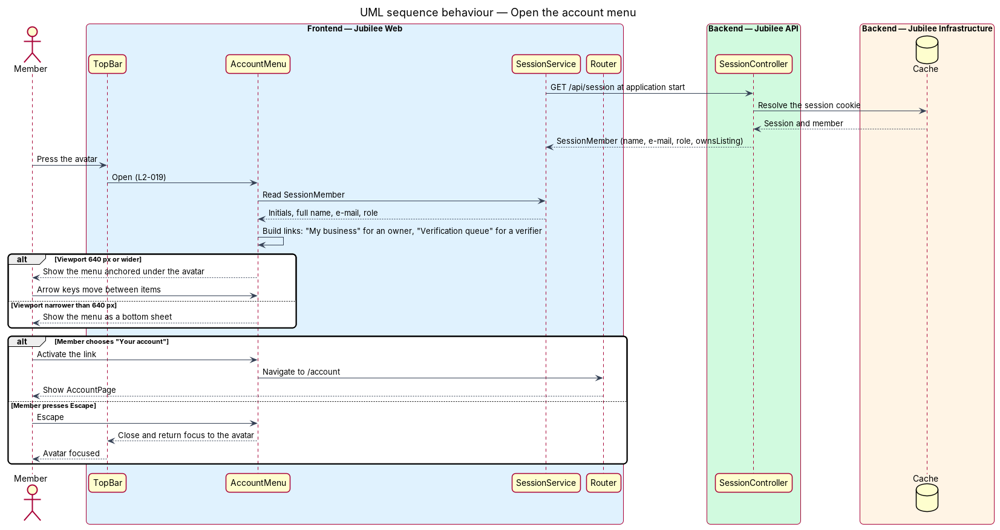

# Edit profile

## Overview

Jubilee is Toronto's Christian marketplace: a directory of verified
Christian-owned businesses that members message, book and order from. A *member*
is a signed-in account holder. Each member has a *profile* — first name, last
name, phone, postal code, home church and optional pronouns kept on the account.
This feature covers two things a member does with that profile: opening the
*account menu* from the top bar, and editing the profile at `/account`.

The account menu is the list of personal links behind the avatar in the top bar.
It shows the member's initials, full name and e-mail, and links to the account
page, requests, saved list, notifications, the business workspace, help and sign
out. The links vary with the member's role: an owner sees "My business" in place
of "List your business", and a verification team member also sees "Verification
queue".

The account page shows the profile fields with their current values and saves
them as one form. A saved phone number is shared with a business only when the
member sends a request, and each request keeps the phone it was sent with.
Pronouns word the copy that other people read about the member, such as church
reference requests and verification messages; they have no other use.

The e-mail address, password, notification settings, data download and account
deletion that also appear on the account page belong to the features
`change-credentials`, `choose-notification-settings`, `download-data` and
`delete-account`.

## Description

The feature is a vertical slice from the account page in `Jubilee Web` to the
`Jubilee database`. Nothing is built yet; the names below are the names the
design introduces.

- **`AccountMenu`** — Angular component opened by the avatar in the top bar. It
  renders initials, full name and e-mail from `SessionService` and the links
  "Your account", "Your requests", "Saved", "Notifications", "List your
  business" (or "My business" for an owner), "Help" and "Sign out". It adds
  "Verification queue" when `MemberRole` is `Verifier` or `Admin`. At a viewport
  of `640 px` or wider it is anchored under the avatar, arrow keys move between
  items, and Escape closes it and returns focus to the avatar. Below `640 px` it
  renders as a bottom sheet.
- **`SessionService`** — Angular service that holds the signed-in member as a
  `SessionMember` signal (name, e-mail, role, whether the member owns a
  listing). It loads the value from `GET /api/session` and refreshes it after a
  profile save, so the menu and the page header show the new name.
- **`AccountPage`** — Angular page at `/account`, behind `AuthGuard`. It shows
  the member's name and "member since {Month YYYY}", the profile form, "Last
  saved {date}", and the actions "Discard changes" and "Save profile". After a
  save it shows "Profile saved. Saved today at {time}."
- **`ProfileForm`** — reactive form inside `AccountPage` with the fields first
  name, last name, phone, postal code, home church and pronouns. Optional fields
  carry "(optional)". The phone hint reads "Shared with a business only when you
  send a request." The form applies the same rules as the server and renders
  failures through `ErrorSummary` and per-field messages (L2-126).
- **`UnsavedChangesGuard`** — Angular `CanDeactivate` guard on `/account`. When
  `ProfileForm` is dirty it asks the member to confirm leaving; a `beforeunload`
  handler covers a browser tab close. "Discard changes" resets the form to the
  last saved values and clears the dirty state.
- **`AccountApi`** — typed Angular HTTP client. `getAccount()` calls
  `GET /api/account`; `saveProfile(profile)` calls `PUT /api/account/profile`.
- **`AccountController`** — ASP.NET Core controller in `Jubilee.Api`. Both
  endpoints act on the member of the current session only; no route takes a
  member identifier, so one member cannot address another member's profile
  (L2-133). A load failure returns `ProblemDetails` with the error reference
  `JB-ACC-503` (L2-118).
- **`GetAccountQuery`** and **`GetAccountQueryHandler`** — return an
  `AccountDto` with the profile, the e-mail and its confirmation state, the
  join date and `ProfileSavedAt`.
- **`UpdateProfileCommand`** and **`UpdateProfileCommandHandler`** — carry the
  six editable fields. The handler loads the `Member`, calls
  `Member.UpdateProfile(...)` and saves in one unit of work. The command has no
  `Role`, `Email` or `Status` property; a body that carries any other field is
  rejected with HTTP `400` and nothing changes.
- **`UpdateProfileCommandValidator`** — FluentValidation validator. A failure
  returns HTTP `422` with one code per field: `PHONE_INVALID` maps to "Enter a
  10-digit phone number, like 416-555-0142." and `POSTAL_CODE_INVALID` maps to
  "Enter a full postal code, like M4C 1A1."
- **`PhoneNumber`** — value object that accepts a 10-digit North American
  number, ignores punctuation and spaces, and stores the ten digits.
- **`PostalCode`** — value object that accepts a full Canadian postal code in
  the pattern letter-digit-letter digit-letter-digit with an optional space, and
  stores it upper-case with the space.
- **`Pronouns`** — enumeration `NotSet`, `SheHer`, `HeHim`, `TheyThem`. Only the
  e-mail and message templates that describe the member to another person read
  it.
- **`Request.ContactPhone`** — copy of the member's phone taken when a request
  is created. The profile save does not touch existing `Request` rows, so a
  request already sent keeps the phone it was sent with, and a request sent
  after the save carries the new phone.

The maximum length of the name and home church fields is `<TO SUPPLY>`.

## Requirements

The feature realizes the following level-2 (L2) requirements. Each L2
requirement refines a level-1 (L1) requirement, cited by identifier.

| L2 ID | Refines (L1) | Requirement |
|-------|--------------|-------------|
| `L2-013` | `L1-002` | The system shall let a member edit first name, last name, phone, postal code and home church at `/account`. |
| `L2-019` | `L1-002` | The avatar in the top bar shall open the account menu. |
| `L2-126` | `L1-018` | A page form submitted with errors shall show a summary that links to each invalid field, shall keep the typed values, and the server shall enforce each rule the browser enforces with the same message code. |
| `L2-133` | `L1-019` | The server shall check the caller's role and ownership of the specific object on each API endpoint, and shall reject an update that carries a field the caller is not allowed to set. |
| `L2-118` | `L1-016` | Each load-error state shall show a reference that the user can quote to support. |

## Diagrams

### System context

A member opens the account menu and edits the profile in Jubilee. The slice
calls no external system; an owner later receives the saved phone only on a
request.

### Containers

`Jubilee Web` renders the menu and the account page and calls `Jubilee API`,
which reads the session from the `Cache` and reads and writes the member in the
`Jubilee database`.

### Components

In `Jubilee Web`, `AccountMenu` and `AccountPage` read `SessionService`, and
`ProfileForm` saves through `AccountApi`. In `Jubilee API`, `AccountController`
dispatches `GetAccountQuery` and `UpdateProfileCommand`; the validator and the
`Member` entity own the field rules.

### Class structure

`UpdateProfileCommandHandler` handles `UpdateProfileCommand` and mutates
`Member`, which holds a `PhoneNumber`, a `PostalCode` and a `Pronouns` value.
`Request` keeps its own `ContactPhone`, separate from the member's current phone.

### Behaviour — save the profile

`ProfileForm` validates in the browser, and the server repeats the same rules.
An invalid phone or postal code returns HTTP `422` and the page keeps the typed
values; a valid save updates `Member` and the page shows "Profile saved. Saved
today at {time}."

### Behaviour — open the account menu

`AccountMenu` builds its links from the `SessionMember` that `SessionService`
holds, chooses the anchored menu or the bottom sheet from the viewport width,
and returns focus to the avatar when it closes.

