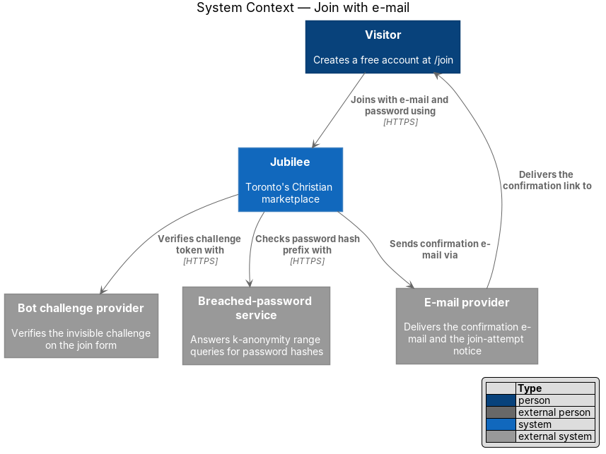
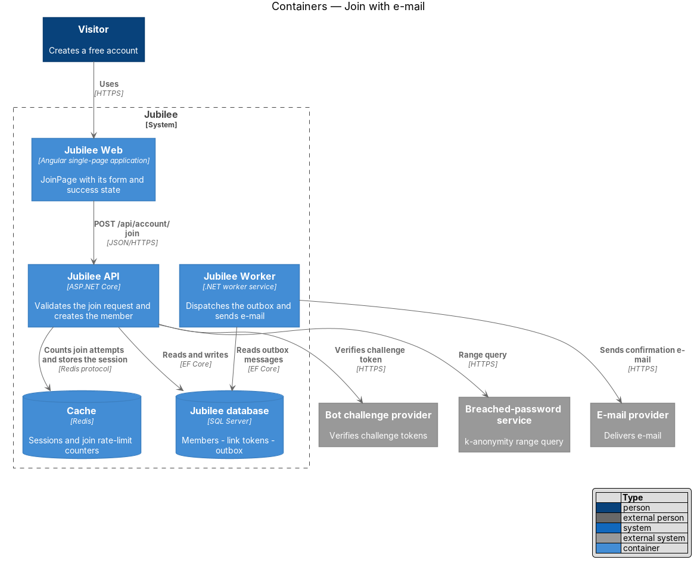
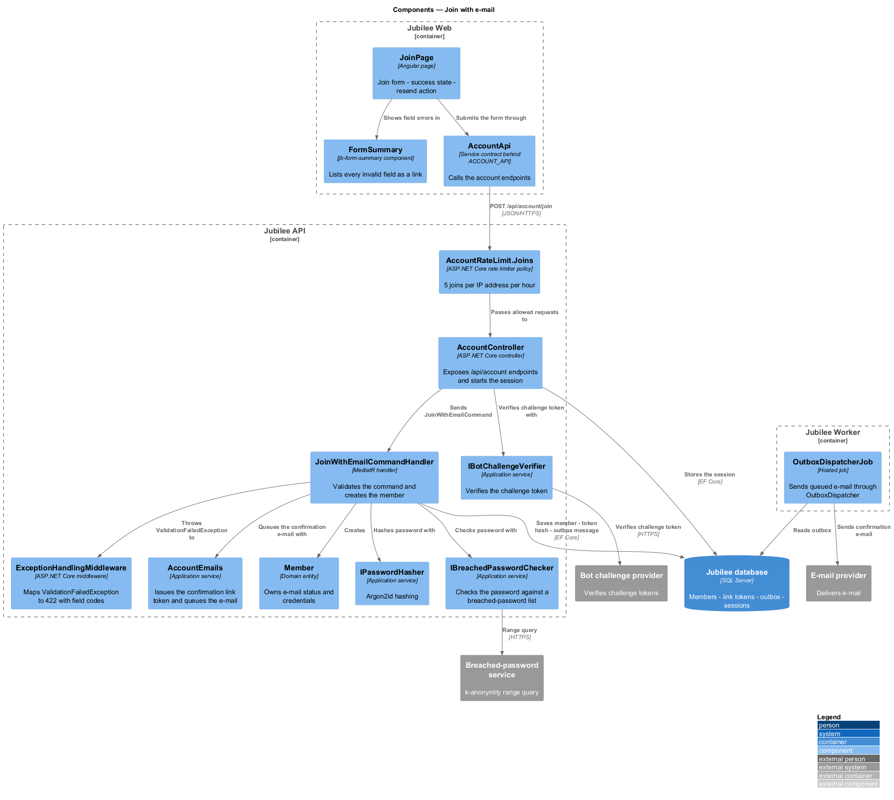
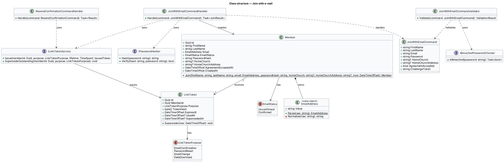
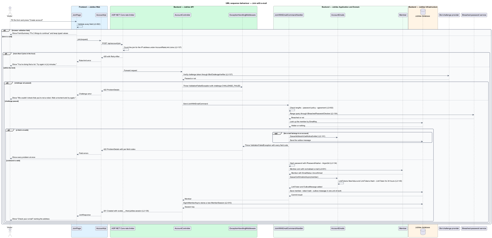
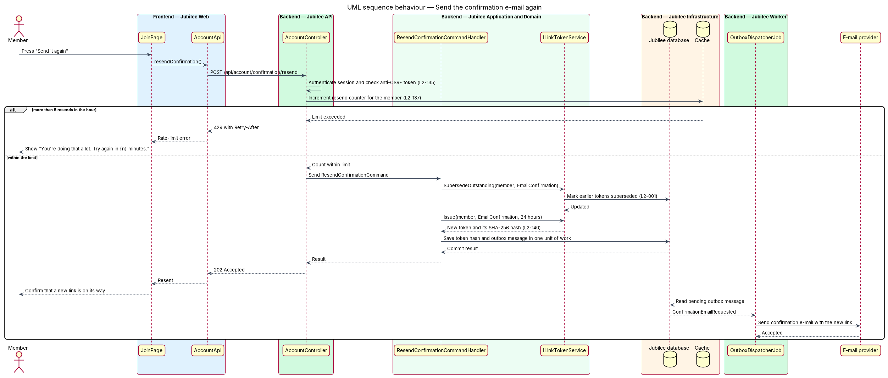

# Join with e-mail

## Overview

Jubilee is Toronto's Christian marketplace. A *visitor* is a person who is not
signed in; a *member* is a signed-in account holder. This feature covers the
first step from one to the other: a visitor creates a free account at `/join`,
the Sign up screen, with a first name, a last name, an e-mail address, a
password, an optional home church and its optional address, and agreement to the
statement of faith and
the terms.

The account starts *unconfirmed* — e-mail status of an account whose address
has not yet been proven by opening an e-mailed link. Joining sends a
*confirmation e-mail* carrying a single-use link that works for 24 hours. The
page then shows "Check your e-mail", names the address, and offers "Send it
again". Opening the link is the subject of the confirm e-mail feature
(`L2-004`); continuing with Google from the same page is the subject of the
continue with Google feature (`L2-003`).

The Sign up screen shares one frame with the Log in screen (`/sign-in`), drawn
from the Magic Patterns design (`L2-187`, ADR 0038). Under 1024 px the
*lockup* — mark and wordmark of Jubilee drawn as one unit — is centred above a
card that holds the form. From 1024 px a dark brand panel on the left holds the
lockup and the form is on the right with no card. When Google sign-in is
configured, "Sign up with Google" comes first, above the form. The "Password"
control offers to show the password being typed.

The join form validates on submit, in the browser and again on the server, and
reports every problem at once. The server treats the browser as untrusted: a
request that bypasses browser validation receives `422` with per-field error
codes and creates nothing. The join endpoint is public, so the slice also
carries the abuse controls for it: a rate limit of 5 joins per IP address per
hour, an invisible bot challenge, and a breached-password check.

## Description

The feature is a vertical slice from the `/join` page to the `Jubilee database`,
with the confirmation e-mail sent by `Jubilee Worker`.

- **`JoinPage`** — Angular page at `/join`, the Sign up screen. It composes
  `jb-auth-layout` with `split` and passes the `heading` "Join Jubilee" and the
  `lead` "Free for everyone in Toronto’s Christian community." The form has
  "First name", "Last name", "Email" (placeholder "you@example.com"),
  "Password" (hint "At least 10 characters.") and "Home church" marked
  "(optional)", with the placeholder "e.g. The Meeting House" and the hint
  "Shown to no one. Helps us recommend businesses near you." "Home church
  address", also marked "(optional)", follows it with the placeholder "e.g.
  2700 Bristol Circle, Oakville" and the hint "Shown to no one."; input stops
  at 200 characters and either field may be filled without the other
  (`L2-196`). Only the optional
  fields are marked; the 4 required controls carry `required` and no marker
  (ADR 0038). From 640 px "First name" and "Last name" sit side by side, and
  from 1024 px "Email" and "Password" do as well; below those widths each pair
  is stacked (`L2-001`). The agreement checkbox reads "I am 18 or older and
  agree to Jubilee’s statement of faith and terms." and links "statement of
  faith" to `/statement-of-faith` and "terms" to `/terms`; both open in a new
  tab so that typed values are kept. The button is "Create account". Under the
  form "Already on Jubilee?" offers "Log in" linking to `/sign-in`. When
  Google sign-in is configured, the button "Sign up with Google", carrying
  `jb-google-mark`, comes first, above the form, and the `jb-divider-text` "or
  use email" separates it from the form; when it is not configured, neither
  the button nor the divider is shown (`L2-003`). The page builds the form
  from `jb-field`, `jb-input`, `jb-password-input`, `jb-checkbox`, `jb-button`,
  `jb-alert` and `jb-form-summary` of the `components` library, and the link
  under the form is a `jb-auth-link`. The inputs limit length to 50 characters
  for each name, 254 for the e-mail and 128 for the password. After a
  successful join the page shows "Check your e-mail" with "Send it again". A
  `GuestGuard` on the route redirects a signed-in member to `/`.
- **`jb-auth-layout`** — frame component of the `components` library, used
  with `split` by the Sign up and Log in screens (`L2-187`). It takes the
  `heading` and the `lead` of the page as inputs and projects the form. Under
  1024 px it shows `jb-lockup` centred above a card that holds the form, and
  the link to the other screen is under the card. From 1024 px it shows a dark
  brand panel on the left with `jb-lockup`, "Hire, shop and book with your
  church family.", "Christian-owned businesses across Toronto, all in one
  place." and "© Jubilee · Toronto", and the form on the right with no card.
  The lockup links to `/welcome`.
- **`jb-password-input`** — component of the `components` library. It wraps
  the password control and adds a button inside it named "Show password".
  Pressed, the button shows the password as typed and is named "Hide
  password"; pressed again, it hides the password and is named "Show password"
  (`L2-187`). The typed value is kept, focus stays on the button, and the form
  is not submitted. The button follows the password in the tab order and works
  with Enter and with Space. It changes only the `type` of the control in the
  browser; nothing is sent to `Jubilee API`.
- **`ErrorSummary`** (`jb-form-summary`) — shared Angular component. On an
  invalid submit it shows a summary titled "Fix {n} things to continue" above
  the form, lists each problem as a link to its field, and receives focus.
  Every typed value except the password is kept.
- **`AccountApi`** — typed Angular HTTP client. `join()` sends
  `POST /api/account/join` with the form values and the bot challenge token;
  `resendConfirmation()` sends `POST /api/account/confirmation/resend`.
- **`RateLimitMiddleware`** — ASP.NET Core middleware in `Jubilee.Api`. It
  counts joins per IP address in the `Cache` and answers `429` with
  `Retry-After` above 5 per hour, and counts confirmation resends per member
  above 5 per hour. The page then shows "You're doing that a lot. Try again in
  {n} minutes."
- **`AccountController`** — ASP.NET Core controller exposing `/api/account`. For
  a join it verifies the challenge token with the `Bot challenge provider`
  through `IBotChallengeVerifier`, sends `JoinWithEmailCommand` through MediatR,
  and sets the session cookie on success.
- **`JoinWithEmailCommand`** — request object carrying `FirstName`, `LastName`,
  `Email`, `Password`, `HomeChurch`, `HomeChurchAddress`, `AgreementAccepted`
  and `ChallengeToken`. The join request carries `homeChurchAddress` (string or
  null) beside `homeChurch`; a home church over 100 characters or an address
  over 200 is refused with the code `TOO_LONG` for that field. Both values are
  stored on `Member` (`HomeChurch`, `HomeChurchAddress`), are shown to no one
  and are used only for recommendations (`L2-145`).
- **`JoinWithEmailCommandValidator`** — FluentValidation validator. It applies
  the field lengths, the password length of 10 to 128 characters with no
  composition rules, the agreement, the uniqueness of the normalised e-mail, and
  the breached-password check through `IBreachedPasswordChecker`. It returns all
  failures together; `ProblemDetailsMiddleware` maps them to `422` with the
  field codes `REQUIRED`, `TOO_LONG`, `EMAIL_INVALID`, `EMAIL_TAKEN`,
  `PASSWORD_TOO_SHORT`, `PASSWORD_BREACHED` and `AGREEMENT_REQUIRED`.
- **`JoinWithEmailCommandHandler`** — MediatR handler. It hashes the password
  with `IPasswordHasher`, creates the `Member`, issues the confirmation
  `LinkToken`, and saves the member, the token hash and a
  `ConfirmationEmailRequested` outbox message in one unit of work. It then
  stores a new `Session` so that the unconfirmed member can resend the link.
- **`Member`** — domain entity. `Member.Join(...)` sets `EmailStatus` to
  `Unconfirmed` and records `AgreementAcceptedAt`.
- **`EmailAddress`** — value object. `Parse` trims the input and lower-cases the
  domain, so the stored address is normalised.
- **`IPasswordHasher`** — application service implemented by
  `Argon2idPasswordHasher`: Argon2id with at least 19 MiB of memory, at least 2
  iterations and a unique salt. The plain password is never stored and never
  written to logs.
- **`ILinkTokenService`** and **`LinkToken`** — the service creates a token with
  at least 128 bits of randomness, stores only its SHA-256 hash with the purpose
  `EmailConfirmation` and an expiry of 24 hours, and returns the raw value once
  for the e-mail. `SupersedeOutstanding` makes earlier links for the same member
  and purpose stop working.
- **`ResendConfirmationCommandHandler`** — handles "Send it again". It
  supersedes the outstanding confirmation tokens, issues a new one and queues a
  new e-mail.
- **`OutboxDispatcherJob`** — hosted job in `Jubilee.Worker`. It reads the
  outbox message and sends the confirmation e-mail through `IEmailSender` to the
  `E-mail provider`.

When the e-mail already belongs to an account, the server returns `EMAIL_TAKEN`
only after the bot challenge passes and within the join rate limit. The field
shows "An account already uses this e-mail. Log in instead, or use another
address.", no second account is created, and the handler queues a notice to the
existing account holder that someone tried to join with the address. A join
that cannot be loaded or completed because the service is unavailable shows the
error reference `JB-AUTH-503`.

## Requirements

The feature realizes the following level-2 (L2) requirements. Each L2
requirement refines a level-1 (L1) requirement, cited by identifier.

| L2 ID | Refines (L1) | Requirement |
|-------|--------------|-------------|
| `L2-001` | `L1-001` | The system shall let a visitor create an account at `/join`, the Sign up screen, with first name, last name, e-mail, password, an optional home church and its optional address, and agreement to the statement of faith and terms, with a Google option offered first on the same page. On success the account shall be created unconfirmed and a confirmation e-mail shall be sent. |
| `L2-196` | `L1-002` | A visitor may give a home church by name, by address, by both or by neither when joining. "Home church address" shall be one optional free-text field of at most 200 characters with the hint "Shown to no one."; a longer value sent to the API shall be refused with the code `TOO_LONG`. |
| `L2-002` | `L1-001` | The join form shall validate on submit, in the browser and again on the server, and shall report every problem at once. |
| `L2-134` | `L1-019` | A stored password shall be hashed with Argon2id (memory at least 19 MiB, iterations at least 2) with a unique salt and shall never reach logs. A password shall be 10 to 128 characters with no composition rules and shall be checked against a breached-password list. |
| `L2-137` | `L1-019` | The server shall respond `429` with `Retry-After` above 5 joins per IP per hour and above 5 e-mail confirmation resends per hour, and the join form shall be protected by a privacy-respecting bot challenge. |
| `L2-140` | `L1-019` | An e-mail confirmation token shall have at least 128 bits of randomness, shall be stored only as a SHA-256 hash, shall have a single purpose, and shall expire after 24 hours. |
| `L2-141` | `L1-019` | For a join with an e-mail that already has an account, the inline message of `L2-002` shall be shown only after the bot challenge passes and within the join rate limit, and an e-mail shall be sent to the existing account holder. |
| `L2-187` | `L1-001` | The Sign up screen (`/join`) and the Log in screen (`/sign-in`) shall share one frame: a brand panel beside the form from 1024 px, and a card under the lockup below that width. Both screens shall offer to show the password being typed. |

## Diagrams

### System context

The visitor joins through Jubilee. Jubilee verifies the bot challenge, checks
the password against the breached-password service, and sends the confirmation
link through the e-mail provider.

### Containers

`Jubilee Web` posts the join request to `Jubilee API`, which writes the member,
the token hash and the outbox message to the `Jubilee database` and keeps the
rate-limit counter and the session in the `Cache`. `Jubilee Worker` sends the
e-mail.

### Components

`JoinPage` submits through `AccountApi`. Inside `Jubilee API` the request passes
`RateLimitMiddleware`, then `AccountController` validates the command and sends
it to `JoinWithEmailCommandHandler`, which creates the `Member` and the
confirmation token. Of the `jb-*` components that `JoinPage` composes, only
`ErrorSummary` is drawn; the others are presentation.

### Class structure

`Member` owns an `EmailAddress` and an `EmailStatus` and receives `LinkToken`
records. The handlers depend on `IPasswordHasher` and `ILinkTokenService`; the
validator depends on `IBreachedPasswordChecker`.

### Behaviour — join with e-mail

The page validates first and shows every problem at once. The server counts the
attempt, verifies the bot challenge, validates again (`L2-002`), hashes the
password (`L2-134`), and commits the member, the token hash (`L2-140`) and the
outbox message in one unit of work. Showing or hiding the password changes
only the control in the browser and adds no message to the sequence
(`L2-187`).

### Behaviour — send the confirmation e-mail again

"Send it again" supersedes the earlier link, issues a new one valid for 24
hours, and is limited to 5 resends per hour (`L2-137`). `OutboxDispatcherJob`
sends the new e-mail after the commit.

