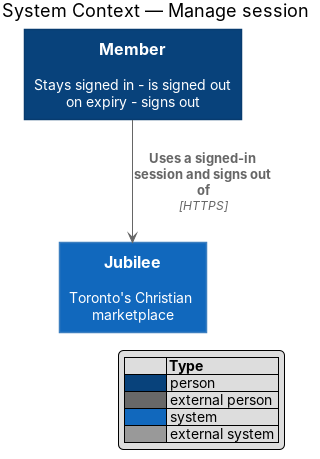
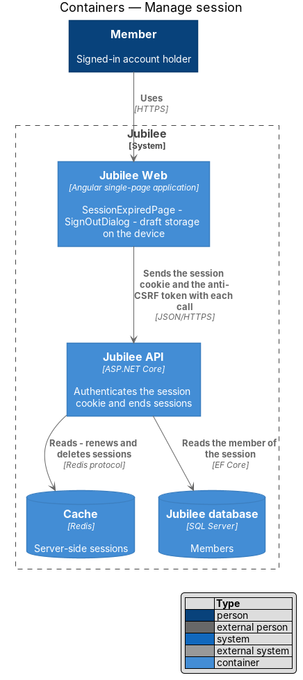
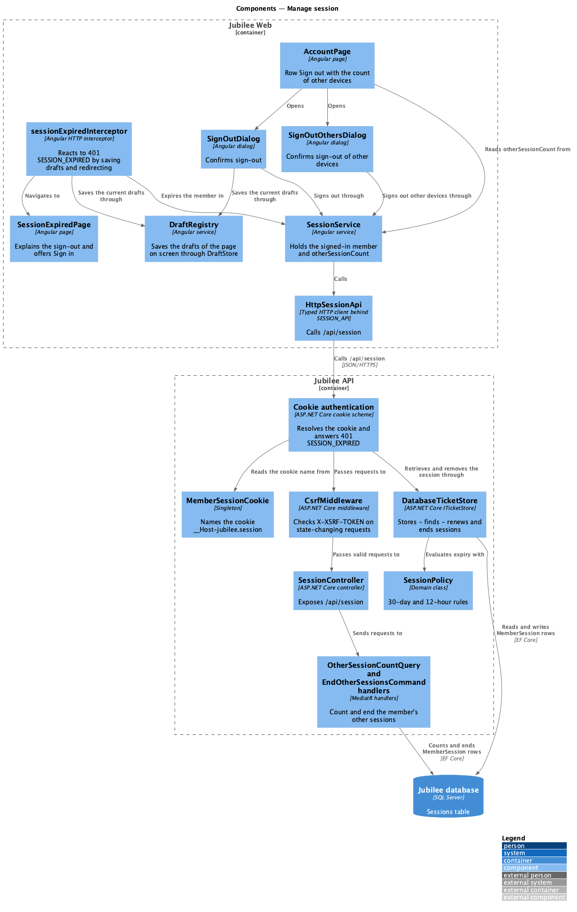
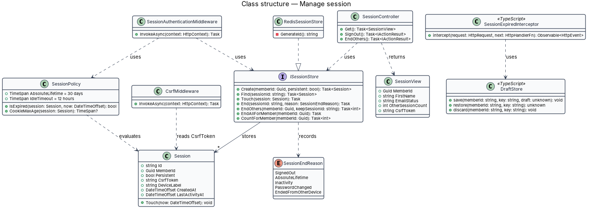
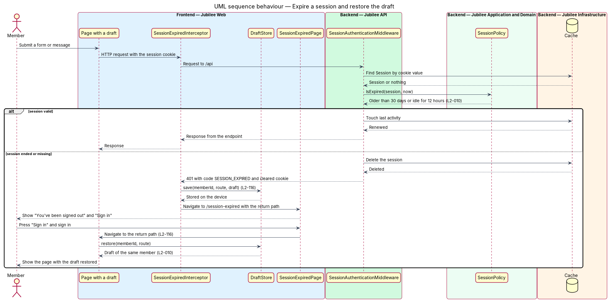
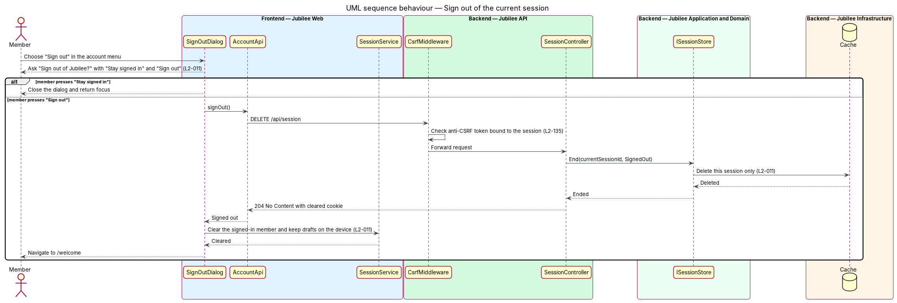
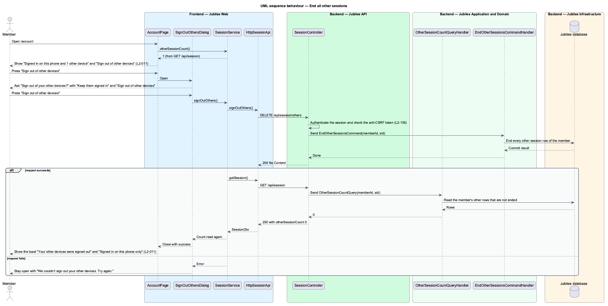

# Manage session

## Overview

Jubilee is Toronto's Christian marketplace. A *session* is the server-side
record that keeps a member signed in between requests. The browser holds only
an opaque random key in a cookie; `Jubilee API` resolves that key to a row of
the `Sessions` table in the `Jubilee database` on every request (ADR 0013).
This feature covers the life of a session after sign-in: how long it lasts,
what the member sees when it ends, and how the member ends it.

A session has two limits. The *absolute lifetime* — longest age a session may
reach, counted from sign-in — is 30 days. The *idle timeout* — longest gap
between two requests — is 12 hours and applies to a session started without
"Keep me logged in"; such a session also ends when the browser closes. A session
ends early when the member signs out or when the account's password changes.

When a session ends while the member is working, the member is sent to
`/session-expired`, and any unsent message or form *draft* — text typed but not
yet submitted — is kept on the device and restored after the next sign-in as
the same member. Signing out ends only the current session; the account page
lets the member end all other sessions.

## Description

The feature spans `Jubilee Web`, the cookie authentication of `Jubilee API`
and the `Jubilee database`. No cache takes part: sessions are rows of the
`Sessions` table (ADR 0013).

- **`MemberSession`** — domain entity and row of the `Sessions` table, with
  `Id`, `KeyHash`, `Kind`, `MemberId`, `Ticket`, `Persistent`, `CreatedAt`,
  `LastActivityAt` and `EndedAt`. `KeyHash` is the SHA-256 of the key in the
  cookie, so a copy of the table cannot be used to impersonate a member.
  `Ticket` is the serialised authentication ticket. `Persistent` is true when
  "Keep me logged in" was ticked. `Touch` records activity and `End` sets
  `EndedAt` once.
- **`DatabaseTicketStore`** — ASP.NET Core `ITicketStore` behind the cookie
  scheme. `StoreAsync` issues a new random 256-bit key and a new `Id` at every
  sign-in, adds the `Id` to the ticket as the claim `sid`, and adds the row.
  `RetrieveAsync` finds the row by the hash of the key, ends it and returns
  nothing when `SessionPolicy.IsExpired` is true, and otherwise writes
  `LastActivityAt` at most once a minute. `RemoveAsync` ends the row.
- **`SessionPolicy`** — static domain class with `AbsoluteLifetime` of 30 days
  and `IdleTimeout` of 12 hours. `IsExpired` is true for an ended session, for
  any session older than 30 days and for a non-persistent session idle for
  more than 12 hours.
- **`MemberSessionCookie`** — singleton of `Jubilee API` that decides the
  name of the member cookie (ADR 0046). The cookie is `__Host-jubilee.session`
  with `Secure` always, `HttpOnly`, `SameSite=Lax` and `Path=/`. Only the
  Development environment, which is served over plain HTTP, issues it as
  `jubilee.session` without the prefix; the setting `Session:HostPrefix`
  overrides the default either way. A session started without "Keep me logged
  in" has a cookie without an expiry, which ends with the browser; a
  persistent one expires 30 days after sign-in. No session token is written to
  `localStorage`.
- **Cookie authentication** — configured in `Program.cs`; no session
  middleware of Jubilee's own exists. A protected request whose cookie finds
  no session is answered `401` with code `SESSION_EXPIRED`, and the cookie is
  removed. A request that carried no cookie is answered `401` with code
  `sign_in_required`. Both answers are `ProblemDetails`, never a redirect.
- **`CsrfToken`** and **`CsrfMiddleware`** — the anti-CSRF token is a random
  value in the cookie `XSRF-TOKEN`, issued by `GET /api/session` to any caller
  and again at sign-in. The app copies it into the header `X-XSRF-TOKEN`.
  `CsrfMiddleware` rejects with `403` and code `csrf_token_invalid` each
  `POST`, `PUT`, `PATCH` and `DELETE` that carries a session cookie and no
  matching header. The token is a double-submit token and is not stored in the
  session row (ADR 0013).
- **No CORS middleware** — `Jubilee API` has no cross-origin caller and no
  allowlist (ADR 0046). No answer carries an `Access-Control-Allow-*` header,
  so a browser denies each cross-origin read and each preflighted request.
- **`SessionController`** — ASP.NET Core controller. `GET /api/session` returns
  the `SessionDto` (member summary, e-mail status and `otherSessionCount`).
  `DELETE /api/session` signs out of the cookie scheme, which ends the current
  row. `DELETE /api/session/others` sends `EndOtherSessionsCommand`. Each
  `DELETE` answers `204`.
- **`OtherSessionCountQuery`** and **`EndOtherSessionsCommand`** — MediatR
  requests that take the member and the `sid` of the current session. The
  query counts the member's other rows that are neither ended nor expired. The
  command ends each other row of the member that is not ended.
- **`SessionService`** — Angular service holding the signed-in member as a
  signal. It loads `GET /api/session` at start-up through `SESSION_API`
  (`HttpSessionApi`). `otherSessionCount` is a signal read from the answer.
  `signOut()` clears the member. `signOutOthers()` calls
  `DELETE /api/session/others` and then reads `GET /api/session` again, so the
  count is never assumed. `expire()` clears the member when the server ended
  the session.
- **`sessionExpiredInterceptor`** — Angular HTTP interceptor. On `401` with
  `SESSION_EXPIRED`, while `SessionService.member()` is still set, it calls
  `DraftRegistry.saveAll()`, then `SessionService.expire()`, then navigates to
  `/session-expired` with `Router.url` as `returnUrl`. The handle session
  expiry feature describes the drafts (`L2-116`).
- **`SessionExpiredPage`** — Angular page at `/session-expired` showing "You've
  been signed out. For your safety we sign you out after 30 days, or when your
  password changes." and "Sign in", which links to `/sign-in` with the
  sanitised `returnUrl`. After sign-in the member returns to the same page
  with the draft restored.
- **`DraftRegistry`** and **`DraftStore`** — Angular services. `DraftRegistry`
  holds the draft sources of the page on screen; `saveAll()` writes their
  snapshots into `DraftStore`, which keeps them in `localStorage` keyed by
  member, address and form. `DraftStore.take` returns a draft only to the
  member who typed it, and `keepOnly` removes every other member's drafts when
  a member is signed in, so a different member does not see a draft.
- **`SignOutDialog`** — Angular dialog opened from "Sign out" in the account
  menu or on the account page. It asks "Sign out of Jubilee?" with "Stay signed
  in" and "Sign out". On confirmation it calls `DraftRegistry.saveAll()`, so an
  unsent draft is kept on the device (`L2-011`), then `SessionService.signOut()`.
  It shows a busy state during the request and navigates to `/welcome` on
  completion.
- **`AccountPage` row "Sign out"** — row of the section "Sign-in and
  security". Its text is "Signed in on this phone only" when
  `otherSessionCount` is zero, "Signed in on this phone and 1 other device"
  when it is 1, and "Signed in on this phone and {n} other devices" above
  that. The row has the button "Sign out", which opens `SignOutDialog`, and,
  only when the count is above zero, the button "Sign out of other devices".
- **`SignOutOthersDialog`** — Angular dialog that asks "Sign out of your other
  devices?" with "Keep them signed in" and "Sign out of other devices". On
  confirmation it calls `SessionService.signOutOthers()`. On success it closes
  and `AccountPage` shows the toast "Your other devices were signed out". On
  failure it stays open with "We couldn’t sign out your other devices. Try
  again."

A password change ends each other session of the member, and a password reset
ends all of them (`ChangePasswordCommandHandler`, `ResetPasswordCommandHandler`,
`L2-134`); the ended sessions then follow the expiry path described here.

## Requirements

The feature realizes the following level-2 (L2) requirements. Each L2
requirement refines a level-1 (L1) requirement, cited by identifier.

| L2 ID | Refines (L1) | Requirement |
|-------|--------------|-------------|
| `L2-010` | `L1-001` | Sessions shall be server-side, shall last up to 30 days when "Keep me logged in" is ticked, and shall end when the password changes. |
| `L2-011` | `L1-001` | A member shall be able to sign out from the account menu or the account page after confirming. An unsent message draft shall be kept on the device at sign-out. The member shall be able to end all other sessions from the account page section "Sign out". |
| `L2-116` | `L1-016` | When an API call returns `401` because the session ended, the app shall save any draft in the current form, navigate to `/session-expired` and, after sign-in, return to the same page with the draft restored. A draft shall be kept on the device and never on the server. |
| `L2-135` | `L1-019` | A session shall be an opaque random identifier of at least 128 bits in the cookie `__Host-jubilee.session`, with `Secure`, `HttpOnly`, `SameSite=Lax`, `Path=/` and the `__Host-` prefix; only the Development environment shall issue it as `jubilee.session` without the prefix. No session token shall be stored in `localStorage`. A state-changing request that carries a session cookie shall carry, in the `X-XSRF-TOKEN` header, the anti-CSRF token of the `XSRF-TOKEN` cookie or be rejected with `403`. The cross-origin allowlist shall be empty: an answer to a request from any other origin shall carry no `Access-Control-Allow-Origin` and no `Access-Control-Allow-Credentials` header. |

## Diagrams

### System context

The member is the only party: sessions are created, checked and ended inside
Jubilee.

### Containers

`Jubilee Web` sends the session cookie and the anti-CSRF token with each call
and keeps drafts in the browser. `Jubilee API` reads, renews and ends sessions
in the `Jubilee database`.

### Components

In the API, the cookie authentication resolves and expires sessions through
`DatabaseTicketStore` and `SessionPolicy`, and `CsrfMiddleware` guards
state-changing requests before `SessionController`. In the web application,
`sessionExpiredInterceptor`, `DraftRegistry`, `SessionExpiredPage`,
`SignOutDialog` and `SignOutOthersDialog` handle the ways a session ends.

### Class structure

`DatabaseTicketStore` stores `MemberSession` rows and evaluates them with
`SessionPolicy`. `SessionController` returns `SessionDto` and sends
`OtherSessionCountQuery` and `EndOtherSessionsCommand`. On the frontend,
`SessionService` depends on the `SessionApi` contract, and the two dialogs
depend on `SessionService`.

### Behaviour — expire a session and restore the draft

`DatabaseTicketStore` applies the 30-day and 12-hour rules (`L2-010`) and the
API answers `401`. The interceptor saves the drafts and shows
`/session-expired`; after sign-in the page restores the draft of the same
member (`L2-116`).

### Behaviour — sign out of the current session

The dialog confirms first and saves the drafts of the page. `DELETE
/api/session` passes the anti-CSRF check (`L2-135`) and ends only the current
session, and the member lands on `/welcome` (`L2-011`).

### Behaviour — end all other sessions

The account page shows the count of other sessions. On confirmation in
`SignOutOthersDialog` the API ends every session of the member except the
current one, and the count is read again from `GET /api/session` (`L2-011`).

