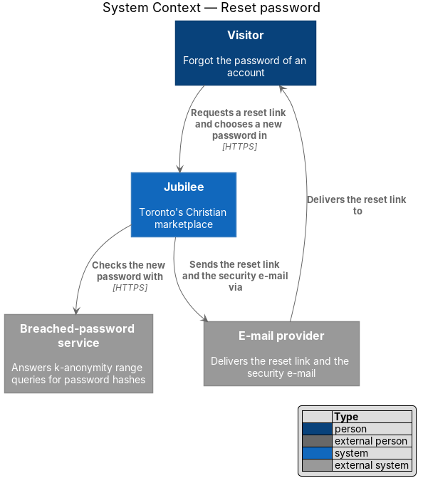
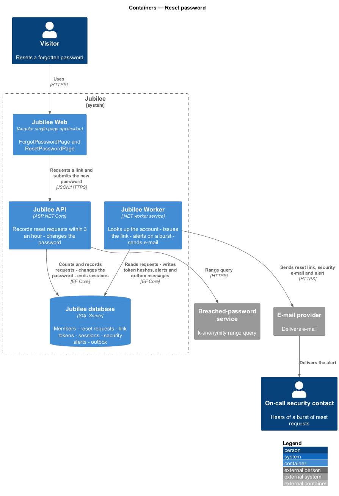
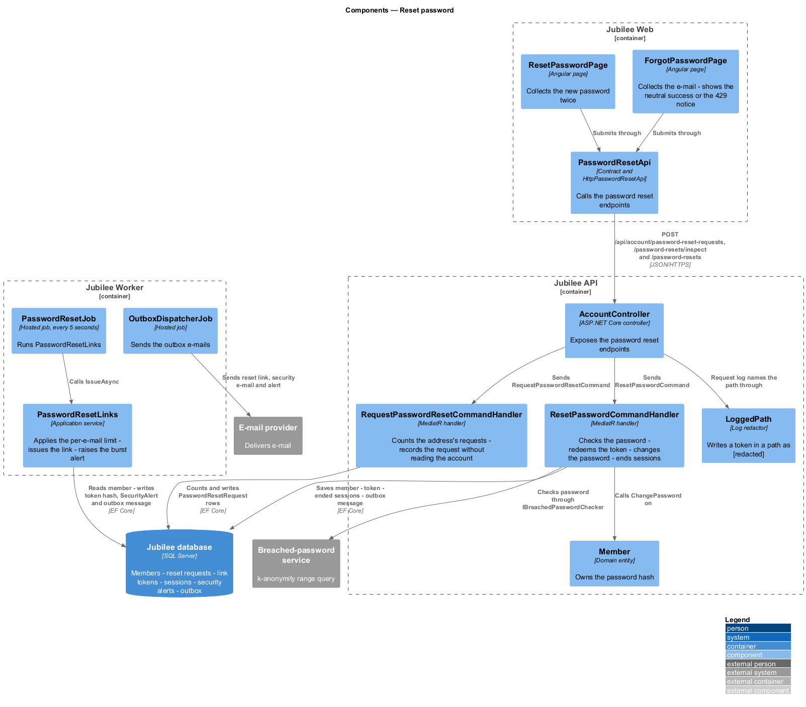
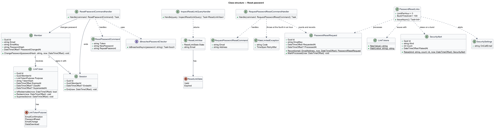
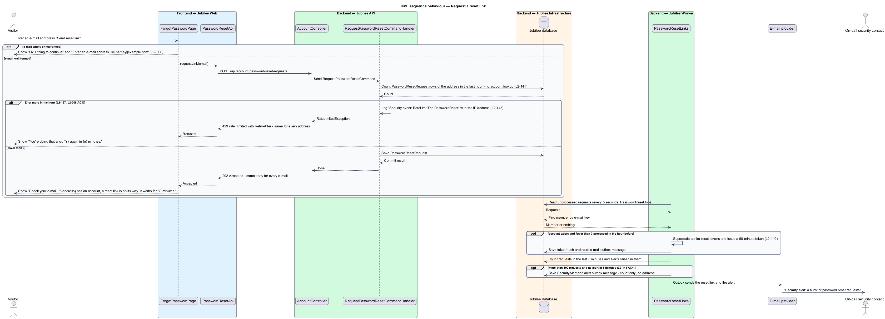
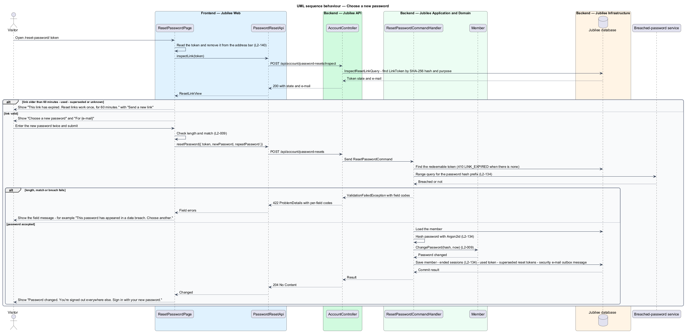

# Reset password

## Overview

Jubilee is Toronto's Christian marketplace. A person who has forgotten the
password of an account recovers access in two steps. At `/forgot-password` the
visitor enters an e-mail and asks for a *reset link* — e-mailed address of the
form `/reset-password/:token` that works once, for 60 minutes. Opening the link
shows a form for a new password.

The first step is public and takes any e-mail, so it is built to reveal
nothing. The page shows the same message whether or not an account exists, the
response has the same status and body, and the median response times for
existing and non-existing e-mails differ by less than 50 ms. The design reaches
this by doing no account lookup in the request: `Jubilee API` only counts the
requests for the address and records this one, and `Jubilee Worker` decides
afterwards whether an e-mail is sent. A fourth request for one address within
an hour is answered `429` with `Retry-After`, the same for any address.

The second step changes the credential. The new password follows the same
policy as at joining: 10 to 128 characters, no composition rules, and not
present in a known-breached password list. A successful change ends every
session of the account, invalidates outstanding reset links, and sends a
security e-mail to the account holder.

## Description

The feature is a vertical slice from the two pages to the `Jubilee database`,
with link issuing, the burst alert and e-mail in `Jubilee Worker` (ADR 0026,
ADR 0064).

- **`ForgotPasswordPage`** — Angular page at `/forgot-password`. An empty or
  malformed e-mail shows the summary "Fix 1 thing to continue" and the field
  error "Enter an e-mail address like name@example.com". After submit it shows
  "Check your e-mail. If {address} has an account, a reset link is on its way.
  It works for 60 minutes." A `429` keeps the form and shows the warning
  "You’re doing that a lot. Try again in {n} minutes.", with {n} the
  `Retry-After` rounded up to whole minutes.
- **`ResetPasswordPage`** — Angular page at `/reset-password/:token`. It reads
  the token, removes it from the address bar, and asks the API for the link
  state. A valid link shows "Choose a new password" and "For {e-mail}", with
  "New password" (hint "At least 10 characters.") and "Repeat new password". An
  expired link shows "This link has expired. Reset links work once, for 60
  minutes." with "Send a new link", which leads to `/forgot-password`.
- **`PasswordResetApi`** — the contract behind the `PASSWORD_RESET_API`
  token, implemented by `HttpPasswordResetApi`: `requestLink(email)`,
  `inspectLink(token)` and `resetPassword({ token, newPassword,
  repeatPassword })`. The token travels in the request body, never in an API URL.
- **`AccountController`** — ASP.NET Core controller with the anonymous
  `POST /api/account/password-reset-requests` (`202`, or `429` with
  `Retry-After`), `POST /api/account/password-resets/inspect` and
  `POST /api/account/password-resets`. Responses carry
  `Referrer-Policy: no-referrer` and `Cache-Control: no-store`.
- **`RequestPasswordResetCommandHandler`** — MediatR handler. It counts the
  `PasswordResetRequest` rows of the lower-cased address in the hour before.
  At 3 it logs `Security event: RateLimitTrip PasswordReset refused from
  {Address}` with the caller's IP address and throws `RateLimitedException`
  (`429`, code `rate_limited`, `Retry-After` when the oldest of the three
  leaves the hour). Otherwise it records one more row. It reads no member, so
  its answer and its work do not depend on the account (`L2-141`).
- **`PasswordResetLinks`** — application service that `PasswordResetJob` in
  `Jubilee.Worker` runs every 5 seconds; the only reader of the account for a
  request. For each unprocessed request it marks the row processed and, when
  fewer than 3 requests of the address were processed in the hour before and a
  member exists, supersedes that member's earlier unused reset tokens, issues a
  new token and queues the reset e-mail. After the pass it counts the requests
  of the last 5 minutes; above 100, and when no `SecurityAlert` of kind
  `PasswordResetBurst` was raised in those 5 minutes, it raises one, logs
  `Security alert: {Count} password reset requests in 5 minutes` and queues
  "Security alert: a burst of password reset requests", with the count and no
  address, to `SecuritySettings.OnCallEmail` (`Security:OnCallEmail`, else the
  Jubilee team's address).
- **`LinkToken`** — domain entity with the purpose `PasswordReset`: 256 bits
  of randomness (`LinkTokens.NewValue`), stored only as a SHA-256 hash, expiring
  after 60 minutes, single-use.
- **`InspectResetLinkQueryHandler`** — returns a `ResetLinkView` with
  `ResetLinkState` `Valid` and the account e-mail, or `Expired` with no e-mail
  for a used, superseded, unknown or older-than-60-minutes token.
- **`ResetPasswordCommandHandler`** — MediatR handler. A token that is no
  longer redeemable returns `410` with code `LINK_EXPIRED`. It checks the new
  password: `REQUIRED`, `TOO_LONG`, `PASSWORD_TOO_SHORT` — "Use at least 10
  characters. This one has 5.", `PASSWORD_BREACHED` — "This password has
  appeared in a data breach. Choose another." (through
  `IBreachedPasswordChecker`) on `newPassword`, and `PASSWORDS_DIFFER` — "The
  two passwords don't match. Type the same password again." on
  `repeatPassword`, as `422`. It then hashes the password with Argon2id, calls
  `Member.ChangePassword`, ends every open `Session` of the member, marks the
  token used, supersedes every other outstanding reset token, and queues the
  security e-mail, all in one unit of work, and logs `Security event:
  PasswordReset` with the member id.
- **`Member`** — domain entity. `ChangePassword(passwordHash, now)` replaces the
  hash and records `PasswordChangedAt`.
- **`LoggedPath`** — the log redactor of ADR 0049. The reset token is never in
  an API path, and a link opened against the API by mistake is logged with the
  token written as `[redacted]`; the worker and `LoggingEmailSender` log the
  subject and the recipient of an e-mail, never its body (`L2-140` AC3).

After the change the page shows "Password changed. You're signed out everywhere
else. Sign in with your new password." The reset does not sign the visitor in.

## Requirements

The feature realizes the following level-2 (L2) requirements. Each L2
requirement refines a level-1 (L1) requirement, cited by identifier.

| L2 ID | Refines (L1) | Requirement |
|-------|--------------|-------------|
| `L2-008` | `L1-001` | The system shall let a visitor ask for a password reset link at `/forgot-password`. |
| `L2-009` | `L1-001` | The reset link at `/reset-password/:token` shall let the member choose a new password. |
| `L2-134` | `L1-019` | A password shall be 10 to 128 characters, shall be checked against a breached-password list, and shall be stored as an Argon2id hash. When an account's password changes, every other session and every outstanding reset link shall be invalidated. |
| `L2-140` | `L1-019` | A password reset token shall have at least 128 bits of randomness, shall be stored only as a SHA-256 hash, shall have a single purpose, shall expire after 60 minutes, shall be single-use, and shall never appear in a log. |
| `L2-141` | `L1-019` | The forgot-password endpoint shall respond with the same status, body shape and timing for existing and non-existing e-mails. |
| `L2-137` | `L1-019` | Password reset requests shall be limited to 3 per e-mail per hour; a request beyond the limit shall be answered 429 with `Retry-After`. |
| `L2-143` | `L1-019` | A rate-limit trip and a reset shall be logged as security events, and more than 100 reset requests in 5 minutes shall alert the on-call security contact. |

## Diagrams

### System context

The visitor requests and uses the reset link through Jubilee. Jubilee sends the
link and the security e-mail through the e-mail provider and checks the new
password with the breached-password service.

### Containers

`Jubilee API` records the reset request within the limit of 3 an hour and
later changes the password. `Jubilee Worker` looks up the account, issues the
link, alerts the on-call security contact on a burst, and sends the e-mail.

### Components

`AccountController` sends the request command, the inspect query and the
reset command. `PasswordResetLinks` in the worker is the only component that
reads the account for a reset request.

### Class structure

`Member` receives `LinkToken` records with the purpose `PasswordReset`.
`RequestPasswordResetCommandHandler` counts and records `PasswordResetRequest`
rows; `PasswordResetLinks` processes them and raises a `SecurityAlert` on a
burst. `ResetPasswordCommandHandler` changes the member's password and ends
their `Session` rows.

### Behaviour — request a reset link

The API answers `429` with `Retry-After` for a fourth request in an hour and
`202` otherwise, after counting and writing request rows only, with no account
lookup (`L2-141`, `L2-137`). The worker sends a 60-minute link only for an
existing account (`L2-008`) and alerts on more than 100 requests in 5 minutes
(`L2-143`).

### Behaviour — choose a new password

The page inspects the link, then submits the new password. The handler checks
length, match and breach status, changes the password, and ends every session
of the account (`L2-009`, `L2-134`).

