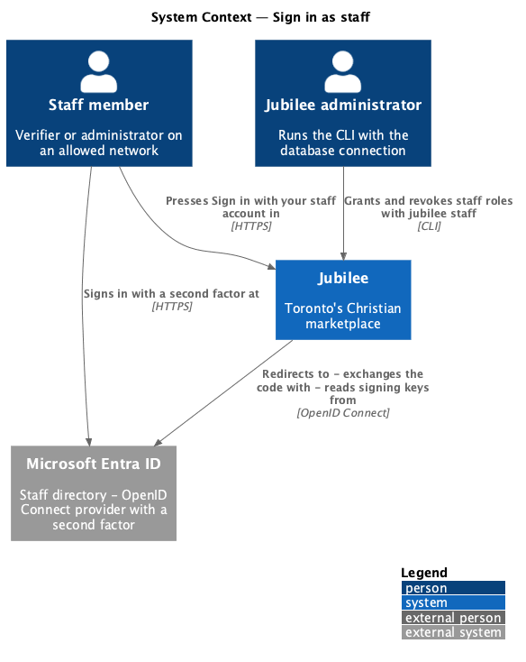
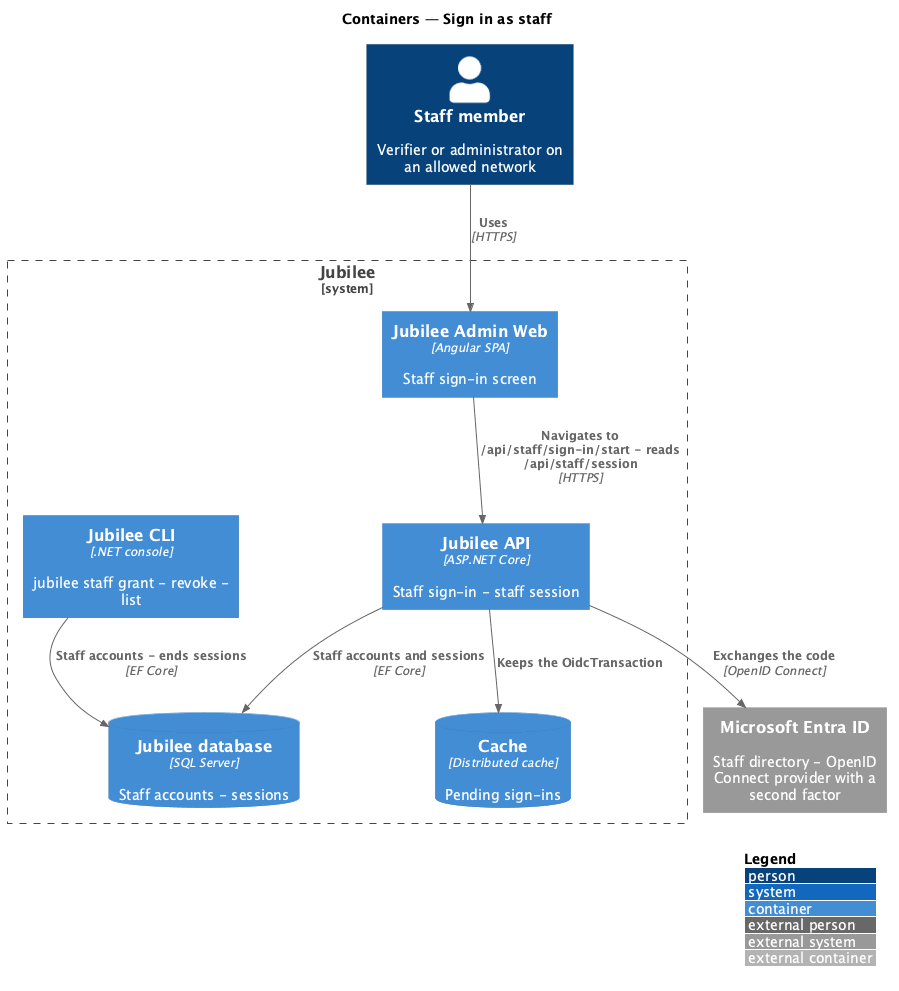
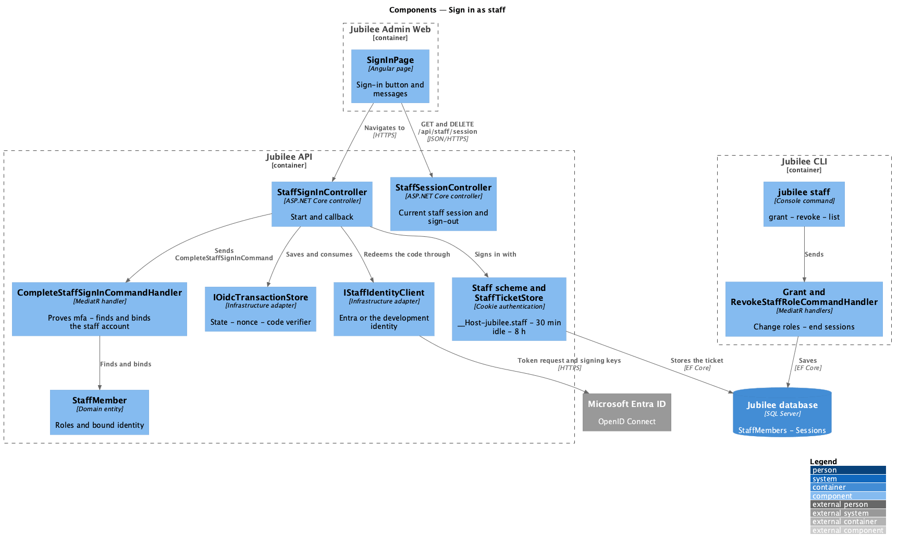
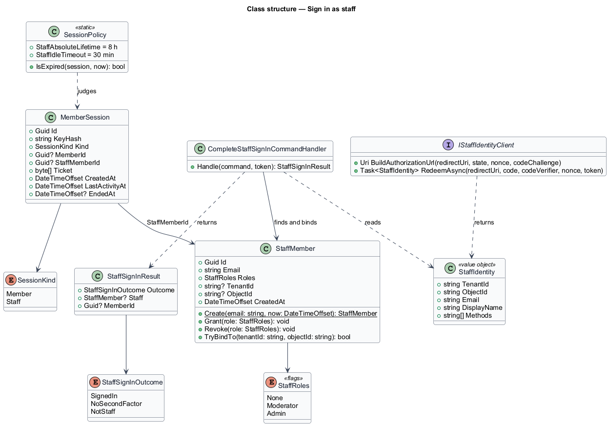
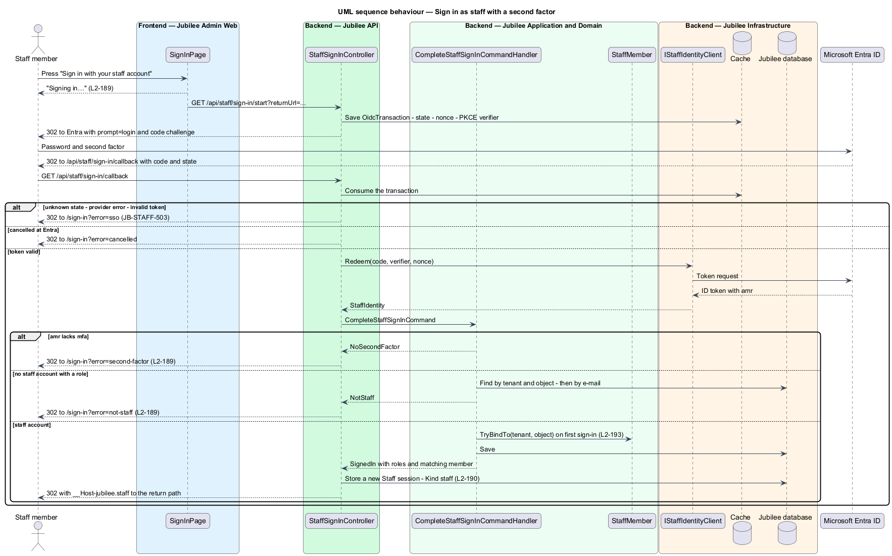
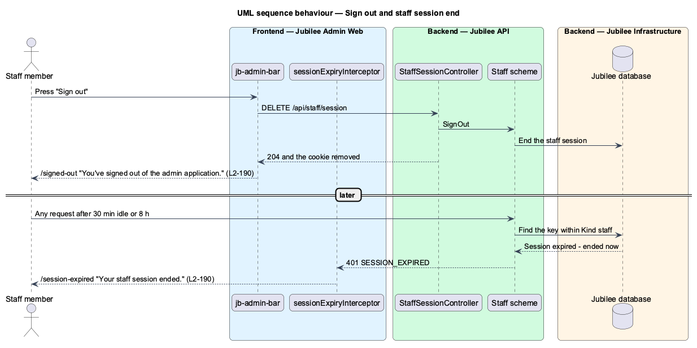
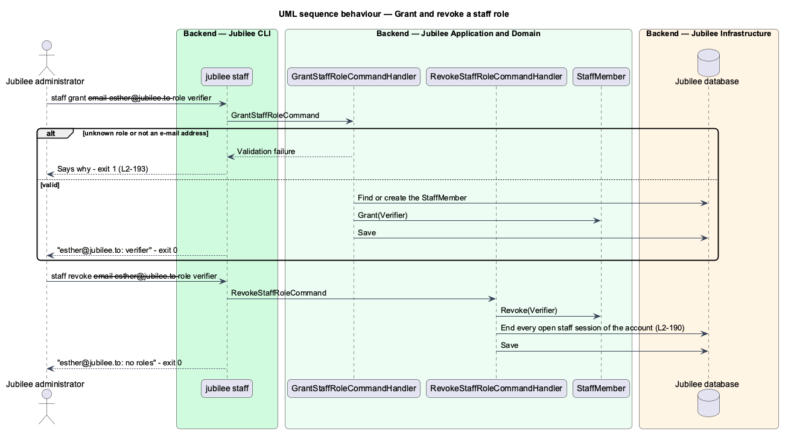

# Sign in as staff

## Overview

Staff sign in to the admin application through *single sign-on* — sign-in at
the organisation's identity provider rather than with a password Jubilee keeps.
The provider is Microsoft Entra ID, Jubilee's staff directory, over OpenID
Connect (ADR 0040). The admin application has no password form (`L2-189`).

A *second factor* is a proof beyond the password, such as an authenticator app
or a passkey. Entra states the methods a sign-in used in the `amr`
(authentication methods references) claim of the ID token. `Jubilee API` reads
that claim on every staff sign-in and admits it only when it names `mfa`; the
provider's own policy is not trusted in place of the proof.

A *staff account* links an identity of the staff directory to the roles it
holds in Jubilee, `moderator` and `admin` (`L2-193`). Staff accounts are managed
only with the Jubilee CLI. A successful sign-in starts a *staff session*: a
server-side session of its own kind, in its own cookie, shorter than a member
session, and never shared with the app (`L2-190`).

## Description

- **`SignInPage`** — Angular page of the admin application at `/sign-in`,
  `/signed-out` and `/session-expired`, in the `bare` shell. It composes
  `jb-auth-layout`, `jb-lockup`, `jb-alert` and `jb-button`. The button "Sign in
  with your staff account" turns busy ("Signing in…") and navigates to
  `GET /api/staff/sign-in/start?returnUrl={path}`. The query `error` picks the
  message: `second-factor`, `not-staff`, `sso` (with `JB-STAFF-503` and "Try
  again"); `cancelled` shows the default state. On load it reads
  `GET /api/staff/session`; a 403 with `code` `NETWORK_NOT_ALLOWED` shows the
  network message and no button (`L2-192` criterion 6).
- **`StaffSignInController`** — ASP.NET Core controller at
  `/api/staff/sign-in`, `[AllowAnonymous]`. `Start` creates an
  `OidcTransaction` (state, nonce, PKCE code verifier, return path) in
  `IOidcTransactionStore` and redirects to the provider with `prompt=login`.
  `Callback` consumes the transaction, redeems the code through
  `IStaffIdentityClient`, sends `CompleteStaffSignInCommand`, and on success
  signs in with the `Staff` scheme and redirects to the return path; otherwise
  it redirects to `/sign-in?error=…`. The redirect URI is
  `StaffSignIn:PublicBaseUrl` followed by `/api/staff/sign-in/callback`, never
  read from the request.
- **`IStaffIdentityClient`** — infrastructure adapter. `EntraStaffIdentityClient`
  builds the authorization URL from the configured endpoints, exchanges the code
  with the client secret and code verifier, and validates the ID token
  (signature from the tenant's keys, issuer `https://sts.windows.net/{tenant}/`,
  audience, lifetime, nonce). It returns a `StaffIdentity`.
  `DevelopmentStaffIdentityClient` returns `StaffSignIn:DevelopmentEmail` with
  `amr` `["pwd","mfa"]` without leaving the machine; the API refuses it outside
  the Development environment.
- **`StaffIdentity`** — value object with `TenantId`, `ObjectId`, `Email`,
  `DisplayName` and `Methods` (the `amr` values).
- **`CompleteStaffSignInCommandHandler`** — MediatR handler. It refuses an
  identity whose `Methods` lack `mfa` (`NoSecondFactor`), then finds the
  `StaffMember` bound to the tenant and object ID, or else the unbound account
  with the identity's normalised e-mail and binds it; no account, or an account
  with no role, is `NotStaff`. On `SignedIn` it returns the account, its roles
  and the id of the member whose confirmed e-mail matches, if any.
- **`StaffMember`** — domain entity: `Id`, `Email`, `Roles` (`StaffRoles` flags:
  `Moderator`, `Admin`; the `Moderator` flag keeps the stored value of the
  former `verifier` role, so earlier grants carry over, ADR 0057), `TenantId`,
  `ObjectId`, `CreatedAt`. `Grant`, `Revoke`
  and `TryBindTo(tenant, object)`, which binds the account on first sign-in and
  answers false for a second, different identity.
- **`Staff` scheme and `StaffTicketStore`** — the second cookie authentication
  scheme. The cookie is `__Host-jubilee.staff` (HttpOnly, Secure,
  SameSite=Strict, path `/`, no expiry). The ticket is kept in the sessions
  table with `Kind` `staff` and `StaffMemberId`; a key is looked up only within
  its kind. `SessionPolicy` ends a staff session 30 minutes after the last
  request or 8 hours after sign-in (`L2-190`). A new identifier is issued at
  every sign-in.
- **`StaffSessionController`** — `GET /api/staff/session` answers the display
  name, initials, e-mail and roles, and counts no queue (ADR 0057) (401
  without a staff session, `SESSION_EXPIRED` when an ended staff cookie came
  with the request). `DELETE /api/staff/session` ends the session and removes
  the cookie.
- **CLI `jubilee staff`** — `grant --email {address} --role moderator|admin`,
  `revoke --email {address} --role moderator|admin` and `list`, sent as
  `GrantStaffRoleCommand`, `RevokeStaffRoleCommand` and `ListStaffQuery`.
  `revoke` ends every staff session of the account. An unknown role or an
  address that is not an e-mail address changes nothing and exits with 1.

## Requirements

The feature realizes the following level-2 (L2) requirements. Each L2
requirement refines a level-1 (L1) requirement, cited by identifier.

| L2 ID | Refines (L1) | Requirement |
|-------|--------------|-------------|
| `L2-189` | `L1-027` | Staff shall sign in to the admin application only through single sign-on; the API shall refuse a sign-in whose `amr` claim does not name `mfa`, an identity that is not a staff account or comes from another tenant, and a callback whose state, nonce or provider answer does not check out, each with its own message, and shall reach the sign-in endpoints only from an allowed network. |
| `L2-190` | `L1-027` | A staff session shall be server-side, in the cookie `__Host-jubilee.staff`, with a new identifier at sign-in, shall end after 30 minutes without a request or 8 hours after sign-in, shall be ended by "Sign out" and by a role revocation, and shall be independent of a member session. |
| `L2-193` | `L1-027` | Staff accounts and their roles shall be granted, revoked and listed with the CLI only; an account shall be bound to its identity on first sign-in; a staff session's decisions shall respect L2-098 criterion 5 for the member whose confirmed e-mail matches the account. |
| `L2-098` | `L1-014` | A moderator shall complete a second factor through single sign-on before any admin screen is available. |

## Diagrams

### System context

The staff member signs in at Microsoft Entra ID, which asks for the second
factor; `Jubilee API` checks the proof on the way back.

### Containers

`Jubilee API` runs the flow and keeps the staff account and the staff session
in the `Jubilee database`; the CLI manages staff accounts.

### Components

`StaffSignInController` uses `IStaffIdentityClient` and sends
`CompleteStaffSignInCommand`; the `Staff` scheme stores the ticket through
`StaffTicketStore`.

### Class structure

`CompleteStaffSignInCommandHandler` turns a `StaffIdentity` into a
`StaffSignInOutcome`; a `MemberSession` of kind `Staff` points at the
`StaffMember`.

### Behaviour — sign in with a second factor

The controller stores state, nonce and the code verifier, and the handler
admits the identity only with `mfa` in `amr` and a staff account with a role
(`L2-189`).

### Behaviour — sign out and session end

"Sign out" ends the staff session on the server; an idle or old session is
found expired and the admin application shows `/session-expired` (`L2-190`).

### Behaviour — grant and revoke a role

The CLI sends the command; revoking ends the account's staff sessions
(`L2-193`).

