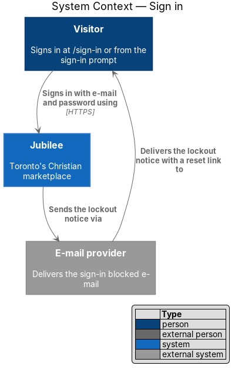
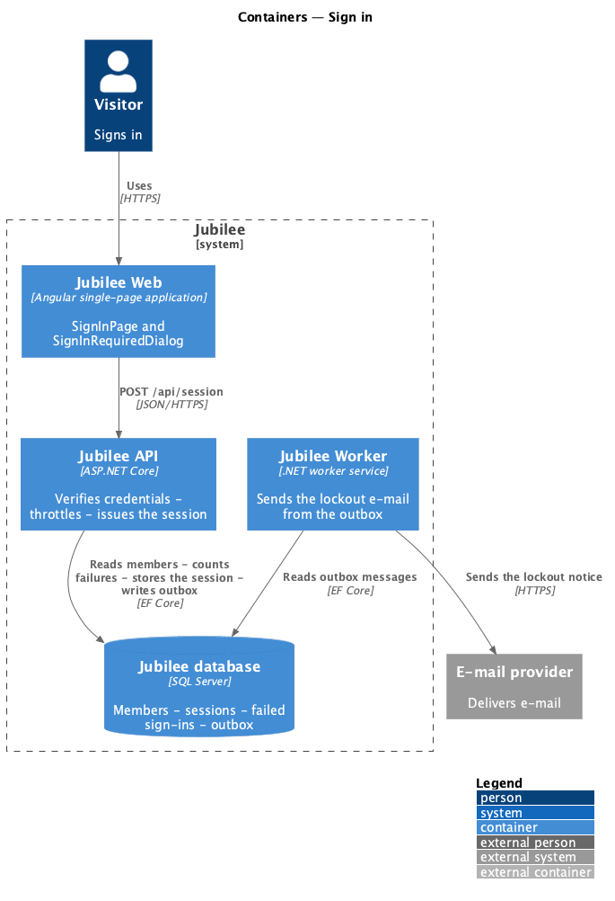
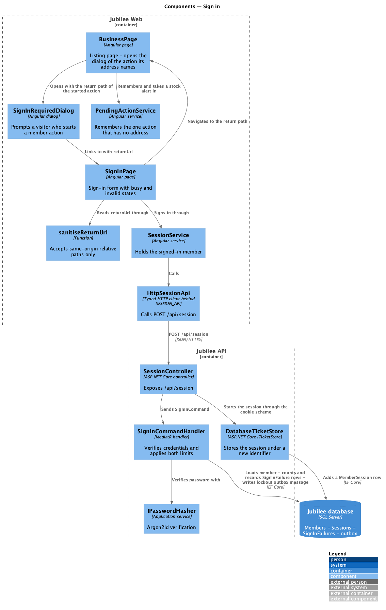
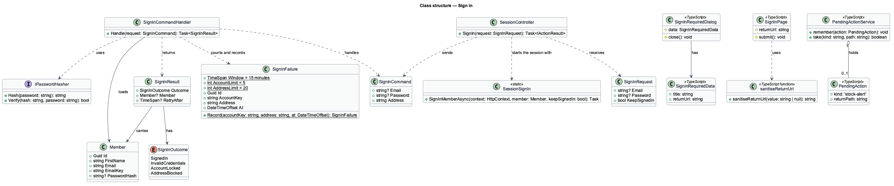
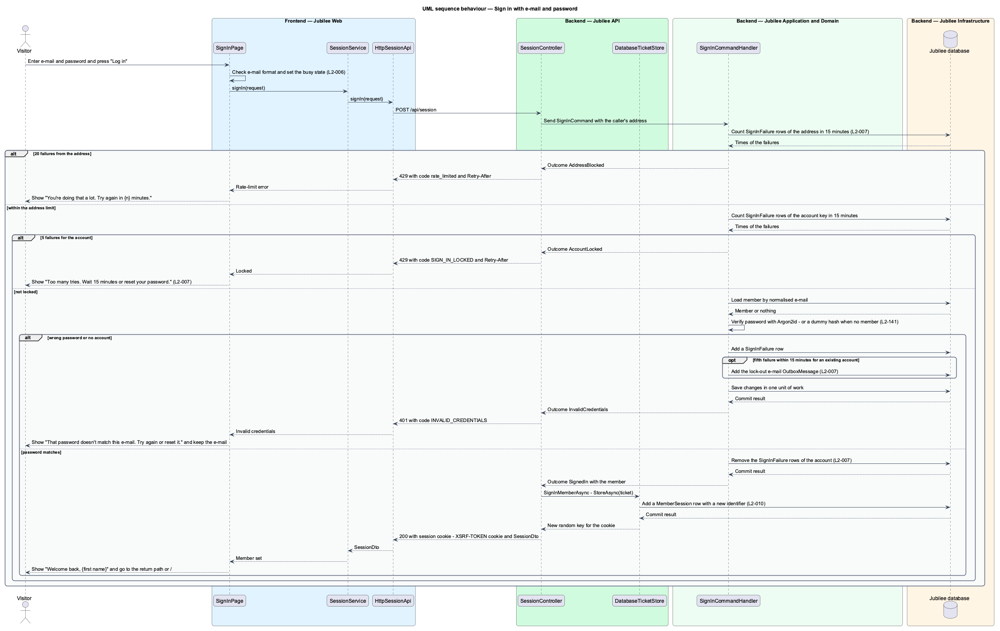
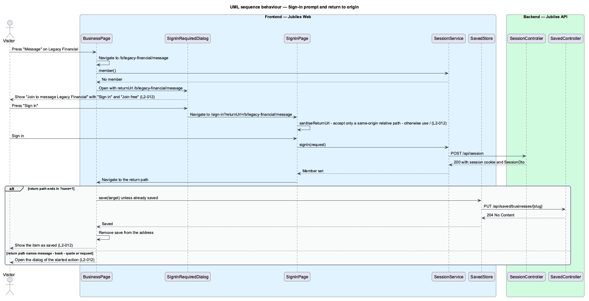

# Sign in

## Overview

Jubilee is Toronto's Christian marketplace. A visitor signs in at `/sign-in`,
the Log in screen, with the e-mail and password of an account and may tick
"Keep me logged in". A successful sign-in starts a *session* — server-side
record that identifies the member on later requests through an opaque cookie.
The lifetime of that session is the subject of the manage session feature
(`L2-010`).

The Log in screen shares one frame with the Sign up screen (`/join`), drawn
from the Magic Patterns design (`L2-187`, ADR 0038). Under 1024 px the
*lockup* — mark and wordmark of Jubilee drawn as one unit — is centred above a
card that holds the form. From 1024 px a dark brand panel on the left holds the
lockup and the form is on the right with no card. When Google sign-in is
configured, "Continue with Google" comes first, above the form; that flow is
the subject of the continue with Google feature (`L2-003`). The "Password"
control offers to show the password being typed.

Two protections surround the form. *Throttling* slows password guessing: 5
failed sign-ins for one account within 15 minutes block that account's sign-in
for 15 minutes, and 20 failed sign-ins from one IP address within 15 minutes
block that address. *Enumeration resistance* keeps the form from revealing
whether an e-mail has an account: a wrong password and an unknown e-mail
produce the same message, status, body shape and timing.

The feature also covers the *sign-in prompt* — dialog shown when a visitor
starts an action that requires an account (message, book, ask, order, save). The
visitor joins or signs in from the dialog and returns to the same listing, where
the started action continues.

## Description

The feature is a vertical slice from the sign-in page and prompt to the
`Jubilee database`, which holds members, sessions and failed sign-ins (ADR
0013).

- **`SignInPage`** — Angular page at `/sign-in`, the Log in screen. It composes
  `jb-auth-layout` with `split` and passes the `heading` "Welcome back" and the
  `lead` "Log in to message businesses and manage your listing." The form has
  "Email" (placeholder "you@example.com"), "Password", the checkbox "Keep me
  logged in" and the button "Log in". "Forgot password?" sits on the line of
  the "Password" label and links to `/forgot-password`. "Keep me logged in" is
  not ticked until the visitor ticks it (ADR 0038). Under the form "New to
  Jubilee?" offers "Create a free account" linking to `/join`. When Google
  sign-in is configured, the button "Continue with Google", carrying
  `jb-google-mark`, comes first, above the form, and the `jb-divider-text` "or
  use email" separates it from the form; when it is not configured, neither
  the button nor the divider is shown (`L2-003`). The page builds the form
  from `jb-field`, `jb-input`, `jb-password-input`, `jb-checkbox`, `jb-button`,
  `jb-alert` and `jb-form-summary` of the `components` library, and the link
  under the form is a `jb-auth-link`. The form is a `<form>` of native controls
  bound to signals with `ngModel`. A malformed e-mail shows "Enter the
  e-mail address you joined with, like name@example.com". While the request is
  in flight the fields are read-only, the button shows a busy state, and a
  second press sends nothing. The route guard `guestGuard` redirects a
  signed-in member to `/`. A load failure shows error reference `JB-AUTH-503`.
  After a sign-in the page shows the toast "Welcome back, {first name}" and
  navigates to the sanitised `returnUrl` of its address, or `/` if none.
- **`jb-auth-layout`** — frame component of the `components` library, used
  with `split` by the Log in and Sign up screens (`L2-187`). It takes the
  `heading` and the `lead` of the page as inputs and projects the form. Under
  1024 px it shows `jb-lockup` centred above a card that holds the form, and
  the link to the other screen is under the card. From 1024 px it shows a dark
  brand panel on the left with `jb-lockup`, "Hire, shop and book with your
  church family.", "Christian-owned businesses across Toronto, all in one
  place." and "© Jubilee · Toronto", and the form on the right with no card.
  The lockup links to `/welcome`.
- **`jb-password-input`** — component of the `components` library. It wraps
  the password control and adds a button inside it named "Show password".
  Pressed, the button shows the password as typed and is named "Hide
  password"; pressed again, it hides the password and is named "Show password"
  (`L2-187`). The typed value is kept, focus stays on the button, and the form
  is not submitted. The button follows the password in the tab order and works
  with Enter and with Space. It changes only the `type` of the control in the
  browser; nothing is sent to `Jubilee API`.
- **`SessionService`** — Angular service that holds the signed-in member as a
  signal. `signIn(request)` calls the session API and sets the member from the
  answer.
- **`SESSION_API`** — injection token of the `SessionApi` contract, implemented
  by `HttpSessionApi`. `signIn({ email, password, keepSignedIn })` sends
  `POST /api/session`.
- **`SessionController`** — ASP.NET Core controller exposing `/api/session`.
  `SignIn` sends `SignInCommand` with the e-mail, the password and the caller's
  IP address. On `SignedIn` it calls `SignInMemberAsync`, which starts the
  session and issues the anti-CSRF cookie `XSRF-TOKEN`, and returns the
  `SessionDto` of the member.
- **`SignInCommandHandler`** — MediatR handler. It counts the `SignInFailure`
  rows of the last 15 minutes, first for the caller's address and then for the
  account key, and refuses when a limit is reached. Otherwise it loads the
  `Member` by normalised e-mail and verifies the password with
  `IPasswordHasher`. When no member exists it verifies against a dummy
  Argon2id hash so that both paths take the same time. It returns a
  `SignInResult` with a `SignInOutcome`. No rate-limiting middleware takes part
  in sign-in: both limits are applied by the handler.
- **`SignInFailure`** — row of the `SignInFailures` table: `AccountKey`,
  `Address` and `At`. The account key is the SHA-256 of the normalised e-mail,
  so an unknown e-mail is counted and locked exactly as an existing one.
  `Window` is 15 minutes, `AccountLimit` is 5 and `AddressLimit` is 20. The
  handler adds a row for each failed sign-in. The fifth row for one account
  starts a lock that lasts 15 minutes from that failure. A successful sign-in
  removes the rows of the account and every row older than the window.
- **`SignInOutcome`** — `SignedIn` returns `200`; `InvalidCredentials` returns
  `401` with code `INVALID_CREDENTIALS` and the page shows "That password
  doesn't match this e-mail. Try again or reset it." with the typed e-mail
  kept; `AccountLocked` returns `429` with code `SIGN_IN_LOCKED` and
  `Retry-After`, and the page shows "Too many tries. Wait 15 minutes or reset
  your password."; `AddressBlocked` returns `429` with code `rate_limited` and
  `Retry-After`, and the page shows "You're doing that a lot. Try again in {n}
  minutes." A locked account is refused even when the password is right.
- **Lock-out e-mail** — `OutboxMessage` created by `OutboxMessage.Email` with
  the subject "Sign-in to Jubilee was blocked", written in the same unit of
  work as the fifth failure of an existing account. `Jubilee Worker` e-mails
  the account holder that sign-in was blocked after repeated failures, with a
  link to `/forgot-password`.
- **`DatabaseTicketStore`** — ASP.NET Core `ITicketStore` behind the cookie
  scheme. At every sign-in `StoreAsync` adds a `MemberSession` row with a new
  identifier and a new random 256-bit key, so a pre-existing cookie value is
  never reused (`L2-010`). The lifetime of the row is the subject of the manage
  session feature.
- **`SignInRequiredDialog`** — Angular dialog opened by an action button when
  `SessionService` reports no member. It takes a `title` and a `returnUrl`. For
  "Message" on Legacy Financial its title is "Join to message Legacy
  Financial"; it offers "Sign in" and "Join free", which link to `/sign-in` and
  `/join` with the `returnUrl`.
- **Return path** — address that carries the started action (ADR 0045). Each
  action that opens a dialog has an address: `/b/{slug}/message`,
  `/b/{slug}/book`, `/b/{slug}/quote`, `/b/{slug}/request` and
  `/b/{slug}/p/{product}/request`; the service, option and quantity chosen
  travel in its query. "Save" is `?save=1` on the listing or product.
  `BusinessPage` and `ProductPage` pass that address to `SignInRequiredDialog`
  as `returnUrl`. After sign-in or join the page at that address opens the
  dialog of the action, or saves the item once through `SavedStore` and removes
  `save` from the address.
- **`sanitiseReturnUrl`** — function. It accepts only a same-origin relative
  path that starts with a single `/`, holds no backslash and no control
  character and is at most 2,000 characters long; any other value becomes `/`.
  `SignInPage`, `SessionExpiredPage` and `ReturnAfterJoinService` read a return
  path through it.
- **`PendingActionService`** — Angular service for the one action that has no
  address, "Tell me when it’s back". `remember` stores a `PendingAction`
  (`kind`, `returnPath`) in `sessionStorage` for the tab. `take`, called by
  `ProductPage` after the return, removes it, and the page carries the action
  out without a second press.
- **`ReturnAfterJoinService`** — Angular service. It keeps the return path of
  a visitor who joins from the dialog in `localStorage` for 24 hours, so that
  "E-mail confirmed" offers "Continue where you left off" (`L2-012`).

## Requirements

The feature realizes the following level-2 (L2) requirements. Each L2
requirement refines a level-1 (L1) requirement, cited by identifier.

| L2 ID | Refines (L1) | Requirement |
|-------|--------------|-------------|
| `L2-006` | `L1-001` | The system shall let a visitor sign in at `/sign-in`, the Log in screen, with e-mail and password, optionally staying signed in. |
| `L2-007` | `L1-001` | Repeated failed sign-ins shall be slowed and then temporarily blocked to stop password guessing. |
| `L2-012` | `L1-001` | When a visitor tries an action that requires an account (message, book, ask, order, save), the system shall prompt the visitor to join or sign in and shall bring the visitor straight back. |
| `L2-141` | `L1-019` | The sign-in endpoint shall respond with the same status, body shape and timing for existing and non-existing e-mails. |
| `L2-137` | `L1-019` | The server shall respond `429` with `Retry-After` when the sign-in limits of `L2-007` are exceeded, and the UI shall show "You're doing that a lot. Try again in {n} minutes." |
| `L2-010` | `L1-001` | A new session identifier shall be issued when a member signs in, and the session shall last 30 days when "Keep me logged in" is ticked. |
| `L2-187` | `L1-001` | The Log in screen (`/sign-in`) and the Sign up screen (`/join`) shall share one frame: a brand panel beside the form from 1024 px, and a card under the lockup below that width. Both screens shall offer to show the password being typed. |

## Diagrams

### System context

The visitor signs in through Jubilee. The e-mail provider delivers the notice
that Jubilee sends when an account is temporarily locked.

### Containers

`Jubilee Web` posts credentials to `Jubilee API`, which reads the member and
keeps failed sign-ins and sessions in the `Jubilee database`. `Jubilee Worker`
sends the lockout notice.

### Components

`BusinessPage` opens `SignInRequiredDialog` with the return path of the started
action, and the dialog links to `SignInPage`. `SignInPage` signs in through
`SessionService` and `HttpSessionApi`. In the API `SessionController` sends
`SignInCommand` to `SignInCommandHandler`, which counts `SignInFailure` rows
and uses `IPasswordHasher`; `DatabaseTicketStore` then stores the session. The
`jb-*` components that `SignInPage` composes are presentation and are not
drawn.

### Class structure

`SignInCommandHandler` handles `SignInCommand` and returns a `SignInResult`
with a `SignInOutcome`. It reads and records `SignInFailure` rows. On the
frontend, `SignInRequiredDialog` carries `SignInRequiredData`, and
`PendingActionService` holds at most one `PendingAction`.

### Behaviour — sign in with e-mail and password

The address limit is checked first, then the account lock (`L2-007`). A wrong
password and an unknown e-mail take the same path and receive the same answer
(`L2-141`). A success removes the failures of the account and issues a new
session identifier. Showing or hiding the password changes only the control in
the browser and adds no message to the sequence (`L2-187`).

### Behaviour — sign-in prompt and return to origin

The dialog passes the address of the started action as `returnUrl`. The visitor
signs in, `SignInPage` navigates to the sanitised path, and the page at that
address either opens the action's dialog or saves the item (`L2-012`).

