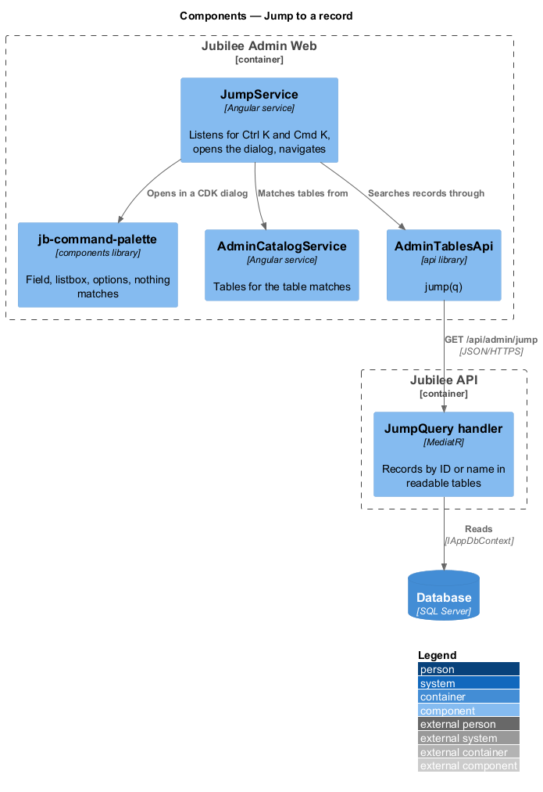
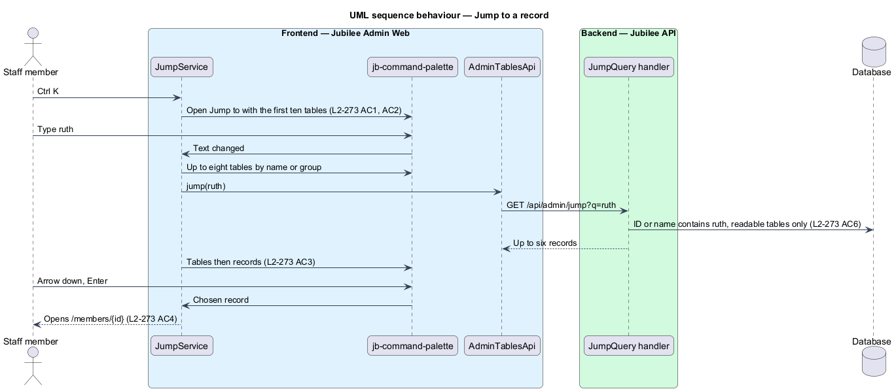

# Jump to a record

## Overview

The *jump palette* lets a staff member go straight to any table or record of the admin
application (`L2-273`). It opens with ⌘K (Ctrl K on Windows and Linux), with the field "Jump to a
table or record" in the top bar, or with the search button that replaces it on a phone. With
nothing typed it lists the first ten tables; typing matches tables by name or group and, across
every table the staff member may read, records by their ID or name. The arrow keys move the
choice, Enter opens it, Escape or a press outside closes the palette.

The record search runs on the server with the staff session, so a record the role may not read is
never listed, and nothing is cached in the browser (`L2-273` AC6, `L2-284`).

## Description

- **`GetAdminJumpQuery`** (`Jubilee.Application/Admin/Jump.cs`, `AdminJumpController`) —
  `GET /api/admin/jump?q=`, any staff role. For each table the staff member may read, in catalog
  order, `AdminTable.MatchAsync` finds records whose ID or name fields contain the text, ignoring
  case, and the search stops at six records in all. A private table (Messages, Message
  attachments) is never searched. Answers `AdminJumpDto { table, tableLabel, singular, id, name }[]`;
  empty text answers nothing; a failure is `JB-ADM-503`.
- **Table matches** — made in the browser from the catalog the shell already holds: up to eight
  tables (ten with nothing typed) whose label or group contains the text.
- **`JumpService`** (admin application, `services/jump.service.ts`) — opens `JumpDialog` as a CDK
  dialog named "Jump to", one at a time; the shell (`ShellPage`) hands it every `keydown` of the
  document, and it opens on ⌘K or Ctrl K. The shell's `(jump)` output, from the jump field and the
  phone's search button, opens it too.
- **`JumpDialog`** (`dialogs/jump`) — container. Tables match in the browser from
  `AdminCatalogService`; records come from `jump(text)` after a pause in typing of 150 ms, timed
  by `debounce(() => timer(…))` so that a frozen clock does not hold it; the newest text wins
  (`switchMap`). Choosing an option closes the dialog and navigates to it; a failed search lists the
  tables alone.
- **`jb-command-palette`** (`components`, block `palette`) — the field (`role="combobox"`, placeholder
  "Members, ruth.c@outlook.com, lst_flower…", "esc"), the list (`role="listbox"`), each option with
  the table icon or "R", its label and its meta (group, or "{singular} · {ID}"), the chosen one
  marked `aria-selected` with the Enter icon and named by the field's `aria-activedescendant`, and
  "Nothing matches “{text}”.", held back while `pending` (the records of the text are not back
  yet). A press on the scrim emits `dismiss`; CDK closes the dialog on Escape. It emits the text and
  the chosen item; it never calls the API.

## Requirements

| L2 ID | Refines (L1) | Requirement |
|-------|--------------|-------------|
| `L2-273` | `L1-027` | ⌘K, Ctrl K, "Jump to a table or record" or "Search" shall open the dialog "Jump to", list tables and up to six readable records matching the text by ID or name, move with the arrow keys, open with Enter, close with Escape, and say "Nothing matches" when nothing does; records the role may not read shall never be listed and nothing shall be cached in the browser. |

## Diagrams

### Components

The palette is a presentation component; the service opens it and the API searches the records.

### Behaviour — jump to a record

Tables match in the browser; records match on the server for the staff member's roles.

