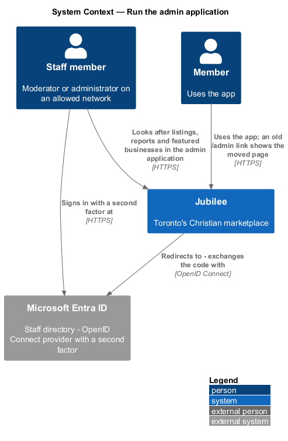
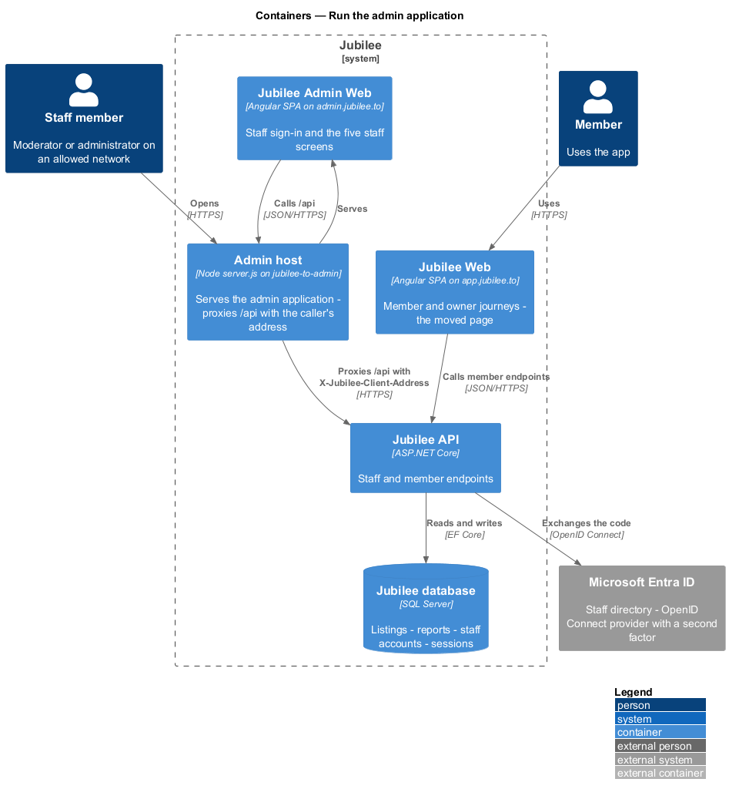
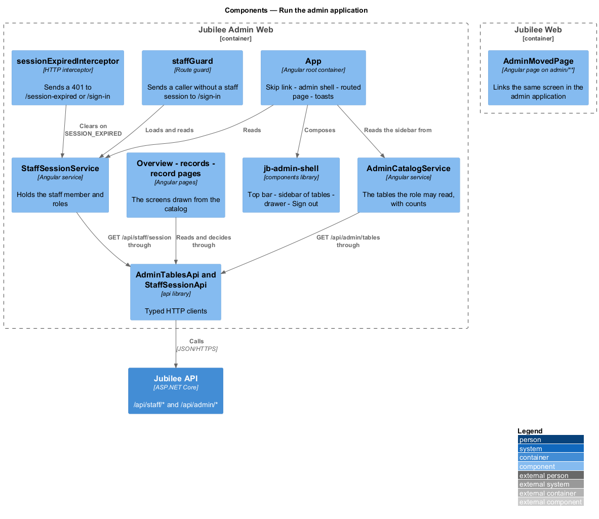
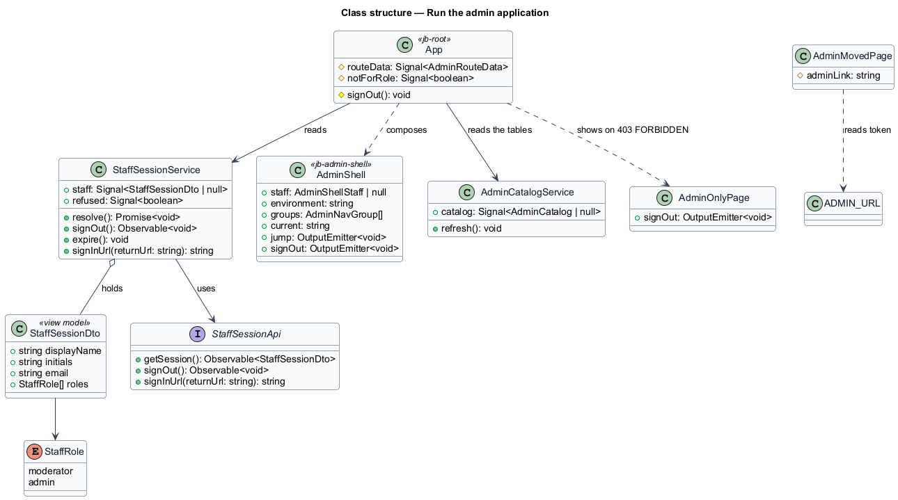
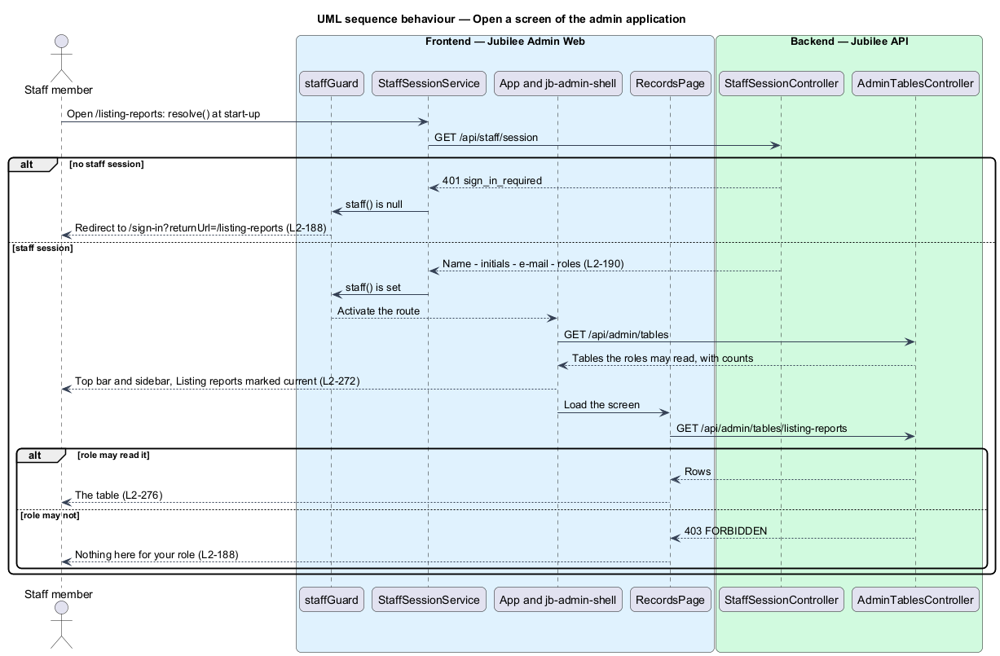
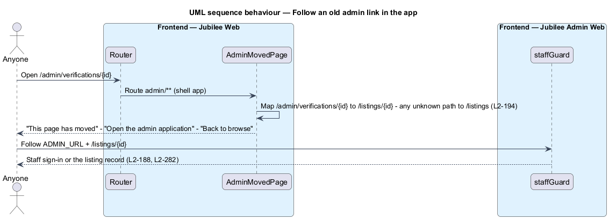

# Run the admin application

## Overview

Jubilee's staff work in their own application, the *admin application*, at
`https://admin.jubilee.to` (`L2-188`). The *Jubilee team* is the staff who
hold the `moderator` role; an *administrator* holds the `admin` role. The admin
application is schema-driven (ADR 0075): its screens are the *overview* (`/`,
`admin/see-what-is-waiting`), a *table* (`/{table}`, the table's key in kebab
case such as `/members` or `/listing-reports`), a *record* (`/{table}/{id}`)
and a new record (`/{table}/new`), all drawn from one catalog of Jubilee's
tables (`admin/work-in-the-tables`). Nobody verifies a listing before it goes
live (ADR 0057): the team looks through the Listings table and takes down one
that misrepresents a business. These screens were once screens of the app
under `/admin/*`; the app keeps a single *moved page* for old links
(`L2-194`).

The admin application is the third Angular application of the frontend
workspace, beside the app (`jubilee`) and the marketing site (`marketing`). It
has its own *shell* (`L2-272`): the ink top bar with the lockup and "Admin",
the field "Jump to a table or record" (`admin/jump-to-a-record`), the address
and environment and the staff member's initials, and beside the screen a
sidebar of every table in its groups with their record counts, a drawer under
1024 px. It has its own routes, its own session, the *staff session*
(`accounts/sign-in-as-staff`), and talks only to the Jubilee API, through a
proxy on its own host (ADR 0040).

## Description

- **`admin` application** — Angular application at `frontend/projects/admin`,
  served by `npm run start:admin` on port 4202 with `/api` sent to the local
  API. `app.config.ts` is its composition root: it provides the router, the
  HTTP client (whose built-in XSRF handling copies the `XSRF-TOKEN` cookie into
  the `X-XSRF-TOKEN` header) with `sessionExpiredInterceptor`, and the API
  tokens `STAFF_SESSION_API`, `ADMIN_TABLES_API`, `ADMIN_API` and
  `ADMIN_CONTENT_API` from the `api` library.
- **`App`** — the application's root container (`jb-root`). It renders
  `jb-skip-link`, `jb-admin-shell` around the routed page, and
  `jb-toast-region`. Route data (`shell`: `admin` or `bare`; `page`) picks the
  chrome and is stamped on `<body data-page>`; the sign-in screens use the
  `bare` shell. The shell's sidebar comes from `AdminCatalogService`, which
  reads `GET /api/admin/tables` (the tables the role may read, with counts)
  at start-up and again on each navigation; nothing polls (ADR 0058).
- **`jb-admin-shell`** — presentation component in `frontend/projects/components`
  (block `admin-app` with `admin-top`, `admin-nav` and `admin-drawer`).
  Inputs: the staff member (name, initials, role), the environment, the groups
  and tables, and the current table or "Overview". It marks the current entry
  with `aria-current="page"`, opens its group, keeps "Accounts" and
  "Moderation" open on the overview, gives each group button `aria-expanded`,
  and under 1024 px shows "Open tables", which opens the sidebar as a CDK
  dialog drawer from the left with "Close tables" and "admin.jubilee.to ·
  {environment}" at its foot. Under 768 px the jump field gives way to
  "Search"; under 640 px the address is hidden. The staff member's menu ends
  with "Sign out" (`L2-190`). It emits `jump` and `signOut`.
- **Role and not-found** — a table the role may not read is not in the sidebar,
  and opening it or one of its records shows `AdminOnlyPage` ("Nothing here for
  your role. These screens are for the Jubilee team. Ask a Jubilee
  administrator for the role you need.", `L2-188` criterion 4) after the API
  answers 403 `FORBIDDEN`. An unknown path, table or record shows
  `NotFoundPage` ("We couldn't find that page." with "Go to the overview",
  criterion 7).
- **Old paths** — `/featured` opens `/featured-slots`, `/policies` and
  `/policies/{slug}` open `/content-versions`, `/reports` opens
  `/listing-reports`, and `/reports/{id}` (linked from the team's e-mails)
  opens the report's record through `OldReportLinkPage`, which asks
  `GET /api/admin/jump?q={id}` which report table holds it (ADR 0075).
- **`StaffSessionService`** — root service. `resolve()` reads
  `GET /api/staff/session` once at start-up and holds the staff member
  (display name, initials, e-mail, roles) as a signal, or
  `null`; `refused` is true when the API answered 403 `NETWORK_NOT_ALLOWED`
  (`L2-192` criterion 6). `signOut()` calls `DELETE /api/staff/session`.
- **`staffGuard`** — functional guard on every screen (`canActivateChild`).
  Without a staff session it sends the browser to `/sign-in?returnUrl={path}`.
  **`signedOutGuard`** on the sign-in screens sends a staff member who is
  already signed in to the screen asked for (`L2-189` criterion 7).
- **`AdminOnlyPage`** — "Nothing here for your role", with "Sign out".
- **`sessionExpiredInterceptor`** — HTTP interceptor. A 401 with `code`
  `SESSION_EXPIRED` clears the staff session and navigates to
  `/session-expired`; a 401 `sign_in_required` navigates to `/sign-in`.
- **Shared helpers** — `ClockService`, `LoadState` with `errorReference` and the
  message-time formatters move from the app to the `api` library, and
  `ToastService` with `jb-toast-region` to the `components` library, so that both
  applications import them.
- **`AdminMovedPage`** — the one page the app keeps under `/admin/**`. It shows
  "This page has moved" with "Open the admin application", whose address is
  `ADMIN_URL` (a per-environment token, `https://admin.jubilee.to` in
  production, `http://localhost:4202` in development) followed by the matching
  screen (`/admin/verifications` to `/listings`, `/admin/verifications/:id` to
  `/listings/:id`, `/admin/reports`, `/admin/reports/:id` and
  `/admin/featured` without their `/admin` prefix, which the admin
  application leads to their tables), or `/listings` for any other path, and "Back to browse". The app's top bar, tab bar and account menu
  show no admin link, the app has no staff route guard, and the app reads no
  staff role and no count.

## Requirements

The feature realizes the following level-2 (L2) requirements. Each L2
requirement refines a level-1 (L1) requirement, cited by identifier.

| L2 ID | Refines (L1) | Requirement |
|-------|--------------|-------------|
| `L2-188` | `L1-027` | The admin application shall be its own application at `https://admin.jubilee.to` with its own routes and shell; its screens shall be the overview (`/`), a table (`/{table}`), a record (`/{table}/{id}`) and a new record (`/{table}/new`); it shall show "Nothing here for your role" for a table the role may not read, send a caller without a staff session to staff sign-in with a return, show "We couldn't find that page." for an unknown path or record, and fit every width from 360 px in both themes with a keyboard. |
| `L2-272` | `L1-027` | Every screen shall sit in one shell: the top bar with the lockup and "Admin", the jump field, the address and environment and the staff member's initials, and a sidebar of the tables in their groups with counts, the current one marked, a drawer under 1024 px, the top bar and sidebar fixed while the screen scrolls. |
| `L2-194` | `L1-014` | The app shall show no admin link and call no admin-only endpoint; an old `/admin/*` link shall show "This page has moved" with "Open the admin application" to the matching screen there (`/admin/verifications` to `/listings`, `/admin/verifications/:id` to `/listings/:id`, any other path to `/listings`) and "Back to browse". |

## Diagrams

### System context

Staff reach Jubilee through the admin application and sign in at Microsoft
Entra ID; members keep using the app.

### Containers

`Jubilee Admin Web` is a third single-page application. Its host proxies `/api`
to `Jubilee API`; `Jubilee Web` keeps only the moved page.

### Components

`App` composes `jb-admin-shell` and the routed pages; `staffGuard`,
`signedOutGuard` and `StaffSessionService` decide what a caller sees.

### Class structure

`StaffSessionService` holds the `StaffSessionDto` of `GET /api/staff/session`
in a signal; the guard and the shell read it, `AdminCatalogService` holds the tables of the
sidebar, and the pages read the API through `AdminTablesApi`.

### Behaviour — open a screen

The guard loads the staff session once; without one the browser goes to staff
sign-in with a return address, and with one the shell renders the tables the
staff member's roles may read (`L2-188`, `L2-272`).

### Behaviour — follow an old link in the app

The app's `admin/**` route renders the moved page, which maps the old path to
the same screen in the admin application (`L2-194`).

