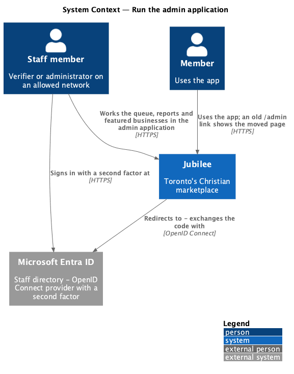
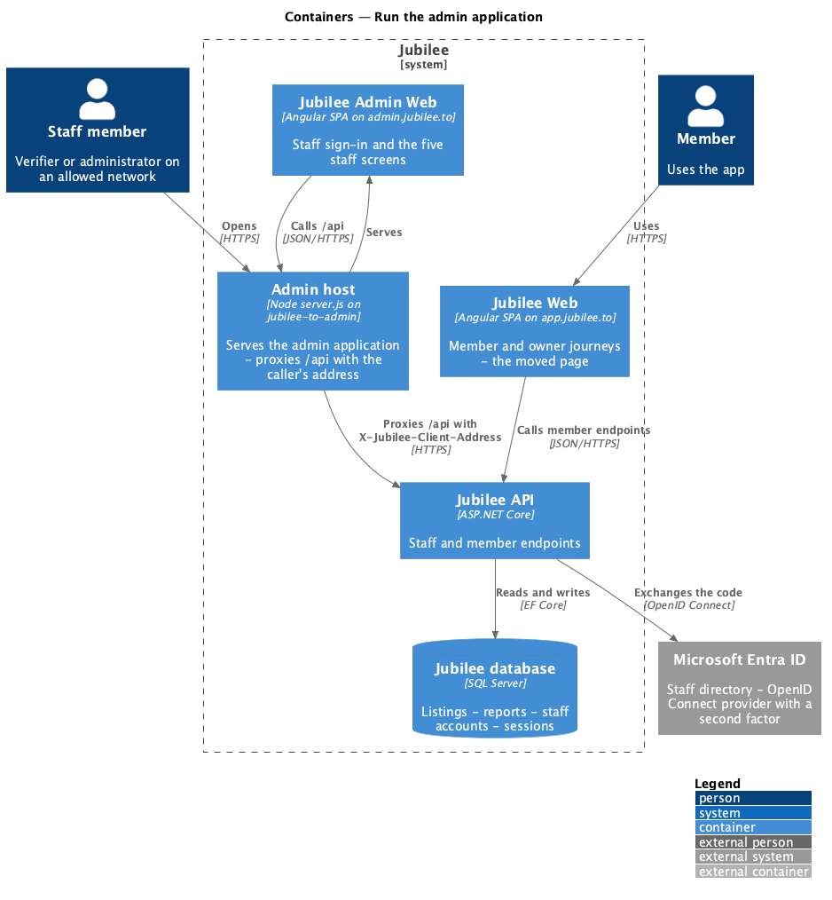
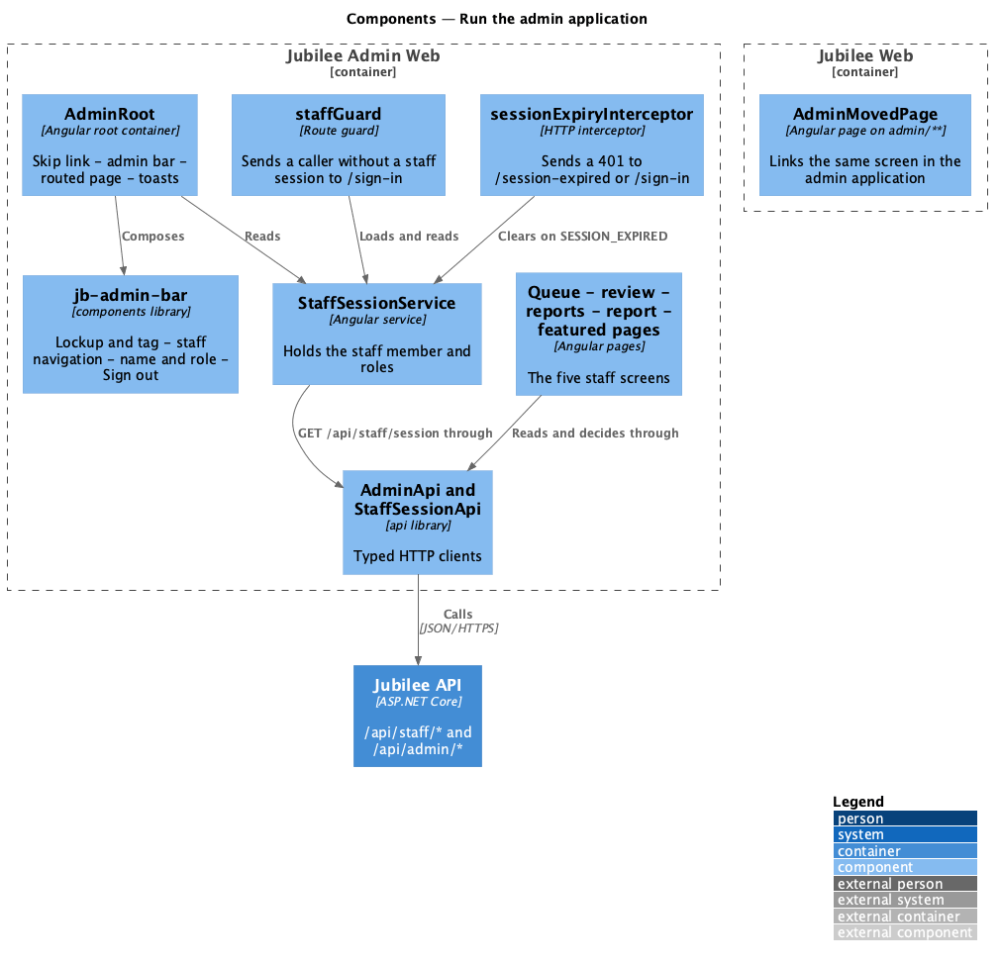
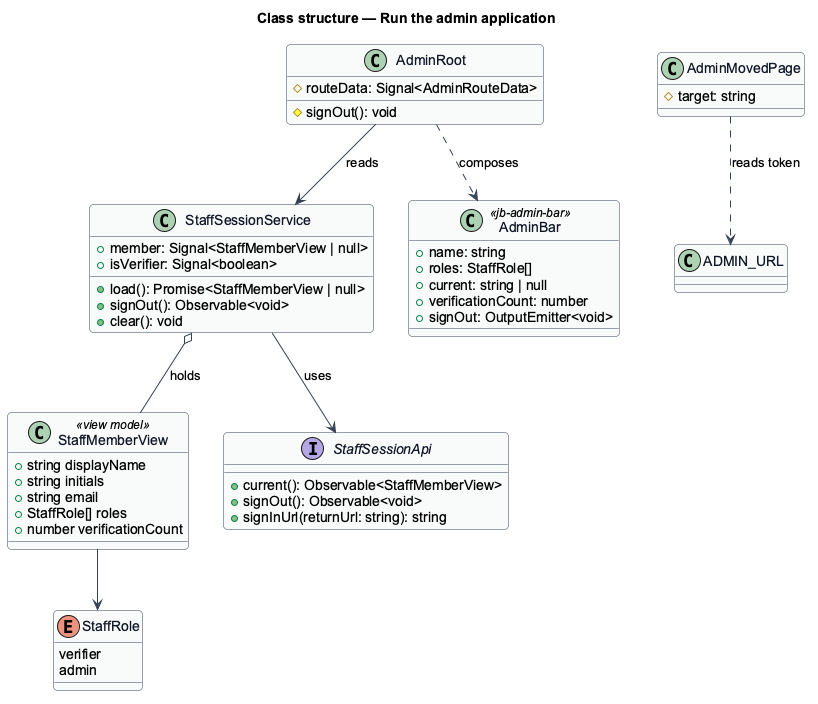
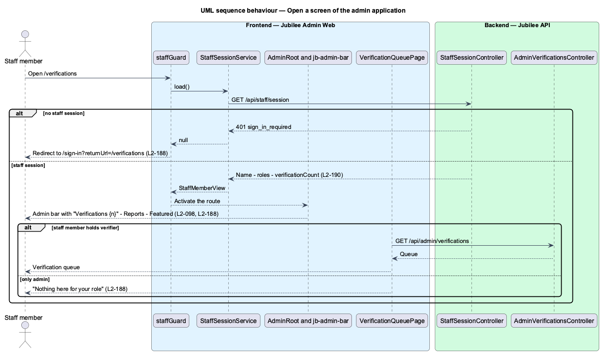
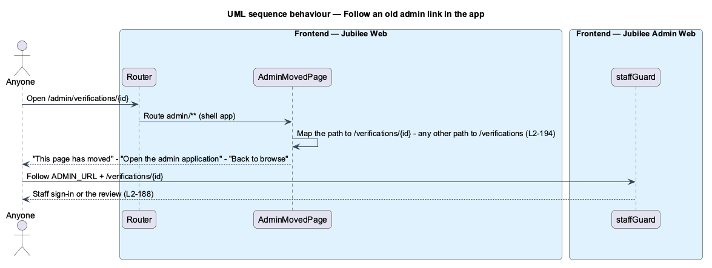

# Run the admin application

## Overview

Jubilee's staff work in their own application, the *admin application*, at
`https://admin.jubilee.to` (`L2-188`). The *verification team* is the staff who
hold the `verifier` role; an *administrator* holds the `admin` role. Before this
feature the verification queue, the review of a listing, the reports and the
featured businesses were screens of the app under `/admin/*`, shown to any
session that carried the `verifier` role. They now live only in the admin
application, and the app keeps a single *moved page* for old links
(`L2-194`).

The admin application is the third Angular application of the frontend
workspace, beside the app (`jubilee`) and the marketing site (`marketing`). It
has its own shell, the *admin bar* (the ink top bar with the "admin" tag, the
staff navigation, the staff member's name and role, and "Sign out"), its own
routes without the `/admin` prefix, and its own session, the *staff session*
(`accounts/sign-in-as-staff`). It talks only to the Jubilee API, through a proxy
on its own host (ADR 0040).

## Description

- **`admin` application** — Angular application at `frontend/projects/admin`,
  served by `npm run start:admin` on port 4202 with `/api` sent to the local
  API. `app.config.ts` is its composition root: it provides the router, the
  HTTP client with the anti-CSRF interceptor, the CDK dialog, and the API
  tokens `ADMIN_API` and `STAFF_SESSION_API` from the `api` library.
- **`AdminRoot`** — the application's root container. It renders `jb-skip-link`,
  `jb-admin-bar`, the routed page in `main` and `jb-toast-region`. Route data
  (`shell`: `admin` or `bare`; `page`) picks the chrome and is stamped on
  `<body data-page>`. The sign-in screens use the `bare` shell.
- **`jb-admin-bar`** — presentation component in `frontend/projects/components`
  (`admin-bar.ts`, `.html`, `.scss`). Inputs: the staff member (`name`,
  `roles`), the current section, and `verificationCount`. It shows the lockup
  with the tag "admin", the links "Verifications {n}", "Reports" and "Featured"
  to a staff member with the `verifier` role (none otherwise), marks the
  current link with `aria-current="page"` and the underline, shows the name and
  role ("Verifier", "Administrator" or both) from 768 px, and emits `signOut`
  from its "Sign out" button. Under 768 px the navigation is one row under the
  lockup that scrolls sideways.
- **`StaffSessionService`** — root service. `load()` reads
  `GET /api/staff/session` once at start-up and holds the staff member
  (display name, initials, e-mail, roles, `verificationCount`) as a signal, or
  `null`.
- **`staffGuard`** — functional route guard on every screen. Without a staff
  session it sends the browser to `/sign-in?returnUrl={path}`; a staff member
  without the `verifier` role is let through to the screen, which renders the
  `NoAccessState` instead of its content (`L2-188` criterion 4).
- **`sessionExpiryInterceptor`** — HTTP interceptor. A 401 with `code`
  `SESSION_EXPIRED` clears the staff session and navigates to
  `/session-expired`; a 401 `sign_in_required` navigates to `/sign-in`.
- **Moved pages** — `VerificationQueuePage` (`/verifications`),
  `VerificationReviewPage` (`/verifications/:id`), `ReportsPage` (`/reports`),
  `ReportPage` (`/reports/:id`) and `FeaturedPage` (`/featured`) move unchanged
  in behaviour from the app, with their dialogs `approve-listing`,
  `request-changes`, `decline-listing` and `report-action`. The "Verification
  team" tabs under each title give way to the admin bar's navigation. `/`
  redirects to `/verifications`; any other path renders `NotFoundState`
  ("We couldn't find that page." with "Go to the verification queue").
- **Shared helpers** — `ClockService`, `LoadState` with `errorReference`, the
  message-time formatters and `ToastService` move from the app to the `api`
  library, so that both applications import them.
- **`AdminMovedPage`** — the one page the app keeps under `/admin/**`. It shows
  "This page has moved" with "Open the admin application", whose address is
  `ADMIN_URL` (a per-environment token, `https://admin.jubilee.to` in
  production, `http://localhost:4202` in development) followed by the path
  without its `/admin` prefix when it is one of the five screens, or
  `/verifications` otherwise, and "Back to browse". The app's top bar, tab bar
  and account menu show no admin link, `verifierGuard` is removed, and the app
  no longer reads `isVerifier` or `verificationCount`.

## Requirements

The feature realizes the following level-2 (L2) requirements. Each L2
requirement refines a level-1 (L1) requirement, cited by identifier.

| L2 ID | Refines (L1) | Requirement |
|-------|--------------|-------------|
| `L2-188` | `L1-027` | The admin application shall be its own application at `https://admin.jubilee.to` with its own routes and shell, shall hold the verification queue, the review, the reports list, a report and the featured businesses, shall show the admin bar with the staff navigation, name, role and "Sign out", shall show "Nothing here for your role" to a staff member without the `verifier` role, shall send a caller without a staff session to staff sign-in, and shall fit every width from 360 px in both themes with a keyboard. |
| `L2-194` | `L1-014` | The app shall show no admin link and call no admin-only endpoint; an old `/admin/*` link shall show "This page has moved" with "Open the admin application" to the same screen there and "Back to browse". |
| `L2-098` | `L1-014` | The admin application's top bar shall show "Verifications {n}" with the number of listings ready to review. |

## Diagrams

### System context

Staff reach Jubilee through the admin application and sign in at Microsoft
Entra ID; members keep using the app.

### Containers

`Jubilee Admin Web` is a third single-page application. Its host proxies `/api`
to `Jubilee API`; `Jubilee Web` keeps only the moved page.

### Components

`AdminRoot` composes `jb-admin-bar` and the routed pages; `staffGuard` and
`StaffSessionService` decide what a caller sees.

### Class structure

`StaffSessionService` holds a `StaffMemberView`; the guard and the shell read
it, and the pages read the API through `AdminApi`.

### Behaviour — open a screen

The guard loads the staff session once; without one the browser goes to staff
sign-in with a return address, and with one the shell renders for the staff
member's roles (`L2-188`).

### Behaviour — follow an old link in the app

The app's `admin/**` route renders the moved page, which maps the old path to
the same screen in the admin application (`L2-194`).

