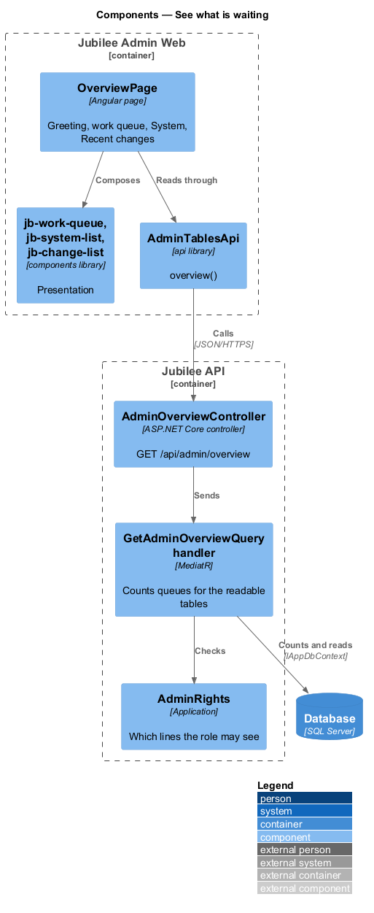

# See what is waiting

## Overview

The *overview* is the first screen of the admin application (`/`, `L2-188`). It tells a staff
member what is waiting on staff when they open it: the *work queue* (`L2-274`), and beside it
*System* and *Recent changes* (`L2-275`).

The work queue has two sections. *Safety* ("Answer within 24 hours") lists open security alerts,
open listing reports, conversation reports open or in review, and open review reports. *Waiting on
us* ("Members are waiting for a decision") lists the data exports that failed or are still
processing, and new feedback. Each *line* names its table, the
oldest record waiting ("Next: …"), how old it is and how many are waiting. A line with nothing
waiting is not shown; with nothing waiting at all the overview says "All clear".

*System* lists the job runs that failed in the last 24 hours, the outbox messages retrying or given
up, and a scheduled maintenance window. *Recent changes* lists the four newest audit records.

The counts are read with the staff session when the overview opens. Nothing polls and nothing is
pushed (ADR 0058). Only the lines of tables the staff member may read are shown (`L2-284`).

## Description

- **`GetAdminOverviewQuery`** (`Jubilee.Application/Admin/Overview.cs`) — reads, for the staff
  member's roles, each queue line's count, its oldest record (ID and the describing line) and that
  record's age, the "Since yesterday" counts (members created, listings published, merch orders
  paid, requests sent in the last 24 hours), the failed job runs of the last 24 hours, the outbox
  messages with attempts and no send (retrying) or failed (gave up), the next scheduled
  maintenance window and the four newest audit records. Answers `AdminOverviewDto`; a failure is
  `JB-ADM-503`.
- **`AdminOverviewController`** — `GET /api/admin/overview`, any staff role.
- **Queue lines** — each line is a table key, a label, a status filter and the tone of its count:

  | Section | Line | Table | Waiting when | Urgent |
  |---|---|---|---|---|
  | Safety | Security alerts | `security-alerts` | open | yes |
  | Safety | Listing reports | `listing-reports` | open | yes |
  | Safety | Conversation reports | `conversation-reports` | open or in review | no |
  | Safety | Review reports | `review-reports` | open | no |
    | Waiting on us | Data exports not delivered | `data-exports` | failed or processing | no |
  | Waiting on us | New feedback | `feedback` | new | no |

  The lines "Listings to review" and "Access requests" of the design are not shown: nothing waits
  for review (ADR 0057), and an access request is a help request e-mailed to the team that carries
  no decision to wait for (`L2-114`, ADR 0074).
- **`OverviewPage`** (`frontend/projects/admin/src/app/pages/overview`) — container. It shows the
  day and the greeting ("Good morning|afternoon|evening, {first name}." in Toronto time), the
  sum of the counts, the "Since yesterday" line, `jb-work-queue` per section, `jb-system-list`
  and `jb-change-list`, or skeletons under `aria-busy`, or the error with `JB-ADM-503` and "Try
  again". A line's name opens the oldest record; its count opens the table filtered to the waiting
  status.
- **Components** (`components`): `jb-admin-heading` (`admin-heading`, `--greeting`),
  `jb-work-queue` (`work-queue`), `jb-system-list` (`system-list`, the state named by its icon:
  "Failed", "Retrying", "Gave up", "Maintenance"), `jb-change-list` (`change-list`), inside the
  `work-grid` and `admin-aside` layout of `jb-work-grid`.

## Requirements

| L2 ID | Refines (L1) | Requirement |
|-------|--------------|-------------|
| `L2-274` | `L1-027` | The overview shall show the day, a greeting with the number of things waiting, "Since yesterday", and the work queue's lines for Safety and Waiting on us with their next record, age and count, "All clear" when nothing waits, skeletons while loading and `JB-ADM-503` on failure, read at that moment for the tables the role may read. |
| `L2-275` | `L1-027` | The overview shall show failed job runs, retrying or abandoned outbox messages, a scheduled maintenance window and the four newest audit records, each opening its table. |

## Diagrams

### System context

A staff member opens the admin application and reads what is waiting from Jubilee's records.

### Components

`OverviewPage` reads `GET /api/admin/overview`; the handler counts each queue in the database for
the role's readable tables.

### Class structure

The overview is one view model of sections, lines, system items and changes.

### Behaviour — open the overview

The counts are read once, when the overview opens (`L2-274` AC7).

