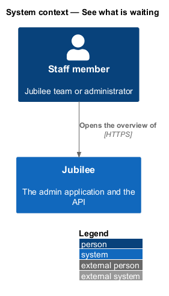
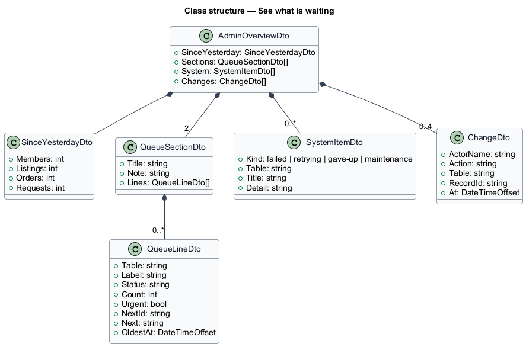
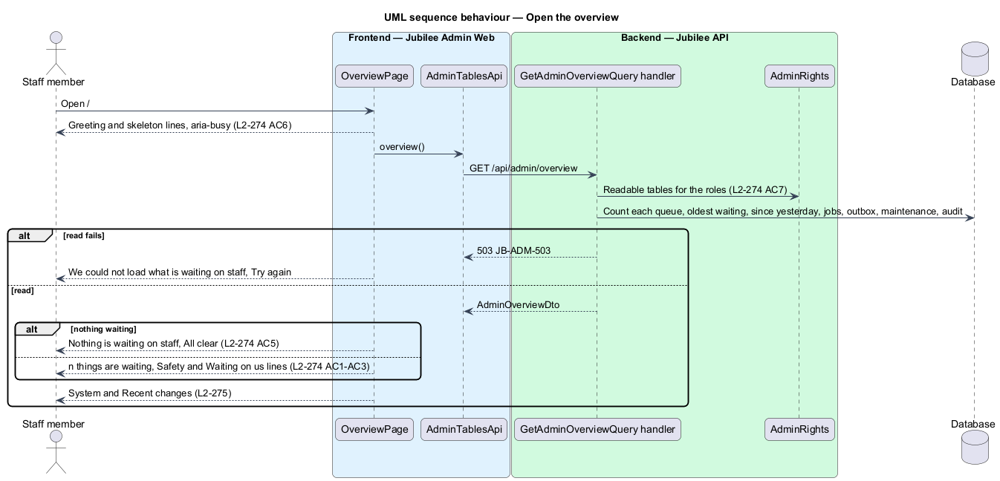

# See what is waiting

## Overview

The *overview* is the first screen of the admin application (`/`, `L2-188`). It tells a staff
member what is waiting on staff when they open it: the *work queue* (`L2-274`), and beside it
*System* and *Recent changes* (`L2-275`).

The work queue has two sections. *Safety* ("Answer within 24 hours") lists open security alerts,
open listing reports, conversation reports open or in review, and open review reports. *Waiting on
us* ("Members are waiting for a decision") lists the data exports that failed or are still
processing, and new feedback. Each *line* names its table, the
oldest record waiting ("Next: …"), how old it is and how many are waiting. A line with nothing
waiting is not shown; with nothing waiting at all the overview says "All clear".

*System* lists the job runs that failed in the last 24 hours, the outbox messages retrying or given
up, and a maintenance window under way. *Recent changes* lists the four newest audit records.

The counts are read with the staff session when the overview opens. Nothing polls and nothing is
pushed (ADR 0058). Only the lines of tables the staff member may read are shown (`L2-284`).

## Description

- **`GetAdminOverviewQuery`** (`Jubilee.Application/Admin/Overview.cs`) — reads, for the staff
  member's roles, each queue line's count, its oldest record (ID and the describing line) and when
  it was created, the "Since yesterday" counts (members created, listings published, merch orders
  paid, requests sent in the last 24 hours), the job runs claimed in the last 24 hours that did not
  finish within the hour (`SiteTables.JobGivesUpAfter`), the outbox messages with attempts and no
  send (`retrying`, at their next attempt) or failed in the last 24 hours (`gave-up`), the
  maintenance window under way (started, not ended, with its "back by") and the four newest audit
  records, each as first name, "{updated|created|read|deleted|restored|exported} {table, singular}"
  and record ID. Each line counts through the table's own `AdminTable.PageAsync` with its waiting
  statuses, so the overview and the table agree. Answers `AdminOverviewDto`; a failure is
  `JB-ADM-503`.
- **`AdminOverviewController`** — `GET /api/admin/overview`, any staff role.
- **Queue lines** — each line is a table key, a label, a status filter and the tone of its count:

  | Section | Line | Table | Waiting when | Urgent |
  |---|---|---|---|---|
  | Safety | Security alerts | `security-alerts` | raised in the last 24 hours | yes |
  | Safety | Listing reports | `listing-reports` | open | yes |
  | Safety | Conversation reports | `conversation-reports` | open or in review | no |
  | Safety | Review reports | `review-reports` | open | no |
  | Waiting on us | Data exports not delivered | `data-exports` | failed or processing | no |
  | Waiting on us | New feedback | `feedback` | new | no |

  The lines "Listings to review" and "Access requests" of the design are not shown: nothing waits
  for review (ADR 0057), and an access request is a help request e-mailed to the team that carries
  no decision to wait for (`L2-114`, ADR 0075). A security alert has no status, so it waits for the
  24 hours after it is raised.

  "Next" describes the oldest record from its own fields: the listing's name for a listing report,
  the reason for a conversation report, "Marked {reason}" for a review report, the member's name
  for a data export, the quoted note for feedback, and the kind for a security alert.
- **`OverviewPage`** (`frontend/projects/admin/src/app/pages/overview`) — container, at `/` in its
  own branch of the routes ahead of the sign-in frame, whose empty path would otherwise match. It
  shows the day and the greeting ("Good morning|afternoon|evening, {first name}." by the hour in
  Toronto, from `ClockService`), the sum of the counts, the "Since yesterday" line,
  `jb-work-queue` per section with lines, `jb-system-list` and `jb-change-list`, or skeletons under
  `aria-busy`, or the error with `JB-ADM-503` and "Try again". A line's name opens the oldest
  record (`/{table}/{id}`); its age and count open the table (`/{table}`). `overview-values.ts`
  holds the pure formatting: the age ("oldest 45m", "3h", "3d"), System's times ("HH:mm") and the
  changes' times ("18 Nov 06:32"), all in Toronto. A sign-in with no screen to return to lands
  here (`screenOrQueue`, `L2-188` AC2).
- **System's words** — the records keep no error text, so System says what they do hold: "{job}
  failed at {time}" with "It did not finish within an hour."; "{topic} retrying, attempt {n}" with
  "Next attempt at {time}."; "{topic} gave up" with "Not sent after {n} attempts in 24 hours.";
  "Maintenance under way" with "Since {time}, back by {time}, read-only" (a maintenance window has
  no title).
- **Components** (`components`): `jb-admin-heading` (`admin-heading`, `--greeting`, with `facts`
  for the "Since yesterday" counts), `jb-work-grid` (`work-grid`), `jb-work-queue` (`work-queue`,
  with `loading` skeletons and the content shown when it has no lines), `jb-admin-aside`
  (`admin-aside`) holding `jb-admin-aside-section` (the `admin-aside__head`, `__title` and
  `__link` of a section), `jb-system-list` (`system-list`, the state named by its icon, `jb-icon`
  with a `label`: "Failed", "Retrying", "Gave up", "Maintenance") and `jb-change-list`
  (`change-list`).
- **Mocks** — `tools/admin-mocks/overview.mjs` holds the queue lines once for the mocks
  (`build.mjs`) and for the e2e stub's answer (`export-e2e.mjs` writes `overview` into
  `e2e/fixtures/api/admin-mock-tables.json`).
- **Open questions** — the mocks' System and Recent changes rows are dated 18 November, after the
  e2e clock's 10 November; they read as times only, so the mismatch is not seen, but the rows
  should be redated when the mock data is next revised. The two dropped lines of the design need
  the design reference updated.

## Requirements

| L2 ID | Refines (L1) | Requirement |
|-------|--------------|-------------|
| `L2-274` | `L1-027` | The overview shall show the day, a greeting with the number of things waiting, "Since yesterday", and the work queue's lines for Safety and Waiting on us with their next record, age and count, "All clear" when nothing waits, skeletons while loading and `JB-ADM-503` on failure, read at that moment for the tables the role may read. |
| `L2-275` | `L1-027` | The overview shall show failed job runs, retrying or abandoned outbox messages, a maintenance window under way and the four newest audit records, each opening its table. |

## Diagrams

### System context

A staff member opens the admin application and reads what is waiting from Jubilee's records.

### Components

`OverviewPage` reads `GET /api/admin/overview`; the handler counts each queue in the database for
the role's readable tables.

### Class structure

The overview is one view model of sections, lines, system items and changes.

### Behaviour — open the overview

The counts are read once, when the overview opens (`L2-274` AC7).

