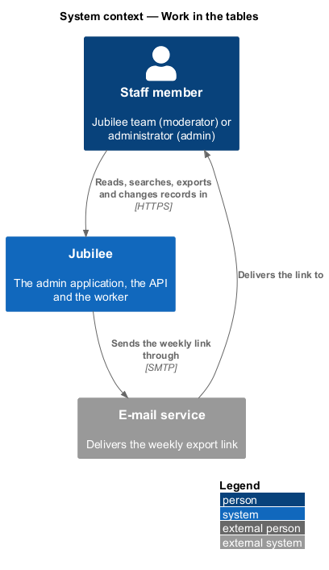
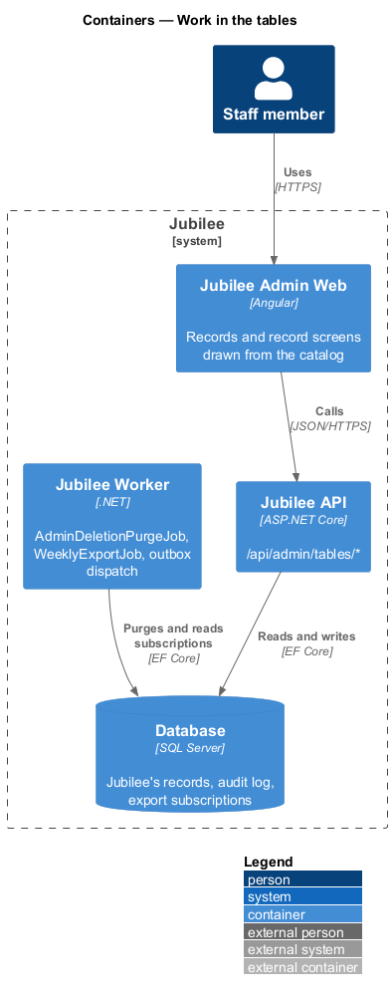
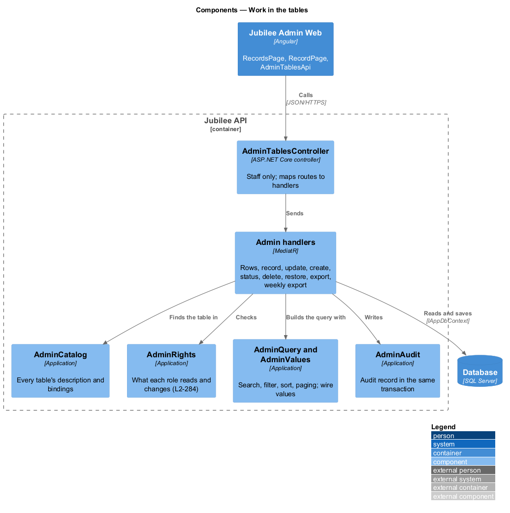
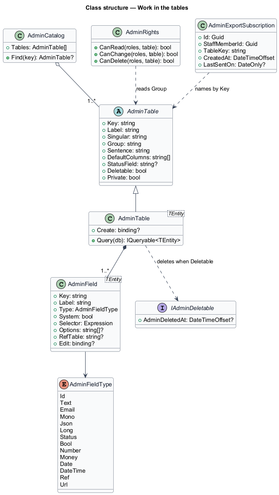
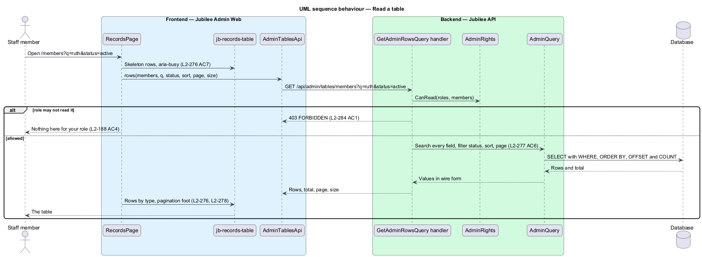
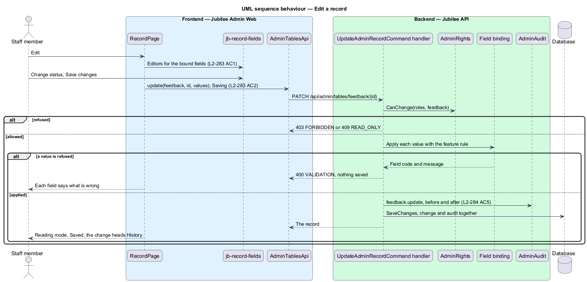
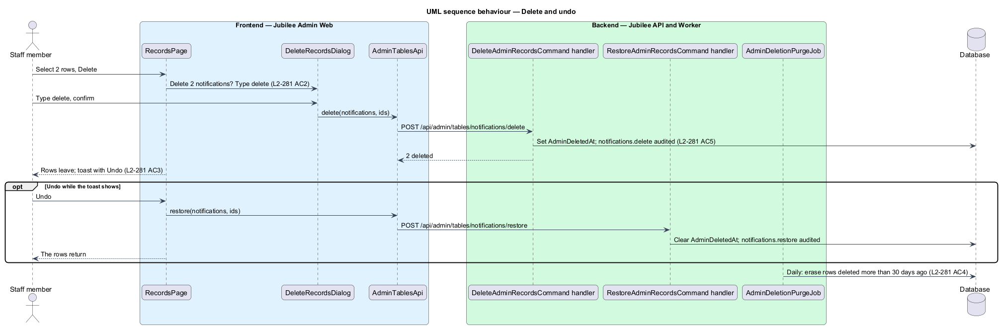

# Work in the tables

## Overview

The admin application (`L2-188`) is *schema-driven* (ADR 0075): each of Jubilee's *tables* is
described once, and one screen draws any of them. A *table* is one kind of Jubilee record shown to
staff (Members, Listings, Listing reports, Audit records…), held in a *group* of the sidebar
(Accounts, Listings, Requests & messaging, Reviews, Moderation, Member activity, Feedback, Merch,
Launch, Site & content, System). A *record* is one row of a table. The *catalog* is the list of
table descriptions in the Application layer; the API serves it, and the admin application reads it
instead of knowing any table itself.

A *staff member* opens a table at `/{table}`, where the key is the table's name in kebab case
(`/members`, `/listing-reports`). The server searches, filters, sorts and pages it; the staff
member chooses the columns and the rows per page, exports it, selects rows to set their status or
delete them, and opens a record at `/{table}/{id}`. The record lists its fields by type, the tables
whose records point at it ("Points here") and its audited history; the staff member edits the
fields the catalog lets them change, creates a record at `/{table}/new`, or deletes one with an
"Undo" while the toast shows.

What a staff member may read and change depends on their *role* (`L2-193`): `admin` or
`moderator` (`L2-284`). System and Staff are read-only to everyone. A *message* opens only while
its conversation has an open report, and opening it is audited. Every change is written to the
audit log (`L2-180`) in the same transaction as the change.

Taking a listing down (`L2-101`), acting on a report (`L2-105`, `L2-237`) and publishing a policy
(`L2-247`) are not field changes: each keeps its own command and dialog and is offered on the
record as an action. The featured slots follow the rules of the featured week (`L2-106`).

## Description

### Backend — catalog and rights (`Jubilee.Application/Admin`)

- **`AdminTable` and `AdminTable<TEntity>`** — the description of one table: `Key`, `Label`,
  `Singular`, `Group`, `Sentence`, `Fields`, `DefaultColumns`, `StatusField`, `NameFields`,
  `Query(IAppDbContext)` (the `IQueryable<TEntity>` it reads, `AsNoTracking`), `Deletable`,
  `Private` (a reason is needed to export it) and the optional `Create` binding. The non-generic
  base lets handlers work on any table; the generic one holds the expressions.
- **`AdminField<TEntity>`** — one field: `Key`, `Label`, `Type` (`AdminFieldType`: `Id`, `Text`,
  `Email`, `Mono`, `Json`, `Long`, `Status`, `Bool`, `Number`, `Money`, `Date`, `DateTime`, `Ref`,
  `Url`), `System` (ID and timestamps, shown in the system line), the selector expression the
  database evaluates, `Options` (a status's wire words), `RefTable` (a reference's table), whether
  search looks at it, and the optional `Edit` binding: the entity method that applies a new value
  with the owning feature's validation.
- **`AdminCatalog`** — the registry of every table, in sidebar order, built once at start-up
  (`Tables/*.cs`, one file per group). `Find(key)` returns a table or null.
- **`AdminRights`** — `CanRead(role, table)`, `CanChange(role, table)`, `CanDelete(role, table)`
  from the matrix of `L2-284` AC1: `admin` reads every table and changes every table but System
  and Staff; `moderator` reads every table but Staff and changes Listings, Reviews, Moderation and
  Feedback. `StaffViewer` carries the staff subject, name and roles from the session.
- **`AdminQuery`** — builds the database query of a table from `q` (every searchable field
  `Contains` the text, ignoring case, IDs included), `status` (the status field equals the wire
  word) and `sort`/`dir` (the field's selector, ascending or descending, else the newest first),
  then counts and pages it (25, 50, 100 or 250 rows). Rows are read as entities and mapped to
  values by the fields' compiled selectors.
- **`AdminValues`** — writes a value in its wire form: an enum as its wire word, a date as ISO
  8601, a reference as `{ id, name }` (its record's name by `L2-282` AC2) or `{ id, deleted: true }`
  when the record is gone.
- **`AdminAudit`** — adds the audit record of a change (`{table}.update`, `.create`, `.delete`,
  `.restore`, `.export`, `messages.read`) to the same `SaveChanges`.
- **`AdminPrivacy`** — what is guarded beyond the role (`L2-284` AC3, AC4). `AuditReadAsync`
  opens a message or a message attachment only while its conversation has a report that is not
  resolved, and writes `messages.read` with that report's ID as the reason; without one it refuses
  with 403 `PRIVATE` and writes nothing. `IsOwnListingAsync` says whether a record of Listings,
  Listing reports or Listing report entries belongs to a listing the staff member owns (its
  `OwnerId` is their subject); `EnsureNotOwnAsync` refuses a change or "Set {status}" of it with
  403 `OWN_LISTING`. The record answers `readAudited` and `ownListing`.

### Backend — handlers and endpoints

| Handler | Endpoint | Does |
|---|---|---|
| `GetAdminCatalogQuery` | `GET /api/admin/tables` | Groups, readable tables, fields, rights, counts |
| `GetAdminRowsQuery` | `GET /api/admin/tables/{table}` | A page of rows, `total`, `page`, `size` |
| `GetAdminRecordQuery` | `GET /api/admin/tables/{table}/{id}` | The record, `pointsHere`, `history`, rights; audits a message read |
| `UpdateAdminRecordCommand` | `PATCH /api/admin/tables/{table}/{id}` | Applies bound fields; `VALIDATION` with field codes |
| `CreateAdminRecordCommand` | `POST /api/admin/tables/{table}` | Creates through the table's `Create` binding |
| `SetAdminStatusCommand` | `POST /api/admin/tables/{table}/status` | Sets the status of the selected IDs through the bound status field |
| `DeleteAdminRecordsCommand` | `POST /api/admin/tables/{table}/delete` | Sets `AdminDeletedAt` on the selected IDs |
| `RestoreAdminRecordsCommand` | `POST /api/admin/tables/{table}/restore` | Clears it ("Undo") |
| `ExportAdminTableQuery` | `GET /api/admin/tables/{table}/export` | `format` `csv` or `json`; `q`, `status` or `ids`; `reason` for a private table |
| `SetWeeklyExportCommand` | `PUT` / `DELETE /api/admin/tables/{table}/weekly-export` | Turns the weekly e-mail on or off |

`AdminTablesController` (`[RequiresStaff]`, any staff role) maps them; the handlers check
`AdminRights` and answer 403 `FORBIDDEN`, 404 `NOT_FOUND`, 409 `READ_ONLY`, 422
`validation_failed` with an `errors` object of field key to code (`REQUIRED`, `TOO_LONG`,
`NOT_ALLOWED`, `NOT_EDITABLE`, `NOT_LIVE`, `OUT_OF_RANGE`, `START_IN_PAST`, `WEEK_FULL`,
`WEEK_OVERLAPS`) or 400 `REASON_REQUIRED`; a failed read answers `JB-ADM-503` (a table) or
`JB-ADM-504` (a record). A change and a creation send `{ "values": { field: text } }`, each value in
its wire form (a reference by its ID); the catalog marks the fields a role may change (`editable`)
and those a new record is given (`creatable`).

### Backend — fields and bindings of this change

- The fields of each table are the entity's own (ADR 0075), under the design's label where the
  meaning is the same. A member's home church and its address, a link token's hash, a password
  hash and a message's text in its row are never fields.
- **Bound edits:** Feedback `status` (`MarkRead`, `StartWork`, `MarkFixed`) and `reply`
  (`ReplyWith`). **Create:** Featured slots (the listing must be live and the week not full,
  `L2-106`). **Record actions** with their own dialogs: Listings "Take down" (`L2-101`), Listing,
  Review and Conversation reports "Act on report" (`L2-105`, `L2-237`), Content versions "Publish a
  new version" (`L2-247`).
- **Deletable** (`IAdminDeletable`, `AdminDeletedAt` and a query filter): Saved items, Recent
  searches, Notifications, Feedback, Feedback screenshots, Stock alerts, Featured slots, Listing
  photos, Product photos, Launch subscribers, Business pre-registrations, Maintenance windows.
- **Private:** Messages, Message attachments (open only with an open report, `L2-284` AC3) and
  Consent records.

### Backend — worker and data

- **`AdminExportSubscription`** — entity: `Id`, `StaffMemberId`, `TableKey`, `CreatedAt`,
  `LastSentOn`. One per staff member and table.
- **`WeeklyExportJob`** — on Mondays from 08:00 Toronto time, for every subscription not yet sent
  that week whose staff member still reads the table, puts an e-mail in the outbox with the link
  `{AdminBaseUrl}/{table}?export=csv` and marks it sent.
- **`AdminDeletionPurgeJob`** — once a day, erases the rows of the deletable tables whose
  `AdminDeletedAt` is more than 30 days old (`L2-281` AC4).

### Frontend (`frontend/projects`)

- **`AdminTablesApi`** (`api`, token `ADMIN_TABLES_API`, `HttpAdminTablesApi`) — the calls above,
  with the view models `AdminCatalog`, `AdminTableInfo`, `AdminFieldInfo`, `AdminRowsPage`,
  `AdminRecord`, `AdminValue`.
- **`AdminCatalogService`** (admin application) — reads the catalog once per screen change and
  holds it as a signal for the shell and the screens.
- **`RecordsPage`** (`/:table`) — container: heading, search, status chips, columns and export
  menus, `jb-records-table`, `jb-bulk-bar`, the delete dialog, toasts. Reads the query from the URL
  (`q`, `status`, `sort`, `dir`, `page`) so a table can be linked and the back button works;
  columns and rows per page from `localStorage` (`AdminTablePreferences`, `L2-278` AC5).
- **`RecordPage`** (`/:table/:id`) — container: `jb-record-crumbs`, `jb-record-head` with "Edit"
  where the table has a field the role may change and "Saved" after a change, `jb-record-fields`,
  `jb-record-system`, `jb-record-aside`, the delete dialog and the record actions' dialogs
  (`take-down-listing`, `report-action`, `publish-policy`).
- **`RecordEditPage`** (`/:table/:id/edit`, `/:table/new`) — container: the same parts with
  `jb-record-fields` in its editing mode, "Cancel" (a link back) and "Save changes" or "Create
  {singular}". It sends only the fields that changed, says each refusal under its field and, once
  saved, opens the record with "Saved". A reference's select offers the first 250 records of its
  table as "{name} · {ID}".
- **`DeleteRecordsDialog`** (`dialogs/delete-records`) — CDK alert dialog of `L2-281` AC1 and AC2.
- **Record notes** (`L2-284`): under the heading, `jb-record-note` says "Jubilee writes these
  records itself…" for a System table, "Messages are private. Opening this one was written to
  Audit records under your name." when `readAudited`, and "This is your own listing…" when
  `ownListing`, which also removes Edit and Delete. A message that answers `PRIVATE` shows "This
  message is private" with "Back to messages" in place of the record.
- **`AdminExportService`** (admin application) — downloads an export: asks for the reason first
  where the table is private (`ExportReasonDialog`, `dialogs/export-reason`, `L2-279` AC4), calls
  the export endpoint and saves the file under the name of its `Content-Disposition`; turns "Email
  me this weekly" on or off and refreshes the catalog. The link of the weekly e-mail,
  `/{table}?export=csv`, downloads every record once and leaves `/{table}` in the address.
- **Components** (`components`): `jb-records-table` (`records`, the `cell--*` values, the phone
  list, skeleton rows, the empty state), `jb-status-pill` (`status status--{tone}`), `jb-lock-tag`,
  `jb-record-head`, `jb-record-fields`, `jb-backlinks`, `jb-history`, `jb-bulk-bar`, `jb-doomed-list`,
  `jb-export-menu` (Export and its menu, the matching rows first while a search or a filter is on),
  `jb-record-note`,
  reusing `jb-menu`, `jb-chip`, `jb-checkbox`, `jb-switch`, `jb-select`, `jb-input`,
  `jb-textarea`, `jb-skeleton`, `jb-empty-state` and `jb-toast-region`.

### Open questions

The choices below are recorded where the requirements, the mocks and the rules differ or leave a
gap.

- **Editing on its own screen**: the mocks reach the editors through links (`edit.html`,
  `create.html`), and the repository's rules forbid an inline form on a page. "Edit" therefore opens
  `/{table}/{id}/edit` and "New {singular}" opens `/{table}/new`; "Cancel" is a link back.
- **Featured slot placement and end date**: `L2-106` AC1 names a placement ("home hero", "browse
  top", "category") and an end date, but `FeaturedSlot` holds a listing, a position and the week it
  starts, and the home page shows one week of five. A slot is created with those three values under
  the featured week's rules; the placement and the end date wait for a change to the entity and the
  home page.
- **Clear search**: `L2-277` AC1 asks for a "Clear search" button that the admin mocks do not draw.
  The search is a `type="search"` field, which clears with Escape, and the empty state offers
  "Clear search and filters".
- **"Set {status}" only where it is bound**: the mocks draw "Set status" for Members, but a status
  changes only through the binding of the feature that owns it (ADR 0075). The bar offers it where
  the table's status field is editable for the role (Feedback), and `POST /{table}/status` refuses
  it elsewhere with 403. Likewise a row's menu offers "Edit" where a field is bound and "Duplicate"
  where the table creates.
- **The row's name**: a row links to its record through its first text column, as the mocks do; a
  table without one (Job runs) opens a record by its row or its "Open".
- **History words**: a change reads "changed {field} from {old} to {new}" with the field in lower
  case, as the mock `saved.html` writes it.
- **Members in the delete mocks**: the mocks draw deleting members, but Members are not deletable
  (a member deletes their own account, `L2-017`). The application offers "Delete" wherever the
  catalog's `canDelete` says so; the mocks stay as a drawing of the dialog.
- **One delete dialog**: the record's dialog (`admin-record/confirm-delete.html`) now names the record
  and its ID and says the data can't be brought back after 30 days, as `L2-281` AC1 asks; it was
  drawn with neither. Both dialogs name the tables that point at the records.
- **Deleting on a phone**: under 768 px the rows have no actions menu, so one record is deleted from
  its own page; checked rows still bring up the bar with "Delete".
- **Undo after a new record took the place**: the unique indexes of saved items, stock alerts and
  launch sign-ups skip deleted rows, so a member can save again what was deleted. If they do,
  "Undo" of the old one would break the index and is refused with `JB-ADM-504`. <TO SUPPLY>
  whether "Undo" should then drop the older copy.
- **Export's menu on a phone**: the menu is aligned to Export's end edge, as the mocks draw it. On a
  phone Export starts its row under the heading, so the menu opens from its start edge instead
  (the application falls back to it wherever the end edge would leave the page).
- **The reason field focused in a dialog**: a field's focus ring sits on its border, as everywhere
  else; the design system's rule that sets the ring off inside a dialog applies to the other
  controls only.
- **One's own listing, as far as the tables reach**: `L2-284` AC4 is enforced on Listings, Listing
  reports and Listing report entries. A Review or a Review report of one's own listing is not
  guarded here; "Take down" and "Act on report" keep the checks of `L2-098` AC5 in their own
  handlers. The record of a listing opens the moderation screen until the old screens retire; the
  behaviour is proved on a listing report until then.
- **A note is not muted inside an alert**: the design system's `.record-note` made the text of the
  warning and information notes muted; it now keeps the alert's colour, as every other alert does.
- **"Type delete to confirm"**: the label is plain text, as its accessible name reads; the mock's
  `<code>` around "delete" is dropped because `jb-field` takes its label as text.

- **Retiring the old screens (ADR 0075)** — done for Featured: `/featured` opens
  `/featured-slots`, and the `admin-featured` page, its API calls and its e2e page object are gone.
  Not yet done, because the record screens do not carry their behaviour yet and retiring them now
  would take it from the Jubilee team:
  - `/listings/{id}` still opens `admin-listing`: the listing record needs "Take down listing" with
    `take-down-listing`, "Taken down {date} by {name}." (`L2-100` AC5, `L2-101`) and the Owner
    panel, flags, "How members see it", the platform panel and a space's terms (`L2-013` AC8,
    `L2-257` AC2, `L2-200` AC3), none of which the record mocks draw yet.
  - `/reports` and `/reports/{id}` still open `admin-reports` and `admin-report`: the report
    records need "Overdue" (`L2-105` AC4, `L2-237` AC1), the reported conversation or review with
    every report of it, the move to "In review" on opening, and the actions of `report-action`
    (`L2-105` AC2 – AC5, `L2-237` AC2 – AC4).
  - `/policies` and `/policies/{slug}` still open `admin-policies` and `admin-policy`: a
    content version's record needs the editor of `L2-247` AC2 – AC4 (title, lead, sections,
    preview) and "Publish version {n}" with `publish-policy`.
  - `AdminFeaturedController` stays until `ModerationTests`, `ModerationBoundTests`,
    `DirectoryCacheTests` and `StaffAccessTests` exercise the week's rules through
    `POST /api/admin/tables/featured-slots`.
  - The own-listing parity case (`admin-record.own-listing`) waits for `/listings/{id}` on the
    record page.
  Each is its own slice: the record mock first, then the action or panel on `RecordPage`, then the
  old screen's tests moved onto it, then the old page, route and endpoints removed.

## Requirements

| L2 ID | Refines (L1) | Requirement |
|-------|--------------|-------------|
| `L2-276` | `L1-027` | Each table shall be described once and one screen, `/{table}`, shall draw any of them: its group, name, sentence, default columns drawn by type, row actions, a phone list under 768 px, skeletons while loading and `JB-ADM-503` on failure. |
| `L2-277` | `L1-027` | A table shall be searched by any field, filtered by its status chips and sorted by a column heading, by the server, with an empty state that clears both. |
| `L2-278` | `L1-027` | A table shall offer "Columns" and "Rows per page" (25, 50, 100, 250) kept per table in the browser, and a pagination foot. |
| `L2-279` | `L1-027` | A table shall export CSV or JSON built on the server and audited, need a reason for private tables, and e-mail a weekly link while the role reads it. |
| `L2-280` | `L1-027` | A row shall offer Open, Edit, Copy ID, Duplicate and Delete as the table allows; checked rows shall show the bulk bar with "Set {status}", Export, Delete and Clear. |
| `L2-281` | `L1-027` | Deleting shall ask first (typing "delete" for many), audit it, offer "Undo", keep the records apart for 30 days and refuse the tables the law keeps. |
| `L2-282` | `L1-027` | A record shall show its breadcrumb, name, status, ID, fields by type, system line, "Points here" and "History", with loading, error and not-found states. |
| `L2-283` | `L1-027` | "Edit" and "New" shall turn the fields the catalog binds into editors validated by the owning feature, audited, with "Saving…", "Saved" and field errors. |
| `L2-284` | `L1-027` | The API shall allow each role only its reads and changes, keep System and Staff read-only, open a message only with an open report and audit its read, and audit every change in the same transaction. |

## Diagrams

### System context

Staff work in the tables of the admin application; the API reads and changes Jubilee's records
and the worker sends the weekly links.

### Containers

`Jubilee Admin Web` reads the catalog, rows and records from `Jubilee API`; `Jubilee Worker`
purges deleted records and sends the weekly exports through the outbox.

### Components

The controller sends every call to a handler that checks `AdminRights` and reads the table's
description in `AdminCatalog`.

### Class structure

A table is a set of typed fields over one entity; bindings tie a field to the entity method that
changes it.

### Behaviour — read a table

The page sends its query from the URL; the server applies search, filter, sort and paging to every
record before it answers (`L2-277` AC6).

### Behaviour — edit a record

A change goes through the field's binding and is audited in the same transaction; a refusal comes
back field by field (`L2-283`, `L2-284` AC5).

### Behaviour — delete and undo

Deleting sets `AdminDeletedAt` and audits it; "Undo" clears it; the worker erases it after 30 days
(`L2-281`).

