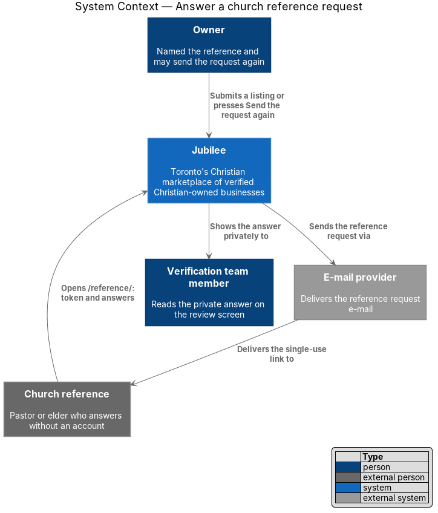
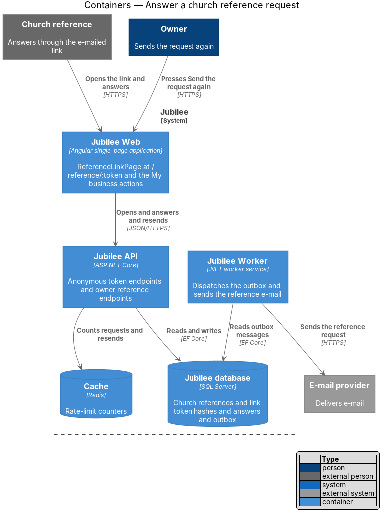
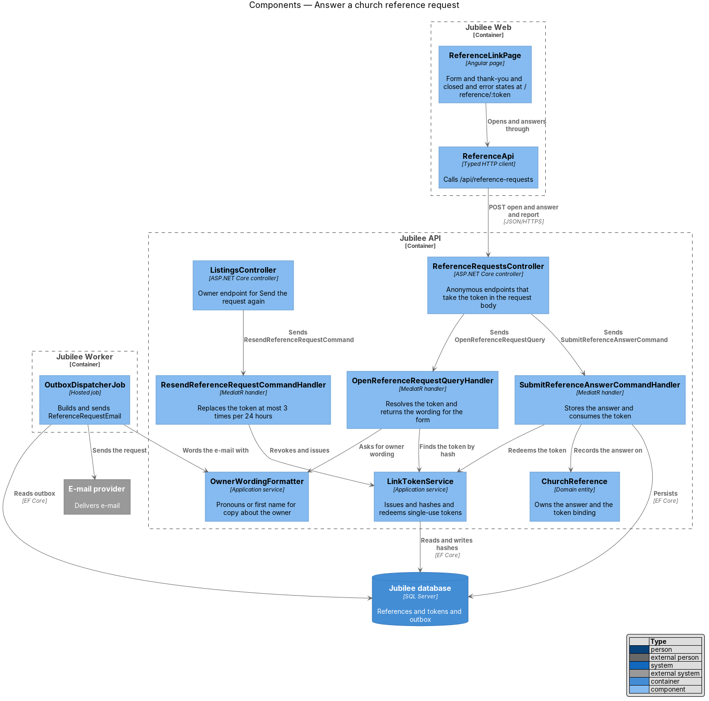
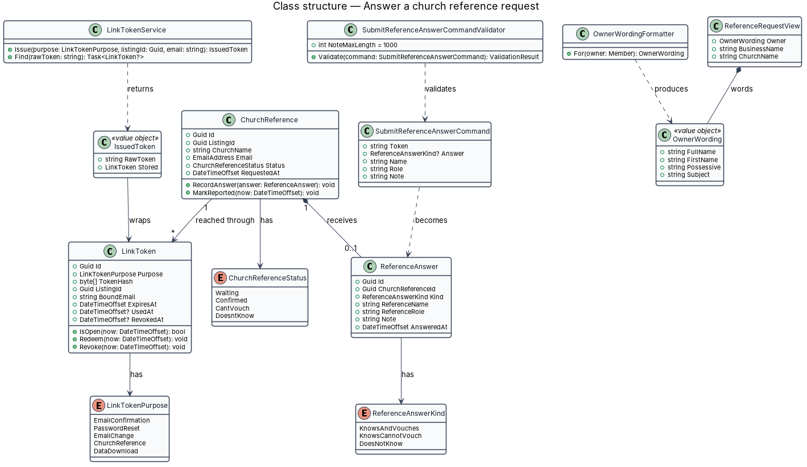
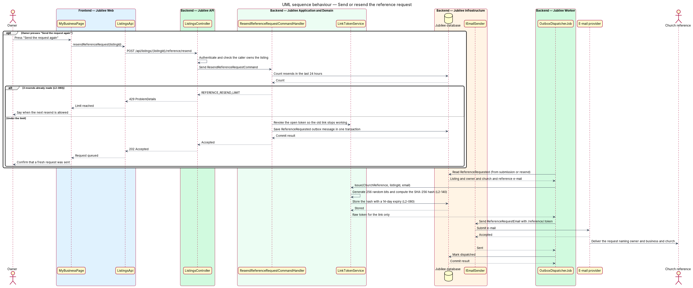
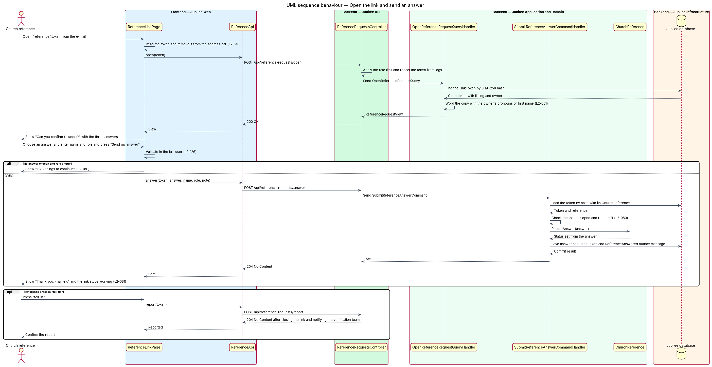
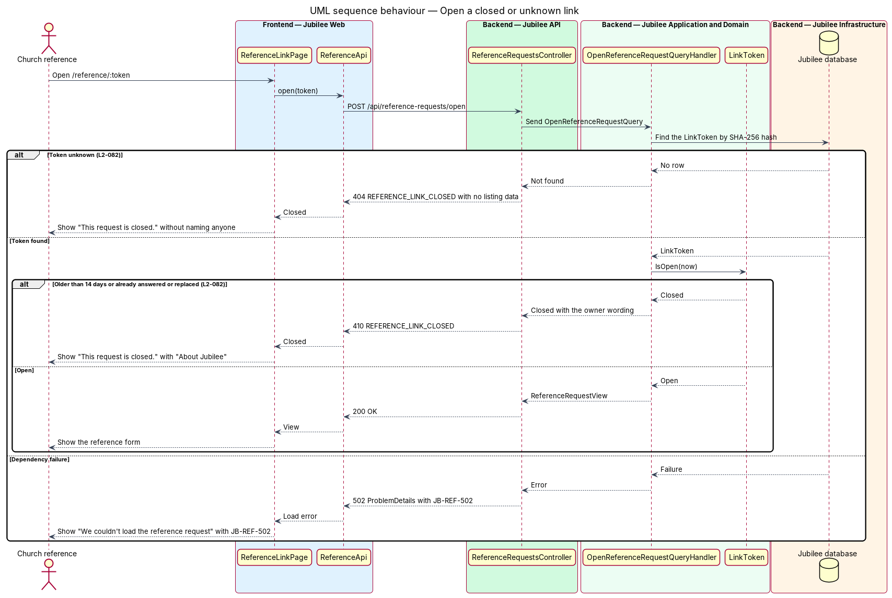

# Answer a church reference request

## Overview

Jubilee verifies each business through a church reference: a pastor or elder,
named by the owner, who confirms the owner privately. The reference holds no
Jubilee account. When a listing is submitted, Jubilee e-mails the reference a
link; the reference opens it, answers one question and is not contacted again
about that listing. This feature covers the request e-mail, the link, the form
at `/reference/:token` and the closed states of the link.

The slice uses four local terms.

- **reference request** — e-mail that asks a named pastor or elder to confirm an owner
- **reference link** — URL `/reference/:token`, bound to one listing and one reference e-mail, valid once for 14 days
- **closed link** — reference link that is older than 14 days, already answered, replaced or reported
- **owner wording** — pronouns the owner chose in the profile, or the owner's first name when none is chosen, used in copy about the owner

The answer is private. Only the verification team reads the answer, the
reference's name and role, and the note; the owner and the public never see
them (L2-146). The effect of the answer on the listing's stage belongs to the
feature `track-reference-outcome`.

## Description

The feature is a vertical slice from the `/reference/:token` page to the
`Jubilee database`, with `Jubilee Worker` sending the request.

- **`ReferenceRequestEmail`** — e-mail template sent when the
  `ReferenceRequested` outbox event is dispatched. It names the owner, the
  business and the church, explains the request in plain language, and links to
  `/reference/:token`. It uses the owner wording.
- **`LinkTokenService`** — issues a `LinkToken` with purpose `ChurchReference`.
  The token has `256 bits` of randomness (at least `128 bits` are required), and
  only its SHA-256 hash is stored. The token is bound to one listing and one
  reference e-mail, expires after `14 days` and works once.
- **`ReferenceLinkPage`** — Angular page at `/reference/:token`, outside the
  signed-in shell. It reads the token, removes it from the address bar, and is
  served with `Referrer-Policy: no-referrer`. It shows "Can you confirm
  {owner}?", the question "How well do you know {owner}?" (required) with the
  answers "I know her and can vouch for her", "I know her, but I can't vouch
  for her business" and "I don't know this person", then "Your name"
  (required), "Your role" (required, placeholder "Pastor, elder, deacon…") and
  "Anything we should know" (optional, 1,000 characters at most).
- **`ReferenceApi`** — typed HTTP client for three anonymous endpoints that
  take the token in the request body: `POST /api/reference-requests/open`,
  `POST /api/reference-requests/answer` and
  `POST /api/reference-requests/report`.
- **`ReferenceRequestsController`** — ASP.NET Core controller. It applies
  `RateLimitMiddleware` limits (values `<TO SUPPLY>`) and redacts the token
  from logs.
- **`OpenReferenceRequestQueryHandler`** — finds the token by hash and returns
  a `ReferenceRequestView` with the owner wording, the business and the church.
  A closed link returns HTTP 410 with code `REFERENCE_LINK_CLOSED`; the page
  shows "This request is closed. Reference links work once, for 14 days. If
  {owner} still needs a reference, she can send you a new request from her
  listing." with "About Jubilee". An unknown token returns HTTP 404 with the
  same code and no listing data, and the page shows the same closed page
  without a name. A 404 status on the HTML document of the route depends on
  the hosting set-up and is `<TO SUPPLY>`.
- **`SubmitReferenceAnswerCommandValidator`** — the same rules as the browser
  form. Code `ANSWER_REQUIRED` maps to "Choose one answer so we know how to
  treat this reference." Code `ROLE_REQUIRED` maps to "Enter your role at the
  church, like pastor or elder." Two failures show the summary "Fix 2 things to
  continue".
- **`SubmitReferenceAnswerCommandHandler`** — redeems the token, stores a
  `ReferenceAnswer`, and writes a `ReferenceAnswered` outbox message in one
  transaction. The page then shows "Thank you, {name}. Your answer went
  privately to the Jubilee verification team. {Owner} will hear from us within
  two business days. You won't be contacted again about this listing."
- **`ReportUnexpectedRequestCommandHandler`** — handles "tell us" under "Not
  expecting this? You can ignore it, or tell us." It closes the link and
  notifies the verification team. The stage the listing takes after a report is
  `<TO SUPPLY>`.
- **`ResendReferenceRequestCommandHandler`** — handles "Send the request again"
  from My business through `POST /api/listings/{listingId}/reference/resend`.
  It revokes the open token, so the old link stops working, and queues a fresh
  request. A fourth resend within `24 hours` returns HTTP 429 with code
  `REFERENCE_RESEND_LIMIT`.
- **`OwnerWordingFormatter`** — returns the `OwnerWording` for the reference
  form, the reference e-mail and the verification team screens. With pronouns
  set (she/her, he/him, they/them) it supplies them; with none it uses the
  first name, as in "named you at Grace Toronto Church as Naomi's church
  reference".
- **Load error state** — when the form cannot load, the API returns HTTP 502
  `ProblemDetails` with `JB-REF-502`, and the page shows "We couldn't load the
  reference request" with the reference.

## Requirements

The feature realizes the following level-2 (L2) requirements. Each L2
requirement refines a level-1 (L1) requirement, cited by identifier.

| L2 ID | Refines (L1) | Requirement |
|-------|--------------|-------------|
| `L2-080` | `L1-012` | When a listing is submitted, the system shall send the reference an e-mail that names the owner, the business and the church and links to `/reference/:token`. The token shall have at least 128 bits of randomness, be stored only as a hash, be bound to one listing and one reference e-mail, and work once, for 14 days; the owner may send a fresh link at most 3 times per 24 hours. |
| `L2-081` | `L1-012` | The reference shall answer without an account at `/reference/:token` by choosing one of three answers and giving a name, a role and an optional note of at most 1,000 characters. After a valid answer or a report the link shall stop working, and copy about the owner shall use the owner's chosen pronouns or first name. |
| `L2-082` | `L1-012` | A link that is older than 14 days, already answered or replaced shall show "This request is closed." An unknown token shall show the same page with HTTP 404 and reveal nothing about a listing, and a form that cannot load shall show `JB-REF-502`. |
| `L2-140` | `L1-019` | Each e-mailed link token shall have at least 128 bits of randomness, be stored only as a SHA-256 hash, have a single purpose and expire as specified. A token page shall set `Referrer-Policy: no-referrer`, remove the token from the address bar after reading it, and keep the token value out of logs. |
| `L2-146` | `L1-020` | A reference's answer, name, role and note shall be visible only to verifiers through the review screen and never to the owner, other members or the public. |
| `L2-126` | `L1-018` | A page form submitted with errors shall show the summary "Fix {n} thing(s) to continue", mark each invalid field, keep typed values, and apply the same rules and message codes on the server. |

## Diagrams

### System context

Jubilee sends the request through the `E-mail provider`. The church reference
answers in Jubilee without an account, and only the verification team reads
the answer.

### Containers

`Jubilee Worker` sends the request. `Jubilee Web` serves the form, and
`Jubilee API` resolves the token against hashes in the `Jubilee database` and
counts requests in the `Cache`.

### Components

`ReferenceRequestsController` sends the query and the answer command, and
`ListingsController` sends the resend command. Each handler uses `LinkTokenService`, and `OwnerWordingFormatter` words both the form and
the e-mail.

### Class structure

A `ChurchReference` is reached through `LinkToken` rows and receives at most
one `ReferenceAnswer`. `LinkTokenService` returns the raw token once, inside
`IssuedToken`.

### Behaviour — send or resend the reference request

A resend revokes the open token and is limited to 3 per `24 hours`.
`OutboxDispatcherJob` issues the token, stores its hash and sends the e-mail.

### Behaviour — open the link and send an answer

The page removes the token from the address bar and sends it in the request
body. A valid answer redeems the token and is saved with the
`ReferenceAnswered` outbox message in one transaction.

### Behaviour — open a closed or unknown link

An unknown token returns HTTP 404 with no listing data, a closed token returns
HTTP 410, and a dependency failure returns HTTP 502 with `JB-REF-502`.

