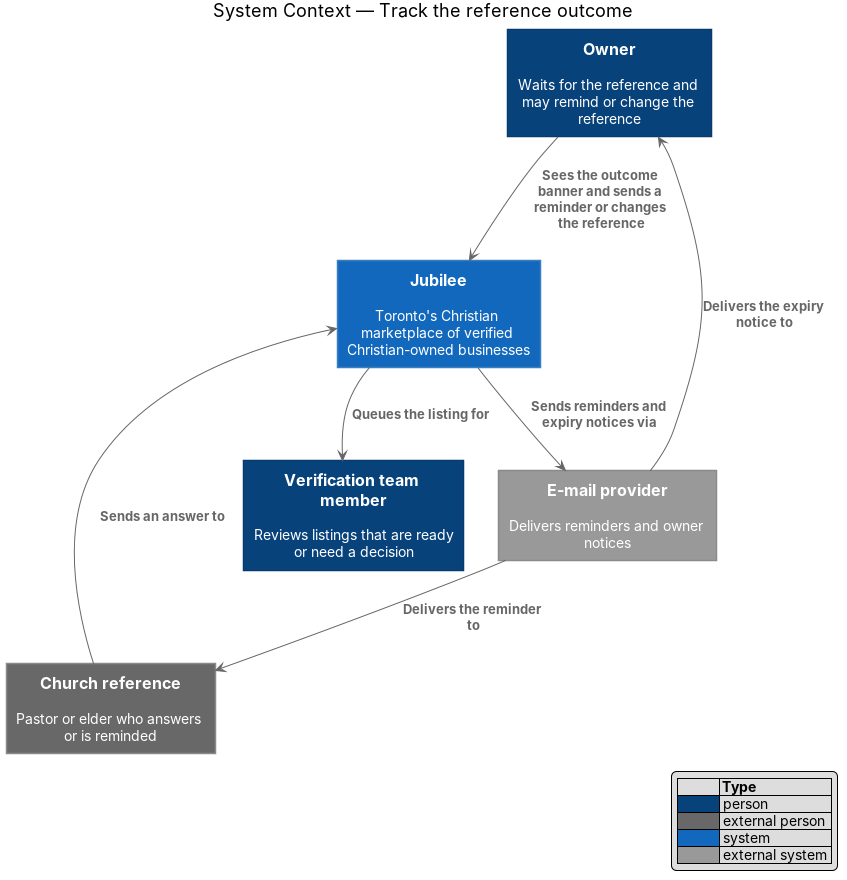
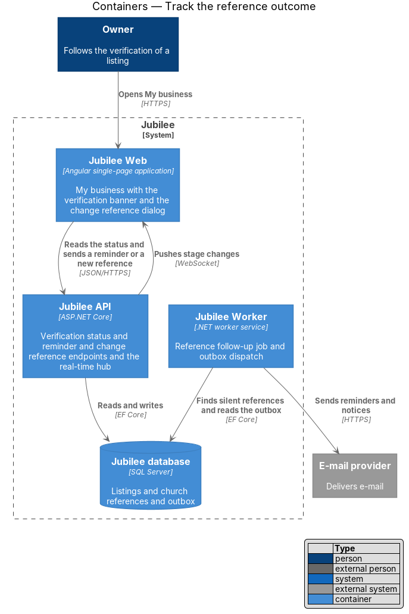
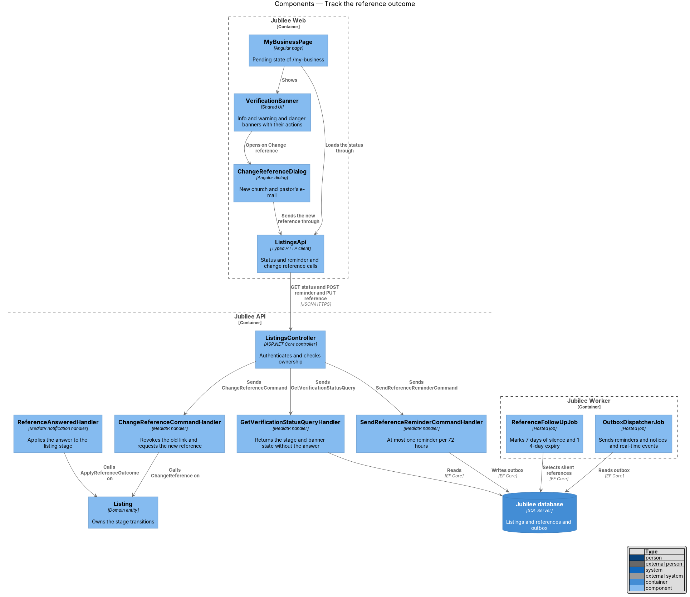
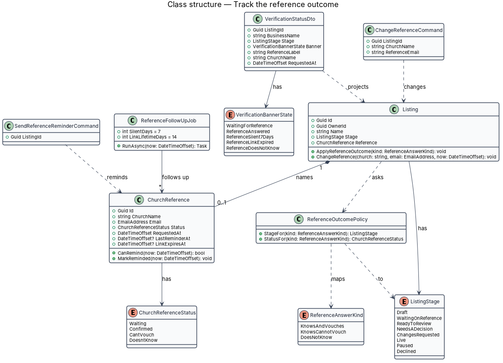
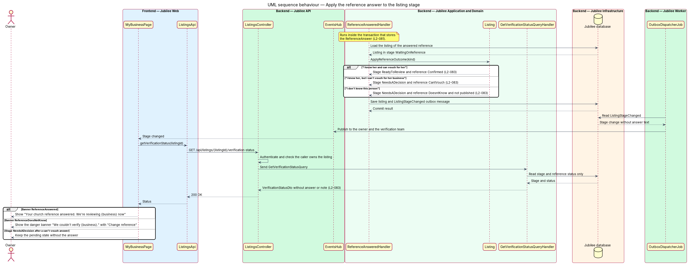
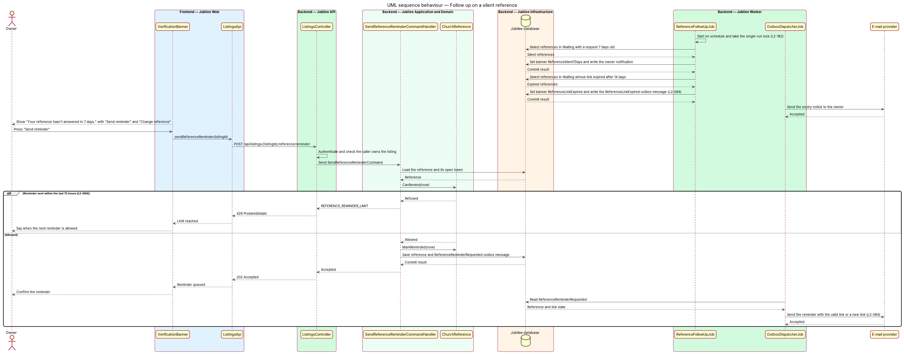
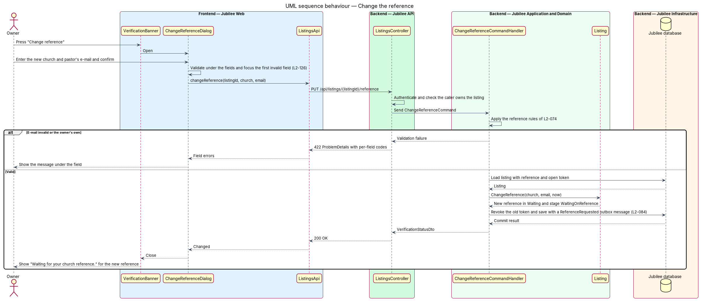

# Track the reference outcome

## Overview

After an owner submits a listing, Jubilee waits for the church reference to
answer through a single-use link. The answer decides where the listing goes
next, and silence from the reference shall not leave the owner stuck. This
feature covers both: mapping the answer to the listing's stage, and the
reminders and reference changes available to the owner while the listing
waits.

The slice uses three local terms.

- **reference outcome** — effect of a church reference's answer on the stage of a listing
- **silent reference** — church reference that has not answered 7 days after the request
- **verification banner** — banner on My business that tells the owner where verification stands and which actions are open

`ListingStage` has eight values: `Draft`, `WaitingOnReference`,
`ReadyToReview`, `NeedsADecision`, `ChangesRequested`, `Live`, `Paused` and
`Declined`. This feature moves a listing out of `WaitingOnReference` to
`ReadyToReview` or `NeedsADecision`, and back to `WaitingOnReference` when the
owner names a different reference.

The owner learns the outcome and never the answer. The reference's answer text
and note are visible only to the verification team (L2-146).

## Description

The feature is a vertical slice from My business to the `Jubilee database`,
with a scheduled job in `Jubilee Worker`.

- **`ReferenceAnsweredHandler`** — MediatR notification handler that runs in
  the transaction that stores the `ReferenceAnswer`. It loads the listing,
  calls `Listing.ApplyReferenceOutcome`, and writes a `ListingStageChanged`
  outbox message. The message carries the stage and no answer text.
- **`ReferenceOutcomePolicy`** — domain rule that maps the answer.
  `KnowsAndVouches` ("I know her and can vouch for her") gives stage
  `ReadyToReview` and reference status `Confirmed`. `KnowsCannotVouch` ("I know
  her, but I can't vouch for her business") gives `NeedsADecision` and
  `CantVouch`. `DoesNotKnow` ("I don't know this person") gives
  `NeedsADecision` and `DoesntKnow`, and the listing is not published.
- **`Listing`** — domain entity. `ApplyReferenceOutcome` accepts an outcome
  only in `WaitingOnReference`. `ChangeReference` replaces the
  `ChurchReference` and returns the listing to `WaitingOnReference`.
- **`MyBusinessPage`** — Angular page at `/my-business`. In the pending state
  it shows the `VerificationBanner` and the verification progress. It reloads
  the status when `RealtimeClient` receives a stage change from `EventsHub`.
- **`VerificationBanner`** — shared banner with one state per
  `VerificationBannerState`. `ReferenceAnswered` shows "Your church reference
  answered. We're reviewing {business} now; expect a decision within two
  business days." `ReferenceSilent7Days` shows the warning "Your reference
  hasn't answered in 7 days. Remind {reference}, or name someone else." with
  "Send reminder" and "Change reference". `ReferenceLinkExpired` offers "Send a
  new request". `ReferenceDoesNotKnow` shows the danger banner "We couldn't
  verify {business}. Your reference told us they don't know you. Name another
  pastor or elder to try again." with "Change reference".
- **`GetVerificationStatusQueryHandler`** — serves
  `GET /api/listings/{listingId}/verification-status`. The
  `VerificationStatusDto` holds the stage, the banner state, the church and the
  request time. It holds no answer text, reference name, role or note. The
  source of the `{reference}` label shown to the owner is `<TO SUPPLY>`; the
  onboarding form collects only the church and the e-mail.
- **`ReferenceFollowUpJob`** — hosted job in `Jubilee Worker`. When 7 days
  pass without an answer, it sets the banner state `ReferenceSilent7Days`. When
  the link expires after 14 days with no answer and no change, it sets
  `ReferenceLinkExpired` and queues an e-mail to the owner. The job is
  idempotent and runs at most once per schedule across instances (L2-182). The
  schedule interval is `<TO SUPPLY>`.
- **`SendReferenceReminderCommandHandler`** — serves
  `POST /api/listings/{listingId}/reference/reminder`. `ChurchReference.CanRemind`
  allows one reminder per `72 hours`; an earlier press returns HTTP 429 with
  code `REFERENCE_REMINDER_LIMIT`. The reminder carries the same link when it
  is still valid, or a new link. `LinkToken` stores only a SHA-256 hash
  (L2-140), so the mechanism that reproduces the same link in a reminder is
  `<TO SUPPLY>`.
- **`ChangeReferenceDialog`** — dialog with "Church" and "Pastor's e-mail". It
  applies the reference rules of L2-074 and shows messages under the fields.
- **`ChangeReferenceCommandHandler`** — serves
  `PUT /api/listings/{listingId}/reference`. It revokes the open token, so the
  old link stops working, stores the new reference, and writes a
  `ReferenceRequested` outbox message that sends the request to the new
  reference.
- **`OutboxDispatcherJob`** — sends the reminder to the reference and the
  expiry notice to the owner through `IEmailSender`, and publishes stage
  changes to `EventsHub`.
- **`ListingsController`** — ASP.NET Core controller. Each endpoint of this
  slice checks that the caller owns the listing and returns HTTP 403 otherwise.

## Requirements

The feature realizes the following level-2 (L2) requirements. Each L2
requirement refines a level-1 (L1) requirement, cited by identifier.

| L2 ID | Refines (L1) | Requirement |
|-------|--------------|-------------|
| `L2-083` | `L1-012` | The system shall move a listing to "Ready to review" when the reference vouches and to "Needs a decision" when the reference cannot vouch or does not know the owner, and shall not publish the listing in the last case. The owner shall see the matching banner and shall never be shown the reference's answer text or note. |
| `L2-084` | `L1-012` | After 7 days without an answer, the owner shall be offered "Send reminder" and "Change reference". A reminder shall be sent at most once per 72 hours, a change of reference shall stop the old link and send a request to the new reference, and at expiry after 14 days the owner shall be e-mailed and offered "Send a new request". |
| `L2-086` | `L1-013` | For a listing waiting on its reference, My business shall show "Waiting for your church reference." with "Send the request again" and "Change reference". |
| `L2-146` | `L1-020` | A reference's answer, name, role and note shall be visible only to verifiers through the review screen and never to the owner, other members or the public. |
| `L2-182` | `L1-025` | Each scheduled job, including reference reminders, shall be idempotent, shall run at most once per schedule across instances, and shall record its last success. |
| `L2-133` | `L1-019` | Each API endpoint shall check the caller's role and ownership of the specific object before doing anything. |

## Diagrams

### System context

The reference's answer reaches Jubilee, which queues the listing for the
verification team and tells the owner the outcome. Reminders and notices leave
through the `E-mail provider`.

### Containers

`Jubilee API` serves the status and the owner actions and pushes stage changes
to `Jubilee Web`. `Jubilee Worker` finds silent references and sends e-mail.

### Components

`ReferenceAnsweredHandler` and `ChangeReferenceCommandHandler` call the
transitions on `Listing`. `VerificationBanner` opens `ChangeReferenceDialog`,
and `ReferenceFollowUpJob` works on the same database.

### Class structure

`ReferenceOutcomePolicy` maps a `ReferenceAnswerKind` to a `ListingStage` and a
`ChurchReferenceStatus`. `VerificationStatusDto` projects the listing for the
owner without the answer.

### Behaviour — apply the reference answer to the listing stage

The handler sets the stage from the answer inside the answer's transaction.
The owner's page reloads a status that holds the stage and the banner state
only.

### Behaviour — follow up on a silent reference

`ReferenceFollowUpJob` raises the 7-day warning and the 14-day expiry. The
owner's reminder is limited to one per `72 hours`.

### Behaviour — change the reference

The dialog applies the L2-074 rules. The handler revokes the old token and
queues a request to the new reference in one transaction.

