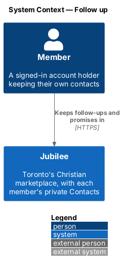
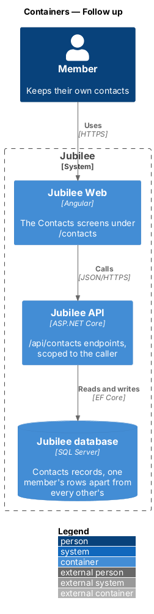
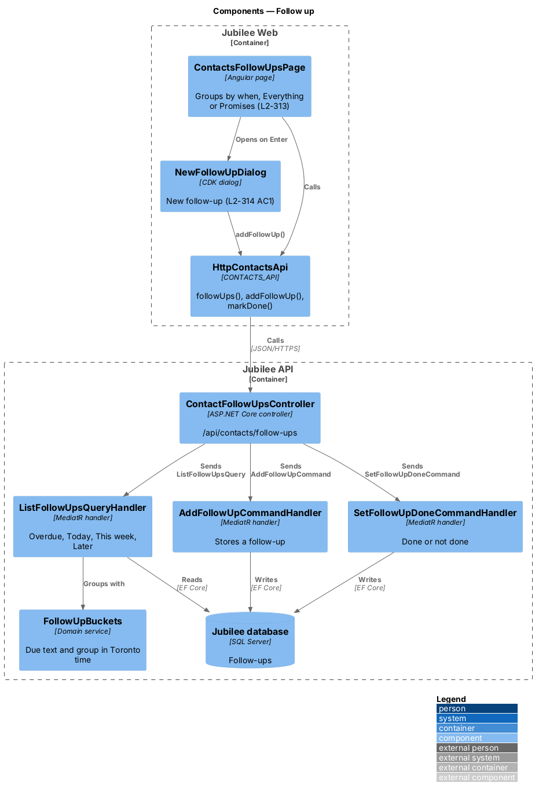
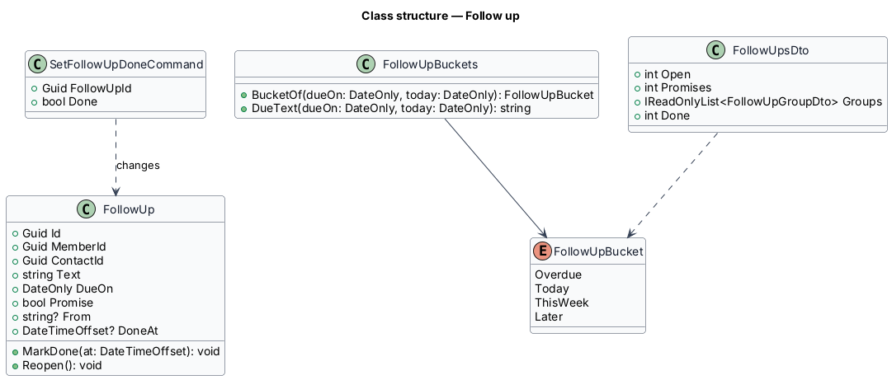
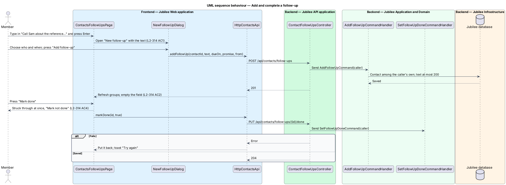

# Follow up

## Overview

*Follow-ups* is the section at `/contacts/follow-ups` that lists what the
member means to do for their people (L1-036). Follow-ups are grouped by when
they are due. A *promise* is a follow-up the member said they would do, and it
says where it was made, so the member keeps their word ("let your 'Yes' be
'Yes'", Matthew 5:37). Follow-ups come from three places: this screen, a
contact's profile and the promises of a logged conversation (`log-with-contact`).

Local terms:

- **group by when**: Overdue, Today, This week (to the coming Sunday) and Later
- **from**: where a promise was made, such as "Phone, 1 Jun"
- **due text**: "{n} days late", "Today", the weekday within this week, or the date

## Description

- **`ContactsFollowUpsPage`** (`pages/contacts-follow-ups/`):
  `GET /api/contacts/follow-ups?show=all|promises` answers the summary
  "{n} open · {m} of them promises you made", the open follow-ups by group with
  their counts, and the number done (`L2-313` AC1–AC3). A group with nothing in
  it is not shown. "Overdue" and its due texts use the alert colour and say
  "late" in words (`L2-323` AC4). "Show {n} done" reveals the done follow-ups of
  the last 90 days under "Done" (`L2-313` AC4).
- **The field** "Call Sam about the reference…": pressing Enter opens
  **`NewFollowUpDialog`** (`dialogs/new-follow-up/`) with the typed text, so
  the page has no inline form (AGENTS.md). The dialog asks who, what (≤ 200,
  empty shows "Say what you’ll do."), when (today by default), promise (off)
  and from (≤ 80). "Add follow-up" saves it (`L2-314` AC1). Under 768 px the
  dialog is a bottom sheet (`L2-130`).
- **`FollowUpBuckets`** (`Jubilee.Domain/Contacts/`): works out the group and
  the due text from `DueOn` and today in Toronto. A follow-up is overdue from
  the day after its due date (`L2-314` AC3). The same rules feed Today's "To do
  today" and the badge (`L2-299` AC6).
- **"Mark done"** (`jb-moment-check`): the page shows the change at once and
  sends `PUT /api/contacts/follow-ups/{id}/done` with `{ done: true|false }` in
  the background. A failure puts it back and shows an error toast with "Try
  again" (`L2-314` AC4). The button is named "Mark done" or "Mark not done".
- **`SetFollowUpDoneCommandHandler`**: sets or clears `DoneAt` on a follow-up
  of the caller's own. Sending the same state twice changes nothing.
- **Retention**: done follow-ups older than 90 days are left out of the list.
  They are kept until the member deletes them or their account (`L2-313` AC4,
  `L2-320` AC6).
- **Tests**: `ContactFollowUpTests` (InMemory, with a fake `TimeProvider`
  across a week's end and Toronto midnight); e2e `contacts-follow-ups.spec.ts`.

### Open questions

- **Where "This week" ends**: the design ends it on the coming Sunday. A
  week that starts on Monday in Canada is assumed.

## Requirements

| L2 ID | Refines (L1) | Requirement |
|-------|--------------|-------------|
| `L2-313` | `L1-036` | Follow-ups shall show "{n} open · {m} of them promises you made", group the open follow-ups into Overdue, Today, This week and Later with counts and due texts, filter to Promises, and show the done ones of the last 90 days on request. |
| `L2-314` | `L1-036` | Enter in the field shall open "New follow-up" with the text; a follow-up shall be overdue from the day after its due date; "Mark done" shall take effect at once and put the follow-up back on failure. |
| `L2-299` | `L1-036` | The Follow-ups badge shall count the follow-ups overdue or due today. |
| `L2-130` | `L1-018` | Dialogs shall be bottom sheets under 768 px and trap focus. |

## Diagrams

### System context

The member keeps follow-ups in Jubilee. No external system takes part.

### Containers

`Jubilee Web` reads and writes follow-ups through `Jubilee API` and the
`Jubilee database`.

### Components

Three handlers list, add and complete follow-ups. `FollowUpBuckets` groups the
list by when each follow-up is due.

### Class structure

A `FollowUp` has a due date, an optional promise with where it came from, and
a done time.

### Behaviour: add and complete a follow-up

Enter opens the dialog, and the new follow-up joins its group. Marking it done
shows at once and is undone if the API refuses.

