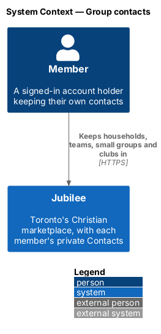
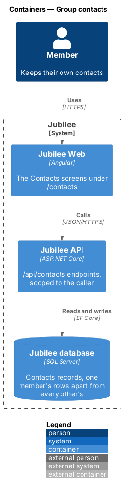
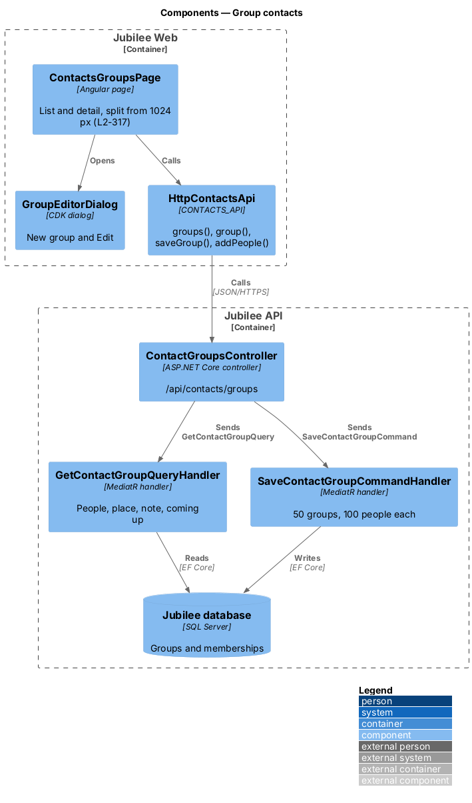
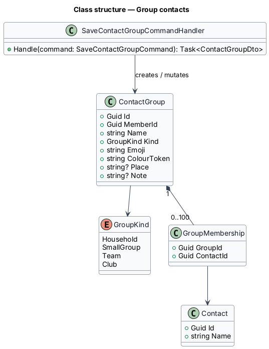
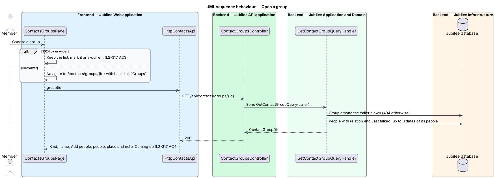

# Group contacts

## Overview

*Groups* at `/contacts/groups` gathers contacts who belong together
(L1-036). A group is a household, a team, a small group (such as a church's
Thursday night group) or a club. A group keeps its people, a place and a note
("Buzzer 4B", "Bring something to share"). It also shows the coming dates of
its people. A contact may be in several groups; a contact's circle is a
separate thing.

Local terms:

- **group kind**: Household, Small group, Team or Club
- **tile**: the group's emoji on its colour, as the library's `jb-media-tile` draws it

## Description

- **`ContactsGroupsPage`** (`pages/contacts-groups/`):
  `GET /api/contacts/groups` lists the groups under "Households", "Small
  groups", "Teams" and "Clubs", each with its tile, name and people's first
  names. A kind with none is left out (`L2-317` AC2).
  - From 1024 px the list stays on the left at 400 px with the chosen group
    marked `aria-current="true"`, and the first group is shown at first.
  - Under 1024 px choosing a group navigates to `/contacts/groups/{id}`, with
    the back link "Groups" (`L2-317` AC3).
  
  The heading carries "Connections" and "New group", which is an icon button
  under 576 px (`L2-317` AC1).
- **Group detail**: `GET /api/contacts/groups/{id}` →
  **`GetContactGroupQueryHandler`** answers the kind, name, people (photo,
  name, relation, Last talked), place, note, and up to three coming dates of
  its people (`L2-317` AC4). Each person opens their profile. "Add people"
  opens a contact picker dialog and calls
  `POST /api/contacts/groups/{id}/people`.
- **`GroupEditorDialog`** (`dialogs/group-editor/`): New group and Edit, with
  name (required, ≤ 60), kind, emoji, a colour from the avatar palette tokens,
  place (≤ 120), note (≤ 500) and people. It saves with "Create group" or
  "Save" (`L2-317` AC5).
- **`SaveContactGroupCommandHandler`**: checks that every person is the
  caller's own contact and holds the limits: 50 groups per member and 100
  people per group (`L2-317` AC6). It stores the colour as a token name, never
  a hex value (`L2-323` AC4).
- **Delete**: "Delete group" asks to confirm and removes the group and its
  memberships, never its people (`L2-317` AC5).
- **Add someone** (`keep-people`) toggles memberships with its group chips.
- **Tests**: `ContactGroupTests` (InMemory); e2e `contacts-groups.spec.ts` at
  360 px and 1280 px.

### Open questions

- **Popkin buttons**: the frame's "Open “{Popkin}”" and "Start a Popkin with
  them" are dropped, because Jubilee has no group conversations (L1-009).

## Requirements

| L2 ID | Refines (L1) | Requirement |
|-------|--------------|-------------|
| `L2-317` | `L1-036` | Groups shall list the groups by kind with tiles and first names, show a chosen group beside the list from 1024 px and on its own page under, with its people, place, note and up to three coming dates, create, edit and delete groups without deleting their people, and hold 50 groups of at most 100 people. |
| `L2-320` | `L1-036` | Every person of a group shall be the caller's own contact, and the API shall enforce every limit. |
| `L2-323` | `L1-036` | Every colour of Contacts shall come from the tokens. |

## Diagrams

### System context

The member keeps groups of their people in Jubilee. No external system takes
part.

### Containers

`Jubilee Web` reads and writes groups through `Jubilee API`.

### Components

The page lists and shows groups and opens the editor dialog. One handler reads
a group and another saves it.

### Class structure

A `ContactGroup` has a kind and up to 100 `GroupMembership` rows, each naming
one contact.

### Behaviour: open a group

The page keeps the list beside the group from 1024 px and navigates to it
under. The handler answers only a group of the caller's own.

