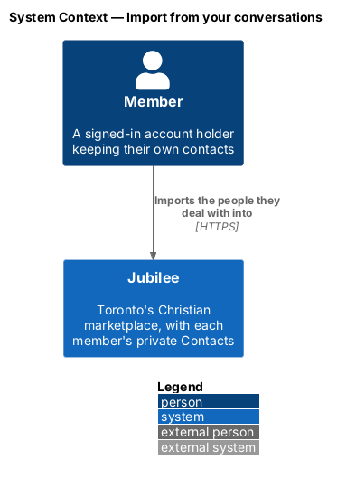
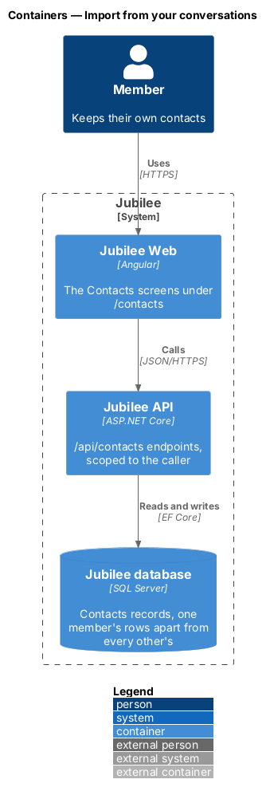
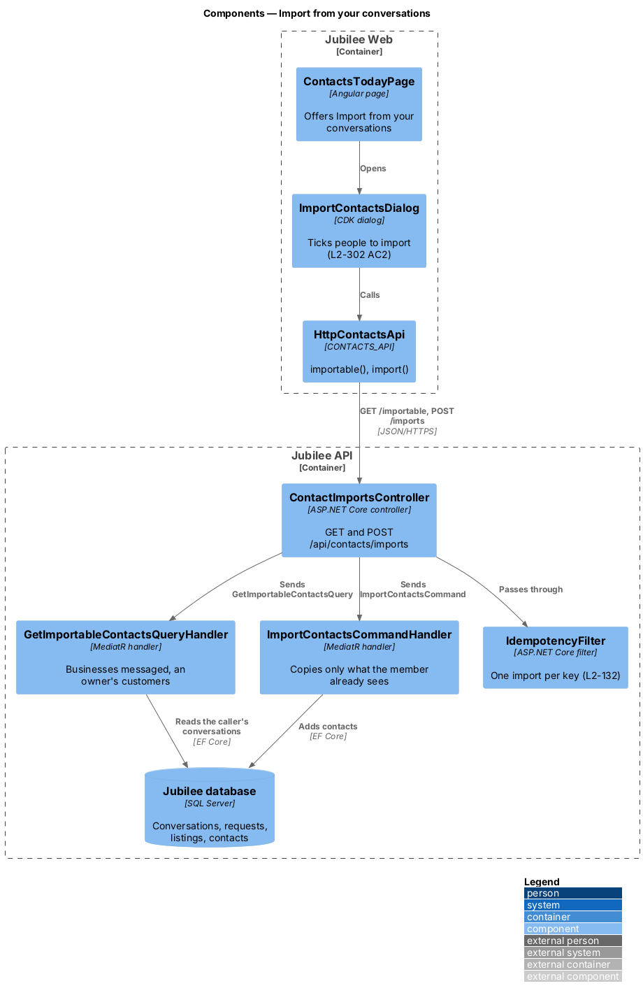
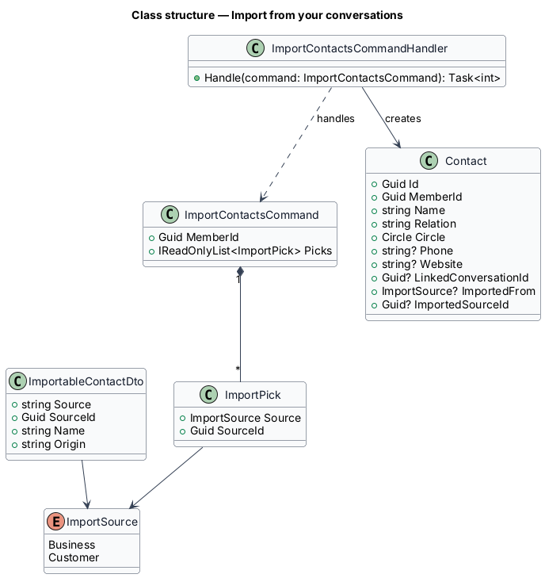
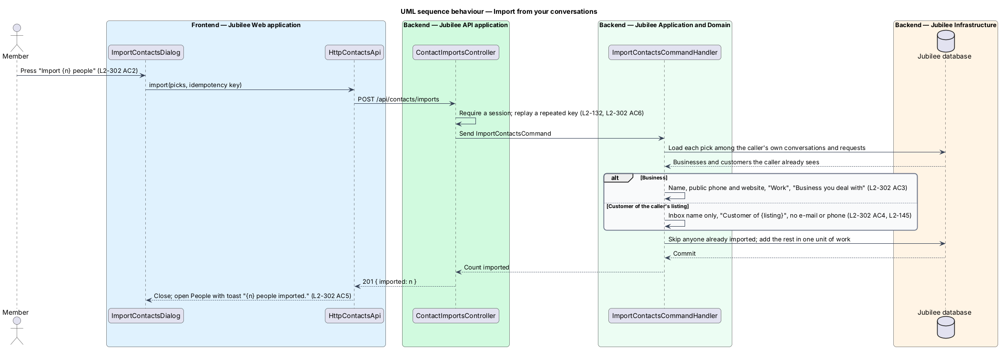

# Import from your conversations

## Overview

A member who starts Contacts already deals with people on Jubilee: the
businesses they have messaged or sent a request to, and, for an *owner*, the
members who have written to their listings. This feature lets the member
bring those people into Contacts in one step (L1-036).

The import copies no more of a person than the member already sees.
Jubilee keeps a member's phone, e-mail, postal code and home church from
businesses (`L2-145`), and the import keeps that promise: an owner's customer
arrives with the name the owner's inbox shows, and nothing else.

Local terms:

- **importable person**: a business the member deals with, or a customer of the member's listing, not yet in their contacts
- **linked contact**: a contact that keeps a link to the Jubilee conversation it came from

## Description

- **"Import from your conversations"**: offered on the empty Today (`L2-301`)
  when the importable count is above zero. It opens
  **`ImportContactsDialog`** (`dialogs/import-contacts/`), a CDK dialog that
  lists each person with their name and origin ("Business you’ve messaged",
  "Customer of {listing}"), all ticked, and "Import {n} people" (`L2-302`
  AC2).
- **`GET /api/contacts/imports`** → **`GetImportableContactsQueryHandler`**:
  reads the caller's own conversations and requests. A business is importable
  when the caller has messaged it or sent it a request. A member is importable
  when they have messaged or sent a request to a listing the caller owns. Anyone
  already imported, by `ImportedFrom` and `ImportedSourceId`, is left out
  (`L2-302` AC1). The same count fills `ContactsTodayDto.ImportableCount`.
- **`POST /api/contacts/imports`** → **`ImportContactsCommandHandler`**:
  loads each pick again among the caller's own sources. A pick that is not
  theirs is skipped and logged (`L2-320` AC1). It then creates the contacts:
  - a business: its name; its public phone and website when its page shows
    them; the circle `Work`; the relation "Business you deal with"; and
    `LinkedConversationId` (`L2-302` AC3);
  - a customer: the inbox name only; the circle `Work`; the relation
    "Customer of {listing}"; and `LinkedConversationId`. The handler never
    reads `Member.Email`, a request's phone, the postal code or the home
    church (`L2-302` AC4, `L2-145`).
- **Idempotency**: the dialog sends an `Idempotency-Key`. The existing
  idempotency filter replays a repeated key (`L2-132`), and the unique index on
  `(MemberId, ImportedFrom, ImportedSourceId)` keeps anyone from being added
  twice (`L2-302` AC6).
- **Result**: the dialog closes, People opens and the toast says "{n} people
  imported."; a failure keeps the dialog with "We couldn’t import them.
  Nothing was added. Try again." (`L2-302` AC5).
- **Limits**: the import counts toward the 2,000 contacts of `L2-320` AC5. An
  import that would pass the limit answers 422 `contacts: LIMIT_REACHED`, and
  nothing is added.
- **Tests**: `ContactImportTests` (InMemory, ADR 0009), including a proof that
  a customer's e-mail and phone are never copied, and
  `e2e/tests/contacts-import.spec.ts`.

### Open questions

- **Later imports**: the frames offer the import only on the empty Today. A
  way to import later, from People, is `<TO SUPPLY>`.
- **A business closed since**: an importable business that is no longer
  public is imported by name without a phone or website. Whether to offer it
  at all is `<TO SUPPLY>`.

## Requirements

| L2 ID | Refines (L1) | Requirement |
|-------|--------------|-------------|
| `L2-302` | `L1-036` | The import shall count the businesses the member has messaged or sent a request to and, for an owner, the members who wrote to their listings; it shall copy for a business its name, public phone and website, and for a customer only the inbox name, never their e-mail, phone, postal code or home church; each contact shall link to its conversation, and nobody shall be added twice. |
| `L2-145` | `L1-020` | A member's phone, e-mail and home church shall not be shown to businesses except as that rule allows. |
| `L2-132` | `L1-018` | A write sent twice shall take effect once. |
| `L2-320` | `L1-036` | Every Contacts record shall be found only among the caller's own, and the API shall enforce every limit. |

## Diagrams

### System context

The member imports, into their own Contacts, people Jubilee already holds
conversations with. No external system takes part.

### Containers

The dialog in `Jubilee Web` asks `Jubilee API`, which reads the caller's
conversations and writes their contacts in the `Jubilee database`.

### Components

One handler lists the importable people and another imports the picks, both
starting from the caller's own conversations.

### Class structure

An `ImportPick` names a source and its id. The handler turns each pick into
a `Contact` that remembers where it came from.

### Behaviour: import

The handler loads each pick among the caller's own sources and copies only
what the rule for its source allows. It skips anyone already imported.

