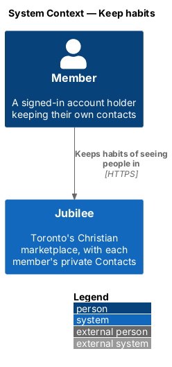
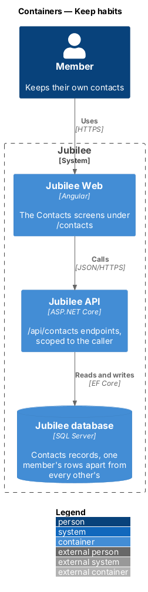
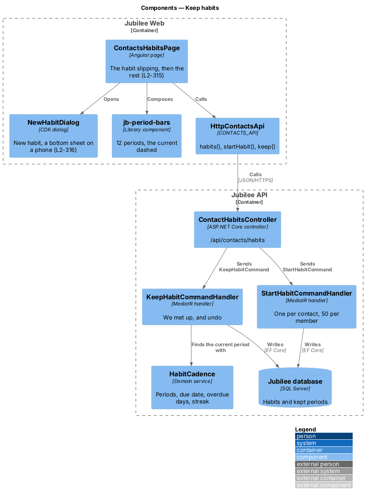
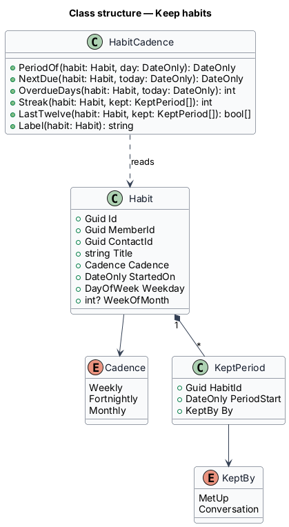
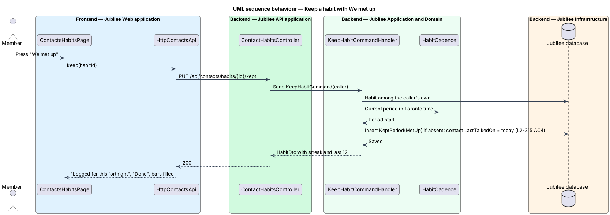

# Keep habits

## Overview

A *habit* is a small rhythm of seeing one contact: a Sunday call, a lunch every
two weeks, a monthly catch-up (L1-036). *Habits* at `/contacts/habits` shows
each habit's last 12 periods and how long it has run, and it leads with the one
slipping most. A member keeps a period by pressing "We met up" or by logging a
conversation with the person in it.

Local terms:

- **cadence**: how often a habit falls: Weekly, Every 2 weeks or Monthly
- **period**: one stretch of a cadence (a week, a fortnight, a month), counted from the day the habit started
- **kept**: said of a period in which the member met up or logged a conversation with the person
- **streak**: the periods kept in a row up to the current one ("11 weeks running")

## Description

- **`ContactsHabitsPage`** (`pages/contacts-habits/`):
  `GET /api/contacts/habits` answers the habits with their cadence label, last
  12 periods, streak, next date and overdue days. The page leads with the most
  overdue habit in the soft alert card: "{n} days overdue", "{cadence} ·
  you’ve kept {k} of the last 12", "Call {first name}" and "We met up". With
  none overdue, the card shows the habit due next (`L2-315` AC2). The rest
  follow as rows (`L2-315` AC3).
- **`jb-period-bars`**: the library component of `view-contact`. On Habits it
  also draws the current period dashed. It is named "Kept {k} of the last
  {n}".
- **`HabitCadence`** (`Jubilee.Domain/Contacts/`): pure rules in Toronto time.
  - The *period* of a day counts from `StartedOn`: 7 days, 14 days, or the
    calendar month for monthly.
  - The *next due* date is the habit's weekday in the current period. For
    monthly it is the `WeekOfMonth`-th weekday of the month.
  - *Overdue days* are counted from the next due date while the current
    period is not kept.
  - The *streak* is the kept periods in a row before the current one, plus the
    current one when it is kept (`L2-315` AC5).
  - The *labels* are "Every {weekday}", "Every 2 weeks" and "Every month", and
    the units "weeks", "fortnights" and "months".
- **"We met up"** → `PUT /api/contacts/habits/{id}/kept` →
  **`KeepHabitCommandHandler`**: inserts a `KeptPeriod` (`KeptBy.MetUp`) for
  the current period if it is absent and sets the contact's `LastTalkedOn` to
  today. The card says "Logged for this {week, fortnight or month}" and the
  button says "Done". `DELETE` on the same address undoes it (`L2-315` AC4).
- **Conversations keep habits**: `LogConversationCommandHandler`
  (`log-with-contact`) inserts a `KeptPeriod` (`KeptBy.Conversation`) for the
  period of the conversation's date.
- **`NewHabitDialog`** (`dialogs/new-habit/`): a bottom sheet under 768 px and
  480 px wide from it. It asks With (a contact picker), What (≤ 80, empty shows
  "Say what you’ll do together.") and How often. The line under the choice
  says when the habit falls, from today's weekday (`L2-316` AC2). "Start the
  habit" calls `POST /api/contacts/habits`.
- **`StartHabitCommandHandler`**: one habit per contact (422
  `contactId: HABIT_EXISTS`) and 50 per member (`L2-316` AC3). It stores
  `StartedOn` as today, the `Weekday` and, for monthly, the `WeekOfMonth`.
- **Habit menu**: "Edit" reopens the dialog. "Stop this habit" asks to confirm
  and deletes the habit with its kept periods (`L2-316` AC4).
- **Reminders**: a habit due today is reminded at 9:00 a.m.
  (`remember-dates`, `L2-312` AC5).
- **Tests**: `ContactHabitTests` (InMemory, with a fake `TimeProvider` across
  months of 28 to 31 days and a daylight-saving change); e2e
  `contacts-habits.spec.ts`.

### Open questions

- **"First Saturday of the month"**: the frame shows this label for a monthly
  habit. The design labels every monthly habit "Every month" and keeps its
  week of the month for the reminder. A label naming the weekday is
  `<TO SUPPLY>`.
- **"Nudge again if a week slips by"**: the dialog's line promises a second
  reminder. The design sends it on the day after the due date when the period
  is not kept, through the job of `remember-dates`.

## Requirements

| L2 ID | Refines (L1) | Requirement |
|-------|--------------|-------------|
| `L2-315` | `L1-036` | Habits shall lead with the most overdue habit, stating its overdue days, cadence and kept count with "Call" and "We met up", list the rest with their last 12 periods, streak and next date, and keep the current period by "We met up" or a logged conversation. |
| `L2-316` | `L1-036` | "New habit" shall ask with whom, what and how often, say when it falls, start the habit with "Start the habit", allow one per contact and 50 per member, and offer "Edit" and "Stop this habit". |
| `L2-305` | `L1-036` | A kept habit shall set the contact's Last talked. |
| `L2-312` | `L1-036` | A habit due today shall be reminded at 9:00 a.m. Toronto time. |

## Diagrams

### System context

The member keeps habits in Jubilee. No external system takes part.

### Containers

`Jubilee Web` reads the habits and keeps periods through `Jubilee API`.

### Components

The page composes `jb-period-bars` and opens the dialog. The handlers keep
periods and start habits with the rules of `HabitCadence`.

### Class structure

A `Habit` has a cadence and the day it started, and it owns its
`KeptPeriod` rows. `HabitCadence` works out periods, streaks and labels from
them.

### Behaviour: keep a habit with "We met up"

The handler keeps the current period once and sets Last talked. The page then
shows the period kept.

