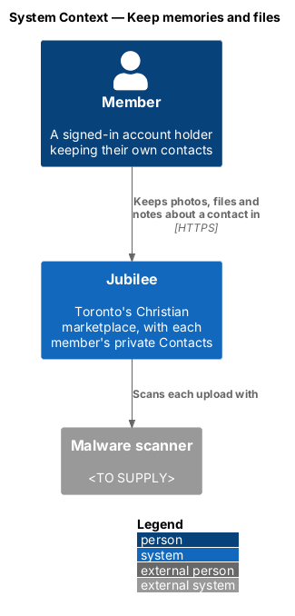
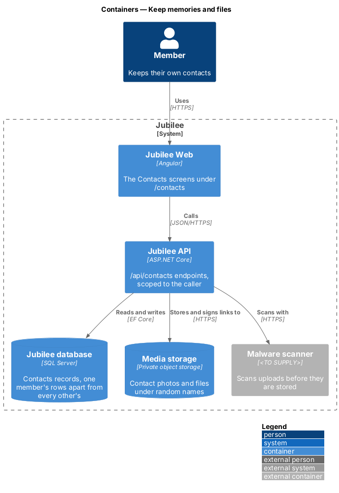
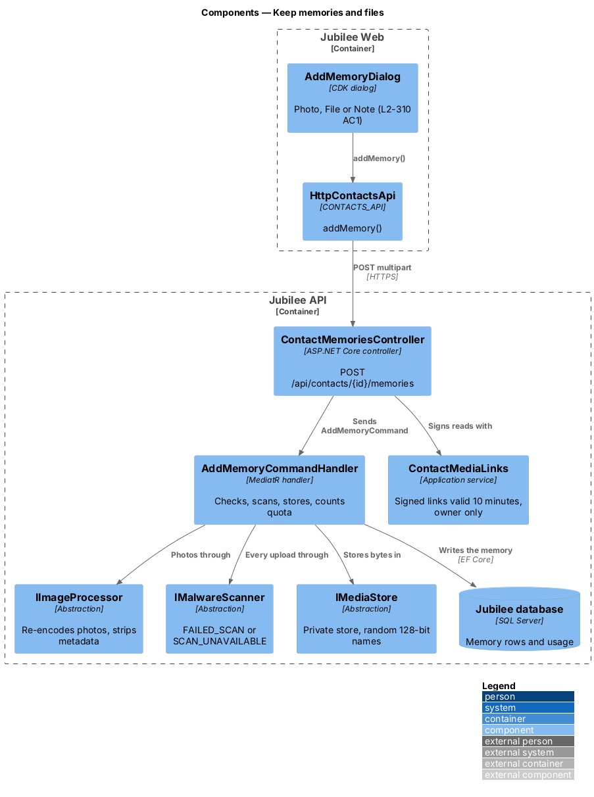
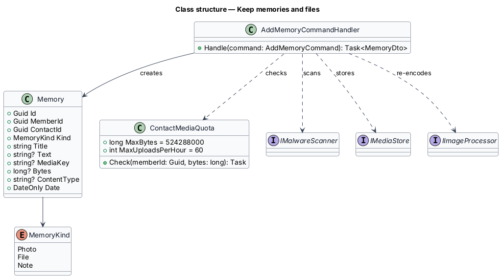
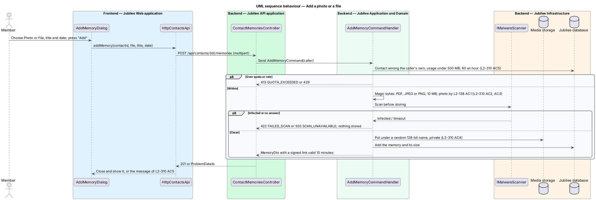

# Keep memories and files

## Overview

*Memories & files* is the third tab of a contact's profile. In it the member
keeps photos, files (a letter, a recipe, a speech) and notes (a gift list)
about the person (L1-036). Everything kept is private to the member. A file
is stored and served under the same checks as every upload to Jubilee
(`L2-138`), and in addition it is never public: it is read only through a
short-lived link that only its owner can use.

Local terms:

- **memory**: a photo, file or note kept about a contact
- **signed link**: an address to a stored file that carries a signature and an expiry, valid for 10 minutes and for its owner only
- **quota**: the 500 MB of photos and files a member may keep in Contacts

## Description

- **`AddMemoryDialog`** (`dialogs/add-memory/`): `jb-segmented-choice`
  Photo, File or Note. A photo and a file take `jb-attach-photo` or a file
  input, a title (≤ 80, the file's name by default) and a date (today by
  default). A note takes a title (≤ 200), text (≤ 4,000) and a date
  (`L2-310` AC1). The dialog shows the errors of AC5 in its alert.
- **`ContactMemoriesController`**: `POST /api/contacts/{id}/memories`
  (multipart for a photo or file, JSON for a note), `PUT` and `DELETE` of
  `/api/contacts/memories/{memoryId}`, and
  `GET /api/contacts/memories/{memoryId}/content`, which redirects to a signed
  link.
- **`AddMemoryCommandHandler`**: runs, in this order:
  1. the contact is found among the caller's own (404 otherwise);
  2. **`ContactMediaQuota`** checks 500 MB in all and 60 uploads an hour.
     Over either it answers 413 `QUOTA_EXCEEDED` or 429 (`L2-310` AC5);
  3. the magic bytes are checked: a file is PDF, JPEG or PNG of at most
     10 MB, and a photo is JPEG or PNG of at most 5 MB and 8,000 × 8,000 px
     (`L2-310` AC2, AC3);
  4. **`IImageProcessor`** (the existing `SkiaImageProcessor`) re-encodes a
     photo and strips its metadata;
  5. **`IMalwareScanner`** scans every upload before it is stored: infected is
     422 `FAILED_SCAN`, and no answer is 503 `SCAN_UNAVAILABLE`, with nothing
     stored (`L2-138` AC4);
  6. **`IMediaStore`** keeps the bytes under a random 128-bit name in the
     private area, never under the public `/media` (`L2-310` AC4);
  7. the `Memory` row records the title, kind, content type, size and date.
- **`ContactMediaLinks`**: signs a link for 10 minutes with the caller's id
  in the signature. A link opened by anyone else, or after expiry, is 404.
  Contact photos (`Contact.PhotoKey`) and milestone photos use the same links.
- **The tab** (`view-contact`): photos in a grid of two columns (four from
  576 px), then files and notes as a list, with the size shown in KB or MB
  (`L2-306` AC5).
- **Deletion**: deleting a memory deletes its row at once and queues its key
  for erasure within 24 hours, like a deleted contact's (`L2-319` AC3).
- **Tests**: `ContactMemoryTests` (InMemory, with the scanner faked through
  its abstraction), covering a file over 10 MB, an infected file, no scanner
  answer, the quota and another member's link; e2e `contacts-memories.spec.ts`
  with stubbed upload answers.

### Open questions

- **Storage vendor and scanner**: the same as the message photos, `<TO SUPPLY>`
  in production.
- **PDF preview**: a file opens in a new tab through its signed link. An
  in-page preview is not designed.

## Requirements

| L2 ID | Refines (L1) | Requirement |
|-------|--------------|-------------|
| `L2-310` | `L1-036` | "Add" shall take a photo, a file (PDF, JPEG or PNG up to 10 MB) or a note; every upload shall be checked, scanned before it is stored, kept privately under a random 128-bit name and read only through a 10-minute signed link of its owner; a member shall keep at most 500 MB and 60 uploads an hour. |
| `L2-138` | `L1-019` | Uploads shall be checked by magic bytes, re-encoded, stripped of metadata and scanned, and a failed upload shall never be stored or served. |
| `L2-306` | `L1-036` | Memories & files shall show the photos in a grid and the files and notes in a list, with its empty state. |
| `L2-319` | `L1-036` | Deleted photos and files shall leave the media store within 24 hours. |

## Diagrams

### System context

The member keeps files about a contact in Jubilee. Every upload is checked by
the malware scanner, whose vendor is `<TO SUPPLY>`.

### Containers

`Jubilee API` scans each upload before writing it to private `Media storage`,
and it records each memory in the `Jubilee database`.

### Components

One handler runs the checks in order through the existing media abstractions.
`ContactMediaLinks` signs every read.

### Class structure

A `Memory` is a photo, a file or a note. The handler depends on the quota and
the three media abstractions.

### Behaviour: add a photo or a file

The quota is checked first, then the type and size, then the scan. Only a
clean file is stored, and the answer carries a signed link.

