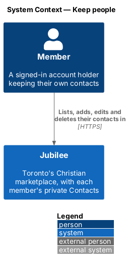
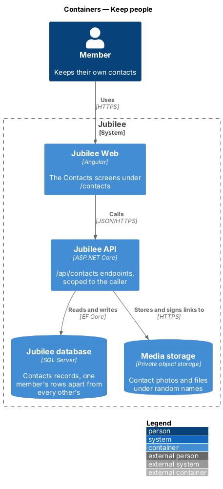
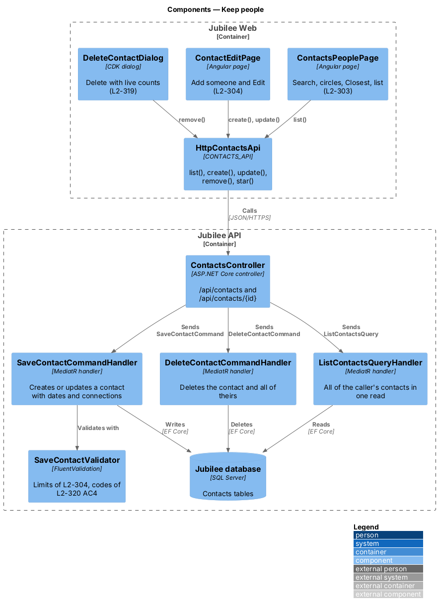
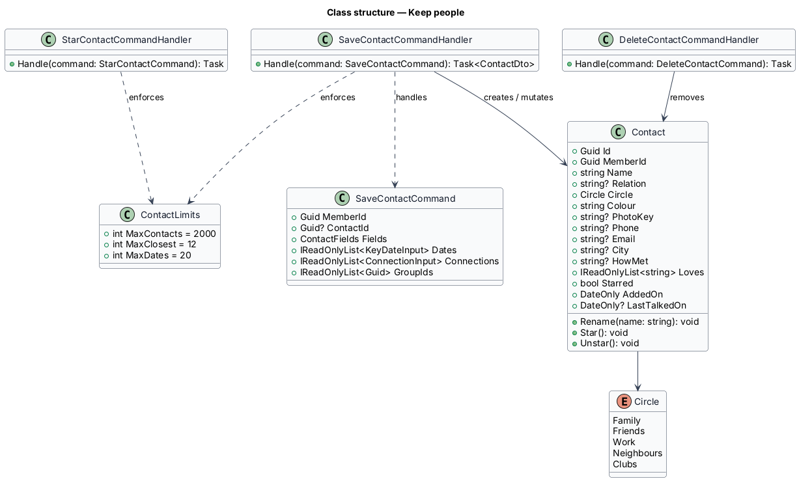
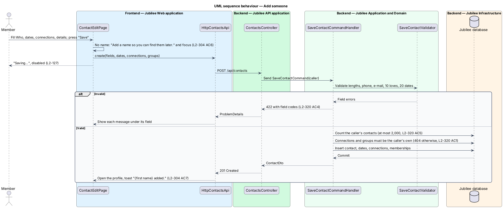
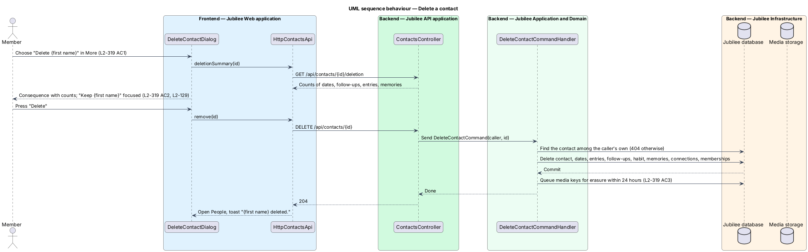

# Keep people

## Overview

People is the list of a member's contacts in Contacts (L1-036). From it the
member finds someone by name or circle and opens their profile. They add
someone new, edit someone's details, keep their closest people at the top
and delete a contact with everything kept about them.

Local terms:

- **circle**: the one group of life a contact belongs to: Family, Friends, Work, Neighbours or Clubs
- **Closest**: the contacts the member has starred, at most 12, shown first on People
- **relation**: how the member knows a contact, in the member's own words ("Sister", "Old boss")
- **connection**: a link between two contacts, in a few words and of a kind (Family, Partner, Friends or Work)

## Description

- **`ContactsPeoplePage`** (`pages/contacts-people/`): `GET /api/contacts`
  answers every contact of the caller in one read, sorted by name
  (`L2-322` AC1). Search ("Search by name") and the circle chips filter in the
  page with no round trip, ignoring case and accents (`L2-303` AC2, AC3).
  "Closest" shows the starred contacts when "All" is chosen and the search is
  empty (`L2-303` AC4). From 768 px each row shows the columns Name, Circle,
  Next date and Last talked. Only the rows in view are rendered (CDK virtual
  scroll), so 2,000 rows scroll smoothly. A quiet contact reads "{n} days ago"
  in bold and in the alert colour (`L2-303` AC5). With no match the page shows
  "No one called “{search}”" and "Add “{search}”" (`L2-303` AC6). The search
  and circle are kept in the query string, so the back link restores them
  (`L2-303` AC7).
- **`ContactEditPage`** (`pages/contacts-edit/`): one page for Add someone
  (`/contacts/people/new`) and Edit (`/contacts/people/{id}/edit`), titled
  "Add someone" or "Edit {first name}" (`L2-304` AC1, AC9). It has four
  sections built from library components:
  - **Who**: `jb-attach-photo`, `jb-field` + `jb-input` for "Name" and "How you
    know them", and `jb-segmented-choice` for "Circle".
  - **Dates to remember**: repeating rows of kind, date and `jb-select`
    reminder, with "Another date".
  - **How they connect**: connection rows with "Remove connection", and
    "Connect to someone" opening a picker dialog, then group chips.
  - **Details**: "Phone", "Email", "City", "How you met" and "Things they love".
  
  Validation follows `L2-126`: a missing name shows "Add a name so you can
  find them later." and takes focus. "Save" reads "Saving…" while busy
  (`L2-127`). "Cancel" with changes opens `LeaveUnsavedDialog` as
  "Discard {first name}?" (`L2-304` AC8).
- **`SaveContactCommand`** / **`SaveContactCommandHandler`**: one command for
  create and update. It holds the fields, the dates, the connections and the
  group ids. It checks that every connected contact and group is the caller's
  own (404 otherwise) and writes everything in one unit of work. A new
  contact's colour comes from the avatar palette tokens, chosen by its id.
- **`SaveContactValidator`** (FluentValidation): name 1–100, relation ≤ 80,
  city ≤ 80, how met ≤ 200, phone ≤ 20 and valid, e-mail ≤ 254 and valid,
  at most 10 loves of ≤ 40 each, at most 20 dates, and connection words ≤ 40
  (`L2-304` AC2–AC5). A failure is 422 ProblemDetails with each field's code
  (`L2-320` AC4).
- **`ContactLimits`**: 2,000 contacts per member (`L2-320` AC5), 12 in
  Closest (`L2-319` AC1) and 20 dates per contact.
- **`StarContactCommandHandler`**: `PUT` and `DELETE /api/contacts/{id}/star`.
  The thirteenth star answers 422 `starred: CLOSEST_FULL`, which the menu shows
  as "Closest holds 12 people. Remove someone first."
- **`DeleteContactDialog`** (`dialogs/delete-contact/`): reads
  `GET /api/contacts/{id}/deletion` for its counts. It states the consequence
  with "Keep {first name}" focused (`L2-319` AC2, `L2-129`).
- **`DeleteContactCommandHandler`**: deletes the contact and every row that
  points at it in one unit of work. Its photos' and files' keys go to the
  erasure queue of `AccountErasure`, which erases them within 24 hours
  (`L2-319` AC3).
- **Tests**: `ContactsTests` (InMemory), one per criterion, including a
  refusal for a contact of another member; e2e `contacts-people.spec.ts` and
  `contacts-edit.spec.ts` through their page objects.

### Open questions

- **Accent folding** in search uses `String.Normalize(FormD)` in the page; a
  server search is not needed while one answer holds every contact.
- **The phone format**: valid means E.164 after removing spaces, dashes and
  brackets; a Toronto number without "+1" is taken as Canadian. To be
  confirmed.

## Requirements

| L2 ID | Refines (L1) | Requirement |
|-------|--------------|-------------|
| `L2-303` | `L1-036` | People shall show the count, search by name, the circle chips with counts, Closest, and the list sorted by name with Next date and Last talked from 768 px, the no-results state with "Add “{search}”", and restore the search and circle on return. |
| `L2-304` | `L1-036` | Add someone and Edit shall offer Who, Dates to remember, How they connect and Details with the stated limits, refuse a missing name with "Add a name so you can find them later.", show "Saving…" while busy, and ask before discarding changes. |
| `L2-319` | `L1-036` | "More" shall add to or remove from Closest, at most 12, and delete a contact after a confirmation with live counts, removing everything of theirs and their media within 24 hours. |
| `L2-126` | `L1-018` | Invalid forms shall show a message under each field and move focus to the first. |
| `L2-127` | `L1-018` | A submit button shall show its busy state until the answer. |
| `L2-129` | `L1-018` | A consequential action shall be confirmed with real counts, the safe choice focused. |
| `L2-320` | `L1-036` | Every Contacts record shall be the caller's own, every limit shall be enforced by the API, and a member shall hold at most 2,000 contacts. |

## Diagrams

### System context

The member keeps their contacts in Jubilee. No external system takes part.

### Containers

`Jubilee Web` reads and writes contacts through `Jubilee API`. A contact's
photo is kept in private `Media storage`.

### Components

People lists the contacts and the edit page saves them through one command,
which a validator checks. Deletion has a handler of its own.

### Class structure

`Contact` holds what the member keeps about a person. `SaveContactCommand`
carries a contact with its dates, connections and groups, and `ContactLimits`
holds the counts the handlers enforce.

### Behaviour: add someone

The page checks the name first. The API validates every field, checks the
limit and the ownership of each connection and group, and saves everything in
one unit of work.

### Behaviour: delete a contact

The dialog states the counts before the member confirms. The handler deletes
every row of the contact and queues their media for erasure.

