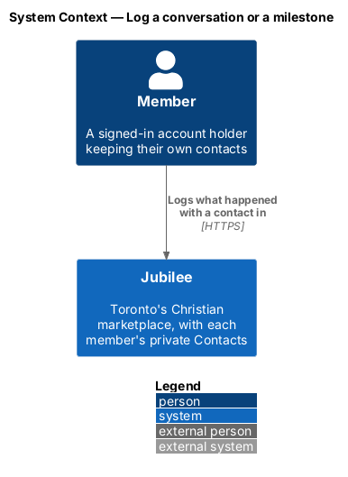
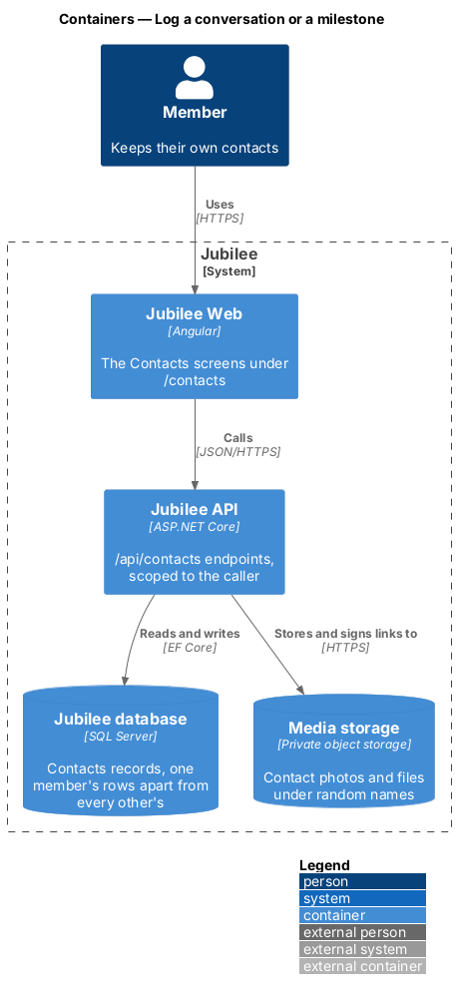
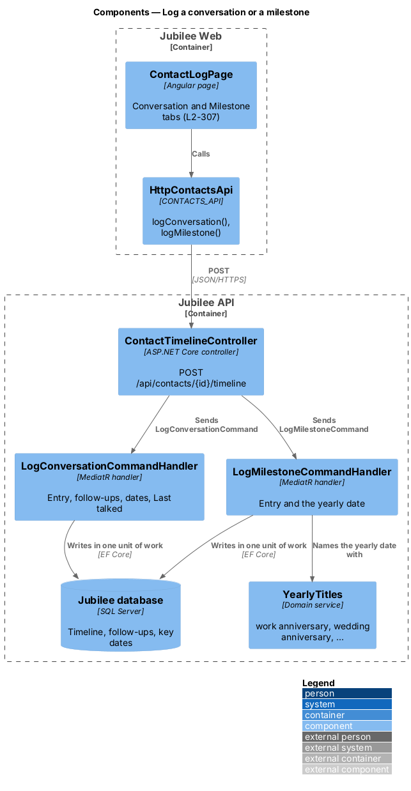
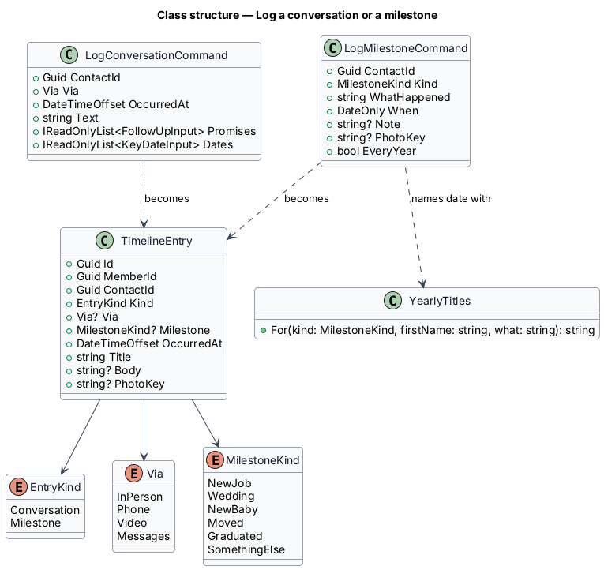
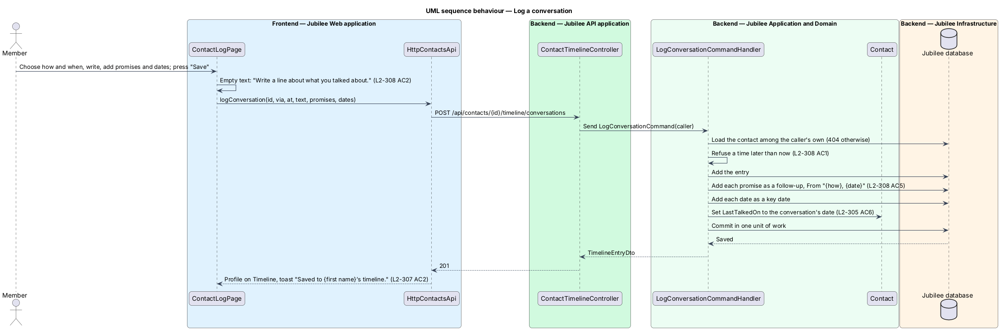
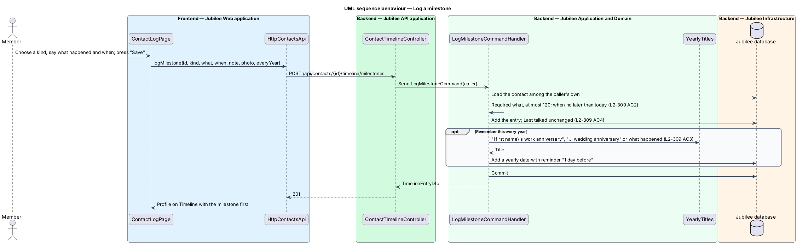

# Log a conversation or a milestone

## Overview

*Log* is the screen at `/contacts/people/{id}/log` where a member writes down
something that happened with a contact (L1-036). There are two kinds:

- a *conversation*: what they talked about, how and when, the promises the
  member made and any dates worth remembering;
- a *milestone*: a turning point in the contact's life, with an option to
  remember it every year.

Each entry joins the contact's timeline. A conversation also sets the
contact's Last talked, so they are no longer quiet. Promises become
follow-ups, so a promise does not slip ("But let your 'Yes' be 'Yes'",
Matthew 5:37).

Local terms:

- **via**: how a conversation happened: In person, Phone, Video or Messages
- **yearly date**: a key date made from a milestone that repeats on its day every year

## Description

- **`ContactLogPage`** (`pages/contacts-log/`): the bar shows "Cancel", the
  contact's `jb-avatar`, the heading "Talked with {first name}" or "{first
  name}’s milestone", and "Save" (`L2-307` AC1). `jb-tabs` switches the kind
  and keeps both forms' values. The query string `?kind=milestone` opens the
  Milestone tab. "Cancel" with anything typed opens `LeaveUnsavedDialog` as
  "Discard this?" with "Keep writing" focused (`L2-307` AC3).
- **Conversation form** (`L2-308`):
  - `jb-segmented-choice` for via, Phone first;
  - when, starting at now, through a date and time picker that allows nothing
    later than now;
  - `jb-textarea` "What did you talk about?", up to 4,000 characters; empty
    shows "Write a line about what you talked about.";
  - the promise rows from "Add a promise or follow-up" (text ≤ 200, a remind
    date, promise on by default);
  - chips under "Worth remembering" from "Add a date".
- **Milestone form** (`L2-309`):
  - six `jb-choice-card` kinds, two to a row and three from 576 px;
  - "What happened?" (required, ≤ 120, empty shows "Say what happened.");
  - "When", no later than today;
  - "Photo", through `jb-attach-photo` and the upload of `keep-memories`;
  - "Note", ≤ 2,000;
  - the `jb-switch` "Remember this every year", on by default.
- **`ContactTimelineController`**: `POST /api/contacts/{id}/timeline/conversations`
  and `POST /api/contacts/{id}/timeline/milestones`, plus `PUT` and `DELETE` of
  `/api/contacts/timeline/{entryId}` for the item menus of `view-contact`.
- **`LogConversationCommandHandler`**: in one unit of work it adds the
  `TimelineEntry` (`Kind = Conversation`) and each promise as a `FollowUp`
  with `From = "{via}, {date}"`. It adds each date as a `KeyDate` and sets
  `Contact.LastTalkedOn` to the conversation's date when that is later
  (`L2-308` AC5). A conversation in a habit's current period also keeps it
  (`L2-315` AC4).
- **`LogMilestoneCommandHandler`**: adds the entry (`Kind = Milestone`) and
  leaves Last talked as it is (`L2-309` AC4). With "Remember this every year"
  it adds a repeating key date with the reminder "1 day before". The date's
  title comes from **`YearlyTitles`**: "{first name}’s work anniversary" for a
  new job, "{first name}’s wedding anniversary" for a wedding, and what
  happened for the rest (`L2-309` AC3).
- **Save result**: the profile opens on Timeline with the new entry first and
  the toast "Saved to {first name}’s timeline." (`L2-307` AC2).
- **Tests**: `ContactTimelineTests` (InMemory), including a refused future
  time and a refused entry for another member's contact; e2e
  `contacts-log.spec.ts`.

### Open questions

- **Duration**: the frame's timeline shows "Phone · 40 min", but Log asks no
  duration, so the timeline shows how it happened only.
- **"Worth remembering" suggestions**: the frame shows a date suggested from
  the text ("Biscuit the greyhound arrives in July"). The design adds dates by
  hand only; any suggestion from the text is `<TO SUPPLY>`.

## Requirements

| L2 ID | Refines (L1) | Requirement |
|-------|--------------|-------------|
| `L2-307` | `L1-036` | Log shall show the contact, a heading by kind, Conversation and Milestone tabs that keep their values, save to the timeline with "Saved to {first name}’s timeline.", and ask before discarding. |
| `L2-308` | `L1-036` | A conversation shall take how, when no later than now, what was talked about (required, up to 4,000), promises and dates; on save each promise shall become a follow-up and the contact's Last talked shall be its date. |
| `L2-309` | `L1-036` | A milestone shall take one of six kinds, what happened (required, up to 120), when no later than today, a photo and a note; "Remember this every year" shall add a yearly date with "1 day before", and a milestone shall not change Last talked. |
| `L2-305` | `L1-036` | Last talked shall be the date of the latest conversation or kept habit, or the date the contact was added. |

## Diagrams

### System context

The member logs what happened with a contact in Jubilee. No external system
takes part.

### Containers

`Jubilee Web` sends the entry to `Jubilee API`, which writes it with its
follow-ups and dates to the `Jubilee database`. A milestone's photo is kept in
`Media storage`.

### Components

Each kind has its own handler. The milestone handler names its yearly date
with `YearlyTitles`.

### Class structure

`TimelineEntry` holds both kinds. A conversation has a `Via`, and a milestone
has a `MilestoneKind`.

### Behaviour: log a conversation

The handler refuses a time later than now. It saves the entry with its
promises and dates and sets Last talked, all in one unit of work.

### Behaviour: log a milestone

The handler saves the milestone and, when asked, a yearly date named for its
kind.

