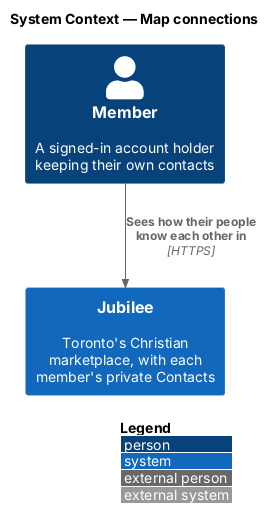
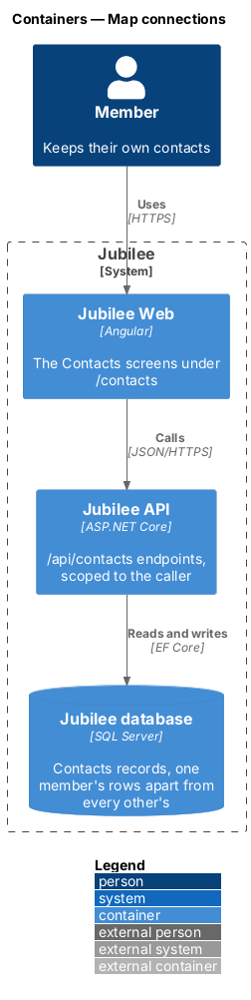
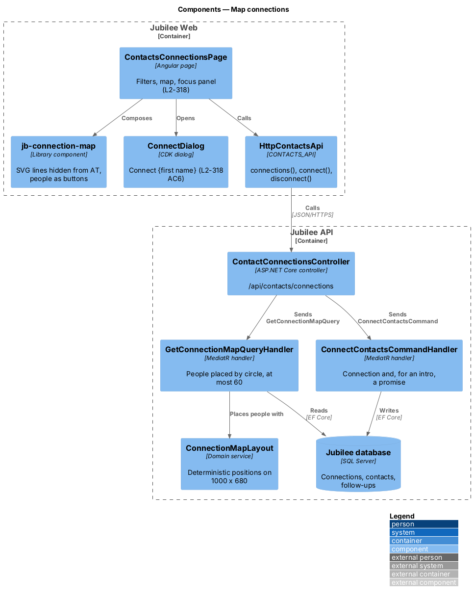
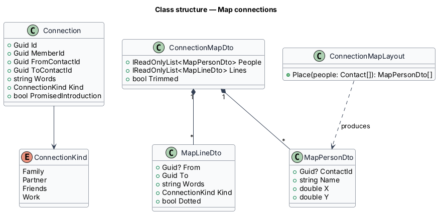
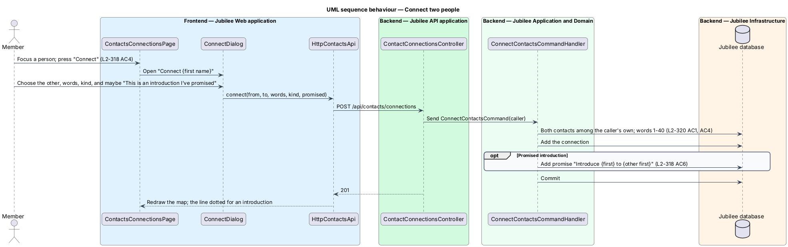

# Map connections

## Overview

*Connections* at `/contacts/connections` draws how a member's people know each
other (L1-036). The member is at the centre and each contact sits in the
quarter of their circle. A line joins two people for each connection: family,
partners, friends or work. Pressing a person focuses them: their lines stand
out, everyone else fades, and a panel says each of their connections in words.
An introduction the member has promised is drawn dotted, and it is also a
follow-up, so the promise is kept.

Local terms:

- **board**: the drawing area of 1000 × 680 units that the map scales to its width
- **focus**: the one person whose connections the map and the panel show
- **member's own line**: the line from the member to a contact, labelled with how they know them

## Description

- **`ContactsConnectionsPage`** (`pages/contacts-connections/`):
  `GET /api/contacts/connections` answers the people placed on the board and
  the lines. The chips Everyone, Family, Friends and Work filter the lines in
  the page, and Family includes the partner lines (`L2-318` AC1). From 1024 px
  the panel sits beside the map, and under it the panel sits below. With no
  focus the panel says "Tap anyone to see their people" (`L2-318` AC5).
- **`jb-connection-map`** (`components/src/lib/connection-map/`): a new
  library component.
  - It draws the lines in an SVG with `aria-hidden="true"`, coloured by the
    tokens of their kind. Work lines are dashed and promised introductions are
    dotted (`L2-318` AC2).
  - It places each person as a `<button>` named by their name, with
    `aria-pressed` for the focus (`L2-318` AC4, AC7).
  - A person's photo is 28 px under 768 px and 46 px from it, and each button's
    target is at least 44 × 44 px (`L2-323` AC2).
  - Arrow keys move between people in reading order.
- **`ConnectionMapLayout`** (`Jubilee.Domain/Contacts/`): places "You" at
  (500, 340). Each circle has a quarter: Family top left, Friends top right,
  Neighbours and Clubs bottom left, Work bottom right. Within a quarter, people
  sit on rings around its centre in the order of their names, so the same
  contacts always land in the same places.
- **`GetConnectionMapQueryHandler`**: reads the caller's contacts and
  connections. Every contact gets the member's own line, labelled with its
  relation, of kind Family for the circle Family, Work for Work and Friends for
  the rest. With more than 60 contacts it keeps the 60 with the latest Last
  talked and sets `Trimmed`, which the page shows as "Showing the 60 people
  you’ve talked to most recently." (`L2-318` AC3).
- **`ConnectDialog`** (`dialogs/connect/`): "Connect {first name}" with the
  other contact, the words (1–40), the kind and "This is an introduction I’ve
  promised". It saves with "Connect" through `POST /api/contacts/connections`
  (`L2-318` AC6).
- **`ConnectContactsCommandHandler`**: checks that both contacts are the
  caller's own and different, and adds the `Connection`. With
  `PromisedIntroduction` it also adds the promise "Introduce {first name} to
  {other first name}" as a follow-up due in 7 days. The focused person's list
  removes a line with `DELETE /api/contacts/connections/{id}`.
- **Add someone** (`keep-people`) writes connections through the same
  `Connection` rows.
- **Tests**: `ContactConnectionTests` (InMemory), covering the trim at 60,
  the promise of an introduction and a connection to another member's
  contact; e2e `contacts-connections.spec.ts` focusing a person by keyboard
  and by touch.

### Open questions

- **Crowded quarters**: past about 20 people in one quarter the rings overlap
  at 360 px. A denser layout is `<TO SUPPLY>`.
- **A promised introduction carried out**: the design leaves the line dotted
  until the member edits it. Marking the follow-up done does not change the
  line.

## Requirements

| L2 ID | Refines (L1) | Requirement |
|-------|--------------|-------------|
| `L2-318` | `L1-036` | Connections shall draw the member at the centre and each contact in the quarter of their circle with a line per connection, coloured and dashed by kind and dotted for a promised introduction, show at most 60 people, focus a person to show their connections in a panel with "Open profile" and "Connect", add a connection with an optional promised introduction, and say every connection in words for assistive technology. |
| `L2-320` | `L1-036` | Both people of a connection shall be the caller's own contacts. |
| `L2-323` | `L1-036` | Every person on the map shall be a target of at least 44 × 44 px, and no state shall be carried by colour alone. |

## Diagrams

### System context

The member sees their people's connections in Jubilee. No external system
takes part.

### Containers

`Jubilee Web` draws the map from one answer of `Jubilee API`.

### Components

The page composes `jb-connection-map` and opens the connect dialog. The
query places people with `ConnectionMapLayout`, and the command adds
connections.

### Class structure

A `Connection` joins two contacts with words and a kind. The map's answer
holds placed people and lines.

### Behaviour: connect two people

The handler checks both people are the caller's own and adds the connection.
For a promised introduction it also adds a follow-up.

