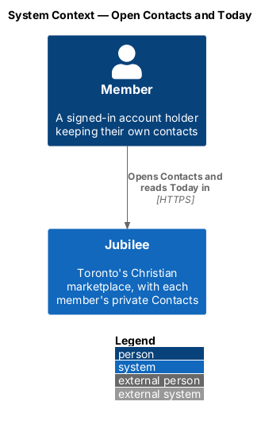
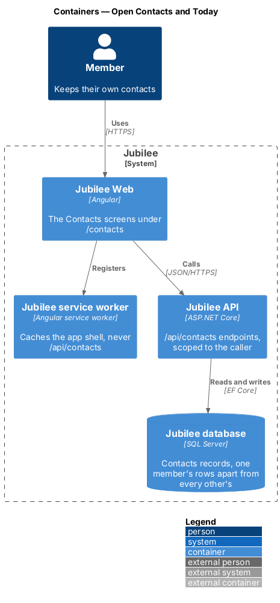
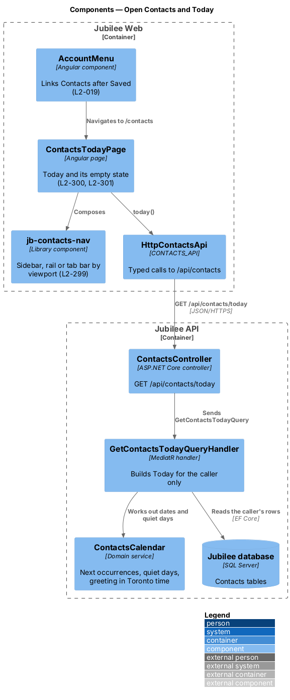
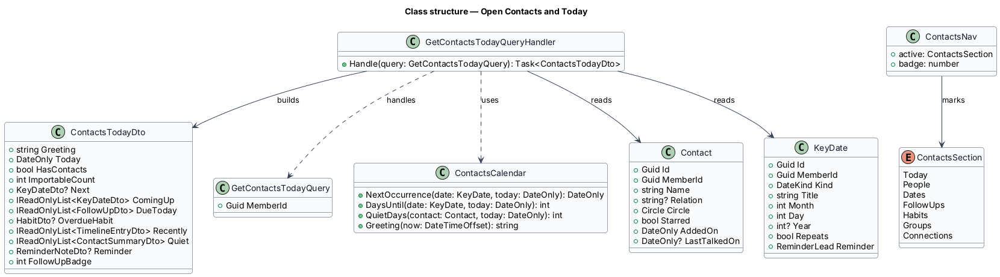
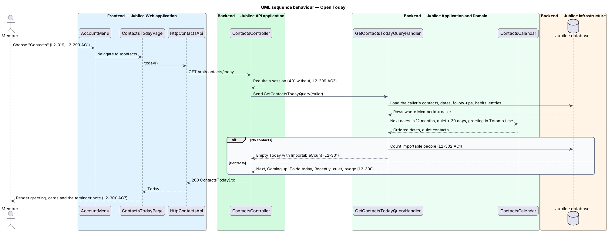

# Open Contacts and Today

## Overview

*Contacts* is a member's own private address book in Jubilee, of the people in
their life and work: customers, suppliers, partners, colleagues, family,
neighbours and their church's small group (L1-036). Only that member ever reads it.
It serves the mission by helping a Christian business owner keep the people
around them as neighbours, not leads, and keep their word to them.

This feature covers the way into Contacts and its first screen:

- "Contacts" in the account menu, after "Saved", and under "You" in the tab
  bar on a phone;
- the Contacts navigation, which lists the seven sections Today, People,
  Dates, Follow-ups, Habits, Groups and Connections;
- *Today*: the screen at `/contacts` that shows what matters with the
  member's people now;
- the empty Today a member sees before adding anyone.

Local terms:

- **contact**: a person the member keeps in Contacts, private to that member
- **key date**: a birthday, an anniversary or another day of a contact's, with a reminder
- **follow-up**: something the member means to do for a contact, with a due date; a *promise* is a follow-up the member said they would do
- **quiet**: said of a contact the member last talked with more than 30 days ago
- **reminder note**: the status note at the top of Today on the day a reminder falls

The Contacts prototype of the Magic Patterns Popkin design draws these
screens (`QuinntyneBrown/Popkin-Community-Platform`, frames Today and My Popkins).
`docs/design-reference/magic-patterns/README.md` records where Jubilee
departs from the frames.

## Description

The slice runs from the account menu in `Jubilee Web` to the Contacts tables
in the `Jubilee database`. No code exists yet; the names below are the names
the design introduces.

- **`AccountMenu`** (`dialogs/account-menu/`): gains "Contacts" after "Saved",
  linking to `/contacts` (`L2-019` AC1, `L2-299` AC1).
- **Routes** (`app.routes.ts`): a lazy child tree under `contacts` (`L2-322`
  AC4) with the addresses and `page` values of `L2-299` AC7, behind the
  sign-in guard (`L2-012`). Every route has `shell: 'app'`; the profile, Edit
  and Log routes also set `contactsTabBar: false` (`L2-299` AC8).
- **`jb-contacts-nav`** (`components/src/lib/contacts-nav/`): the Contacts
  navigation. From 1024 px it is a labelled sidebar with the wordmark, the
  back link "Browse", the heading "Contacts" and the seven sections. From
  768 px to 1023 px it is an icon rail 84 px wide. Under 768 px it is a tab bar
  of five: Today, People, Dates, Follow-ups and Groups. On Habits the tab bar
  marks Today, and on Connections it marks Groups (`L2-299` AC3–AC5). The
  current item carries `aria-current="page"`. The Follow-ups badge is named
  "Follow-ups, {n} due" (`L2-299` AC6).
- **`ContactsTodayPage`** (`pages/contacts-today/`): composes `jb-page-header`,
  a date card, `jb-list` rows, `jb-moment-check` for "Mark done", chips for
  the quiet people and `jb-toast`-style status for the reminder note
  (`L2-300`). With `hasContacts` false it renders the empty state of `L2-301`.
- **`CONTACTS_API`** / **`HttpContactsApi`** (`api/src/lib/api/contacts-api.ts`):
  the contract for every Contacts call; pages depend on the token. `today()`
  calls `GET /api/contacts/today`. No call uses `OWN_OFFLINE_FALLBACK`, and the
  service worker caches no `/api/contacts` answer (`L2-321` AC3).
- **`ContactsController`** (`Jubilee.Api/Controllers/`): `[Route("api/contacts")]`.
  It is authenticated by the fallback policy and has no `[AllowAnonymous]`.
- **`GetContactsTodayQuery`** / **`GetContactsTodayQueryHandler`**
  (`Jubilee.Application/Contacts/`): reads the caller's contacts, key dates,
  follow-ups, habits and timeline entries through `ContactsScope`
  (`protect-contacts`). It returns `ContactsTodayDto` in one request (`L2-322`
  AC1).
- **`ContactsCalendar`** (`Jubilee.Domain/Contacts/`): pure date rules in
  America/Toronto. They cover the next occurrence of a key date (29 February
  falls on 28 February in other years, `L2-311` AC3), days until a date, quiet
  days (`L2-305` AC6) and the greeting: "Morning" before noon, "Afternoon" to
  5:59 p.m., "Evening" after (`L2-300` AC1).
- **Reminder note**: the handler sets `Reminder` when a key-date reminder of
  the caller falls today and is not dismissed. Dismissing it calls
  `PUT /api/contacts/reminders/{id}/dismissed` (`L2-300` AC7).
- **Badge**: `FollowUpBadge` is the number of open follow-ups that are overdue
  or due today; the navigation reads it from Today and from every section's
  own answer (`L2-299` AC6).
- **Tests**: API integration tests on the InMemory provider (ADR 0009) in
  `backend/tests/Jubilee.Api.Tests/ContactsTodayTests.cs`, one per criterion
  (`L2_300_AC6_...`). Playwright behaviour specs `e2e/tests/contacts-today.spec.ts`
  through `e2e/pages/contacts-today.page.ts`, with the recorded answers
  refreshed and the states of `pages/contacts-today/*.html` in `routes.ts`.

### Open questions

- **Mocks**: `pages/contacts-today/*` are to be drawn from the Today frame
  before implementation, with Toronto sample people.
- **Back link**: the frame's "Your Popkins" becomes "Browse" to `/`; the
  owner may prefer "Your account".
- **Last time line**: worked out from the latest conversation's title, not
  written by hand as in the frame.

## Requirements

| L2 ID | Refines (L1) | Requirement |
|-------|--------------|-------------|
| `L2-299` | `L1-036` | Contacts shall be reached from "Contacts" in the account menu and under "You", shall require sign-in, and shall show the sidebar, rail or five-tab bar by viewport with the current section marked and the Follow-ups badge named with its count. |
| `L2-300` | `L1-036` | Today shall greet the member by the time in Toronto and show the soonest date card, Coming up, To do today with Mark done and the overdue habit, Recently, the quiet contacts, and on reminder days a dismissible reminder note. |
| `L2-301` | `L1-036` | Before any contact exists, Today shall say "Who do you want to keep close?" with "Add someone", "Import from your conversations" when there is anyone to import, and the line that only the member can see their contacts. |
| `L2-019` | `L1-002` | The account menu shall link "Contacts" after "Saved". |
| `L2-322` | `L1-036` | Contacts screens shall answer within 200 ms at the 95th percentile in one request each and load as a lazy route. |
| `L2-323` | `L1-036` | Contacts shall fit every viewport in both themes, work by keyboard and touch with 44 px targets, show its loading, empty and failed states, and never carry a state by colour alone. |

## Diagrams

### System context

A member opens Contacts in Jubilee. Today calls no external system.

### Containers

`Jubilee Web` asks `Jubilee API` for Today, and the API reads the caller's
rows in the `Jubilee database`. The service worker caches the app shell but
no Contacts answer.

### Components

The account menu navigates to Today, which composes the Contacts navigation
and calls the contract. The handler builds Today with the date rules of
`ContactsCalendar`.

### Class structure

`ContactsTodayDto` holds each part of Today. The handler reads `Contact` and
`KeyDate` and works out dates and quiet days with `ContactsCalendar`.

### Behaviour: open Today

The API refuses a request without a session. With no contacts it answers the
empty Today with the number of people to import; otherwise it answers every
part of Today in one response.

