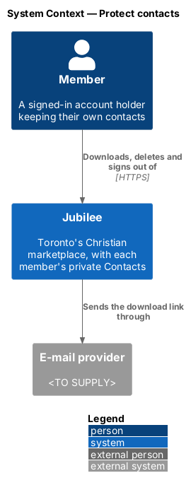
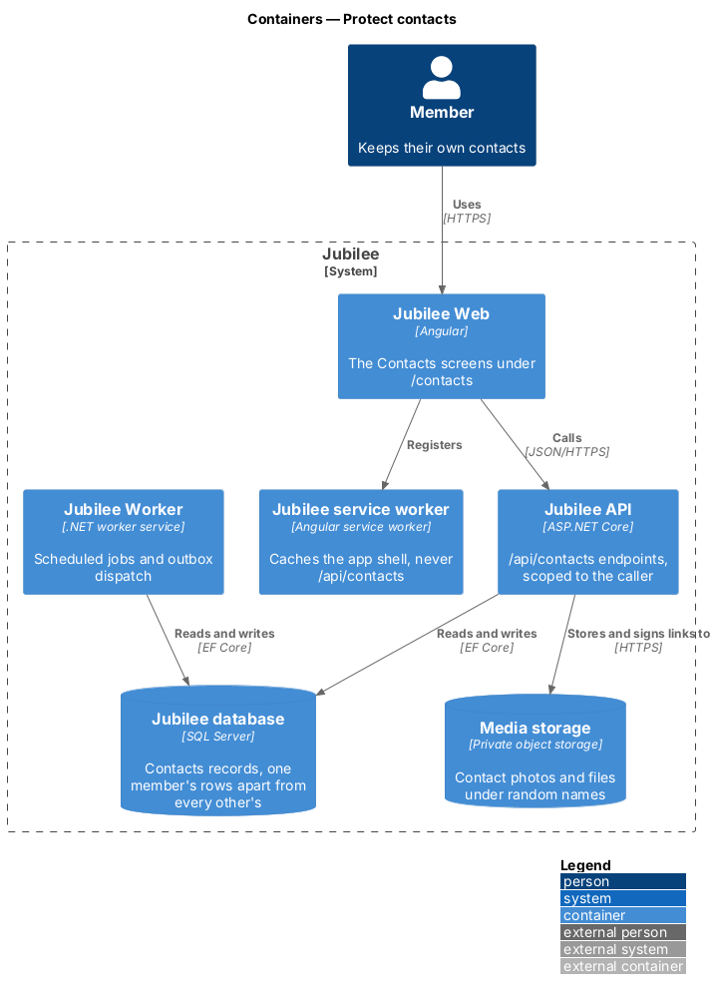
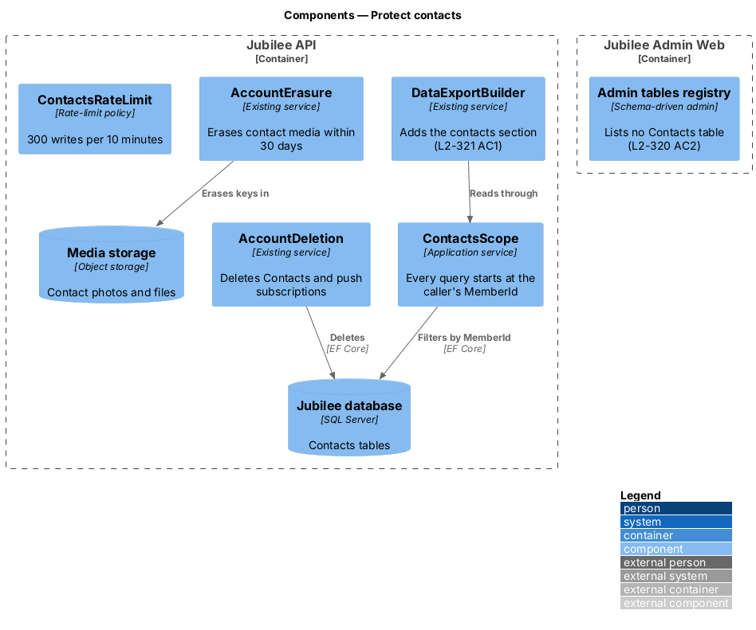
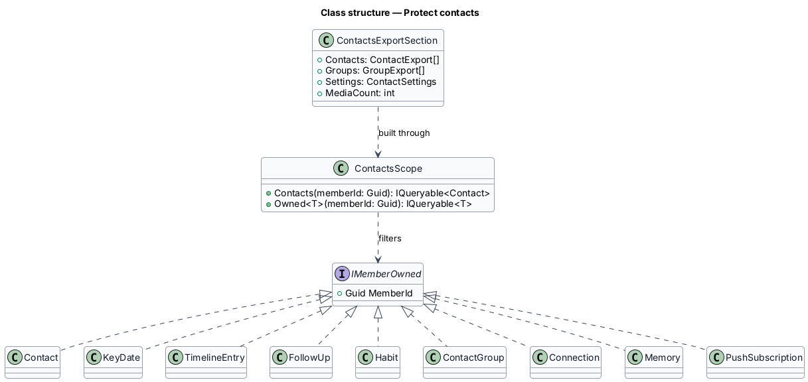
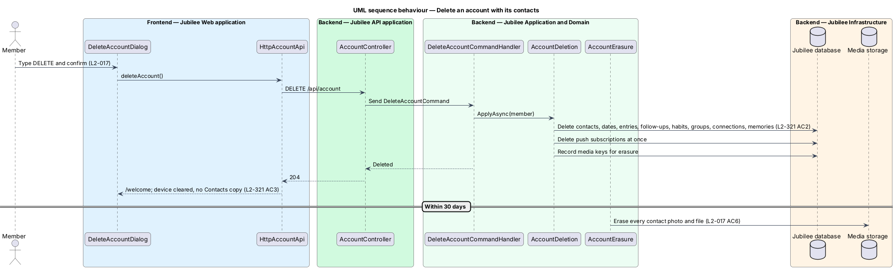

# Protect contacts

## Overview

Contacts holds what a member writes about other people: their phone numbers,
their birthdays, what was said in a conversation. Those people never agreed to
be written about, so the design treats every record of Contacts as personal
data that one member alone reads (L1-036, L1-020). This cross-cutting feature
gathers the rules every other Contacts slice relies on:

- every query starts from the caller's own records;
- no one else ever reads them, not even the Jubilee team;
- Contacts is not used for anything but the member's own reminders;
- the member's data download includes Contacts;
- deleting the account deletes Contacts;
- signing out leaves nothing of Contacts on the device;
- Contacts meets the platform's performance, responsive and accessibility
  rules.

Local terms:

- **member-owned record**: a row of Contacts that carries the `MemberId` of the one member who may read it
- **contacts scope**: the single entry point through which every Contacts query reads member-owned records

## Description

- **`IMemberOwned`** (`Jubilee.Domain/Contacts/`): an interface with
  `MemberId`, implemented by `Contact`, `KeyDate`, `TimelineEntry`,
  `FollowUp`, `Habit`, `ContactGroup`, `Connection`, `Memory`,
  `ContactSettings` and `PushSubscription`. Each table has an index that
  starts with `MemberId`.
- **`ContactsScope`** (`Jubilee.Application/Contacts/`): `Owned<T>(memberId)`
  returns `db.Set<T>().Where(x => x.MemberId == memberId)`. Every Contacts
  handler reads through it. An id that is not found there answers 404, and
  the attempt is logged with the caller's id and the route, never the
  record's content (`L2-320` AC1, `L2-133` AC2). Each endpoint has an API test
  proving another member is refused (`L2-133` AC5).
- **Out of the admin application**: the admin table registry of `L2-276`
  lists no Contacts table, and no admin endpoint reads one (`L2-320` AC2).
  Engineers reach the data only with the just-in-time access of `L2-150` AC2.
- **No other use** (`L2-320` AC3):
  - no Contacts table joins the recommendation, search, analytics or
    "New businesses" code;
  - no endpoint reads a phone's address book;
  - no handler sends an e-mail or message to a contact.
  
  The only messages Contacts causes are the member's own reminders
  (`remember-dates`).
- **Output as text** (`L2-320` AC4): templates bind with interpolation, never
  `innerHTML`, and e-mail templates encode every field (`L2-136` AC2).
  Validators answer 422 with each field's code.
- **Limits** (`L2-320` AC5): 2,000 contacts per member, and a rate-limit
  policy `contacts-writes` of 300 writes per member per 10 minutes. Past it the
  API answers 429 with `Retry-After` and the message of `L2-137` AC1.
- **Storage** (`L2-320` AC6): Contacts rows are encrypted at rest and kept in
  Canada with the rest of the database (`L2-147`). They are kept until the
  member deletes them or the account.
- **Privacy page** (`L2-320` AC7): the content of `/privacy` gains the
  paragraph on Contacts, published through the content versions of
  `trust-content`.
- **Copy rules** (`L2-320` AC8): no line of Contacts calls a person a lead, a
  prospect or a target, ranks people by worth, or promises sales or blessing.
  Review checks this against `docs/scripture.md`; no test parses copy.
- **Data download** (`L2-321` AC1): `DataExportBuilder` gains a `contacts`
  section of every member-owned record and the reminder settings, read through
  `ContactsScope`. Photos and files are counted in `mediaCount`, not copied
  (`L2-018` AC4).
- **Account deletion** (`L2-321` AC2):
  - `AccountDeletion.ApplyAsync` deletes every member-owned record of Contacts
    and the push subscriptions at once;
  - it records the media keys for `AccountErasure`, which erases the photos
    and files within the 30 days of `L2-017` AC6;
  - the deletion ledger's re-apply (`L2-017` AC7) runs the same step.
- **Sign-out** (`L2-321` AC3): the service worker's `ngsw-config.json` caches no
  `/api/contacts` answer, and no Contacts call uses the offline fallback, so
  sign-out has nothing of Contacts to clear.
- **Offline** (`L2-323` AC6): opening Contacts offline shows the offline page
  of `L2-122`. On a screen already open every write is disabled with
  "You’re offline. Contacts will work again when you’re connected."
- **Performance** (`L2-322`): each screen is one request, served within
  200 ms at the 95th percentile for 2,000 contacts. Writes take 300 ms or
  less. The routes are lazy, so the browse home's bundle does not grow.
- **Devices and states** (`L2-323`): every screen and dialog is drawn and
  checked at 360, 576, 768, 992 and 1280 px in both themes; the responsive and
  accessibility sweeps gain their routes (ADR 0010, run by the owner only).
- **Tests**: a refusal test per endpoint, `ContactsExportTests` and
  `ContactsDeletionTests` (InMemory, ADR 0009), and the e2e sign-out spec
  asserting no Contacts request is answered from a cache.

### Open questions

- **A contact who is also a member**: a member might ask Jubilee what another
  member has written about them. Contacts is the writer's own notes, so the
  design discloses nothing. A legal review of this under PIPEDA is
  `<TO SUPPLY>`.

## Requirements

| L2 ID | Refines (L1) | Requirement |
|-------|--------------|-------------|
| `L2-320` | `L1-036` | Every Contacts record shall be found only among the caller's own, read by no one else including the Jubilee team, used for nothing but the member's own reminders, stored and shown as text, limited by the API, encrypted and kept in Canada, explained on the privacy page, and described in copy that never calls a person a lead or promises sales. |
| `L2-321` | `L1-036` | The data download shall include Contacts with its media counted, account deletion shall delete Contacts and erase its media within 30 days, and sign-out shall leave nothing of Contacts on the device. |
| `L2-322` | `L1-036` | Contacts screens and writes shall meet the API latency budgets for 2,000 contacts, reminders shall be created by 9:15 a.m., and Contacts shall load as a lazy route. |
| `L2-323` | `L1-036` | Contacts shall fit every viewport in both themes, work by keyboard and touch with 44 px targets, show its states, honour reduced motion, never carry a state by colour alone, and disable writes offline. |
| `L2-017` | `L1-002` | Deleting an account shall delete its data and erase it within 30 days. |
| `L2-018` | `L1-002` | The data download shall hold the member's data, with photos counted, not copied. |
| `L2-133` | `L1-019` | A member asking for another member's record by id shall get 404, logged. |
| `L2-150` | `L1-020` | Engineers shall reach production data only through just-in-time, logged access. |

## Diagrams

### System context

The member downloads their data, deletes their account and signs out in
Jubilee. The download link is e-mailed through the e-mail provider, whose
vendor is `<TO SUPPLY>`.

### Containers

`Jubilee API` reads Contacts only through the contacts scope. `Jubilee Worker`
builds the download and erases media. The service worker caches no Contacts
answer.

### Components

`ContactsScope` is the one way into Contacts data. The existing export,
deletion and erasure services read and delete through it. The admin
application has no table for it.

### Class structure

Every Contacts entity implements `IMemberOwned`, and `ContactsScope` filters
them all by the caller's `MemberId`.

### Behaviour: delete an account with its contacts

Account deletion removes every Contacts record and push subscription at once.
The erasure removes the member's photos and files within 30 days.

