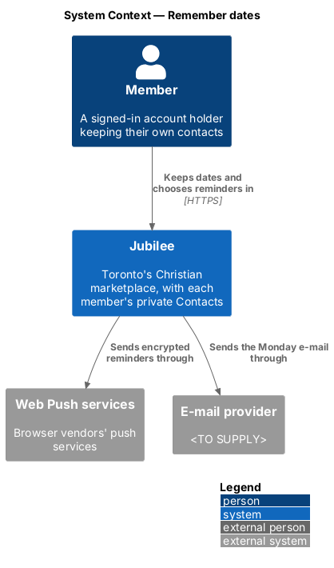
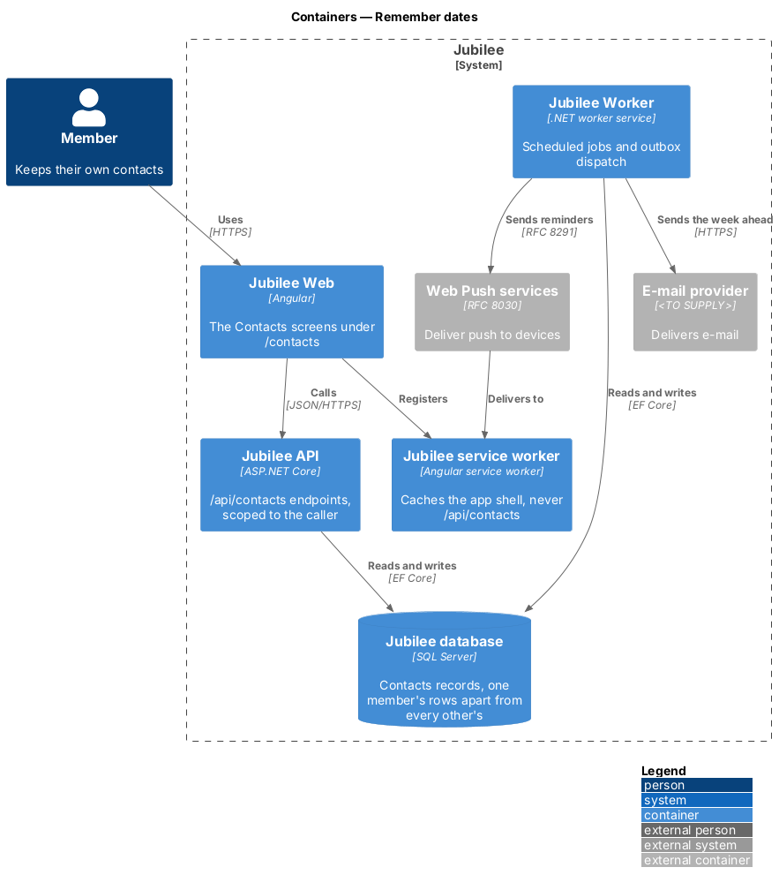
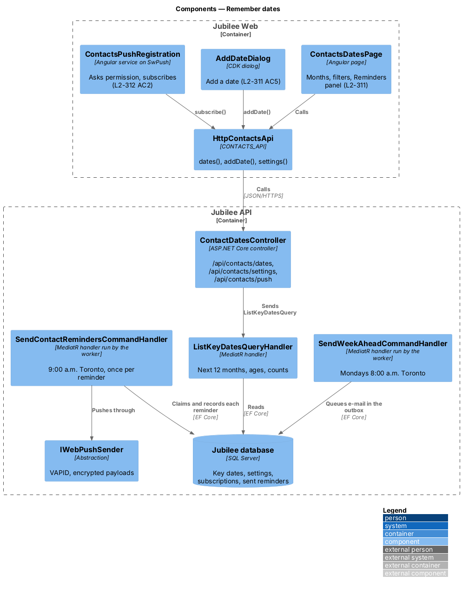
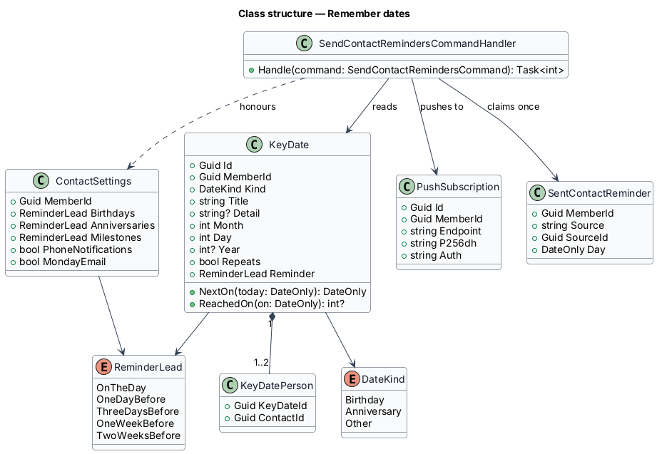
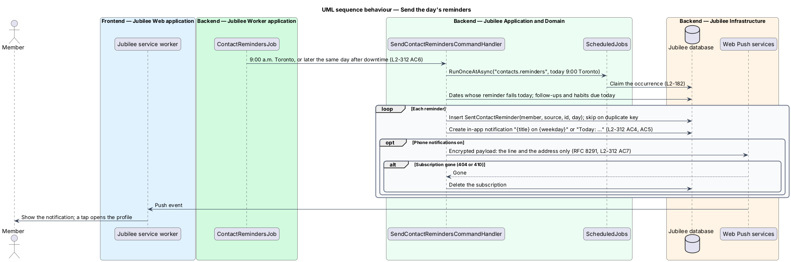
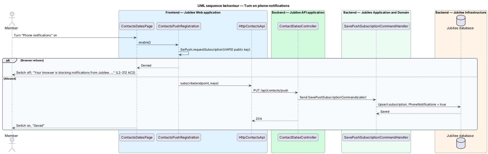

# Remember dates

## Overview

*Dates* is the section at `/contacts/dates` that lists the key dates of a
member's people for the next 12 months: birthdays, anniversaries and other
days that matter (L1-036). Each date has a reminder lead time. On the
reminder day Jubilee tells the member in four ways:

- in the notification centre;
- in a note at the top of Today;
- by a push notification to the member's devices, when they turn that on;
- in a Monday e-mail of the week ahead, when they turn that on.

Local terms:

- **lead time**: how long before a date its reminder falls: On the day, 1 day before, 3 days before, 1 week before or 2 weeks before
- **default lead time**: the lead time a new date of a kind starts with
- **Web Push**: the browser standard (RFC 8030, RFC 8291) by which a server sends an encrypted notification to a device through the browser vendor's push service
- **week ahead**: the Monday e-mail of the dates and follow-ups of the next 7 days

## Description

- **`ContactsDatesPage`** (`pages/contacts-dates/`): `GET /api/contacts/dates`
  answers the next 12 months from today in Toronto, grouped by month and
  soonest first (`L2-311` AC2). The chips Everything, Birthdays, Anniversaries
  and Milestones filter in the page (`L2-311` AC1). Each row is a
  `jb-date-tile`, a new library component of the weekday and day that is set
  in the bright tone at 14 days or less. Under 576 px the row shows "{n}d".
- **Details by rule** (`KeyDate.ReachedOn`):
  - "Turns {n}" for a birthday with a year;
  - "{n} years married" for a wedding anniversary;
  - "{n} years" for another anniversary with a year.
  
  The count is the one reached on the coming date. 29 February falls on
  28 February in other years (`L2-311` AC3).
- **Reminders panel**: three `jb-select` defaults and two `jb-switch` toggles,
  each saved on its own with `PUT /api/contacts/settings`. Each row shows
  "Saved", or puts its value back with an error toast, as `L2-016` does
  (`L2-311` AC4).
- **`ContactSettings`**: created on first use with the defaults of `L2-312`
  AC1: 1 week before, 3 days before, On the day, phone notifications off and
  the Monday e-mail off. A date keeps its own `Reminder`, so changing a
  default changes only new dates.
- **`AddDateDialog`** (`dialogs/add-date/`): whom (one or two contacts), kind,
  title (made from the kind and first names, such as "Chidi & Tomás’s
  anniversary"), date, repeats every year (on), detail (≤ 80) and reminder. It
  saves with `POST /api/contacts/dates` and "Add date" (`L2-311` AC5). A date
  that does not repeat leaves the list once it has passed.
- **`ContactsPushRegistration`** (`api/src/lib/helpers/`): wraps Angular's
  `SwPush`. Turning the switch on calls `requestSubscription` with the VAPID
  public key from `/api/contacts/push/key`, then
  `PUT /api/contacts/push` with the endpoint and keys. A refusal sets the
  switch back off with the message of `L2-312` AC2. Turning it off deletes
  this device's subscription.
- **`SendContactRemindersCommandHandler`** (run by `ContactRemindersJob` in
  `Jubilee.Worker`, every 5 minutes from 9:00 a.m. to 11:59 p.m. Toronto time):
  1. it claims the day's occurrence through `ScheduledJobs.RunOnceAtAsync`
     (`L2-182`);
  2. it finds the dates whose reminder falls today and the follow-ups and
     habits due today;
  3. for each one it inserts a `SentContactReminder` keyed by member, source,
     id and day, so a retry or a second worker sends nothing twice
     (`L2-312` AC6);
  4. it creates the `Notification` (`L2-064`) with the lines of `L2-312` AC4
     and AC5, which opens the person's profile;
  5. when phone notifications are on, it sends a push through `IWebPushSender`.
  
  A day missed while Jubilee was down is sent when it is running again on the
  same day, never on a later day.
- **`IWebPushSender`** (`Jubilee.Infrastructure/Notifications/`): signs with
  VAPID and encrypts the payload to the device (RFC 8291). The payload holds
  only the line and the address. A 404 or 410 from the push service deletes
  the subscription (`L2-312` AC7). The VAPID private key is a secret of the
  environment.
- **Service worker**: the Angular service worker shows the push and opens its
  address when it is tapped (`SwPush.notificationClicks`).
- **`SendWeekAheadCommandHandler`** (run on Mondays at 8:00 a.m. Toronto
  time): for each member with the Monday e-mail on and something in the next
  7 days, it queues "Your week with your people" in the outbox. The e-mail has
  one line per item, "Open Contacts", and a one-click unsubscribe that turns
  the Monday e-mail off (`L2-312` AC3, `L2-068` AC3). The unsubscribe page
  (`L2-224`) gains this category.
- **Scale**: the reminder job reads by day and member in batches of 1,000. It
  creates every reminder of a day for 100,000 members by 9:15 a.m.
  (`L2-322` AC3).
- **Tests**: `ContactDatesTests` and `ContactRemindersTests` (InMemory, with a
  fake `TimeProvider` and a fake `IWebPushSender`). They cover 29 February,
  once-only sending under retry, a gone subscription and a week with nothing
  to send. The e2e spec `contacts-dates.spec.ts` stubs the push permission.

### Open questions

- **Web Push is new to Jubilee**: no other feature uses it yet. An ADR should
  record the VAPID keys, their rotation and the push payload rule.
- **The e-mail's look**: `emails/contacts-week-ahead.html` is to be drawn.
- **The hours of the job**: the frame says "At 9 am on reminder days". The
  design keeps 9:00 a.m. as the time the reminders are created.

## Requirements

| L2 ID | Refines (L1) | Requirement |
|-------|--------------|-------------|
| `L2-311` | `L1-036` | Dates shall list the next 12 months by month with the filters, the tile in the bright tone at 14 days or less, the detail worked out from the year, 29 February on 28 February in other years, the Reminders panel saving each change, and "Add a date" for one or two contacts. |
| `L2-312` | `L1-036` | New accounts shall start with the stated default lead times and both switches off; phone notifications shall ask the browser and say when it refuses; reminders shall be created at 9:00 a.m. Toronto time once each, as notifications and, when on, encrypted pushes holding only the line and the address; the Monday e-mail shall be sent at 8:00 a.m. with an unsubscribe. |
| `L2-016` | `L1-002` | Each setting shall save on its own, show "Saved", and return on failure. |
| `L2-064` | `L1-010` | Notifications shall appear in the notification centre. |
| `L2-068` | `L1-010` | Every notification e-mail shall carry a one-click unsubscribe for its category. |
| `L2-182` | `L1-025` | Scheduled jobs shall run once per occurrence across instances and record their success. |
| `L2-322` | `L1-036` | Every reminder of a day shall be created by 9:15 a.m. for 100,000 members. |

## Diagrams

### System context

The member keeps dates in Jubilee. Jubilee sends reminders through the browser
vendors' push services and the Monday e-mail through the e-mail provider,
whose vendor is `<TO SUPPLY>`.

### Containers

`Jubilee API` keeps dates, settings and push subscriptions. `Jubilee Worker`
creates the day's reminders, pushes them and queues the Monday e-mail. The
service worker shows each push on the device.

### Components

The page and its dialog call the API. Two worker-run handlers send the
reminders and the week ahead, and the push sender encrypts each push.

### Class structure

A `KeyDate` has a kind, a day and a lead time, and it is for one or two
contacts. `SentContactReminder` records each reminder sent, so none is sent
twice.

### Behaviour: send the day's reminders

The job claims the day once. It records each reminder before it notifies or
pushes, and it deletes a subscription the push service says is gone.

### Behaviour: turn on phone notifications

The browser asks the member first. A refusal leaves the switch off with a
message, and an allowed subscription is stored for this device.

