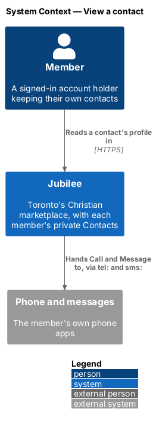
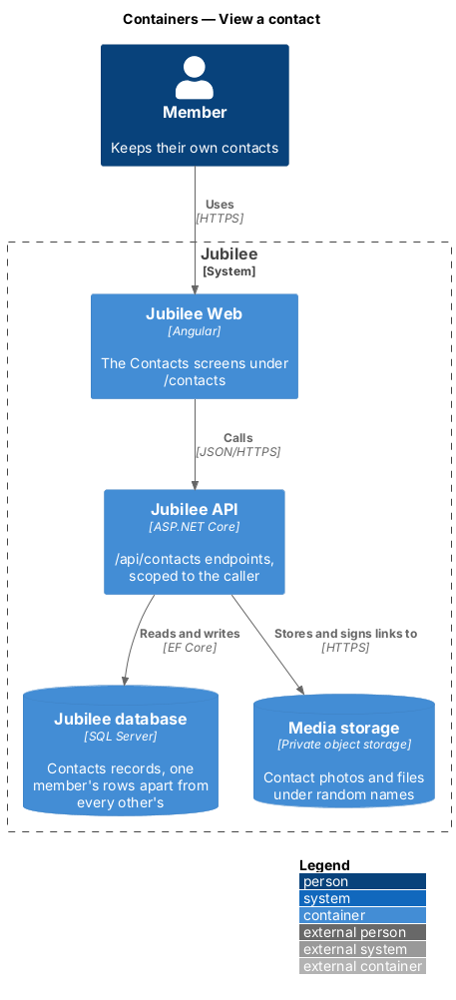
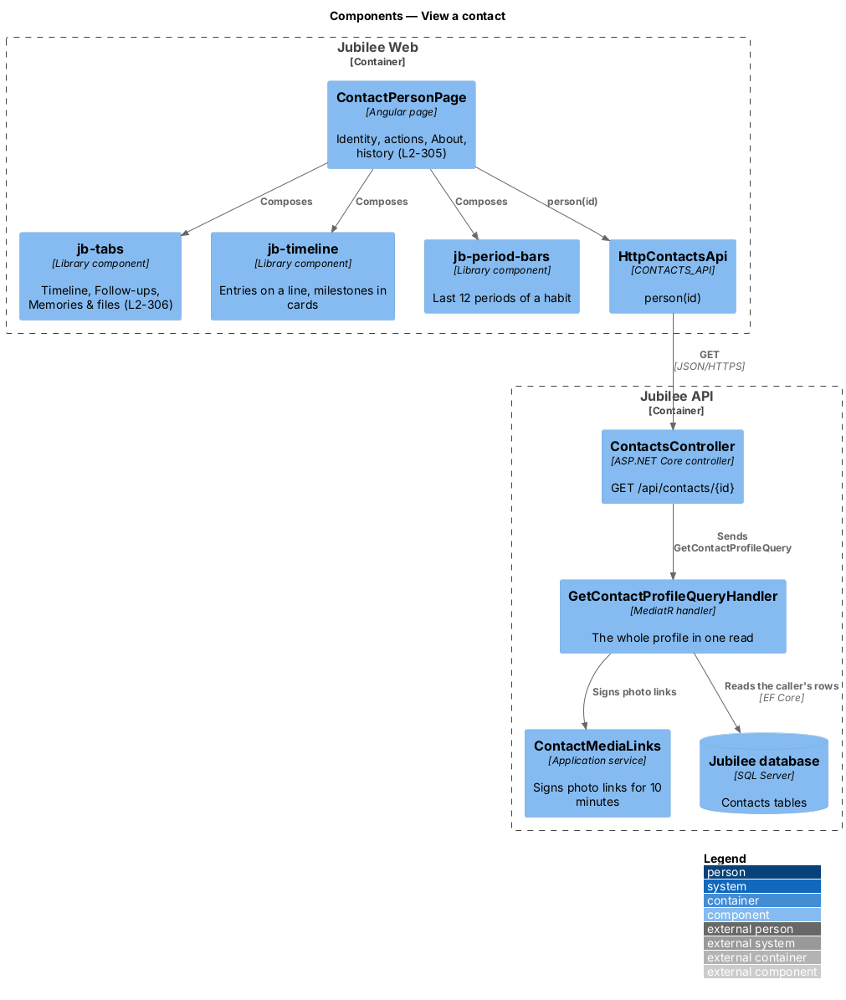
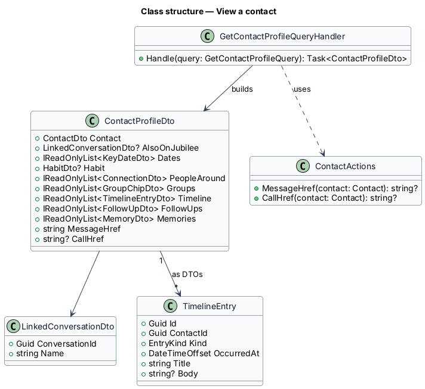
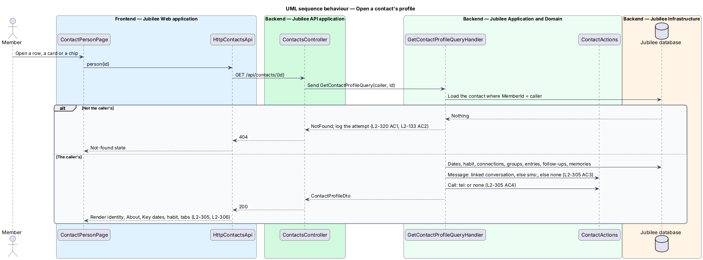

# View a contact

## Overview

A contact's *profile* is the page at `/contacts/people/{id}` that gathers all
the member keeps about one person (L1-036). It shows who they are and how to
reach them, their dates, the member's habit with them, the people around them,
and their history in three tabs: Timeline, Follow-ups and Memories & files.

Local terms:

- **timeline**: the conversations and milestones logged with a contact, newest first
- **milestone**: a turning point in a contact's life (a new job, a wedding, a baby, a move, a graduation)
- **people around**: the contacts connected to this one, and the groups they are in
- **Last talked**: the date of the latest conversation logged with a contact or habit kept with them, or before any, the date they were added

## Description

- **`ContactPersonPage`** (`pages/contacts-person/`): reads
  `GET /api/contacts/{id}` once and renders the profile. The back link is
  named for the screen it came from, passed as router state and defaulting to
  "People" (`L2-305` AC1). From 1024 px the facts sit in a column of 320 px
  (360 px from 1280 px) beside the history; under 1024 px they come first
  (`L2-305` AC7). The bottom tab bar is hidden under 768 px (`L2-299` AC8).
- **Actions** (`ContactActions`, `Jubilee.Application/Contacts/`): the API
  works out the links so every client agrees:
  - `MessageHref` is the linked conversation (`/messages/{id}`), else
    `sms:{phone}`, else none (`L2-305` AC3);
  - `CallHref` is `tel:{phone}` or none (`L2-305` AC4).
  
  A disabled button carries the description "Add a phone number to send a
  message." or "Add a phone number to call." through `aria-describedby`.
  Jubilee sends nothing itself (`L2-320` AC3).
- **"Also on Jubilee: {name}"**: shown for a linked contact, opening the
  conversation. The handler shows it only while the caller is still a party to
  that conversation (`L2-305` AC2).
- **Key dates**: rows with `jb-icon` (cake, heart, sparkle), title,
  "{weekday}, {date} · in {n} days" and the reminder. "Add a date" opens
  `AddDateDialog` (`remember-dates`) for this contact (`L2-305` AC8).
- **Habit card**: `jb-period-bars` (`components/src/lib/period-bars/`), a new
  library component that draws 12 bars named "Kept {k} of the last 12". It
  shows "Next: {date}", or the overdue text. Without a habit, a dashed button
  "Make a habit of seeing {first name}" opens `NewHabitDialog`
  (`keep-habits`, `L2-305` AC9).
- **About** and **Loves**: `jb-description-list` of the known facts and
  `jb-tag` chips (`L2-305` AC10).
- **People around**: the connections not to the member, each opening the
  other's profile, and a `jb-chip` per group opening `/contacts/groups/{id}`
  (`L2-305` AC11).
- **History**: `jb-tabs` with Timeline, Follow-ups ("Follow-ups {n}") and
  Memories & files (`L2-306` AC1):
  - **Timeline** uses `jb-timeline` with the chips All, Conversations and
    Milestones. A milestone sits in the warm card, and the empty state is that
    of `L2-306` AC3.
  - **Follow-ups**: the field opens `NewFollowUpDialog` on Enter
    (`follow-up`, `L2-306` AC4).
  - **Memories & files**: a photo grid and a file and note list, with "Add"
    opening `AddMemoryDialog` (`keep-memories`, `L2-306` AC5).
- **Item menus**: each entry, follow-up and memory has a `jb-menu` with "Edit"
  and "Delete". Deleting follows `L2-129`, and the toast offers "Undo" within
  10 seconds, which restores the row (`L2-306` AC6).
- **`GetContactProfileQueryHandler`**: loads the contact through
  `ContactsScope`. Another member's id is 404 and is logged (`L2-320` AC1). It
  then loads the dates, habit, connections, groups, entries, follow-ups and
  memories in one request. Photo links are signed by `ContactMediaLinks` for
  10 minutes (`L2-310` AC4).
- **Tests**: `ContactProfileTests` (InMemory); e2e `contacts-person.spec.ts`
  with page-object regions for identity, about, dates, habit and each tab.

### Open questions

- **Undo** keeps a deleted item for 10 seconds on the client and then sends
  the delete; whether the API keeps a soft-deleted row instead is
  `<TO SUPPLY>`.

## Requirements

| L2 ID | Refines (L1) | Requirement |
|-------|--------------|-------------|
| `L2-305` | `L1-036` | A profile shall show the back link named for its origin, Edit and More, the identity with "Also on Jubilee" for a linked contact, Message, Call and Log with their rules, Key dates, the habit card or its invitation, About with Loves, and People around. |
| `L2-306` | `L1-036` | The profile's tabs Timeline, Follow-ups and Memories & files shall list their items with their empty states, and each item shall be editable and deletable with Undo. |
| `L2-320` | `L1-036` | A Contacts record of anyone else shall answer 404 and be logged, and Jubilee shall send nothing to a contact. |
| `L2-129` | `L1-018` | A reversible deletion shall be confirmed and its toast shall carry "Undo". |

## Diagrams

### System context

The member reads a profile in Jubilee. "Call" and "Message" hand over to the
member's own phone apps through `tel:` and `sms:` links. Jubilee itself sends
nothing.

### Containers

The profile reads one answer from `Jubilee API`. Photos load from private
`Media storage` through signed links.

### Components

The page composes the library's tabs, timeline and period bars. The handler
builds the whole profile, and `ContactMediaLinks` signs its photo links.

### Class structure

`ContactProfileDto` carries every part of the profile, with the links that
`ContactActions` works out.

### Behaviour: open a profile

A contact of anyone else is not found and the attempt is logged. Otherwise the
handler answers the profile with its actions decided.

