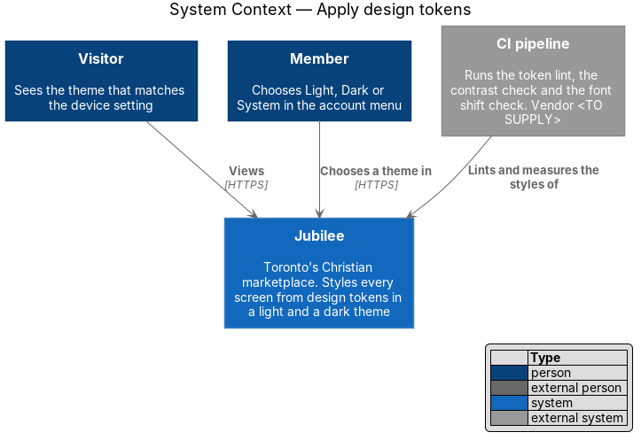
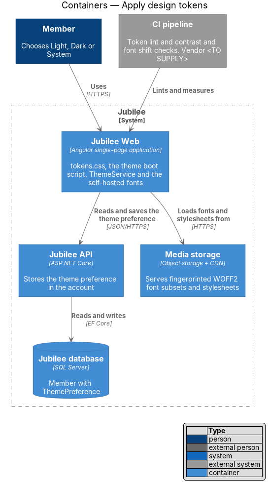
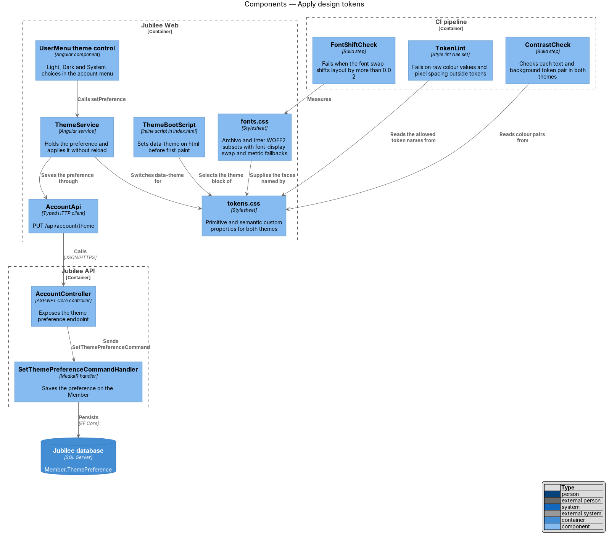
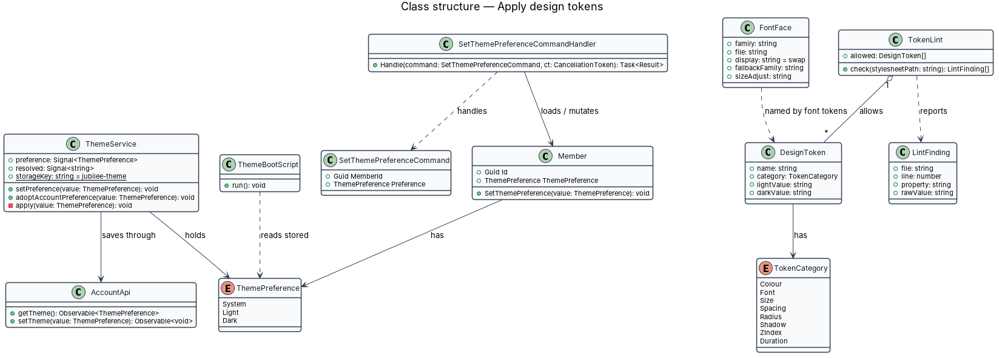
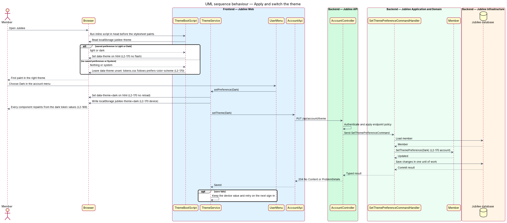
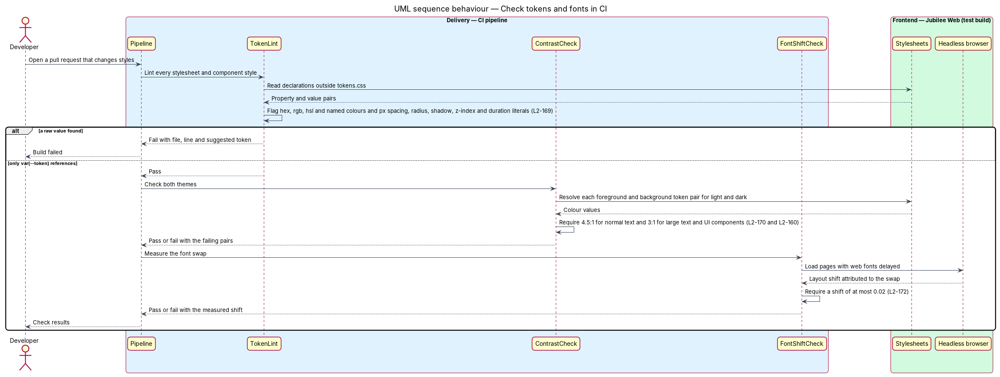

# Apply design tokens

## Overview

Jubilee is Toronto's Christian marketplace: a directory of
Christian-owned businesses. Its visual language comes from the HTML mocks in
`docs/mocks/`: ink and cream neutrals, a gold accent that always carries ink
text, green for highlights, links and success, Archivo for headings and
Inter for text. This feature makes that language the single source of every
visual value in `Jubilee Web`, in a light and a dark theme, and checks at build
time that no stylesheet bypasses it.

The feature uses these terms:

- **design token** — named CSS custom property that holds one visual value, such as `--color-accent` or `--space-4`
- **primitive token** — token that names a raw value on a scale, such as `--palette-ink-900`
- **semantic token** — token that names a purpose and refers to a primitive token, such as `--color-bg-brand`; components use semantic tokens only
- **theme** — set of values for the semantic colour and shadow tokens; Jubilee has a light theme and a dark theme
- **theme preference** — choice of Light, Dark or System; System follows the `prefers-color-scheme` setting of the device
- **flash of the wrong theme** — first paint in one theme followed by a repaint in the other
- **metric-compatible fallback** — system font face adjusted with `size-adjust` so that text set in it occupies the same space as the web font

The token file is `docs/mocks/assets/tokens.css`. The application build takes it
unchanged (or the design system's token export, once `docs/design-system/`
exists), so the mocks and the product stay on the same values. The components
that consume the tokens belong to the sibling feature `build-components`.

## Description

The slice has a styling part in `Jubilee Web`, a small persistence path through
`Jubilee API` for the theme preference, and three checks in the CI pipeline.

- **`tokens.css`** — the token stylesheet. `:root` defines the primitive
  tokens (`--palette-*`) and the semantic tokens: colour (`--color-*`),
  typography (`--font-family-*`, `--font-size-*`, `--text-*`), spacing
  (`--space-*`), layout (`--layout-*`), radius (`--radius-*`), elevation
  (`--shadow-*`), motion (`--duration-*`, `--ease-*`) and z-order (`--z-*`).
  Every other stylesheet refers to values through `var(--token)`, so a changed
  token value reaches each component on rebuild with no other code change.
- **Theme blocks** — `tokens.css` redefines the semantic colour and shadow
  tokens under `[data-theme="dark"]`, and under
  `@media (prefers-color-scheme: dark)` for `:root:not([data-theme="light"])`.
  With no `data-theme` attribute the page follows the device setting.
- **`ThemeBootScript`** — inline script in the `head` of `index.html`, placed
  before the stylesheet link. It reads the `localStorage` key `jubilee-theme`
  and sets `data-theme="light"` or `data-theme="dark"` on `html`; for `system`
  or no saved value it sets nothing. It runs before first paint, so no flash of
  the wrong theme occurs. The Content Security Policy allows it by hash.
- **`ThemeService`** — Angular service that holds the `ThemePreference`
  signal. `setPreference` updates `data-theme` on `html` without reload, writes
  `jubilee-theme` to `localStorage`, and saves the value to the account through
  `AccountApi`. After sign-in, `adoptAccountPreference` applies the account
  value on a device that has no saved value.
- **`UserMenu` theme control** — control in the account menu with the choices
  Light, Dark and System. The chosen option carries `aria-pressed="true"`.
- **`AccountApi`** — typed HTTP client. `setTheme` calls
  `PUT /api/account/theme`; the session summary returned by `GET /api/session`
  includes the stored preference.
- **`SetThemePreferenceCommand`** and
  **`SetThemePreferenceCommandHandler`** — MediatR command and handler behind
  `AccountController`. The handler loads the signed-in `Member`, calls
  `SetThemePreference`, and saves in one unit of work.
- **`Member.ThemePreference`** — `ThemePreference` value (`System`, `Light`,
  `Dark`) stored on the `Member`; the default is `System`.
- **`fonts.css`** — `@font-face` rules for Archivo (headings,
  `--font-family-display`) and Inter (body text, `--font-family-sans`). Both
  are self-hosted WOFF2 subsets with `font-display: swap`; the subset ranges
  are `<TO SUPPLY>`. The file also declares the fallback faces
  `Archivo Fallback` and `Inter Fallback` over a local system font with
  `size-adjust` (values `<TO SUPPLY>`). The font tokens list the web font, its
  fallback face and then the system font stack.
- **`TokenLint`** — style lint rule set run in CI (tool `<TO SUPPLY>`). It
  fails the build on a raw colour value (hex, `rgb()`, `hsl()` or a named
  colour) or a pixel value for spacing, size, radius, shadow, z-index or
  duration in any stylesheet other than `tokens.css`. Each `LintFinding` names
  the file, line, property and raw value.
- **`ContrastCheck`** — CI step that resolves each text and background token
  pair in both themes and requires `4.5:1` for normal text and `3:1` for large
  text and UI components (`L2-160`). It also fails when `--color-accent` is used
  as a text colour.
- **`FontShiftCheck`** — CI step that loads pages with the web fonts delayed
  and fails when the layout shift caused by the font swap exceeds `0.02`.

## Requirements

The feature realizes the following level-2 (L2) requirements. Each L2
requirement refines a level-1 (L1) requirement, cited by identifier.

| L2 ID | Refines (L1) | Requirement |
|-------|--------------|-------------|
| `L2-169` | `L1-024` | Every colour, font, size, spacing, radius, shadow, z-index and duration in the application styles shall come from the tokens in `docs/mocks/assets/tokens.css` (or the design system's token export), and a lint rule shall fail the build on raw colour values or pixel spacing outside tokens. A changed token value shall update every component that uses it on rebuild with no other code change. |
| `L2-170` | `L1-024` | With no saved preference the app shall follow `prefers-color-scheme`. When the member chooses Light, Dark or System in the account menu, the theme shall switch without reload, shall be remembered on the device and in the account, and shall apply before first paint. Both themes shall meet `L2-160`. |
| `L2-172` | `L1-024` | Headings shall use Archivo and body text shall use Inter, both as self-hosted WOFF2 subsets with `font-display: swap` and a fallback to the system font stack in the tokens. The font swap shall cause no layout shift above 0.02. |
| `L2-160` | `L1-022` | Normal text shall meet a contrast of 4.5:1 and large text and UI components 3:1 for every text and background pair in both themes. The gold accent shall not be used for text. |

## Diagrams

### System context

Visitors see the theme that matches the device setting, and members choose a
theme in Jubilee. The CI pipeline lints and measures the styles.

### Containers

`Jubilee Web` holds the tokens, the fonts and the theme logic. `Jubilee API`
stores the theme preference in `Jubilee database`, and `Media storage` serves
the font files and stylesheets.

### Components

`ThemeBootScript` and `ThemeService` select the theme block of `tokens.css`
through `data-theme`. `ThemeService` saves the preference through `AccountApi`
to `SetThemePreferenceCommandHandler`. `TokenLint`, `ContrastCheck` and
`FontShiftCheck` run in the CI pipeline.

### Class structure

`ThemeService` holds a `ThemePreference` and saves it through `AccountApi`;
`SetThemePreferenceCommandHandler` stores it on `Member`. `TokenLint` allows a
set of `DesignToken` values and reports `LintFinding` values.

### Behaviour — apply and switch the theme

`ThemeBootScript` sets `data-theme` before first paint from the saved device
value, or leaves it unset to follow `prefers-color-scheme`. A choice in the
account menu switches the theme at once, is written to `localStorage`, and is
saved to the account through `PUT /api/account/theme`.

### Behaviour — check tokens and fonts in CI

`TokenLint` fails the build on a raw value outside `tokens.css`.
`ContrastCheck` then checks both themes against `L2-160`, and `FontShiftCheck`
holds the font swap to a layout shift of at most `0.02`.

