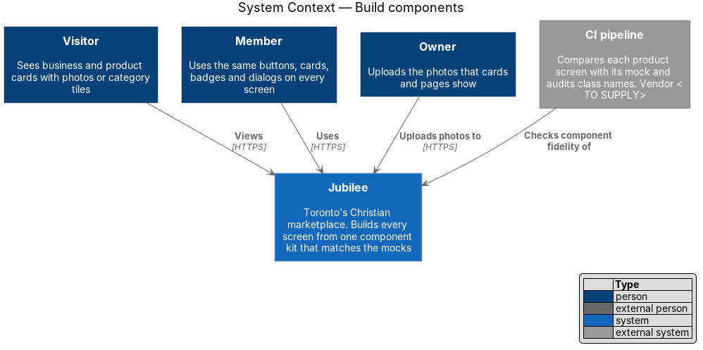
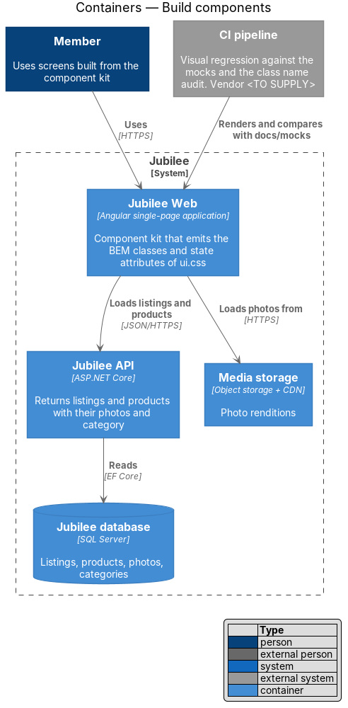
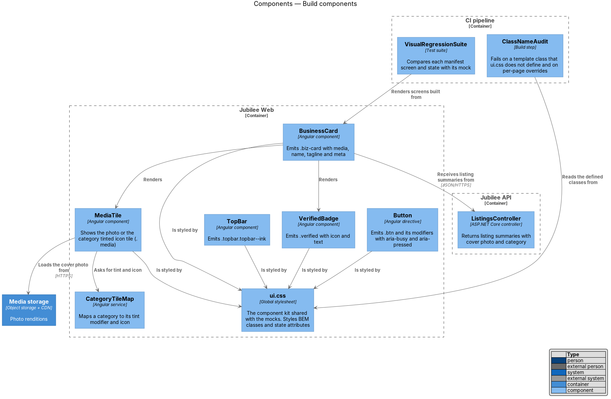
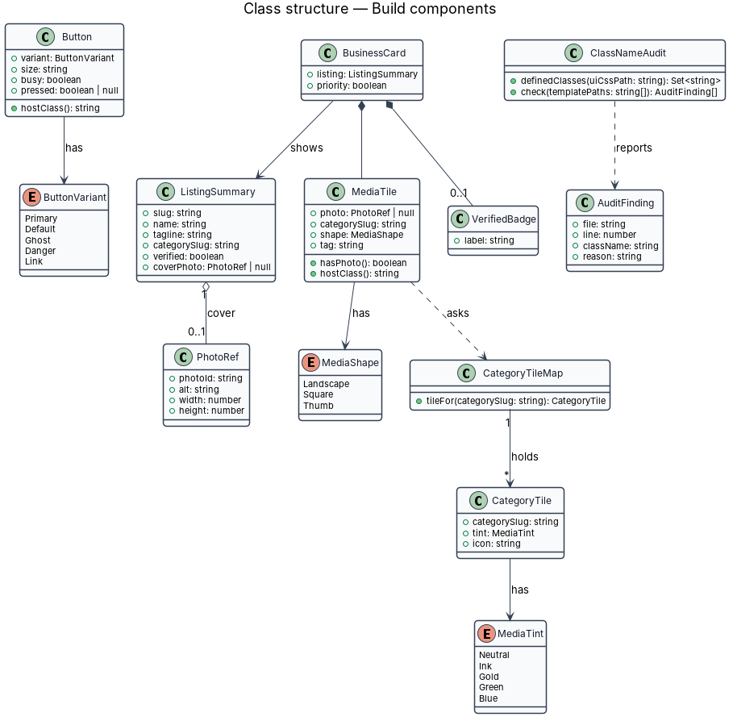
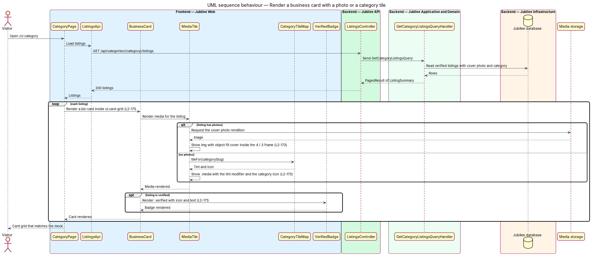
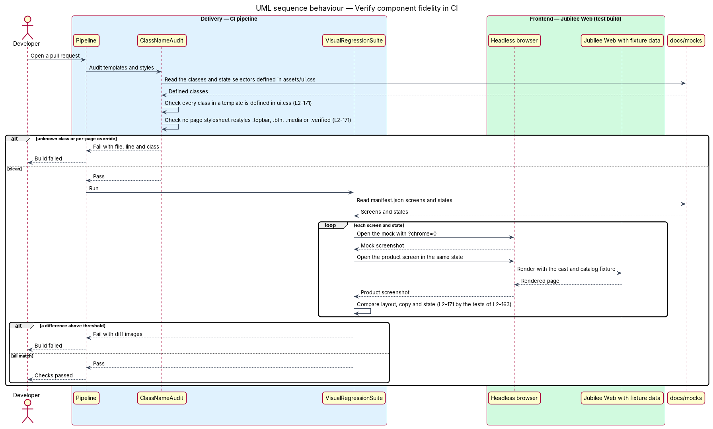

# Build components

## Overview

Jubilee is Toronto's Christian marketplace: a directory of verified
Christian-owned businesses. Its screens are specified by static HTML mocks in
`docs/mocks/`: 39 pages, 21 dialogs and 7 notification types in 271 states,
listed in `docs/mocks/manifest.json`. The mocks share one stylesheet,
`docs/mocks/assets/ui.css`. This feature builds the Angular component kit of
`Jubilee Web` so that each product screen matches its mock in layout, copy and
states, and so that the mocks remain a valid visual reference after the product
ships.

The feature uses these terms:

- **component kit** — set of shared Angular components and directives from which every page and dialog is built
- **BEM class** — class name in block, element, modifier form, such as `.biz-card`, `.biz-card__name` and `.btn--primary`
- **state attribute** — attribute that carries a component state and that `ui.css` styles: `aria-current`, `aria-pressed`, `aria-invalid`, `aria-busy` and `data-state`
- **media tile** — framed image area of a card or page (`.media`); it holds a real photo or, without photos, a tinted tile with the category icon
- **per-page override** — style rule in a page stylesheet that changes the appearance of a kit component on that page only
- **fidelity** — agreement between a product screen and its mock in layout, copy and states

The rule of the feature is that a component adds no appearance of its own. It
emits the mock's class names and state attributes, and `ui.css` styles them from
the design tokens. The tokens, themes and fonts belong to the sibling feature
`apply-design-tokens`; the viewport widths of the visual regression tests
belong to `adapt-navigation` in the responsive design subsystem.

## Description

The slice lives in `Jubilee Web`, with data from `Jubilee API`, photos from
`Media storage`, and two checks in the CI pipeline.

- **`ui.css`** — the component stylesheet, a copy of
  `docs/design-system/assets/components.css` kept in
  `frontend/projects/components/src/lib/styles/` and loaded once as a global
  stylesheet after `tokens.css`. Kit components declare no colours, sizes or spacing of their
  own. A new component is added to `ui.css` and to a mock first, never to a
  page stylesheet.
- **`Button`** — Angular directive on `button` and `a` elements. It emits
  `.btn` with the modifiers `.btn--primary`, `.btn--ghost`, `.btn--danger`,
  `.btn--link`, `.btn--sm`, `.btn--lg`, `.btn--icon` and `.btn--block`. Primary
  buttons are gold with ink text, pill shaped (`--radius-full`), and carry the
  `--color-accent-border` edge. A busy button sets `aria-busy="true"`; a toggle
  sets `aria-pressed`.
- **`TopBar`** — Angular component that emits `.topbar.topbar--ink`, the ink
  top bar. The current navigation link carries `aria-current="page"`.
- **`BusinessCard`** — Angular component that emits `a.biz-card` with a
  `MediaTile`, `.biz-card__name`, `.biz-card__tagline` and `.biz-card__meta`.
  The product variant adds `.product-card`. Cards sit in `ul.card-grid` or
  `ul.scroller`.
- **`MediaTile`** — Angular component that emits `.media` with the shape
  modifiers `.media--square` and `.media--thumb` and an optional `.media__tag`.
  For a listing or product with photos it renders the real photo through
  `ResponsiveImage`. Without photos it renders the category's tinted icon tile:
  a tint modifier (`.media--ink`, `.media--gold`, `.media--green` or
  `.media--blue`) and the category icon.
- **`.media > img` rule** — rule in `ui.css`: the image fills the frame with
  `width: 100%`, `height: 100%` and `object-fit: cover`. The frame keeps its
  aspect ratio (`4 / 3`, or `1` for `.media--square` and `.media--thumb`), so
  no image distorts.
- **`CategoryTileMap`** — Angular service that maps each of the 10 categories
  to a `CategoryTile` (tint and icon). The mapping follows the mocks: Shops gold
  bag "Shop"; Financial & insurance green chart "Financial"; Legal &
  immigration blue shield "Legal"; Home & property ink wrench "Home"; Real
  estate & living gold home "Real estate"; Health & family green heart
  "Health"; Business & tech blue briefcase "Business"; Learning blue book
  "Learning"; Media ink image "Media"; Community green user "Community".
- **`VerifiedBadge`** — Angular component that emits `.verified` with the
  check icon and text, so the status is not conveyed by colour alone. It renders
  only for a listing that passed verification.
- **Form and feedback components** — `Field` (`.field`, `.input` with
  `aria-invalid="true"` and `.field__error`), `ErrorSummary` (`.form-summary`),
  `DialogShell` (`.dialog`, `.dialog__panel`), `Toast` (`.toast`), `Banner`
  (`.banner`) and the skeleton, empty and error blocks (`.skeleton`, `.empty`,
  `.empty--error`). Each follows the same rule: mock classes, state attributes,
  no local appearance.
- **`ListingSummary` and `PhotoRef`** — data that `ListingsApi` returns for a
  card: slug, name, tagline, category, verified flag and an optional cover
  photo with its alt text and intrinsic width and height.
- **`ClassNameAudit`** — CI step. It parses `ui.css` into the set of defined
  classes and state selectors, then scans each Angular template and stylesheet.
  It fails the build on a template class that `ui.css` does not define and on a
  page stylesheet rule that targets a kit class (a per-page override), for
  example `.topbar`, `.btn`, `.media` or `.verified`.
- **`VisualRegressionSuite`** — the test suite of `L2-163`. For each screen
  and state in `docs/mocks/manifest.json` it renders the product screen with a
  fixture of the mocks' cast and catalog and compares it with the mock opened
  with `?chrome=0`. A difference above the threshold (`1 %` of the pixels of a region) fails the
  build.

## Requirements

The feature realizes the following level-2 (L2) requirements. Each L2
requirement refines a level-1 (L1) requirement, cited by identifier.

| L2 ID | Refines (L1) | Requirement |
|-------|--------------|-------------|
| `L2-171` | `L1-024` | Each screen shall use the mocks' BEM class names and accessible state attributes (`aria-current`, `aria-pressed`, `aria-invalid`, `aria-busy`, `data-state`) from `docs/mocks/assets/ui.css`. Each screen and state in `docs/mocks/manifest.json` shall match its mock in layout, copy and states, verified by the visual regression tests of `L2-163`, and the ink top bar, gold pill-shaped primary buttons, media tiles and verified badges shall follow the mock components without per-page overrides. |
| `L2-173` | `L1-024` | A listing or product with photos shall show the real photos; without photos it shall show the category's tinted icon tile (`.media`). Every image shall keep its aspect ratio with `object-fit: cover` and shall not distort. |
| `L2-163` | `L1-023` | Visual regression tests in CI shall compare each screen with its approved baseline at 360, 576, 768, 992 and 1280 px wide and shall fail the build on a difference above threshold. |
| `L2-160` | `L1-022` | The gold accent shall not be used for text; gold controls shall carry ink text and the darker `--color-accent-border` edge. Each status shall be conveyed by text or icon as well as colour. |

## Diagrams

### System context

Visitors, members and owners use screens built from one component kit. The CI
pipeline checks the fidelity of those screens against the mocks.

### Containers

`Jubilee Web` holds the component kit, `Jubilee API` returns listings and
products with their photos and category, and `Media storage` serves the photo
renditions.

### Components

`BusinessCard` renders `MediaTile` and `VerifiedBadge`; `MediaTile` loads the
cover photo or asks `CategoryTileMap` for a tint and icon. Each kit component
is styled by `ui.css` alone. `ClassNameAudit` and `VisualRegressionSuite` run
in the CI pipeline.

### Class structure

`BusinessCard` shows a `ListingSummary` and owns a `MediaTile` and at most one
`VerifiedBadge`. `MediaTile` uses the optional `PhotoRef` or a `CategoryTile`
from `CategoryTileMap`. `ClassNameAudit` reports `AuditFinding` values.

### Behaviour — render a business card with a photo or a category tile

For each listing, `MediaTile` shows the cover photo with `object-fit: cover`
when the listing has photos, and the category's tinted icon tile otherwise.
`VerifiedBadge` renders for a verified listing.

### Behaviour — verify component fidelity in CI

`ClassNameAudit` fails the build on a class that `ui.css` does not define or on
a per-page override. `VisualRegressionSuite` then compares each manifest screen
and state with its mock.

