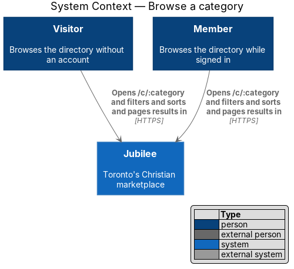
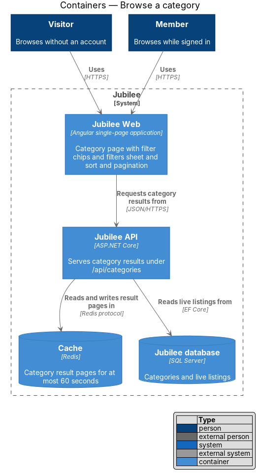
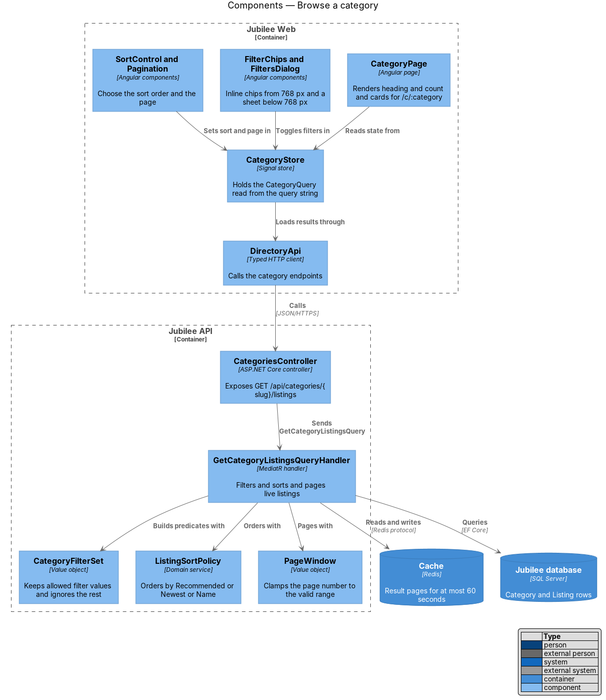
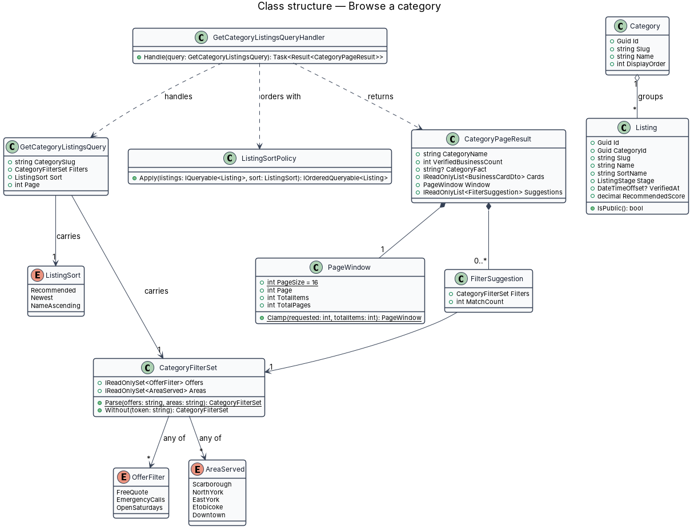
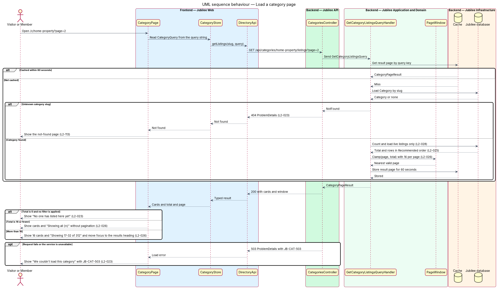
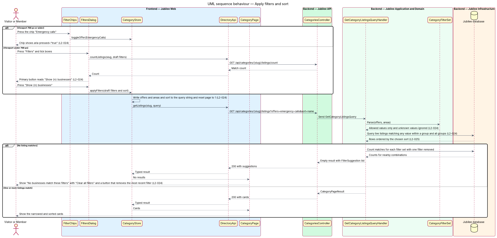

# Browse a category

## Overview

Jubilee is Toronto's Christian marketplace: a directory of businesses that the
verification team has checked against a church reference. The directory is
divided into ten fixed categories: Shops, Financial & insurance, Legal &
immigration, Home & property, Real estate & living, Health & family, Business &
tech, Learning, Media and Community. This feature covers the page that lists the
businesses of one category at `/c/:category`.

A visitor or member opens a category from the browse home, from a breadcrumb or
from a shared link. The page shows the breadcrumb "Browse / Home & property",
the category heading, the line "{n} verified businesses", an optional category
fact such as "3 take emergency calls", filter chips, a "Filters" button, a
"Sort" control and one business card per result. Only live listings appear.

The feature uses the following local terms.

- **live listing** — listing that is verified and not paused, deleted or under a moderation hold
- **filter group** — set of filter values of one kind; the two groups are "Offers" and "Area served"
- **category query** — combination of filters, sort order and page number that the query string of the page URL carries
- **category fact** — short count shown beside the business count, derived from one offer filter

The category query lives in the URL, so a copied link reproduces the same
filters, sort and page on another device. The server treats the query string as
untrusted input: it ignores filter values outside the allowed set and replaces
an out-of-range page number with the nearest valid page.

## Description

The feature is a read-only vertical slice from the Angular page to the database.

- **`CategoryPage`** — Angular page for the route `/c/:category`. It renders the
  breadcrumb, heading, count line, category fact, `FilterChips`, `SortControl`,
  the `BusinessCard` grid and `Pagination`. It renders the empty state "No one
  has listed here yet" with "List your business" and "Browse other categories",
  the no-results state, and the error state "We couldn't load this category"
  with the reference `JB-CAT-503`. An unknown slug leads to the not-found page.
- **`FilterChips`** — inline toggle chips shown from 768 px: one per offer
  ("Free quote", "Emergency calls", "Open Saturdays") and one per area, labelled
  "Serves {area}". Each chip is a button with `aria-pressed`. The chips stay visible in the no-results state.
- **`FiltersDialog`** — sheet shown below 768 px when "Filters" is pressed. It
  lists "Offers" (Free quote, Emergency calls, Open Saturdays), "Area served"
  (Scarborough, North York, East York, Etobicoke, Downtown), "Sort" and "Clear
  all". Its primary button reads "Show {n} businesses"; the count comes from
  `GET /api/categories/{slug}/listings/count` each time a box changes.
- **`SortControl`** — control that offers "Recommended" (the default), "Newest"
  and "Name A–Z".
- **`Pagination`** — previous, numbered and next controls that collapse middle
  pages to "…", with the footer "Showing 1–16 of 312". With 16 or fewer results
  it renders no controls and the footer "Showing all {n}". After a page change
  it moves focus to the results heading.
- **`CategoryStore`** — signal store that owns the category query. It reads the
  query from the query string parameters `offers`, `areas`, `sort` and `page`,
  writes each change back to the URL, resets `page` to 1 when a filter or the
  sort changes, and remembers the most recently added filter for the "Remove"
  button of the no-results state.
- **`DirectoryApi`** — typed Angular HTTP client for
  `GET /api/categories/{slug}/listings` and its `/count` variant.
- **`CategoriesController`** — ASP.NET Core controller in `Jubilee.Api`. Both
  endpoints are anonymous. The controller returns 404 `ProblemDetails` for an
  unknown slug and 503 `ProblemDetails` with `JB-CAT-503` when the query cannot
  be served.
- **`GetCategoryListingsQuery`** and **`GetCategoryListingsQueryHandler`** —
  MediatR query and handler. The handler loads the `Category`, restricts the
  result to live listings, applies the `CategoryFilterSet`, orders with
  `ListingSortPolicy`, pages with `PageWindow`, and returns a
  `CategoryPageResult`. It keeps each result page in `Cache` for at most
  60 seconds, keyed by slug and category query.
- **`CategoryFilterSet`** — value object parsed from the `offers` and `areas`
  parameters. It keeps values of the `OfferFilter` and `AreaServed`
  enumerations and drops every other value. Values within one group combine
  with OR; the two groups combine with AND.
- **`ListingSortPolicy`** — domain service that maps `ListingSort` to an
  ordering. `NameAscending` orders by `Listing.SortName`, a stored form of the
  name that is case-folded, stripped of accents and stripped of a leading
  "The". `Newest` orders by `Listing.ApprovedAt`, the date of verification, descending. `Recommended`
  orders by `Listing.RecommendedScore` descending and then by `SortName`.
- **`Listing.RecommendedScore`** — stored score that combines profile
  completeness, response time and recency. The score is `0.5 × completeness + 0.3 × responsiveness +
  0.2 × recency`, each input between 0 and 1; the formula is documented in
  `docs/adr/0004-directory-ordering-rules.md`. No input represents
  payment; paid placement does not exist.
- **`PageWindow`** — value object with a fixed page size of 16. `Clamp` maps a
  page number below 1 to page 1 and a page number beyond the last page to the
  last page.
- **`FilterSuggestion`** — pair of a filter set and its match count. When
  filters match nothing, the handler counts the matches of each filter set
  obtained by removing one filter, and the page states those counts in the
  suggestion line, one sentence per removal that would match something:
  "Without “Serves Scarborough”, 3 businesses match."
- **Category fact** — the count of live listings in the category that offer
  emergency calls, shown as "{n} take emergency calls" beside the business
  count and left out when it is 0.

`DirectoryCacheInvalidationInterceptor` in `Jubilee.Infrastructure` removes the cached directory entries
when `AppDbContext` saves a change to a `Listing`, `Product` or `FeaturedSlot`.
`IDirectoryReadCache` is built on `IDistributedCache`, in memory unless a Redis
connection string is configured, and the API also marks the responses
`Cache-Control: public, max-age=60` (`docs/adr/0003-directory-read-cache.md`).

### Spaces

`/c/rooms-rentals` lists space cards instead of business cards, with the term
filter and without the business filters or "Sort". `GET
/api/categories/{slug}/listings` gains `term` (a wire value; an unknown value
is ignored), `GetCategoryListingsQuery` gains `Term`, and `CategoryPageResult`
gains `Spaces` (`SpaceCardDto`) and `Term`. Spaces are newest first and paged
16 at a time. The page is part of the feature
[Browse spaces](../browse-spaces/README.md) (ADR 0041).

## Requirements

The feature realizes the following level-2 (L2) requirements. Each L2
requirement refines a level-1 (L1) requirement, cited by identifier.

| L2 ID | Refines (L1) | Requirement |
|-------|--------------|-------------|
| `L2-023` | `L1-003` | The page `/c/:category` shall list the live businesses in one category. |
| `L2-024` | `L1-003` | Filters shall narrow a category by offer attributes and area served. From 768 px the filters shall be inline chips; below 768 px they shall open in a sheet. |
| `L2-025` | `L1-003` | Category results shall be sortable by Recommended, Newest or Name A–Z. |
| `L2-026` | `L1-003` | Long categories shall be paged 16 businesses at a time. |
| `L2-028` | `L1-003` | Browse, category, search, featured and related lists shall show only listings that are verified and not paused, deleted or under a moderation hold. |
| `L2-113` | `L1-016` | An unknown URL, a removed listing or a resource the user may not know exists shall produce a 404 response and the not-found page. |
| `L2-118` | `L1-016` | Every load-error state shall show a reference that the user can quote to support. |
| `L2-201` | `L1-028` | `/c/rooms-rentals` shall list the space cards newest first, 16 to a page, filtered by the term carried in the URL, without the business filters or "Sort", and shall end with "List a space". |

## Diagrams

### System context

Visitors and members both browse a category. The feature involves no external
system.

### Containers

`Jubilee Web` requests category results from `Jubilee API`, which reads live
listings from `Jubilee database` and keeps result pages in `Cache` for at most
60 seconds.

### Components

In `Jubilee Web`, the filter, sort and pagination components change the category
query in `CategoryStore`, which loads results through `DirectoryApi`. In
`Jubilee API`, the handler combines `CategoryFilterSet`, `ListingSortPolicy` and
`PageWindow`.

### Class structure

`GetCategoryListingsQuery` carries a `CategoryFilterSet`, a `ListingSort` and a
page number. The handler returns a `CategoryPageResult` that holds the cards,
the `PageWindow` and any `FilterSuggestion` entries.

### Behaviour — load a category page

The handler answers from `Cache` when a result page is at most 60 seconds old.
Otherwise it loads the category, returns 404 for an unknown slug, counts and
loads live listings, and clamps the page to the valid range.

### Behaviour — apply filters and sort

A chip press or the filters sheet changes the category query, the store writes
it to the query string, and the handler ignores disallowed values. When nothing
matches, the handler returns counts for nearby filter combinations.

