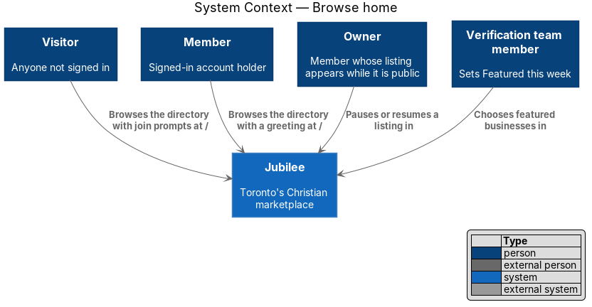
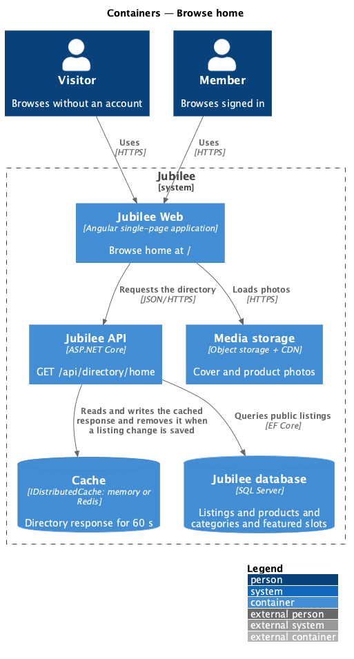
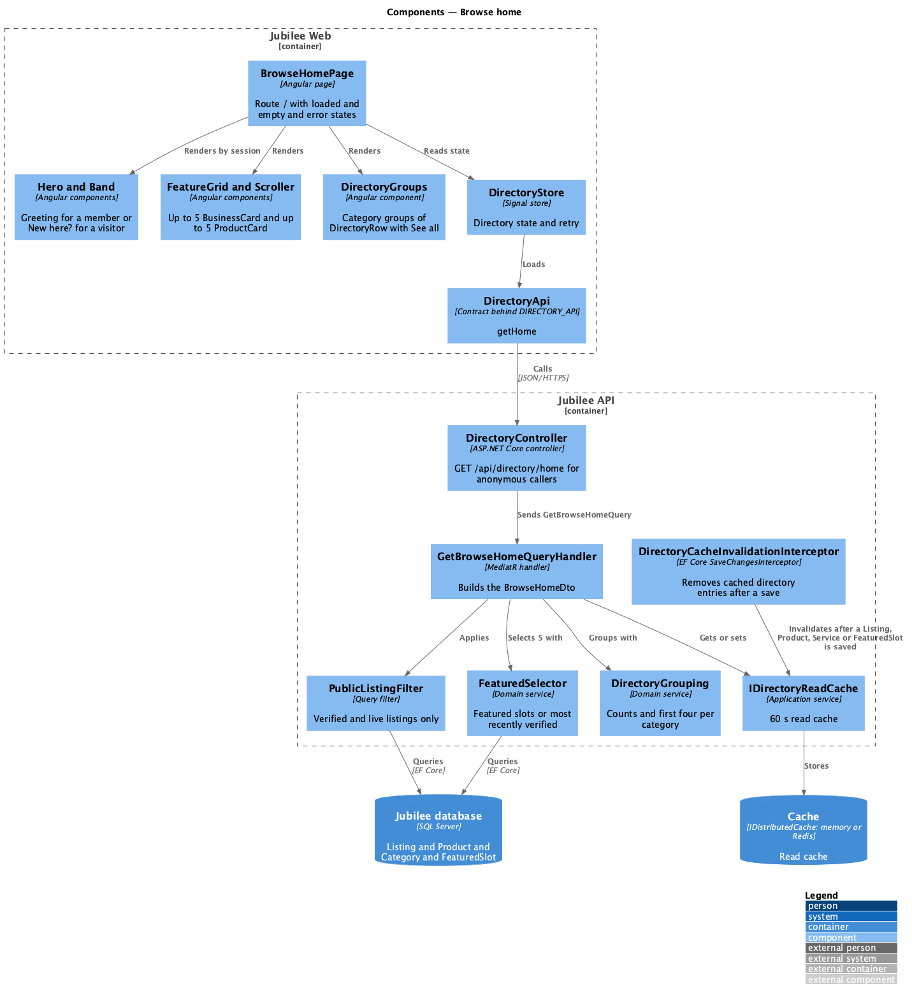
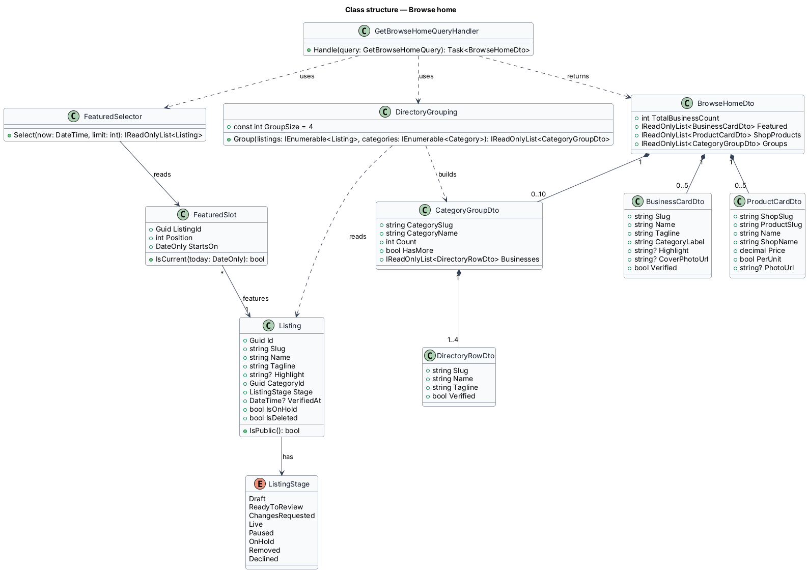
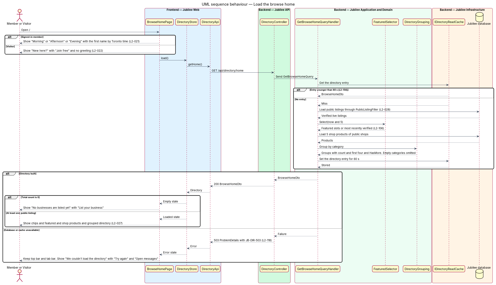
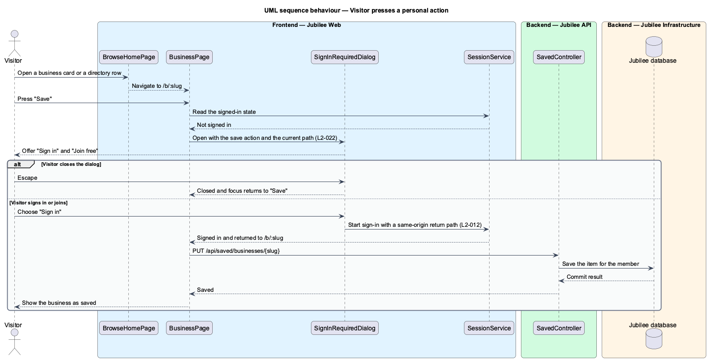
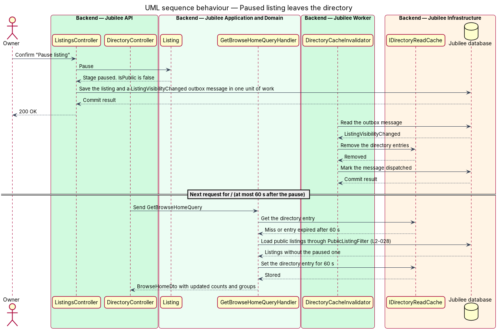

# Browse home

## Overview

Jubilee is Toronto's Christian marketplace: a directory of verified
Christian-owned businesses. The *browse home* at `/` is the main page of the
directory. It is the first page a signed-in *member* sees, and a *visitor* —
anyone who is not signed in — sees the same directory with prompts to join in
place of the personal parts.

The page has four parts. Category chips ("All" plus the ten categories) lead to
the category pages. "Featured this week" shows up to five businesses that the
verification team chose for the week. "From the shops" shows up to five
products with a link "All shops". "All {n} businesses" is the full directory
grouped by category; each *category group* shows its count and up to four
businesses, with "See all {n}" when the category holds more.

Three kinds of item appear on the page, each with fixed display rules. A
*business card* is the large tile used for featured businesses. A *product card*
shows one product with its shop and price. A *directory row* is the compact
one-line entry used inside a category group.

Every item on the page is a *public listing* — listing that is verified and
live, and not paused, deleted or under a moderation hold. A listing in any
other state does not appear and is not counted, and it leaves the page within
60 seconds of being paused.

## Description

The feature is a read-only vertical slice from the browse page in `Jubilee Web`
to the `Jubilee database`, with a short-lived read cache in between. The
directory response carries no personal data, so the same response serves
members and visitors. Nothing is built yet; the names below are the names the
design introduces.

- **`BrowseHomePage`** — Angular page at `/`, open to visitors and members. It
  composes the parts below and owns the page states. With no public listing it
  shows "No businesses are listed yet" with "List your business". When the
  directory fails to load, the top bar and tab bar stay and the page shows "We
  couldn't load the directory" with `JB-DIR-503`, "Try again" and "Open
  messages".
- **`GreetingHeader`** — Angular component for a signed-in member. It reads the
  first name from `SessionService` and the hour in `America/Toronto` from the
  browser service `ClockService`: "Morning, {first name}" before
  12:00, "Afternoon, {first name}" from 12:00, "Evening, {first name}" from
  17:00. A visitor gets no greeting.
- **`JoinPanel`** — Angular component shown to a visitor in place of the
  greeting: "New here?" with "Join free to message businesses, book meetings and
  save favourites." and "Join free". For a visitor the top bar shows "Sign in"
  and "Join free" in place of the avatar, and the page shows no saved-heart
  state and no message count.
- **`CategoryChips`** — Angular component with "All" and the ten categories,
  each a link to `/c/:category`.
- **`FeaturedRail`** and **`BusinessCard`** — up to five featured businesses.
  Each card has a category media tile or cover photo, a short category label,
  the name, the tagline, an optional highlight (green line) and the "Verified"
  mark. The name wraps and is never truncated; the tagline is clamped to two
  lines.
- **`ShopProductsRail`** and **`ProductCard`** — up to five products with "All
  shops". Each card shows photo, product name, shop name and price, formatted by
  `PricePipe` as "$34" or "$22 ea" for per-unit pricing.
- **`DirectoryGroupList`** and **`DirectoryRow`** — the heading "All {n}
  businesses" and one group per category with its count. A group with more than
  four businesses lists four and a "See all {n}" link to the category page; a
  group of four or fewer lists all of them with no link; a category with no
  public listing is omitted. A row truncates a long name to one line with an
  ellipsis and exposes the full name to assistive technology.
- **`CountPipe`** — Angular pipe that formats counts with a thousands separator
  ("1,204").
- **`SignInPromptService`** — Angular service that opens `SignInRequiredDialog`
  when a visitor presses a save, message, book, quote or order action, and
  keeps the action to resume after sign-in (L2-012).
- **`DirectoryStore`** and **`DirectoryApi`** — signal store and typed HTTP
  client. `DirectoryApi.getHome()` calls `GET /api/directory/home`. The store
  holds the states loading, loaded, empty and error, and "Try again" reloads
  only the directory region.
- **`DirectoryController`** — ASP.NET Core controller in `Jubilee.Api`. The
  home endpoint allows anonymous callers. A failure returns `ProblemDetails`
  with the error reference `JB-DIR-503` and the correlation ID (L2-118).
- **`GetBrowseHomeQuery`** and **`GetBrowseHomeQueryHandler`** — MediatR query
  and handler. The handler returns a `BrowseHomeDto` from `IDirectoryReadCache`
  or builds it: total count, featured businesses from `FeaturedSelector`, five
  shop products, and the groups from `DirectoryGrouping`.
- **`PublicListingFilter`** — query filter that keeps only public listings. It
  excludes the stages draft, ready to review, changes requested and
  declined, and each paused, deleted or held listing
  (L2-028). Each public list and count in the slice applies it.
- **`FeaturedSelector`** — application service in `Jubilee.Application`, because it queries the database. It returns the public listings of
  the current week's `FeaturedSlot` rows, up to five; when none is set it
  returns the most recently verified public listings.
- **`DirectoryGrouping`** — application service that turns public listings into
  `CategoryGroupDto` items: the category's count, its first four listings, and
  `HasMore` when the count exceeds four. It omits a category whose count is 0.
- **`IDirectoryReadCache`** and **`DirectoryCacheInvalidator`** — Redis read
  cache with a time to live of `60 s`, and the outbox handler in
  `Jubilee Worker` that removes the cached entry when a listing changes state.
  Together they bound the time a paused listing stays visible to 60 seconds.

A member's saved-heart state and message count come from the saved-list and
messaging slices and are merged in the browser. "From the shops" shows the five most recently added
products of public listings in the Shops category, newest first. The four
businesses inside a category group are the first four in "Recommended" order
(`docs/adr/0004-directory-ordering-rules.md`). The top bar entries for
messages and notifications lead to screens of later journeys; "Open messages"
is offered to a member only, and a visitor gets "Sign in" in its place. The direct-URL rule of
L2-028 (HTTP `404` for a listing that is not public, with a preview for its
owner and the verification team) is enforced by the business page slice.

Until the outbox of `Jubilee Worker` exists (`operations/run-background-jobs`),
`DirectoryCacheInvalidationInterceptor` in `Jubilee.Infrastructure` does the
work of `DirectoryCacheInvalidator`: it removes the cached directory entries
when `AppDbContext` saves a change to a `Listing`, `Product` or `FeaturedSlot`.
`IDirectoryReadCache` is built on `IDistributedCache`, in memory unless a Redis
connection string is configured, and the API also marks the responses
`Cache-Control: public, max-age=60` (`docs/adr/0003-directory-read-cache.md`).

## Requirements

The feature realizes the following level-2 (L2) requirements. Each L2
requirement refines a level-1 (L1) requirement, cited by identifier.

| L2 ID | Refines (L1) | Requirement |
|-------|--------------|-------------|
| `L2-021` | `L1-003` | The system shall serve `/` as the browse home: greeting, search, category chips, featured businesses, products from the shops, and the full directory grouped by category. |
| `L2-022` | `L1-003` | Visitors shall see the same directory with join prompts in place of personal actions. |
| `L2-027` | `L1-003` | Business cards, product cards and directory rows shall follow fixed display rules. |
| `L2-028` | `L1-003` | Browse, category, search, featured and related lists shall show only listings that are verified and not paused, deleted or under a moderation hold. |
| `L2-012` | `L1-001` | When a visitor tries an action that needs an account (message, book, ask, order, save), the system shall prompt them to join or sign in and bring them straight back. |
| `L2-106` | `L1-014` | The listings a verifier chooses as "Featured this week" shall show on the welcome and browse pages from the start date for 7 days, and a featured listing that is paused or removed shall be skipped. |
| `L2-118` | `L1-016` | Each load-error state shall show a reference that the user can quote to support. |
| `L2-156` | `L1-021` | Responses for the public directory and category pages shall be cached for up to 60 seconds and invalidated when a listing changes state. |

## Diagrams

### System context

Visitors and members browse the directory in Jubilee. The verification team
sets the featured businesses, and owners' listings appear only while public.
The slice calls no external system.

### Containers

`Jubilee Web` requests the directory from `Jubilee API`, which answers from the
`Cache` or the `Jubilee database`; photos load from `Media storage`.
`Jubilee Worker` removes the cached entry when a listing changes state.

### Components

`BrowseHomePage` composes the greeting or join panel, the two rails and the
grouped directory, and loads through `DirectoryStore` and `DirectoryApi`.
`GetBrowseHomeQueryHandler` uses `PublicListingFilter`, `FeaturedSelector` and
`DirectoryGrouping`.

### Class structure

`BrowseHomeDto` holds the total count, the featured `BusinessCardDto` items, the
`ProductCardDto` items and the `CategoryGroupDto` items, each group with up to
four `DirectoryRowDto` items. `Listing.IsPublic()` states the visibility rule.

### Behaviour — load the browse home

The page shows the greeting for a member or the join panel for a visitor, then
renders the directory from one response. An empty directory and a failed load
each have their own state.

### Behaviour — visitor presses a personal action

A visitor who presses save, message, book, quote or order gets the sign-in
prompt; after sign-in the page resumes the action.

### Behaviour — paused listing leaves the directory

Pausing a listing removes the cached directory through the outbox, and the
`60 s` expiry bounds the delay, so the listing is absent within 60 seconds.

