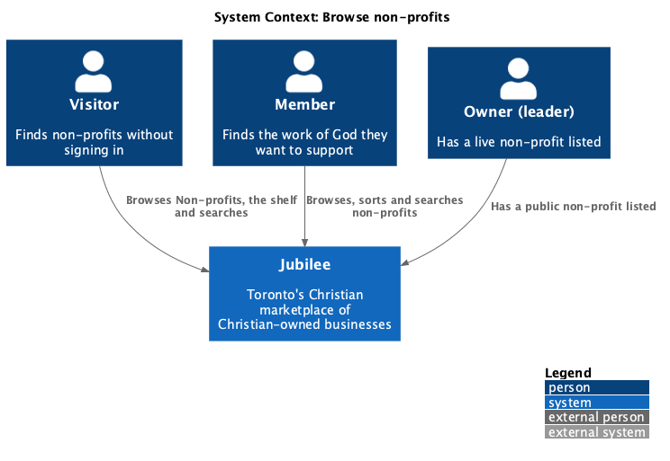
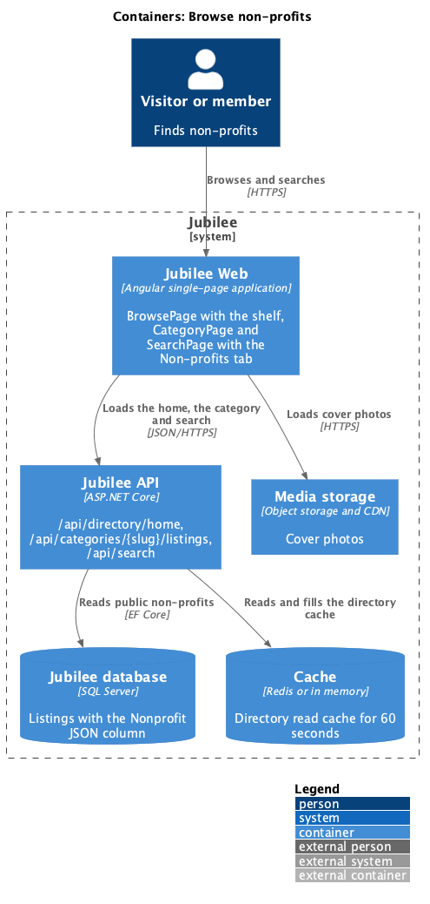
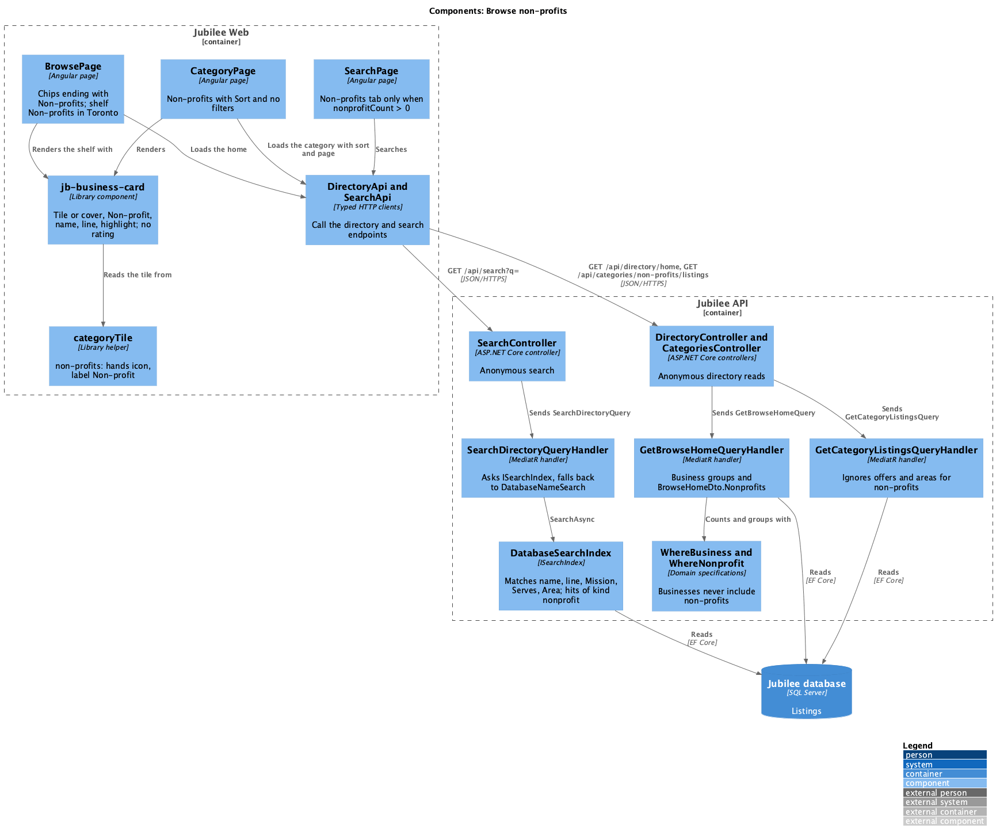
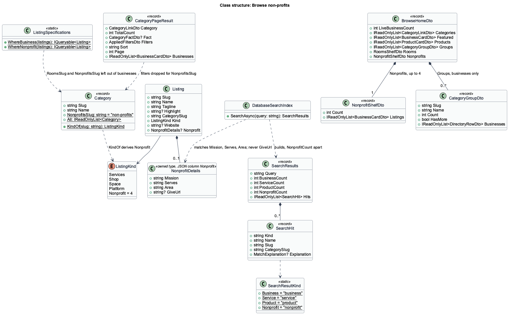
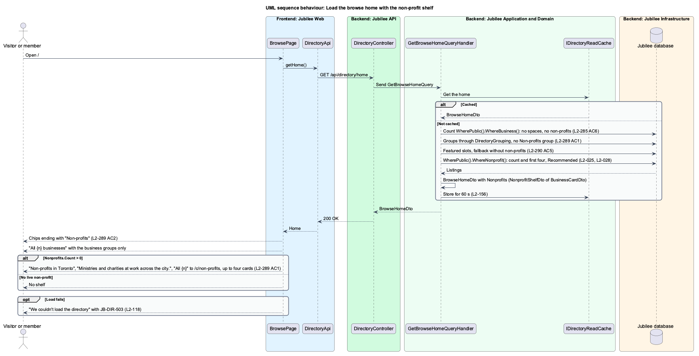
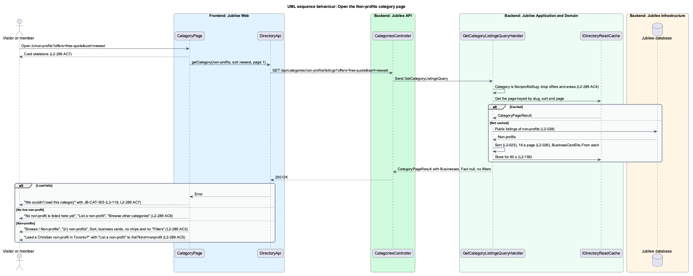
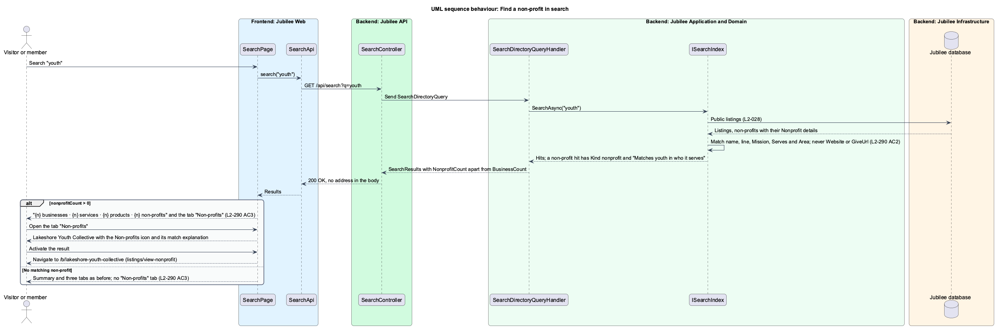

# Browse non-profits

## Overview

Jubilee is Toronto's Christian marketplace: a directory of
Christian-owned businesses. Besides businesses, shops, spaces and software
platforms, the directory holds *non-profits*: listings for a Christian
ministry, charity or other organisation at work in Toronto that sells nothing
to the people it serves (`onboarding/describe-nonprofit`). Every non-profit is
in the category "Non-profits" (`non-profits`), the thirteenth of thirteen, and
its kind is `nonprofit`. The copy calls the owner of a non-profit its
*leader*, whether they lead it or represent it; the role is the owner of L1.

This feature covers how visitors and members find non-profits in the
directory:

- the category chip "Non-profits" and the shelf "Non-profits in Toronto" on
  the browse home at `/`;
- the "Non-profits" category page at `/c/non-profits`;
- non-profits in search results at `/search?q=`, in a group of their own;
- non-profits in the lists every listing already joins: "More in
  Non-profits", the saved list and "New businesses".

A non-profit is not a business, so it is never counted as one: it is not in
"All {n} businesses", the browse groups, the welcome page's count or the
fallback of "Featured this week" (ADR 0074). It is counted only as a
non-profit, on its shelf, on its category page and in its search group.

A non-profit has no card of its own. It is shown on the *business card*, the
tile every list of listings uses, with the "Non-profits" *media tile* (the
tinted icon tile that stands in for a photo) and the short label
"Non-profit". It never carries a rating, because a non-profit takes no
reviews (`listings/view-nonprofit`).

Every non-profit shown is a *public listing* by the rules of `L2-028`: live,
and not paused, deleted or held. Nobody checks a non-profit first (ADR 0057),
and no list, card or count calls a non-profit verified, approved, registered,
vetted or endorsed.

## Description

The feature extends the three directory slices (`directory/browse-home`,
`directory/browse-category`, `directory/search-directory`) from the pages in
`Jubilee Web` to the `Jubilee database`. The model is fixed by
[ADR 0074](../../../adr/0074-non-profits.md) and copies the software platform
(`directory/browse-platforms`), except where a non-profit is kept apart from
the businesses.

- **`Category.All`**: gains `new(NonprofitsSlug, "Non-profits")` as the
  thirteenth and last entry, after "Software platforms" (`L2-285` AC2).
  `Category.NonprofitsSlug` is `"non-profits"`. Every copy of the category
  list gains the same entry: `CATEGORIES` in
  `frontend/projects/api/src/lib/models/categories.ts` (with its `blurb` and
  `trades` words) and the category chips that read `BrowseHomeDto.Categories`
  (`CategoryLinkDto.All`).
- **`Category.KindOf`**: answers `ListingKind.Nonprofit` for
  `NonprofitsSlug`, as it answers `Shop`, `Space` and `Platform` for theirs.
  `WireValues.Of` writes the kind as `nonprofit`.
- **`categoryTile`** (`components/src/lib/media-tile/category-tile.ts`): gains
  `'non-profits': { tint: …, icon: 'hands', label: 'Non-profit' }`. The
  `jb-icon` set (`components/src/lib/icon/icons.ts`) gains `hands`. The tile
  says its category in the label text, never by tint alone (`L2-298` AC4). The
  tint is green.
- **`jb-business-card`** (`BusinessCard`): reused unchanged. For a non-profit
  it shows the tile or the cover photo, "Non-profit", the name, the line and
  the optional highlight. It shows no rating: a non-profit's star counts stay
  zero, because it takes no reviews (`L2-290` AC1). The whole card is one link
  to `/b/:slug`.
- **`BusinessCardDto`**: unchanged. It has no field for an address, so no card
  carries the website or the page for giving (`L2-290` AC1).
- **`ListingSpecifications.WhereBusiness`** (`Jubilee.Domain`): leaves out
  non-profits as it leaves out spaces: `l.CategorySlug != Category.RoomsSlug
  && l.CategorySlug != Category.NonprofitsSlug`. Every caller therefore stops
  counting non-profits among businesses without a change of its own:
  `GetBrowseHomeQueryHandler` ("All {n} businesses"), `GetWelcomeQueryHandler`
  ("Browse all {n}"), `DirectoryGrouping` (no "Non-profits" group) and
  `FeaturedSelector` (the fallback of "Featured this week") (`L2-285` AC6,
  `L2-290` AC5). A new `WhereNonprofit` selects
  `l.CategorySlug == Category.NonprofitsSlug`.
- **`FeaturedSelector`**: unchanged in code. The featured slots the Jubilee
  team sets (`moderation/feature-businesses`) are read by listing id, not
  through `WhereBusiness`, so the team may still choose a non-profit for a
  slot; only the fallback of the most recently published leaves it out.
- **`BrowseHomeDto`**: gains `Nonprofits` (`NonprofitShelfDto`: `Count`, the number of live
  non-profits, and `Listings`, up to four `BusinessCardDto` in Recommended
  order, `L2-025`), as `RoomsShelfDto` holds `SpaceCardDto`. `GetBrowseHomeQueryHandler` builds it from
  `WherePublic().WhereNonprofit()`, sorted by `ListingSortPolicy` with the
  Recommended order, and caches it with the rest of the home in
  `IDirectoryReadCache` (`L2-156`). With no live non-profit `Count` is 0.
- **`BrowsePage`** (`pages/browse/`): the category chips end with
  "Non-profits" (`L2-289` AC2). After "All {n} businesses" the page shows the
  shelf "Non-profits in Toronto" with the line "Ministries and charities at
  work across the city.", "All {n}" linking to `/c/non-profits`, and up to
  four non-profits as `jb-business-card` items (`L2-289` AC1). With `Count` 0
  the shelf is not shown. The shelf composes library components only
  (`jb-section-header` and `jb-card-grid` or their equivalents in the mock).
- **`CategoryPage`** (`pages/category/`): for `non-profits` it reuses the
  branch of `software-platforms`. The computed `platforms` becomes a check of
  either slug (named for what it does: no filters, Sort kept). The page
  renders:
  - the breadcrumb "Browse / Non-profits", the heading "Non-profits" and the
    count "{n} non-profits" ("1 non-profit");
  - the "Sort" control (`L2-025`) and `jb-pagination`, 16 to a page
    (`L2-026`);
  - the non-profits as `jb-business-card` items in `jb-card-grid`;
  - no offer chips, no area chips, no "Filters" button and no category fact;
  - the closing band "Lead a Christian non-profit in Toronto?", "List it for
    free. Supporters go to its own website to give." and "List a non-profit"
    linking to `/list?kind=nonprofit`, when at least one non-profit is listed
    (`L2-289` AC5);
  - with no live non-profit, the empty state "No non-profit is listed here
    yet", "Know a Christian ministry or charity in Toronto? Invite them to
    list free, or list the one you lead.", "List a non-profit" and "Browse
    other categories" (`L2-289` AC6);
  - while loading, `jb-card-grid-skeleton`; on a failed load, "We couldn't
    load this category" with `JB-CAT-503` (`L2-289` AC7).
- **`GetCategoryListingsQuery`** and its handler: for `NonprofitsSlug` the
  handler replaces the filters of the request with the empty
  `CategoryFilterSet` before it builds the cache key, exactly as for
  `PlatformsSlug`, so `offers=` and `areas=` are ignored and never multiply
  the cached pages (`L2-289` AC4). It then follows the business branch: it
  counts, sorts by `ListingSortPolicy`, pages 16 at a time and fills
  `CategoryPageResult.Businesses`. `Fact` is null, `Filters` is empty and
  `Suggestions` is empty. `sort=` and `page=` apply as for any category.
- **`DatabaseSearchIndex`** (`Jubilee.Infrastructure/Search/`): for a listing
  with `Nonprofit` details it also matches `Nonprofit.Mission`,
  `Nonprofit.Serves` and `Nonprofit.Area`, in memory over the public listings
  as it does for a space and a platform (ADR 0011). The match labels are "its
  mission", "who it serves" and "where it works", so an explanation reads
  "Matches youth in who it serves". `Listing.Website` and
  `Nonprofit.GiveUrl` are never in the searched text (`L2-290` AC2). A
  non-profit hit has `Kind` `nonprofit` (`SearchResultKind.Nonprofit`), is
  counted in `NonprofitCount` and never in `BusinessCount`, and has no `Space`
  card. As for the other kinds, at most 20 non-profit hits are returned and
  the count is of all the matches.
- **`SearchResults`**: gains `NonprofitCount` (`int`), sent as
  `nonprofitCount`. `SearchResultKind` gains `Nonprofit = "nonprofit"`.
- **`DatabaseNameSearch`**: the fallback (`L2-181`). It matches a non-profit
  by name and returns it with `Kind` `nonprofit` and counted in
  `NonprofitCount`, so a non-profit is never a business hit, with the index or
  without it.
- **`SearchApi`** and the model `SearchResults` in
  `frontend/projects/api/src/lib/models/`: gain `nonprofitCount`, and
  `SearchResultKind` gains `'nonprofit'`.
- **`SearchPage`** (`pages/search/`): `TABS` gains a fourth entry "Non-profits"
  (kind `nonprofit`) after "Products". The `tabs` computed offers it only when
  `nonprofitCount` is above 0, so a search with no matching non-profit reads
  exactly as before (`L2-290` AC3). The summary line adds "· {n} non-profits"
  ("1 non-profit") only in that case. A non-profit hit is listed as a business
  hit is, as a row with the "Non-profits" icon and its match explanation;
  activating it opens `/b/:slug`.
- **`NewBusinessNotifier`**: unchanged. When a leader publishes a non-profit,
  members who browsed "Non-profits" with "New businesses" on are told "New in
  Non-profits: {name}", and the non-profit is in the weekly note (`L2-290`
  AC4, `L2-222`).
- **Related and saved**: unchanged. "More in Non-profits" on a non-profit page
  follows `L2-040` (`listings/view-nonprofit`). A saved non-profit shows in
  the saved list with its card (`L2-290` AC7, `listings/save-listing`).
- **`PublicListingFilter`**: the same public-listing rule as every directory
  list. A non-profit is never an exception.
- **Seed**: `DemoCatalogue.cs` gains three invented non-profits on `.example`
  addresses: Hope House Toronto, Bread & Bridges and Lakeshore Youth
  Collective. No real organisation is seeded (ADR 0074).
- **Tests**: API integration tests on the InMemory provider (ADR 0009) in
  `backend/tests/Jubilee.Api.Tests/` (`NonprofitDirectoryTests`,
  `NonprofitSearchTests`, beside `PlatformDirectoryTests` and
  `PlatformSearchTests`), one per criterion and named for it
  (`L2_285_AC6_...`, `L2_289_AC1_...`, `L2_290_AC3_...`). Playwright behaviour
  specs in `e2e/tests/` (`browse-nonprofits.spec.ts`,
  `search-nonprofits.spec.ts`) state intent through the page objects of the
  browse home, the category page and search in `e2e/pages/`; the recorded API
  answers are refreshed in the same change, and `e2e/fixtures/routes.ts` gains
  the states of `pages/category/non-profits*.html` and
  `pages/search/non-profits.html`.

### Open questions

The choices below are recorded where the design reference and the rules
differ or leave a gap.

- **No drawing in the design reference**: the Magic Patterns reference draws
  no non-profit. The screens are drawn in `docs/mocks/` from the existing
  business card, category page, browse home and search (ADR 0074).
- **The shelf's type** (settled): `L2-289` AC1 asks for business cards, so the
  shelf is `NonprofitShelfDto(Count, Listings)` of `BusinessCardDto`, as
  `RoomsShelfDto` holds `SpaceCardDto`, and not a `CategoryGroupDto`, whose
  `DirectoryRowDto` entries carry no cover photo and no highlight.
- **Not counted among the businesses**: unlike a platform, a non-profit is
  left out of `WhereBusiness`, because L1-035 and ADR 0074 say it is not a
  business. A platform stays counted among them.
- **Search labels**: "its mission", "who it serves" and "where it works" are
  the form's fields in lower case, shortened as "who it is for" is for a
  platform.
- **The fallback search**: `L2-290` does not name the name search of
  `L2-181`. The design keeps a non-profit out of "Businesses" there too, so the
  groups do not change when the index fails.
- **Tile tint**: green, the icon `hands` and the label "Non-profit" (ADR 0074).
- **No filters**: offers and areas served describe a trade that visits a
  customer. Filters on "Non-profits" are deferred.

## Requirements

The feature realizes the following level-2 (L2) requirements. Each L2
requirement refines a level-1 (L1) requirement, cited by identifier.

| L2 ID | Refines (L1) | Requirement |
|-------|--------------|-------------|
| `L2-285` | `L1-035` | A listing in "Non-profits" (`non-profits`), the thirteenth of thirteen categories, shall be a non-profit and nothing else shall be; a non-profit shall follow the public-listing rules of every listing, no screen shall call it verified, approved, registered, vetted or endorsed, and non-profits shall not be counted among the businesses. |
| `L2-289` | `L1-035` | The browse home shall end its category chips with "Non-profits" and show the shelf "Non-profits in Toronto" with "All {n}" and up to four non-profits in Recommended order after "All {n} businesses", without a "Non-profits" group; `/c/non-profits` shall list the non-profits as business cards, 16 to a page, with "Sort" and without the offers, the areas, "Filters" or the category fact, ignore `offers=` and `areas=`, end with "List a non-profit", and show its empty, loading and failed states. |
| `L2-290` | `L1-035` | A non-profit shall be shown on the business card with the "Non-profits" tile, the label "Non-profit", no rating and no address; search shall match it by name, line, mission, who it serves and where it works, never by its addresses, in a fourth group "Non-profits" offered only when it has a match and not counted under "Businesses"; it shall join "New businesses", "More in Non-profits" and the saved list, and never the fallback of "Featured this week". |
| `L2-298` | `L1-035` | The "Non-profits" category page and the shelf shall fit from 360 px, work by keyboard and touch with 44 px targets, show their loading, empty and failed states, and use the tokens in both themes, the tile saying its category in text. |
| `L2-025` | `L1-003` | A category shall be sortable by "Recommended", "Newest" and "Name A–Z". |
| `L2-026` | `L1-003` | Long categories shall be paged 16 at a time. |
| `L2-028` | `L1-003` | Browse, category, search, featured and related lists shall show only listings that are live and not paused, deleted or under a moderation hold. |
| `L2-118` | `L1-016` | Every load-error state shall show a reference that the user can quote to support. |
| `L2-156` | `L1-021` | Responses for the public directory and category pages shall be cached for up to 60 seconds and invalidated when a listing changes state. |
| `L2-181` | `L1-025` | When the search index is unavailable, the application shall fall back to a database name search of the public listings and shall show results without match explanations. |

## Diagrams

### System context

Visitors and members find non-profits in Jubilee; a leader's non-profit
appears only while public. The slice calls no external system, and Jubilee
never requests a non-profit's website or page for giving.

### Containers

`Jubilee Web` loads the browse home, the category page and search from
`Jubilee API`, which answers from the `Cache` or the `Jubilee database`; cover
photos load from `Media storage`.

### Components

The three pages render `jb-business-card` and the category tile from the
components library. The browse-home handler builds the non-profit shelf
beside the business groups, `WhereBusiness` leaves non-profits out of every
business count, the category handler drops the filters for `non-profits`, and
the search index returns non-profit hits of their own kind.

### Class structure

`Category.KindOf` derives `ListingKind.Nonprofit` from the category.
`BrowseHomeDto` gains `Nonprofits` and `SearchResults` gains
`NonprofitCount`; the search index reads `NonprofitDetails.Mission`, `Serves`
and `Area` only.

### Behaviour: load the browse home with the non-profit shelf

The handler counts businesses without non-profits and builds the shelf from
the live non-profits; the page shows the shelf only when its count is above
zero.

### Behaviour: open the "Non-profits" category page

The handler ignores `offers=` and `areas=`, applies the sort and the page, and
the page shows business cards without filters.

### Behaviour: find a non-profit in search

A search matches a non-profit by its name, line, mission, who it serves and
where it works, and returns it as a hit of kind `nonprofit` counted apart from
the businesses; the "Non-profits" tab is offered only when that count is above
zero.

