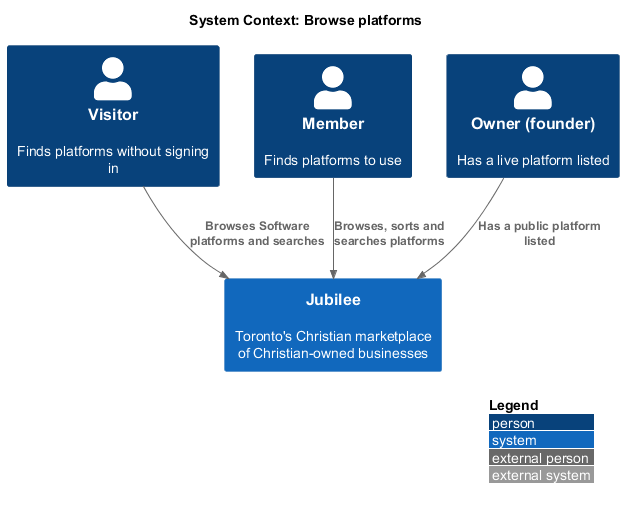
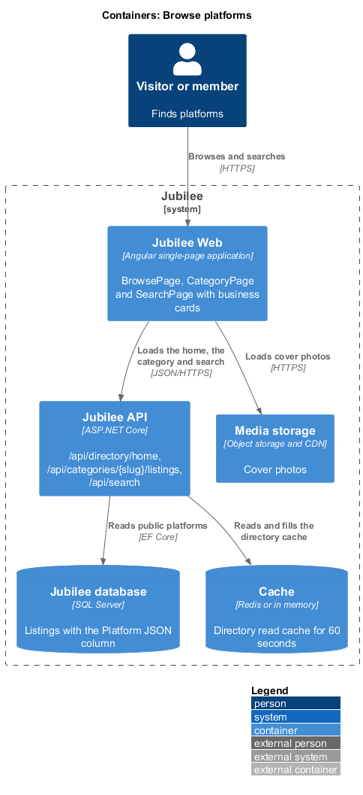
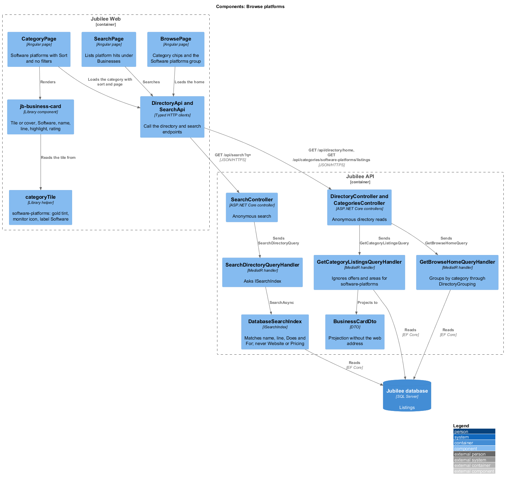
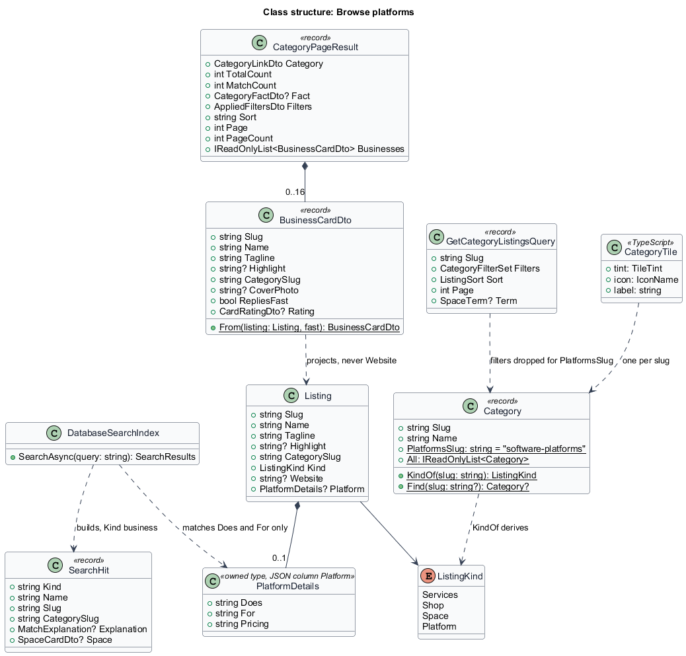
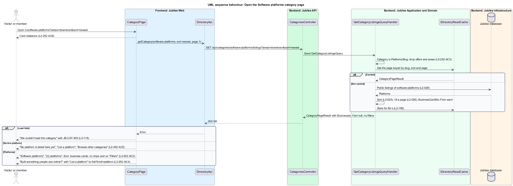
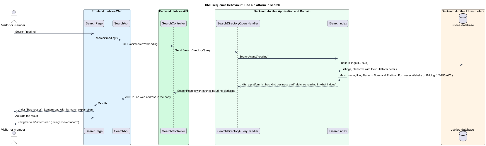

# Browse platforms

## Overview

Jubilee is Toronto's Christian marketplace: a directory of
Christian-owned businesses. Besides businesses, shops and spaces, the directory
holds *software platforms*: listings for a product people use online, a web app
or an online tool, with no shop, no area served and no opening hours
(`onboarding/describe-platform`). A software platform is called a *platform*
for short. Every platform is in the category "Software platforms"
(`software-platforms`), the twelfth of twelve, and its kind is `platform`. The
copy calls the owner of a platform its *founder*; the role is the owner of L1.

This feature covers how visitors and members find platforms in the directory:

- the category chip and the group "Software platforms" on the browse home at
  `/`;
- the "Software platforms" category page at `/c/software-platforms`;
- platforms in search results at `/search?q=`;
- platforms in the lists every business already joins: "Featured this week",
  "More in Software platforms", the saved list and "New businesses".

A platform has no card of its own. It is shown on the *business card*, the
tile every list of businesses uses, with the "Software platforms" *media tile*
(the tinted icon tile that stands in for a photo) and the short label
"Software".

Every platform shown is a *public listing* by the rules of `L2-028`: live, and
not paused, deleted or held. Nobody verifies a platform first (ADR 0057), and
no list, card or count calls a platform verified, approved or vetted.

## Description

The feature extends the three directory slices (`directory/browse-home`,
`directory/browse-category`, `directory/search-directory`) from the pages in
`Jubilee Web` to the `Jubilee database`. The model is fixed by
[ADR 0072](../../../adr/0072-software-platforms.md). Most of the slice is
reuse: a platform joins every list of businesses because it is a business card
and is not a space.

- **`Category.All`**: gains `new(PlatformsSlug, "Software platforms")` as the
  twelfth and last entry, after Community. `Category.PlatformsSlug` is
  `"software-platforms"`. Every copy of the category list gains the same entry:
  `CATEGORIES` in `frontend/projects/api/src/lib/models/categories.ts` (with its
  `blurb` and `trades` words) and the category chips that read
  `BrowseHomeDto.Categories` (`CategoryLinkDto.All`).
- **`Category.KindOf`**: answers `ListingKind.Platform` for
  `PlatformsSlug`, as it answers `Shop` and `Space` for theirs. `WireValues.Of`
  writes the kind as `platform`.
- **`categoryTile`** (`components/src/lib/media-tile/category-tile.ts`): gains
  `'software-platforms': { tint: 'gold', icon: 'monitor', label: 'Software' }`.
  The `jb-icon` set (`components/src/lib/icon/icons.ts`) gains `monitor`. The
  tile says its category in the label text, never by tint alone (`L2-262`
  AC4).
- **`jb-business-card`** (`BusinessCard`): reused unchanged. It shows the tile
  or the cover photo, "Software", the name, the line, the optional highlight
  and the rating from three reviews (`L2-231`). The whole card is one link to
  `/b/:slug`. There is no platform card.
- **`BusinessCardDto`**: unchanged. It has no field for the web address, so no
  card carries one (`L2-253` AC1).
- **`BrowsePage`** (`pages/browse/`): no new code. The category chips end
  with "Software platforms". `DirectoryGrouping` leaves out spaces only
  (`WhereBusiness`), so platforms are counted in "All {n} businesses" and the
  group "Software platforms" follows "Community" with its count, its first
  four platforms (`DirectoryRowDto`) and "See all {n}". `DirectoryGrouping`
  already omits a category with no public listing, so the group is absent
  while no platform is live.
- **`CategoryPage`** (`pages/category/`): for `software-platforms` it renders
  the business branch without the filters:
  - the breadcrumb "Browse / Software platforms", the heading "Software
    platforms" and the count "{n} platforms" ("1 platform");
  - the "Sort" control (`L2-025`) and `jb-pagination`, 16 to a page;
  - the platforms as `jb-business-card` items in `jb-card-grid`;
  - no offer chips, no area chips, no "Filters" button and no category fact;
  - the closing band "Built something people use online?", "List your platform
    for free. Members go to your website to use it." and "List a platform"
    linking to `/list?kind=platform`, when at least one platform is listed;
  - with no live platform, the empty state "No platform is listed here yet",
    "Know a Christian founder in Toronto? Invite them to list free, or list
    your own platform.", "List a platform" and "Browse other categories";
  - while loading, `jb-card-grid-skeleton`; on a failed load, "We couldn't
    load this category" with `JB-CAT-503`.
- **`GetCategoryListingsQuery`** and its handler: for `PlatformsSlug` the
  handler replaces the filters of the request with the empty
  `CategoryFilterSet` before it builds the cache key, so `offers=` and
  `areas=` are ignored and never multiply the cached pages. It then follows
  the business branch: it counts, sorts by `ListingSortPolicy`, pages 16 at a
  time and fills `CategoryPageResult.Businesses`. `Fact` is null, `Filters` is
  empty and `Suggestions` is empty. `sort=` and `page=` apply as for any
  category.
- **`GetCategoryListingCountQuery`**: unchanged. The page never calls it for
  `software-platforms`, because "Filters" is not shown.
- **`DatabaseSearchIndex`** (`Jubilee.Infrastructure/Search/`): for a listing
  with `Platform` details it also matches `Platform.Does` and `Platform.For`,
  in memory over the public listings as it does for a space (ADR 0011). The
  match labels are "what it does" and "who it is for", so an explanation reads
  "Matches reading in what it does". `Listing.Website` and
  `Platform.Pricing` are never in the searched text. A platform hit has
  `Kind` `business`, so it counts in "Businesses" (`L2-029` AC1), and has no
  `Space` card.
- **`SearchPage`** (`pages/search/`): no new code. A platform hit is listed
  under "Businesses" as every business hit is, with the "Software platforms"
  icon and its match explanation.
- **`DatabaseNameSearch`**: the fallback, unchanged. It matches a platform by
  name.
- **`NewBusinessNotifier`**: unchanged. When a founder publishes a platform,
  members who browsed "Software platforms" with "New businesses" on are told
  "New in Software platforms: {name}", and the platform is in the weekly note
  (`L2-222`).
- **Featured, related and saved**: unchanged. The Jubilee team may choose a
  platform as a featured business (`moderation/feature-businesses`). "More in
  Software platforms" on a platform page follows `L2-040`
  (`listings/view-platform`). A saved platform shows among the saved
  businesses with its card (`listings/save-listing`).
- **`PublicListingFilter`**: the same public-listing rule as every directory
  list. A platform is never an exception.
- **Seed**: `DemoCatalogue.cs` gains three invented platforms on `.example`
  addresses: Lanternread by Abigail Thornton, Gatherboard by Nathaniel Brooks
  and Ledgerleaf by Priscilla Wong.
- **Tests**: API integration tests on the InMemory provider (ADR 0009) in
  `backend/tests/Jubilee.Api.Tests/` (`PlatformDirectoryTests`,
  `PlatformSearchTests`, beside `SpaceDirectoryTests` and `SpaceSearchTests`),
  one per criterion and named for it (`L2_248_AC2_...`, `L2_252_AC3_...`,
  `L2_253_AC2_...`). Playwright behaviour specs in `e2e/tests/`
  (`browse-platforms.spec.ts`, `search-platforms.spec.ts`) state intent
  through the page objects of the browse home, the category page and search in
  `e2e/pages/`; the recorded API answers are refreshed in the same change.

### Open questions

The choices below are recorded where the design reference and the rules
differ or leave a gap.

- **No drawing in the design reference**: the Magic Patterns reference draws
  no platform. The screens are drawn in `docs/mocks/` from the existing
  business card, category page and search (ADR 0072).
- **No platform card**: nothing on a card is particular to a platform, so the
  business card is used. A platform card of its own is deferred (ADR 0072).
- **No filters**: offers and areas served describe a trade that visits a
  customer. Filters on "Software platforms" are deferred (ADR 0072).
- **Counted among the businesses**: platforms count in "All {n} businesses" on
  the browse home, and as "{n} platforms" on their own category page.
- **Search results as rows**: `L2-253` AC2 says "as business cards".
  `SearchPage` lists every business hit as a row with its match explanation,
  and only spaces as cards. The design keeps the row, which is what a business
  hit is today; the mock `pages/search/platforms.html` settles the wording.
- **Match labels**: "what it does" and "who it is for" are the words of the
  form's fields in lower case, as "the space" and "key facts" are for a space.

## Requirements

The feature realizes the following level-2 (L2) requirements. Each L2
requirement refines a level-1 (L1) requirement, cited by identifier.

| L2 ID | Refines (L1) | Requirement |
|-------|--------------|-------------|
| `L2-248` | `L1-033` | A listing in "Software platforms" (`software-platforms`), the twelfth of twelve categories, shall be a platform and nothing else shall be; a platform shall follow the public-listing rules of every listing, and no screen shall call it verified, approved or vetted. |
| `L2-252` | `L1-033` | The browse home shall end its category chips with "Software platforms" and show its group after "Community", counting platforms in "All {n} businesses"; `/c/software-platforms` shall list the platforms as business cards, 16 to a page, with "Sort" and without the offers, the areas, "Filters" or the category fact, ignore `offers=` and `areas=`, end with "List a platform", and show its empty, loading and failed states. |
| `L2-253` | `L1-033` | A platform shall be shown on the business card with the "Software platforms" tile, the label "Software" and no web address; search shall match it by name, line, "What it does" and "Who it is for" and never by web address or pricing; and it shall join "New businesses", "Featured this week", "More in Software platforms" and the saved list like any business. |
| `L2-025` | `L1-003` | A category shall be sortable by "Recommended", "Newest" and "Name A–Z". |
| `L2-026` | `L1-003` | Long categories shall be paged 16 at a time. |
| `L2-028` | `L1-003` | Browse, category, search, featured and related lists shall show only listings that are live and not paused, deleted or under a moderation hold. |
| `L2-118` | `L1-016` | Every load-error state shall show a reference that the user can quote to support. |
| `L2-156` | `L1-021` | Responses for the public directory and category pages shall be cached for up to 60 seconds and invalidated when a listing changes state. |

## Diagrams

### System context

Visitors and members find platforms in Jubilee; a founder's platform appears
only while public. The slice calls no external system, and Jubilee never
requests a platform's website.

### Containers

`Jubilee Web` loads the browse home, the category page and search from
`Jubilee API`, which answers from the `Cache` or the `Jubilee database`; cover
photos load from `Media storage`.

### Components

The three pages render `jb-business-card` and the category tile from the
components library. The category handler drops the filters for
`software-platforms`, and the search index reads the platform's words.

### Class structure

`Category.KindOf` derives `ListingKind.Platform` from the category.
`BusinessCardDto` is projected from `Listing` without `Website`, and the
search index reads `PlatformDetails.Does` and `PlatformDetails.For` only.

### Behaviour: open the "Software platforms" category page

The handler ignores `offers=` and `areas=`, applies the sort and the page, and
the page shows business cards without filters.

### Behaviour: find a platform in search

A search matches a platform by its name, line, "What it does" and "Who it is
for", and returns it as a business hit.

