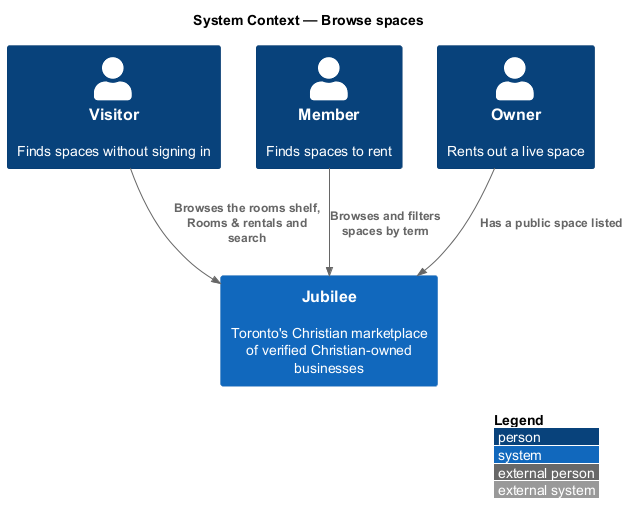
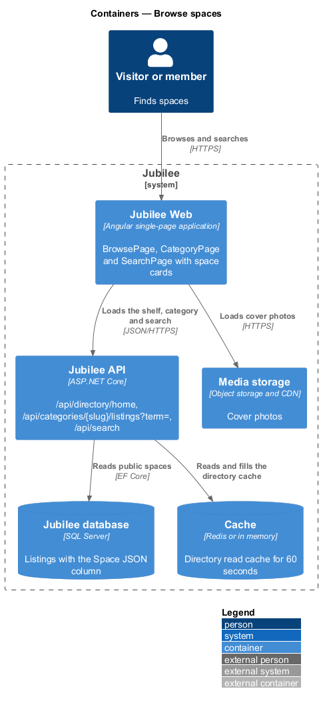
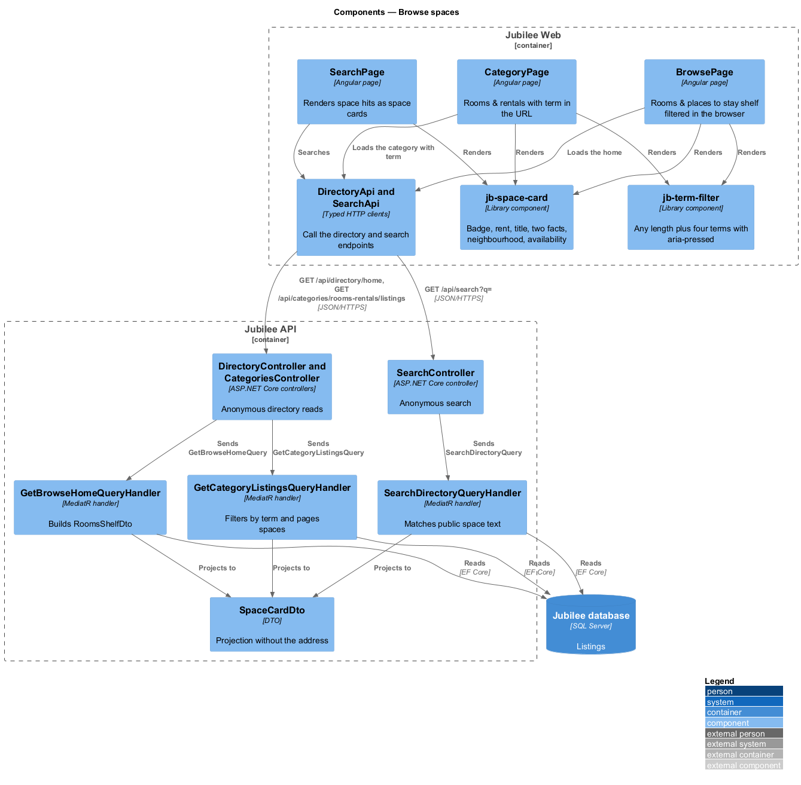
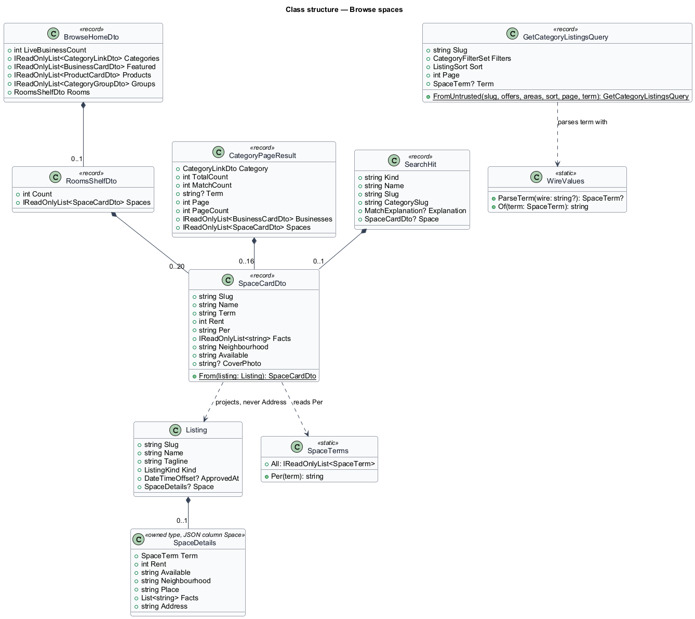
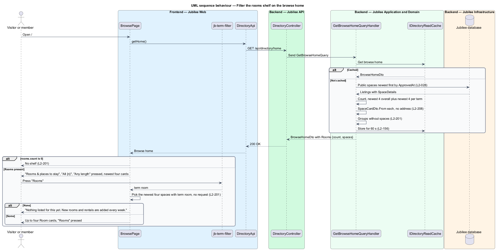
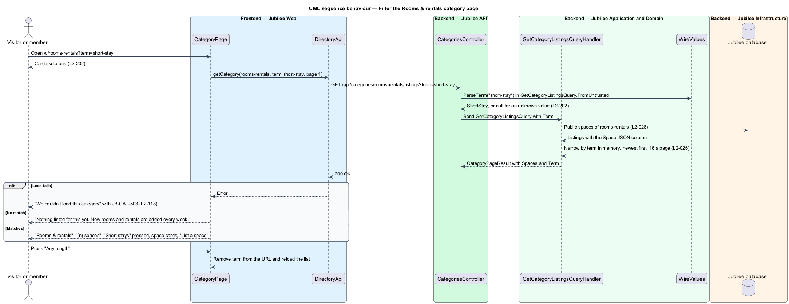
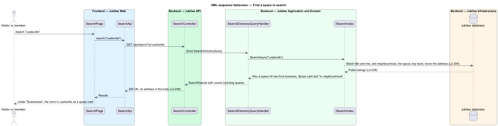

# Browse spaces

## Overview

Jubilee is Toronto's Christian marketplace: a directory of verified
Christian-owned businesses. Besides businesses and shops, the directory holds
*spaces*: listings for a room, suite, apartment, house or hall that an owner
rents out (`onboarding/describe-space`). Every space is in the category "Rooms
& rentals" (`rooms-rentals`) and is rented under one *term*: "Short stay",
"Long term", "Room" or "Roommate".

This feature covers how visitors and members find spaces in the directory:

- the *rooms shelf* "Rooms & places to stay" on the browse home at `/`, after
  "Featured this week";
- the "Rooms & rentals" category page at `/c/rooms-rentals`;
- spaces in search results at `/search?q=`;
- the *space card*, the tile every one of these lists uses for a space.

A *term filter* narrows a list of spaces to one term. It has "Any length"
(pressed by default), "Short stays", "Long term", "Rooms" and "Roommates", each
a toggle button whose pressed state is carried by `aria-pressed`.

Every space shown is a *public listing* by the rules of `L2-028`: verified,
live, and not paused, deleted or held. The *exact address* of a space is never
part of any list, card or search response, and is never searched (`L2-208`).

## Description

The feature extends the three directory slices (`directory/browse-home`,
`directory/browse-category`, `directory/search-directory`) from the pages in
`Jubilee Web` to the `Jubilee database`. The model is fixed by ADR 0042.

- **`jb-space-card`** (`SpaceCard`, `components/src/lib/space-card/`) —
  presentation component in the components library. It shows the cover photo or
  the category media tile, a term badge ("Short stay", "Long term", "Room" or
  "Roommate wanted"), the rent ("$950" with "/ month" or "/ night"), the title
  (wrapping, clamped to two lines), up to two key facts joined by " · ", the
  neighbourhood and the availability line. The whole card is one link to
  `/b/:slug`, so click, tap, Enter and Space open the space page. The link's
  accessible name is the title, and the term, rent and neighbourhood are text,
  never colour alone (`L2-203`). It takes a space card view model matching
  `SpaceCardDto`. Previews of a space that is not live use its sibling
  **`jb-space-card-preview`** (`SpaceCardPreview`), which shares the card's
  rules, follows nothing and is marked "Pending verification" until it is
  `verified` (`onboarding/describe-space`).
- **`jb-term-filter`** (`TermFilter`, `components/src/lib/term-filter/`) —
  the five toggle buttons with `aria-pressed`. It emits the chosen term's wire
  value or `null` for "Any length".
- **`availability`** — pure helper in
  `frontend/projects/components/src/lib/space-card/space-terms.ts`, beside the
  term badges, tiles and `formatRent`, that turns the availability text into the card line: "Available now" when it
  is "Now", "From {text}" for a monthly term, and the text as given for a Short
  stay.
- **`BrowsePage`** (`pages/browse/`) — after "Featured this week" it renders
  the rooms shelf when `rooms.count` is above zero: the heading "Rooms & places to stay",
  "All {n}" linking to `/c/rooms-rentals`, `jb-term-filter` and up to four
  `jb-space-card` items newest first. A pressed term filters the shelf's
  spaces in the browser without a request. A term with no space shows "Nothing
  listed for this yet. New rooms and rentals are added every week." and the
  filter stays. The browse search placeholder reads "Plumber, lawyer, room to
  rent…".
- **`BrowseHomeDto.Rooms`** — new `RoomsShelfDto(Count, Spaces)` on `GET
  /api/directory/home`, built by `GetBrowseHomeQueryHandler`: `Count` (live
  spaces) and `Spaces`, the union of the four newest spaces overall and the four
  newest of each term (`RoomsShelfLimit` 4), newest first by `ApprovedAt`, as
  `SpaceCardDto` items (at most 20). With no live space, `Count` is 0 and
  `Spaces` is empty, so the shelf is not shown. The whole DTO stays in
  `IDirectoryReadCache` (ADR 0003).
- **`DirectoryGrouping`** — leaves spaces out: "All {n} businesses" counts only
  businesses and has no "Rooms & rentals" group (`L2-201` AC6).
- **`CategoryPage`** (`pages/category/`) — for `rooms-rentals` it shows the
  breadcrumb "Browse / Rooms & rentals", the heading "Rooms & rentals" with "{n}
  spaces", `jb-term-filter` and the space cards newest first in
  `jb-card-grid`, 16 to a page with `jb-pagination`. The business filters and
  "Sort" are not shown. The chosen term is the `term` query parameter; opening
  the URL applies it. The page ends with "Have a spare room, suite or hall?",
  "Rent it to someone from the community. Free to list." and "List a space"
  linking to `/list?kind=space`. Loading shows `jb-card-grid-skeleton`; a failed
  load shows "We couldn't load this category" with `JB-CAT-503`.
- **`DirectoryApi.getCategory`** — adds `term` to `GET
  /api/categories/{slug}/listings`.
- **`CategoriesController`** — reads `term` from the query string.
- **`GetCategoryListingsQuery`** — gains `SpaceTerm? Term`. `FromUntrusted`
  parses the term with `WireValues.ParseTerm`; an unknown value is ignored.
  For `rooms-rentals` the handler loads the category's live spaces, narrows
  them by term in memory (the term is inside the `Space` JSON column), orders
  them newest first, pages 16 at a time, and fills `CategoryPageResult.Spaces`
  (`IReadOnlyList<SpaceCardDto>`) and `CategoryPageResult.Term` (the wire value,
  or empty); `Businesses` is empty and the filters, fact and sort are not
  applied.
- **`SpaceCardDto`** — `Slug`, `Name` (the title), `Term` (wire value),
  `Rent`, `Per` (`night` or `month`), `Facts` (the first two key facts),
  `Neighbourhood`, `Available` and `CoverPhoto`. It is built by
  `SpaceCardDto.From(Listing)` and has no address field (`L2-203` AC4).
- **`SearchDirectoryQueryHandler`** and **`ISearchIndex`** — on `GET
  /api/search`, a live space matches by its title and line like any listing,
  and also by its neighbourhood, the space and its key facts, with the match
  explanations "in neighbourhood", "in the space" and "in key facts"; the exact
  address is not in the searched text. A space hit keeps
  `Kind` `business`, so it counts in "Businesses" (`L2-029` AC1), and carries
  `SearchHit.Space` (`SpaceCardDto`) so `SearchPage` renders it as a
  `jb-space-card` in a card grid above the rows of the businesses that match. `DatabaseNameSearch`, the fallback, applies the same fields.
- **`PublicListingFilter`** — the same public-listing rule as every directory
  list; a space is never an exception.

### Open questions

The choices below are recorded where the design reference and the rules
differ or leave a gap.

- **Shelf filtering in the browser** — the shelf carries the newest four of
  each term so that the filter answers without a request and the browse home
  stays one cached response; the category page filters on the server because it
  pages.
- **Availability** — free text. The card shows "Available now" for "Now",
  "From {text}" for a monthly term and the text as given for a Short stay; the
  server does not parse it, so spaces are not sorted or filtered by date.
- **Key facts** — the design's sell frame has no "Key facts" field but the card
  shows two, so the form adds it (`onboarding/describe-space`).
- **Hourly rent** — deferred; a hall is priced per night as a Short stay.
- **Sign-up intents** — "Find a place" and "Rent out a space" are deferred.

## Requirements

The feature realizes the following level-2 (L2) requirements. Each L2
requirement refines a level-1 (L1) requirement, cited by identifier.

| L2 ID | Refines (L1) | Requirement |
|-------|--------------|-------------|
| `L2-197` | `L1-028` | A space shall be in the category "Rooms & rentals", the second of eleven, under one of the terms Short stay, Long term, Room and Roommate, with rent per night for a Short stay and per month otherwise, and shall follow the public-listing rules of every listing. |
| `L2-201` | `L1-028` | The browse home shall show "Rooms & places to stay" with "All {n}", a term filter and up to four space cards when a space is live, filter it by term without reloading, leave spaces out of "All {n} businesses", and use the placeholder "Plumber, lawyer, room to rent…". |
| `L2-202` | `L1-028` | `/c/rooms-rentals` shall list the space cards newest first, 16 to a page, filtered by the term carried in the URL, without the business filters or "Sort", and shall end with "List a space". |
| `L2-203` | `L1-028` | A space card shall show the cover or tile, the term badge, the rent, the title, up to two key facts, the neighbourhood and the availability, open the space page from click, tap, Enter or Space, announce its parts as text, and carry no exact address. |
| `L2-204` | `L1-028` | Search shall match live spaces by title, line, neighbourhood, the space and key facts, list them under "Businesses" as space cards, and never search or return the exact address. |
| `L2-208` | `L1-028` | No public endpoint shall return the exact address of a space to a visitor, a member or the verification team. |
| `L2-026` | `L1-003` | Long categories shall be paged 16 at a time. |
| `L2-028` | `L1-003` | Browse, category, search, featured and related lists shall show only listings that are verified and not paused, deleted or under a moderation hold. |
| `L2-118` | `L1-016` | Every load-error state shall show a reference that the user can quote to support. |
| `L2-156` | `L1-021` | Responses for the public directory and category pages shall be cached for up to 60 seconds and invalidated when a listing changes state. |

## Diagrams

### System context

Visitors and members find spaces in Jubilee; owners' spaces appear only while
public. The slice calls no external system.

### Containers

`Jubilee Web` loads the browse home, the category page and search from
`Jubilee API`, which answers from the `Cache` or the `Jubilee database`; cover
photos load from `Media storage`.

### Components

The three pages render `jb-space-card` and `jb-term-filter` from the components
library. The three query handlers build `SpaceCardDto` items, which hold no
address.

### Class structure

`BrowseHomeDto.Rooms`, `CategoryPageResult.Spaces` and `SearchHit.Space` all
carry `SpaceCardDto`, projected from `Listing` and its `SpaceDetails` without
the address.

### Behaviour — filter the rooms shelf on the browse home

The shelf arrives with the browse home in one cached response; pressing a term
picks the newest four of that term in the browser.

### Behaviour — filter the "Rooms & rentals" category page

The category page carries the term in the URL and the server filters and pages
the spaces.

### Behaviour — find a space in search

A search matches a space by its public text and returns it as a business hit
with its space card.

