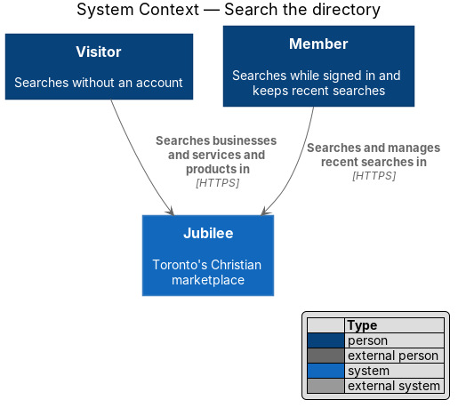
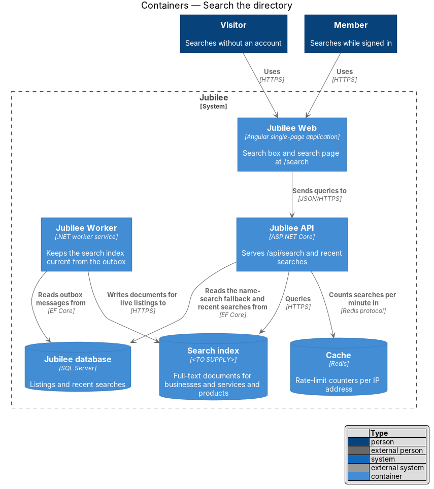
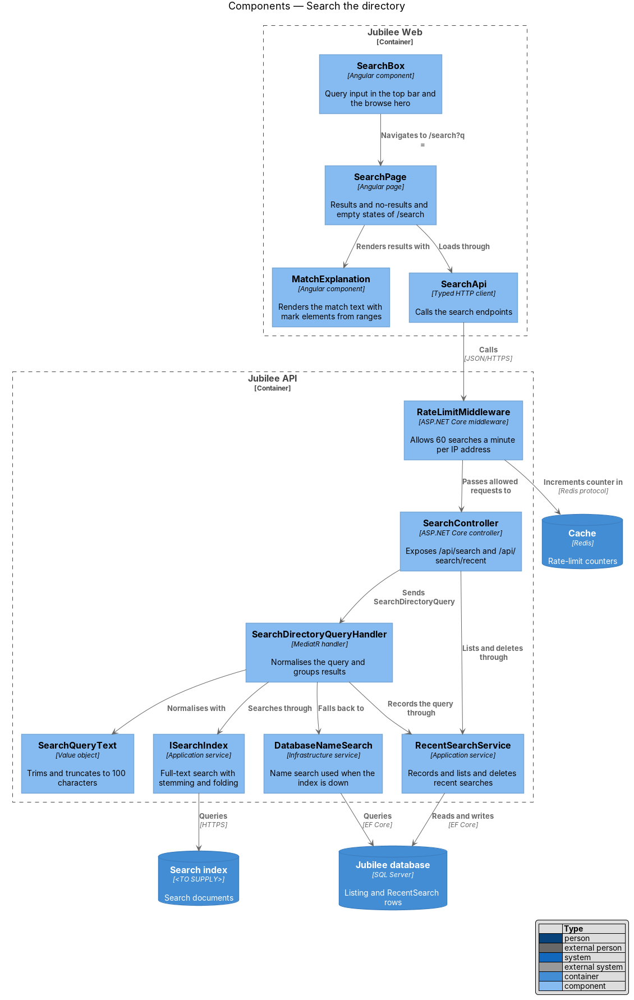
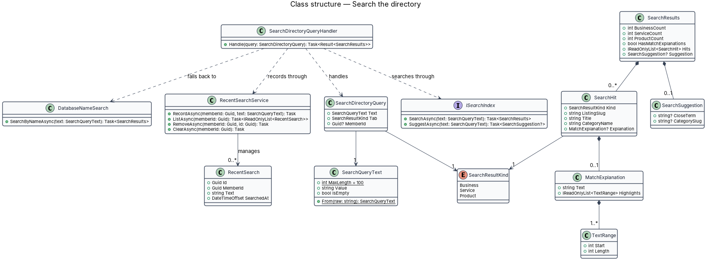
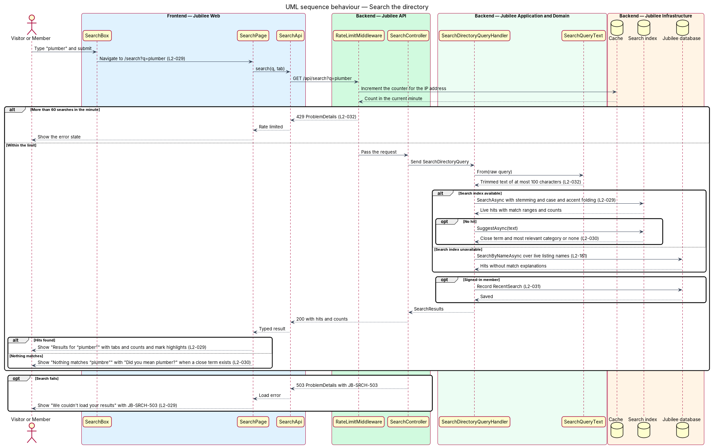
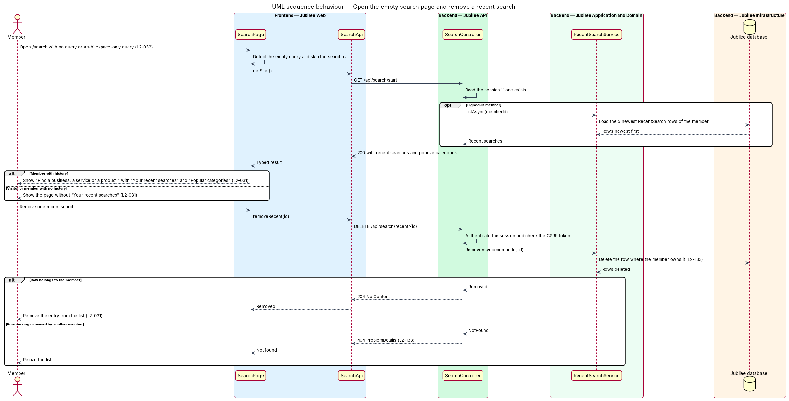

# Search the directory

## Overview

Jubilee is Toronto's Christian marketplace. Besides browsing by category, a
visitor or member can search the whole directory by keyword. This feature covers
the search box in the top bar and the browse hero, and the search page at
`/search`.

A search matches business names, taglines, descriptions, services and products.
The results page groups the matches under three tabs, "Businesses", "Services"
and "Products", each with a count, and explains why each result matched, for
example "Matches plumbing in name and 4 services". Only live listings and their
services and products are searchable.

The feature uses the following local terms.

- **query** — text that the person submits, trimmed and cut to at most 100 characters
- **match explanation** — sentence under a result that names where the query matched, with the matched term highlighted
- **close term** — indexed term that differs slightly from a query that matched nothing, offered as "Did you mean plumber?"
- **recent search** — query that a signed-in member submitted, stored on the server and shown on the empty search page
- **empty search page** — state of `/search` when the query is absent or contains only whitespace

Full-text search runs against the `Search index`, whose product is
`<TO SUPPLY>`. When the index is unavailable, the feature falls back to a name
search in `Jubilee database` and omits match explanations (`L2-181`).

## Description

The feature is a vertical slice from the search box to the search index.

- **`SearchBox`** — Angular component used in the top bar and the browse hero.
  On submit it navigates to `/search?q={query}`. On the search page it keeps the
  submitted query in the input.
- **`SearchPage`** — Angular page for `/search`. With a query it renders the
  heading "Results for “plumber”", the line "{n} businesses · {n} services ·
  {n} products" and the three tabs. With no match it renders "Nothing matches
  “plumbre”", the suggestion and its "Search “plumber”" button, and a link to
  the most relevant category; with no close term it omits the suggestion line
  and links to all categories. With an empty query it renders the empty search
  page without calling the search endpoint. On failure it renders "We couldn't
  load your results" with the reference `JB-SRCH-503`.
- **`MatchExplanation`** — Angular component that renders the explanation text.
  The API returns plain text plus highlight ranges; the component builds the
  `<mark>` elements itself. The query and all result text pass through Angular
  text binding, so HTML or script in a query is displayed as text and is never
  executed.
- **`SearchApi`** — typed Angular HTTP client for `GET /api/search`,
  `GET /api/search/start`, `DELETE /api/search/recent/{id}` and
  `DELETE /api/search/recent`.
- **`RateLimitMiddleware`** — middleware in `Jubilee.Api`. It counts requests to
  `GET /api/search` per IP address in `Cache` and returns HTTP 429 once one IP
  address has sent more than 60 searches in a minute.
- **`SearchController`** — ASP.NET Core controller. `GET /api/search` and
  `GET /api/search/start` are anonymous; the two `DELETE` endpoints require a
  session. A failed search returns 503 `ProblemDetails` with `JB-SRCH-503`.
- **`SearchQueryText`** — value object that owns the input rules. `From` trims
  the raw text and truncates it to 100 characters. A whitespace-only value is
  empty, and the API answers an empty query with the same payload as
  `GET /api/search/start`.
- **`SearchDirectoryQuery`** and **`SearchDirectoryQueryHandler`** — MediatR
  query and handler. The handler searches through `ISearchIndex`, requests a
  `SearchSuggestion` when nothing matches, falls back to `DatabaseNameSearch`
  when the index call fails, and records the query for a signed-in member.
- **`ISearchIndex`** — application service implemented in
  `Jubilee.Infrastructure` over the `Search index`. The index analyser applies
  stemming, case folding and accent folding, so "plumber", "plumbing" and
  "Plumbers" return the same businesses, and "café" matches "cafe". The index
  holds documents for live listings only.
- **`DatabaseNameSearch`** — infrastructure service that matches the query
  against live listing names in `Jubilee database`. Its results set
  `HasMatchExplanations` to `false`.
- **`SearchResults`**, **`SearchHit`** and **`SearchSuggestion`** — result
  types. `SearchResults` carries the three counts and the hits; each `SearchHit`
  carries its `SearchResultKind` and an optional `MatchExplanation`;
  `SearchSuggestion` carries the close term and the slug of the most relevant
  category.
- **`RecentSearch`** and **`RecentSearchService`** — entity and application
  service for a member's search history. The service lists the 5 newest entries
  newest first, removes one entry, and clears all entries. Removal deletes the
  rows from `Jubilee database`. A visitor has no stored history.
- **`SearchIndexingJob`** — hosted job in `Jubilee.Worker`. It consumes outbox
  messages raised by listing, service and product changes and writes or deletes
  the matching index documents (`L2-182`).
- **Popular categories** — list shown on the empty search page. The rule that
  selects the categories is `<TO SUPPLY>`.

## Requirements

The feature realizes the following level-2 (L2) requirements. Each L2
requirement refines a level-1 (L1) requirement, cited by identifier.

| L2 ID | Refines (L1) | Requirement |
|-------|--------------|-------------|
| `L2-029` | `L1-004` | The page `/search?q=` shall search business names, taglines, descriptions, services and products, and shall group the results. |
| `L2-030` | `L1-004` | When a query matches nothing, the page shall say so, shall offer a close term and a search button for it when one exists, and shall link to the most relevant category or, with no close term, to all categories. |
| `L2-031` | `L1-004` | The page `/search` with no query shall help the member start, with up to 5 recent searches and popular categories. |
| `L2-032` | `L1-004` | The system shall truncate a query to 100 characters, shall treat a whitespace-only query as empty, shall render a query as text, and shall answer more than 60 searches a minute from one IP address with HTTP 429. |
| `L2-028` | `L1-003` | Browse, category, search, featured and related lists shall show only listings that are verified and not paused, deleted or under a moderation hold. |
| `L2-118` | `L1-016` | Every load-error state shall show a reference that the user can quote to support. |
| `L2-133` | `L1-019` | The server shall check the caller's role and ownership of the specific object on every API endpoint, and shall answer a request for another member's object with 404. |
| `L2-181` | `L1-025` | When the search index is unavailable, the application shall fall back to a database name search and shall show results without match explanations. |

## Diagrams

### System context

Visitors and members search the directory. Members also manage their recent
searches. The feature involves no external system.

### Containers

`Jubilee API` queries the `Search index`, counts searches per IP address in
`Cache`, and reads the fallback and recent searches from `Jubilee database`.
`Jubilee Worker` keeps the index current.

### Components

`RateLimitMiddleware` guards the search endpoint. The handler normalises the
query with `SearchQueryText`, searches through `ISearchIndex`, and uses
`DatabaseNameSearch` as the fallback.

### Class structure

`SearchResults` aggregates `SearchHit` entries and an optional
`SearchSuggestion`. A `MatchExplanation` holds text and highlight ranges, not
markup.

### Behaviour — search the directory

The middleware applies the `L2-032` rate limit, the handler normalises the
query and searches the index, and the page renders results, the no-results
state or the error state. The index failure branch shows the `L2-181` fallback.

### Behaviour — open the empty search page and remove a recent search

The empty search page loads recent searches for a signed-in member only.
Removing an entry deletes the row on the server, scoped to the owning member.

