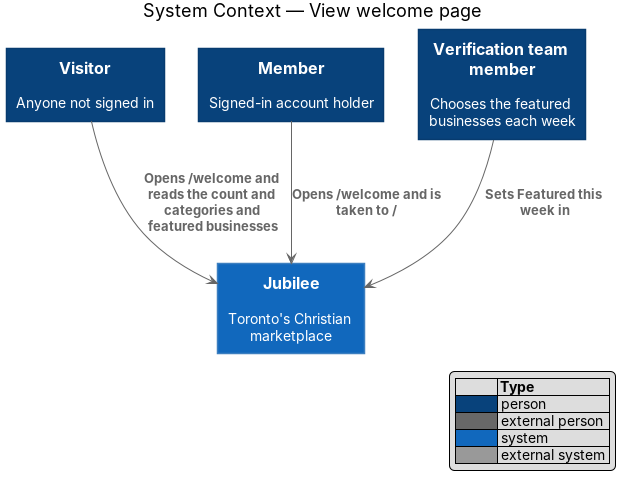
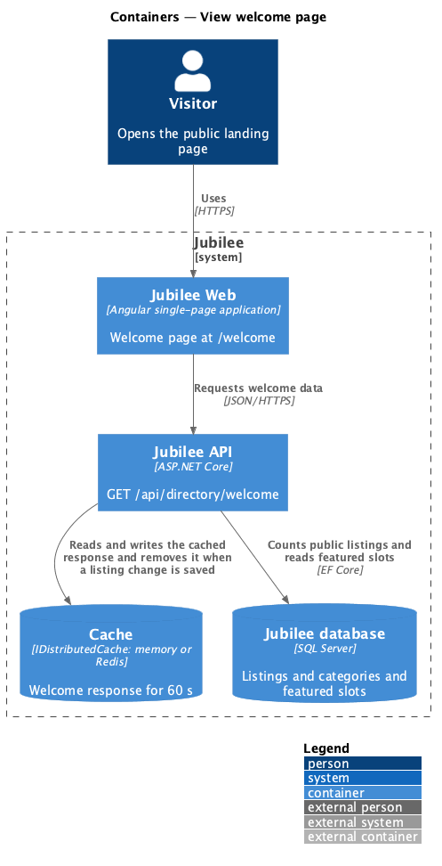
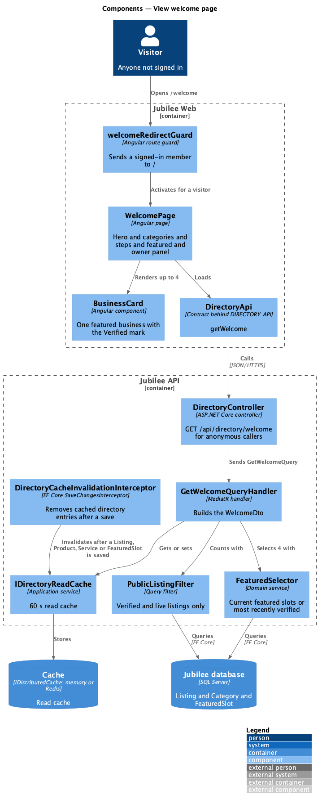
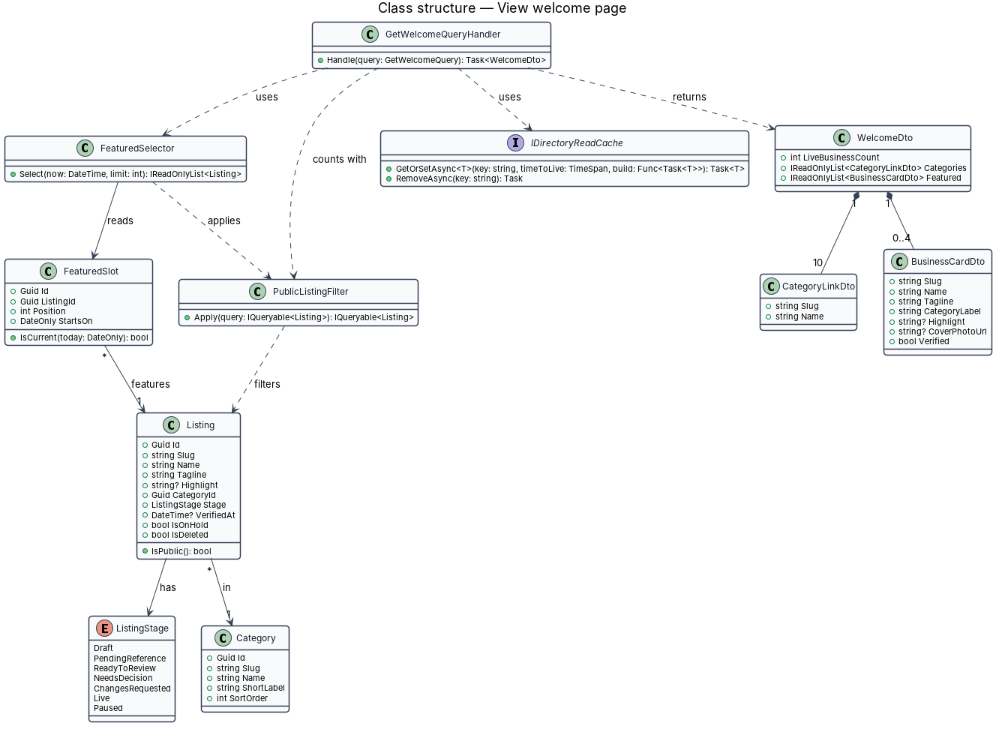
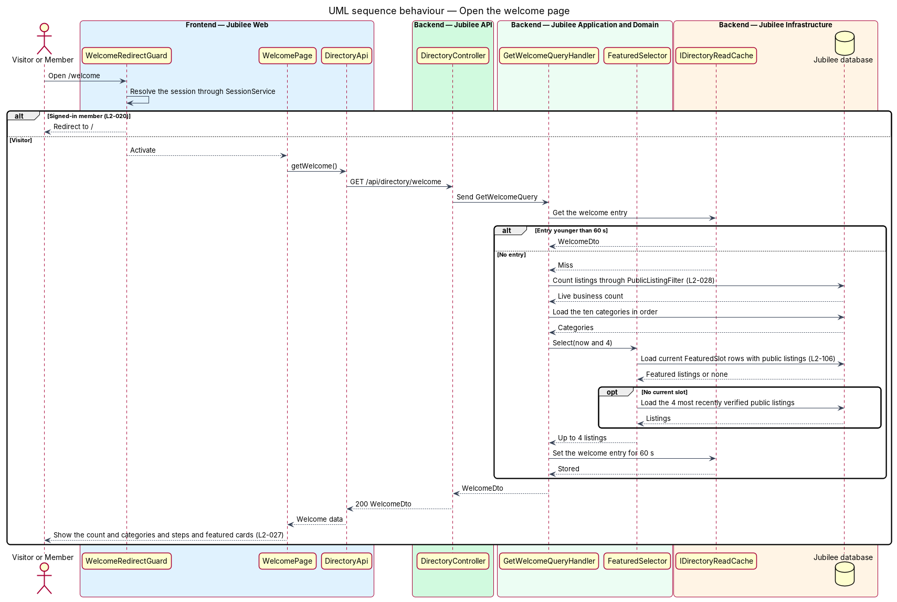
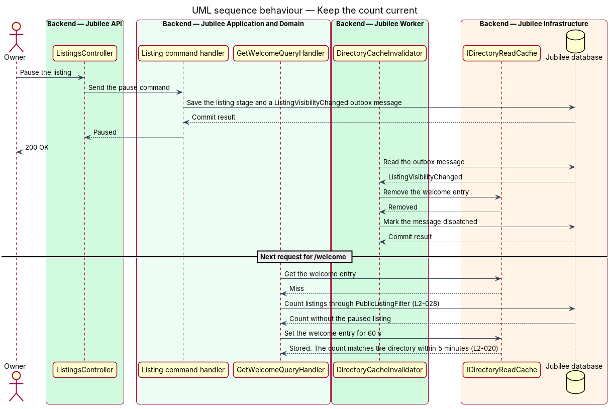

# View welcome page

## Overview

Jubilee is Toronto's Christian marketplace: a directory of verified
Christian-owned businesses where members find a business, message it, book a
meeting, ask for a quote or request a product. A *visitor* is anyone who is not
signed in. This feature is the public landing page at `/welcome`, the first
page a visitor sees.

The page explains the marketplace and invites the visitor to join or to browse.
It shows the tagline "Toronto's Christian marketplace", the heading "Do business
with Toronto's Christian community.", and a *live count* — number of businesses
that are verified and currently public. Below that it lists the ten categories
as links, three "How Jubilee works" steps, up to four *featured businesses*
under "Featured this week", and an "Own a business?" panel for owners who want
to list.

A featured business is a live listing that the verification team chose for the
week. The page shows only listings that are verified and live; a listing that
is paused, removed or not yet verified never appears and is never counted.

The page is for visitors. A signed-in member who opens `/welcome` is taken to
the browse home at `/`.

## Description

The feature is a read-only vertical slice from the welcome page in
`Jubilee Web` to the `Jubilee database`, with a short-lived read cache in
between. Nothing is built yet; the names below are the names the design
introduces.

- **`WelcomePage`** — Angular page at `/welcome`. It renders the hero with the
  line "{n} verified businesses — shops, advisors, trades and more. Free to
  join, free to list." and the actions "Join free" (to `/join`) and "Browse
  businesses" (to `/`); the category links; the three steps "Find someone you
  can trust", "Ask, book or order" and "Keep wealth working for the kingdom";
  "Featured this week" with "Browse all {n}"; and the "Own a business?" panel
  with "List your business".
- **`WelcomeRedirectGuard`** — Angular `CanActivate` guard on `/welcome`. It
  waits for `SessionService` to resolve the session and returns a redirect to
  `/` for a signed-in member.
- **`CategoryLinkList`** — Angular component that renders the ten categories as
  links to `/c/:category`, in the fixed order Shops, Financial & insurance,
  Legal & immigration, Home & property, Real estate & living, Health & family,
  Business & tech, Learning, Media, Community.
- **`BusinessCard`** — shared Angular component for one featured business:
  category media tile or cover photo, short category label, name, tagline,
  optional highlight and the "Verified" mark (L2-027). The name wraps and the
  tagline is clamped to two lines.
- **`DirectoryApi`** — typed Angular HTTP client. `getWelcome()` calls
  `GET /api/directory/welcome`.
- **`DirectoryController`** — ASP.NET Core controller in `Jubilee.Api`. The
  welcome endpoint allows anonymous callers and returns a `WelcomeDto` with no
  personal data, so one response serves every visitor.
- **`GetWelcomeQuery`** and **`GetWelcomeQueryHandler`** — MediatR query and
  handler. The handler asks `IDirectoryReadCache` for the `WelcomeDto` and
  builds it from the database on a miss.
- **`WelcomeDto`** — response with `LiveBusinessCount`, the ten
  `CategoryLinkDto` items and up to four `BusinessCardDto` items.
- **`PublicListingFilter`** — query filter that defines a public listing:
  stage live, not paused, not deleted and not under a moderation hold. Both the
  count and the featured list apply it (L2-028).
- **`FeaturedSelector`** — application service in `Jubilee.Application`, because it queries the database. `Select(now, limit)` returns the
  public listings of the `FeaturedSlot` rows whose 7-day window contains `now`,
  in slot order, skipping any listing that is no longer public. When no slot is
  current it returns the most recently verified public listings. The welcome
  page asks for 4.
- **`FeaturedSlot`** — entity written by the verification team: listing,
  position, start date and a 7-day duration.
- **`IDirectoryReadCache`** — Redis-backed read cache for directory responses.
  The welcome entry has a time to live of `60 s` and is removed when a listing
  changes state, so the count and the featured list match the directory well
  inside the 5-minute limit.
- **`DirectoryCacheInvalidator`** — outbox handler in `Jubilee Worker`. It
  removes the cached directory entries when a listing is approved, paused,
  resumed, removed or featured.

"List your business" takes a visitor to `/join?returnUrl=/list`, so that they
arrive at the listing form once they have an account. The page text does not
wait for the welcome data: until it arrives, and when the load fails, the hero
line reads "Shops, advisors, trades and more. Free to join, free to list."
without the count and "Featured this week" is left out. The page therefore has
no loading, empty or error state of its own.

Until the outbox of `Jubilee Worker` exists (`operations/run-background-jobs`),
`DirectoryCacheInvalidationInterceptor` in `Jubilee.Infrastructure` does the
work of `DirectoryCacheInvalidator`: it removes the cached directory entries
when `AppDbContext` saves a change to a `Listing`, `Product` or `FeaturedSlot`.
`IDirectoryReadCache` is built on `IDistributedCache`, in memory unless a Redis
connection string is configured, and the API also marks the responses
`Cache-Control: public, max-age=60` (`docs/adr/0003-directory-read-cache.md`).

## Requirements

The feature realizes the following level-2 (L2) requirements. Each L2
requirement refines a level-1 (L1) requirement, cited by identifier.

| L2 ID | Refines (L1) | Requirement |
|-------|--------------|-------------|
| `L2-020` | `L1-003` | The system shall serve `/welcome` as the public landing page for visitors. |
| `L2-028` | `L1-003` | Browse, category, search, featured and related lists shall show only listings that are verified and not paused, deleted or under a moderation hold. |
| `L2-027` | `L1-003` | Business cards, product cards and directory rows shall follow fixed display rules. |
| `L2-106` | `L1-014` | The listings a verifier chooses as "Featured this week" shall show on the welcome and browse pages from the start date for 7 days, and a featured listing that is paused or removed shall be skipped. |

## Diagrams

### System context

A visitor opens the welcome page in Jubilee and is invited to join or browse. A
signed-in member who opens it is sent to the browse home. The slice calls no
external system.

### Containers

`Jubilee Web` requests the welcome data from `Jubilee API`, which answers from
the `Cache` or the `Jubilee database`. `Jubilee Worker` removes the cached entry
when a listing changes state.

### Components

`WelcomeRedirectGuard` decides whether `WelcomePage` renders. The page loads
through `DirectoryApi`; `GetWelcomeQueryHandler` uses `IDirectoryReadCache`,
`PublicListingFilter` and `FeaturedSelector`.

### Class structure

`GetWelcomeQueryHandler` returns a `WelcomeDto` made of a count, ten
`CategoryLinkDto` items and up to four `BusinessCardDto` items.
`FeaturedSelector` reads `FeaturedSlot` and `Listing`.

### Behaviour — open the welcome page

A member is redirected to `/` before any data is requested. For a visitor, the
handler answers from the cache when the entry is younger than `60 s` and
otherwise counts public listings and selects the featured four.

### Behaviour — keep the count current

A listing state change removes the cached welcome entry through the outbox, so
the next request rebuilds the count; the `60 s` expiry bounds staleness if the
removal is delayed.

