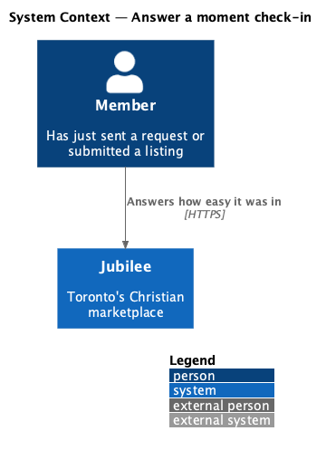
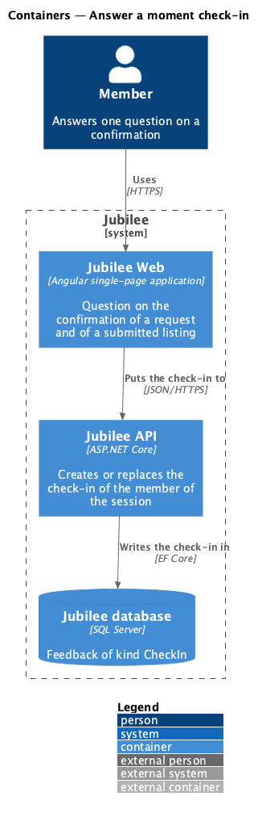
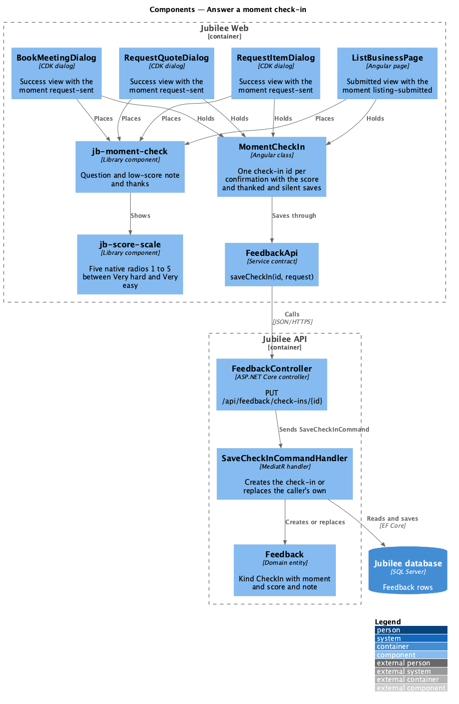
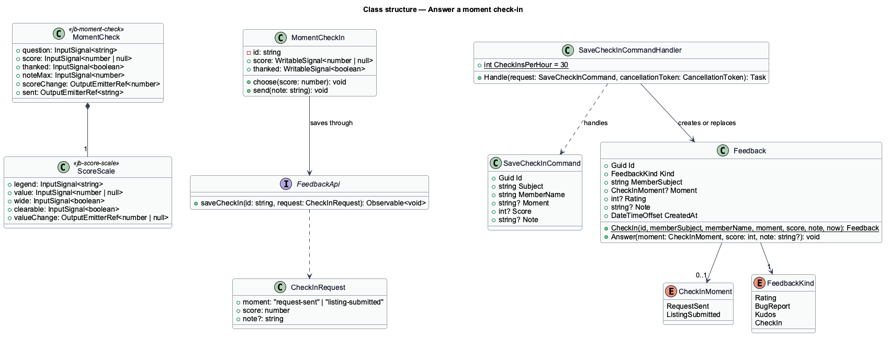
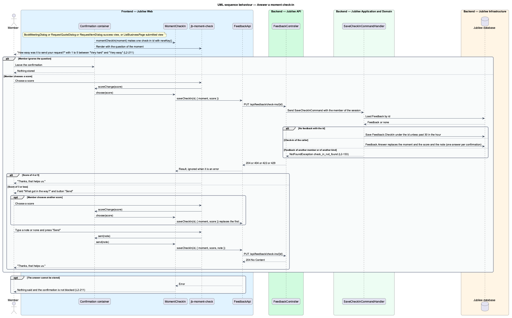

# Answer a moment check-in

## Overview

Jubilee is Toronto's Christian marketplace. Two moments matter most to a member:
sending a request to a business and publishing a listing. Right
after either, the confirmation asks one question about how easy it was. This
feature covers that question, the follow-up for a low score and the way the
answer is stored.

The terms below are local to this feature.

- **moment** — point at which the question is asked: `request-sent` or `listing-submitted`
- **check-in** — one answer to the question of one confirmation: a score of 1 to 5 and an optional note
- **score** — one of the five choices between "Very hard" and "Very easy"
- **low score** — score of 3 or less, which asks "What got in the way?"
- **check-in id** — identifier the app makes once per confirmation and under which every change of the answer is stored

The question is a courtesy on a success screen. A member who ignores it stores
nothing. An answer that cannot be stored says nothing and blocks nothing
(`L2-211` criterion 6). A check-in is not listed under "Your feedback"
(`L2-213` criterion 6). The decisions behind the feature are recorded in
ADR 0043.

## Description

The feature is a vertical slice from four confirmations to the `Feedback` table.

- **`div[jb-moment-check]`** — component `MomentCheck` of the `components`
  library (`moment-check/`). Its inputs are `question`, `score`, `thanked` and
  `noteMax`; it shows a `wide` `jb-score-scale` between the words "Very hard"
  and "Very easy". Its output `scoreChange` carries the chosen score and `sent`
  the note when "Send" is pressed. It has three views: the question; the
  question with the field "What got in the way?" and the button "Send", while a
  score is chosen and `thanked` is false; and "Thanks, that helps us." in a
  `role="status"` line. The note is optional and the field holds it to 1,000
  characters. The component makes no request.
- **`fieldset[jb-score-scale]`** — component `ScoreScale` of the `components`
  library (`score-scale/`). Five native radio inputs in one group draw the scores 1 to
  5, so the arrow keys and assistive technology work without script (ADR 0035,
  `L2-158`). The feedback page reuses it for the four area scores
  (`send-feedback-from-page`).
- **Placement after a request** — the success views of `BookMeetingDialog`,
  `RequestQuoteDialog` and `RequestItemDialog`
  (`frontend/projects/jubilee/src/app/dialogs/book-meeting/`, `request-quote/`,
  `request-item/`) render `jb-moment-check` with the question "How easy was it
  to send your request?" and the moment `request-sent`.
- **Placement after a listing** — the published view of `ListBusinessPage`
  (`frontend/projects/jubilee/src/app/pages/list-business/`) renders
  `jb-moment-check` with the question "How easy was it to list your business?"
  and the moment `listing-submitted`.
- **Check-in id** — each of the four containers holds a `MomentCheckIn` made by
  `momentCheckIn(moment)`
  (`frontend/projects/jubilee/src/app/services/moment-check-in.ts`), which makes
  one id with `newKey()` and keeps the `score` and whether `thanked` shows as
  signals; the container binds them to `jb-moment-check` and passes
  `scoreChange` to `choose` and `sent` to `send`. Choosing a score, choosing
  another score and sending the note all address that id, so one answer is kept
  per confirmation and nothing is stored twice. No idempotency key is used
  (ADR 0043).
- **Choosing a score** — `MomentCheckIn.choose` calls
  `FeedbackApi.saveCheckIn(id, { moment, score })` at once. A score of 4 or 5 shows "Thanks, that helps us."
  A score of 3 or less shows the field and "Send". Choosing another score sends
  the same call with the new score, which replaces the first.
- **Sending the note** — "Send" calls `MomentCheckIn.send`, which calls
  `FeedbackApi.saveCheckIn(id, { moment, score, note })` with the trimmed note,
  or without a note when it is empty, and shows "Thanks, that helps us."
- **Silent failure** — `MomentCheckIn` subscribes with an error handler that
  does nothing, so every error of `saveCheckIn` is ignored: a lost connection,
  HTTP 404, 422, 429 and 5xx. No alert, toast or busy
  state is shown, the view advances as if the answer were stored, and the
  confirmation behaves as before (`L2-211` criterion 6).
- **`FeedbackApi.saveCheckIn`** — method of the `FeedbackApi` contract
  (`FEEDBACK_API`, `HttpFeedbackApi`). It sends
  `PUT /api/feedback/check-ins/{id}` with the moment, the score and the optional
  note.
- **`FeedbackController`** — ASP.NET Core controller at `api/feedback`. The
  `PUT` action takes the member from the session and sends `SaveCheckInCommand`.
- **`SaveCheckInCommand`** and `SaveCheckInCommandHandler` — MediatR command
  in `Jubilee.Application/MemberFeedback/FeedbackKinds.cs`. The handler
  validates the moment (`MOMENT_UNKNOWN`), the score (`SCORE_REQUIRED`) and the
  note (`NOTE_TOO_LONG`). It creates a `Feedback` of kind `CheckIn` with the
  given id through `Feedback.CheckIn`, or replaces the moment, the score and the
  note through `Feedback.Answer` when the id is a check-in of the same member.
  An id that belongs to another member's feedback, or to feedback of another
  kind, answers 404 with `check_in_not_found` (`L2-133`). The
  handler refuses a new check-in past 30 in an hour per member with 429 and
  `Retry-After`; replacing an existing check-in is not counted.
- **`Feedback`** — domain entity (`Jubilee.Domain/Feedback.cs`). A check-in
  holds `Kind` `CheckIn`, the `CheckInMoment` (`RequestSent`,
  `ListingSubmitted`) in `Moment`, the score in `Rating` and the note in `Note`;
  its `IdempotencyKey` is its id. The fields of the other kinds stay null.
- **Tests** — `e2e/tests/feedback-check-ins.spec.ts` drives the question
  through the page object `e2e/pages/moment-check.ts` (`MomentCheck`).
  Each library component has a parity spec in `e2e/tests/parity/` (ADR 0036).
  The Magic Patterns Feedback frame is not captured, so their specs declare
  their reference `absent`; `e2e/fixtures/parity.ts` then looks for
  `docs/design-reference/magic-patterns/components/<component>/<case>-<width>.png`
  and, once the owner saves one, compares that case with it at 3 % without the
  spec being edited (ADR 0059). The specs of this feature are `moment-check` and
  `score-scale`.

## Requirements

The feature realizes the following level-2 (L2) requirements. Each L2
requirement refines a level-1 (L1) requirement, cited by identifier.

| L2 ID | Refines (L1) | Requirement |
|-------|--------------|-------------|
| `L2-211` | `L1-029` | Right after a member sends a request or submits a listing, one question shall ask how easy it was. |

## Diagrams

### System context

A member who has just sent a request or submitted a listing answers one question
in Jubilee.

### Containers

`Jubilee Web` asks the question on the confirmation and puts the answer to
`Jubilee API`, which stores it in `Jubilee database`.

### Components

Four containers place `jb-moment-check`, which shows `jb-score-scale`. Each
container holds a `MomentCheckIn`, which saves through `FeedbackApi` to the `PUT` action of
`FeedbackController`, which sends `SaveCheckInCommand`.

### Class structure

`SaveCheckInCommand` carries the id the app made. The handler creates or
replaces one `Feedback` of kind `CheckIn` with a `CheckInMoment`.

### Behaviour — answer the question

Each change of the answer is the same `PUT` to the same id. A high score ends
with the thanks, a low score asks for a note, and a failure is silent
(`L2-211`).

