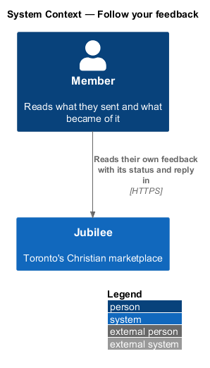
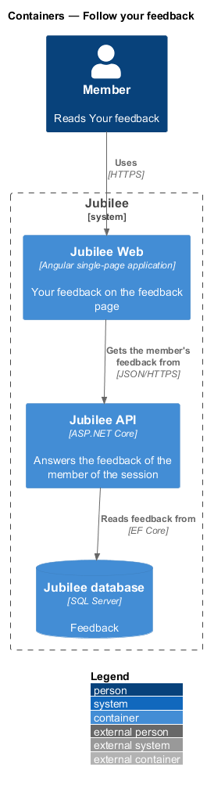
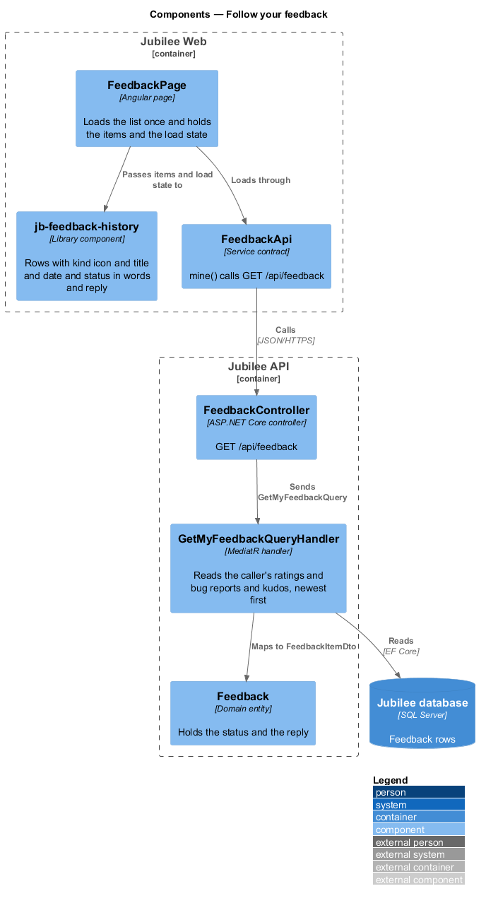
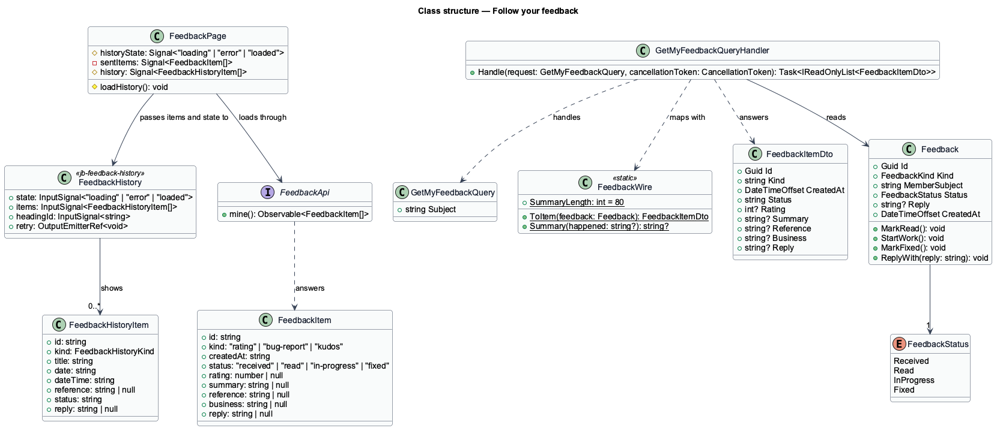
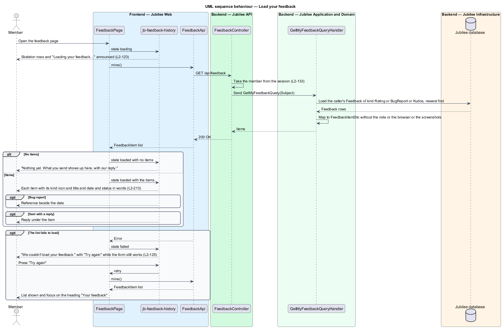

# Follow your feedback

## Overview

Jubilee is Toronto's Christian marketplace. A member who has sent feedback wants
to know what became of it. This feature covers "Your feedback", the list on the
feedback page that shows a member their own ratings, bug reports and kudos, each
with its status and any reply from the team.

The terms below are local to this feature.

- **item** — one rating, bug report or kudos the member sent
- **status** — what became of an item: `Received`, `Read`, `InProgress` or `Fixed`, shown as "Received", "Read by the team", "Being worked on" or "Fixed"
- **reply** — text the team wrote about an item, shown under it
- **reference** — identifier of a bug report, `FB-` and six characters, shown with its date
- **title parts** — values from which the page words an item's title: the rating, the summary of a bug report, or the business of kudos

A member sees their own items and nobody else's (`L2-133`). Moment check-ins
(`L2-211`) are not in the list.

Status and replies are stored and shown; writing them is a staff operation of
the admin application and is not part of this feature (`L2-214` criterion 13,
ADR 0043). No endpoint sets them yet, so every item says "Received" and has no
reply. The read side is complete, so the list shows a status or a reply as soon
as one is set (`L2-214` criterion 13). Telling the member of a change is a later
change as well.

## Description

The feature is a vertical slice from `FeedbackPage` to the `Feedback` table.

- **`FeedbackPage`** — page of the app at `/feedback/:tab`
  (`frontend/projects/jubilee/src/app/pages/feedback/`). `loadHistory()` loads
  the list once, in `ngOnInit`; the page holds the items and the load state
  `historyState` (`loading`, `loaded`, `error`) as signals. The computed
  `history` turns each `FeedbackItem` into a `FeedbackHistoryItem` in words:
  the title from `feedbackTitle`, the date from `threadTime` and the status
  from `feedbackStatusLabel`, helpers of the `api` library
  (`models/feedback.ts`, `helpers/message-time.ts`). A change of tab does not
  load the list again. After a successful send, when the list has loaded, the
  page puts the answered item at the top of it (`L2-212` criterion 11).
- **`section[jb-feedback-history]`** — component `FeedbackHistory` of the
  `components` library (`feedback-history/`), with the inputs `state` and
  `items` and the output `retry`. It shows the heading "Your feedback" and one
  row per item in the order given. A row has an icon for the kind (`star`,
  `bug`, `heart`) with the kind's name for assistive technology, a title, the
  date in a `time` element, the reference of a bug report beside its date, the
  status in words and the reply under the row when there is one. The status is
  text; a colour only accompanies it. The component makes no request.
- **Titles** — `feedbackTitle` words them. A rating reads "Rated Jubilee {n} of
  5". A bug report reads its summary, the first line of what happened shortened
  to 80 characters by the API (`FeedbackWire.Summary`). Kudos reads "Kudos to
  the Jubilee team" or "Kudos to {business}".
- **Dates** — each date is formatted by `threadTime` of the `api` library
  against `ClockService.now()`, as `L2-131` requires.
- **Empty list** — "Nothing yet. What you send shows up here, with our reply."
- **Loading** — `jb-feedback-history` shows three `jb-skeleton` rows of the
  final row layout in a list marked `aria-busy="true"` and named "Loading your
  feedback" (`L2-123`). The skeletons do not animate under
  `prefers-reduced-motion: reduce`.
- **Load error** — the region shows a `jb-alert` "We couldn't load your
  feedback." with "Try again", whose `retry` calls `loadHistory()` and reloads
  only the list. The tabs and the form stay and still work (`L2-125`).
- **`FeedbackApi.mine`** — method of the `FeedbackApi` contract (`FEEDBACK_API`,
  `HttpFeedbackApi`). It calls `GET /api/feedback` and answers a list of
  `FeedbackItem`.
- **`FeedbackController`** — ASP.NET Core controller at `api/feedback`. The
  `GET` action takes the member from the session and sends `GetMyFeedbackQuery`.
  A visitor receives 401.
- **`GetMyFeedbackQuery`** and `GetMyFeedbackQueryHandler` — MediatR query in
  `Jubilee.Application/MemberFeedback/Feedback.cs`. The handler reads the
  `Feedback` rows whose `MemberSubject` is the caller's and whose `Kind` is not
  `CheckIn`, newest first, and maps each with `FeedbackWire.ToItem`. It takes no member or filter from the request, so
  another member's items cannot be asked for (`L2-133`).
- **`FeedbackItemDto`** — answer per item: the id, the kind and the status in
  the words of `FeedbackWire` (`rating`, `bug-report`, `kudos`; `received`,
  `read`, `in-progress`, `fixed`), the date, the rating of a rating, the summary
  of a bug report, the reference, the business name of kudos for a business
  (`Business`) and the reply. The note, the
  answers of a bug report, the browser and device and the screenshots are not in
  the answer (`L2-214` criterion 10).
- **`Feedback`** — domain entity. `Status` starts at `Received`. `MarkRead`,
  `StartWork`, `MarkFixed` and `ReplyWith` change the status and the reply; no
  endpoint calls them, and `FeedbackTests` use them to show the read side.
- **Tests** — the `your feedback (L2-213)` block of
  `e2e/tests/feedback-page.spec.ts` drives the list through
  `e2e/pages/feedback.page.ts`.
  Each library component has a parity spec in `e2e/tests/parity/` (ADR 0036).
  The Magic Patterns Feedback frame is not captured, so their specs declare
  their reference `absent`; `e2e/fixtures/parity.ts` then looks for
  `docs/design-reference/magic-patterns/components/<component>/<case>-<width>.png`
  and, once the owner saves one, compares that case with it at 3 % without the
  spec being edited (ADR 0060). The spec of this feature is `feedback-history`.

## Requirements

The feature realizes the following level-2 (L2) requirements. Each L2
requirement refines a level-1 (L1) requirement, cited by identifier.

| L2 ID | Refines (L1) | Requirement |
|-------|--------------|-------------|
| `L2-213` | `L1-029` | A member shall see what they sent and what became of it. |
| `L2-123` | `L1-018` | A list that fetches for longer than 200 ms shall show skeletons matching the final layout and announce "Loading {thing}…" in a visually hidden live region, and skeletons shall not animate under `prefers-reduced-motion: reduce`. |
| `L2-125` | `L1-018` | When a page's data fails to load, the top bar, tab bar and footer shall stay, only the failed region shall show the error, and "Try again" shall reload only that region. After a successful retry, focus shall move to the region's heading. |
| `L2-133` | `L1-019` | The server shall check the caller's role and ownership of the specific object on every API endpoint before doing anything. |

## Diagrams

### System context

A member reads their own feedback, its status and the team's reply in Jubilee.

### Containers

`Jubilee Web` asks `Jubilee API` for the member's feedback, which the API reads
from `Jubilee database`.

### Components

`FeedbackPage` loads through `FeedbackApi` and passes the items to
`jb-feedback-history`. `FeedbackController` sends `GetMyFeedbackQuery`, whose
handler reads the caller's `Feedback` rows.

### Class structure

`GetMyFeedbackQuery` carries only the caller's subject. The handler maps each
`Feedback` to a `FeedbackItemDto`, which leaves out the note, the browser and the
screenshots.

### Behaviour — load your feedback

The page shows skeleton rows, then the list, the empty text or the load error.
"Try again" reloads the list alone (`L2-123`, `L2-125`, `L2-133`).

