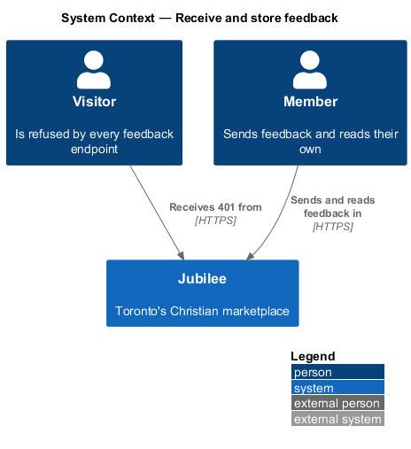
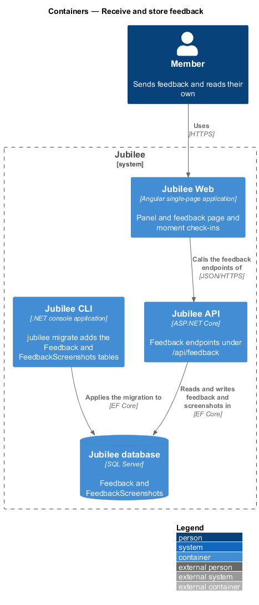
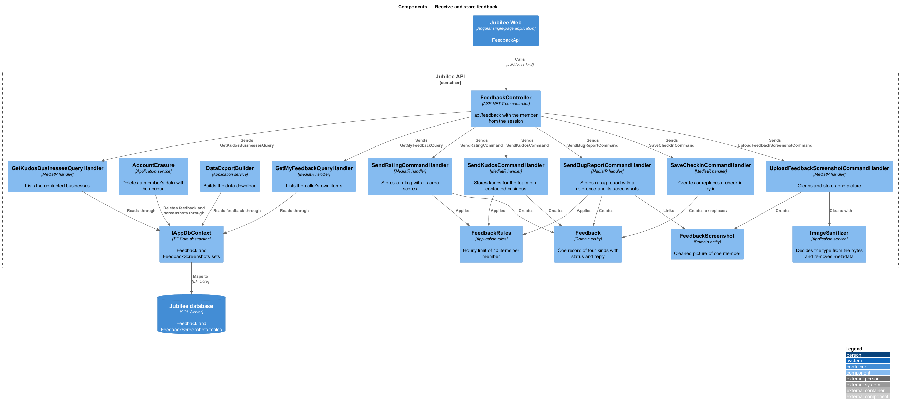
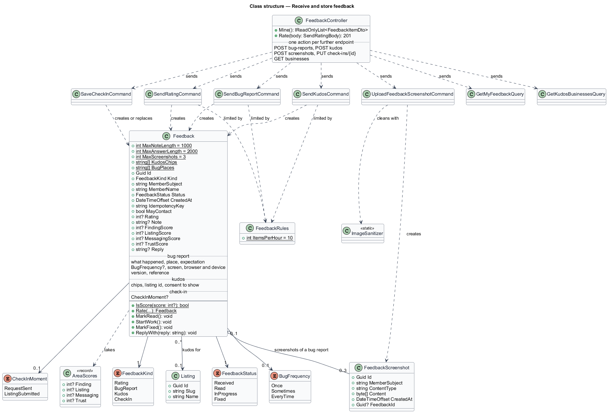
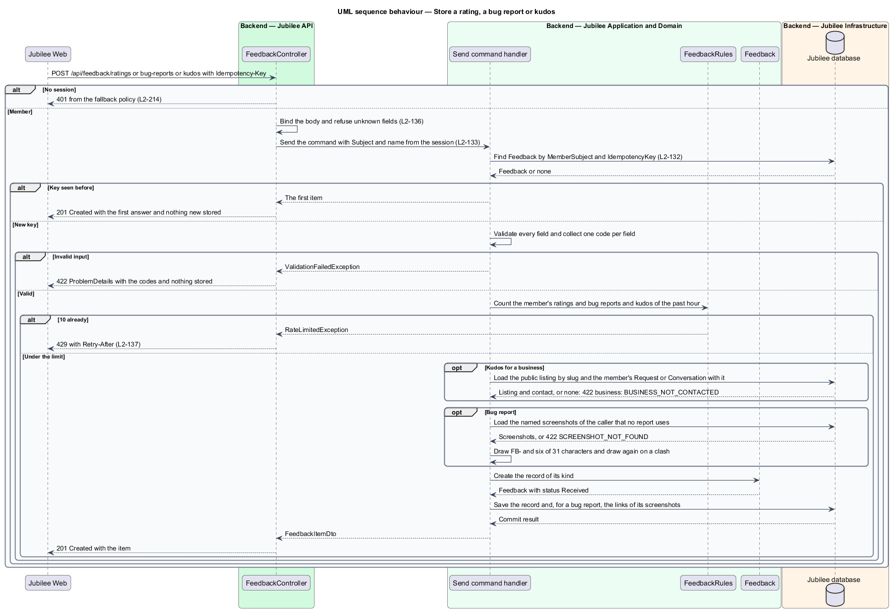
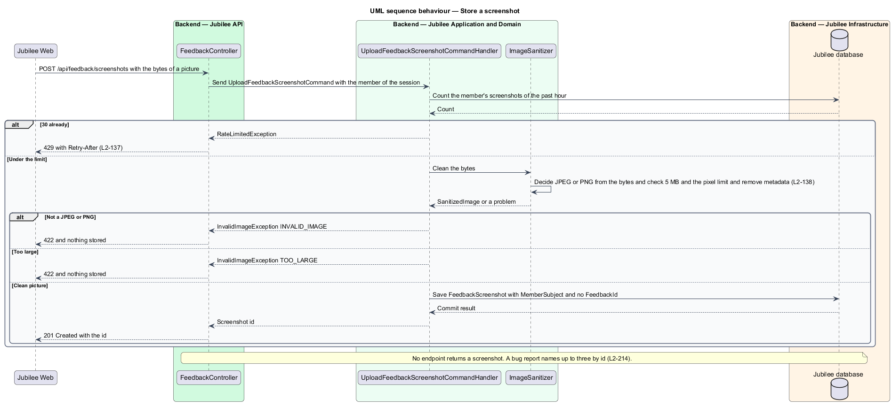
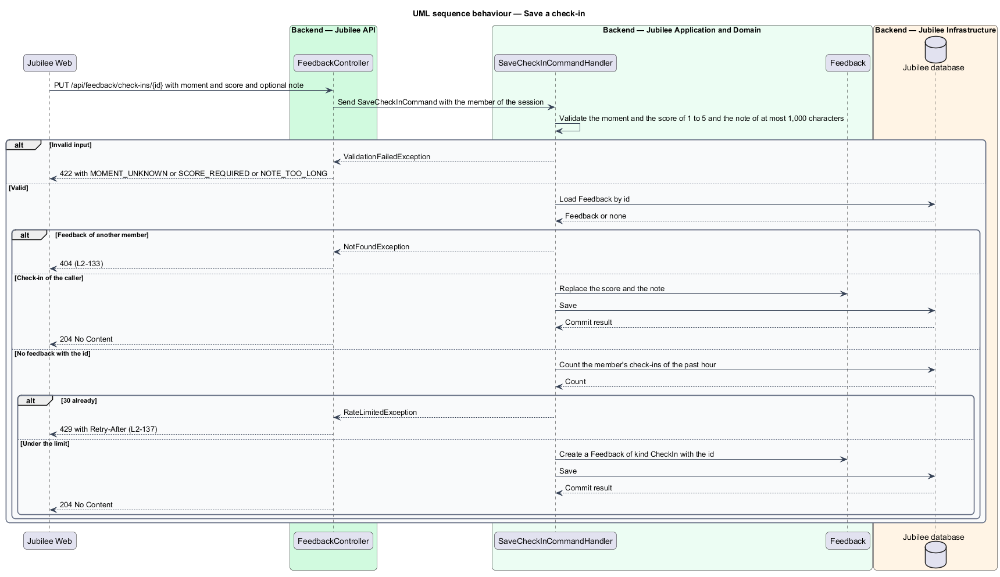
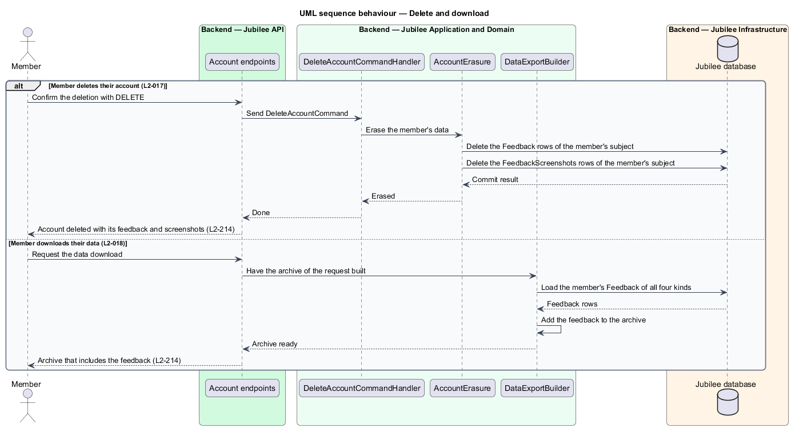

# Receive and store feedback

## Overview

Jubilee is Toronto's Christian marketplace. A member sends feedback from the
panel, from the feedback page and from a moment check-in. This feature covers
the API behind all three: the endpoints under `/api/feedback`, the rules each
applies again on the server, the one record that holds every kind of feedback,
the screenshots of a bug report, and what happens to feedback when a member
deletes their account or downloads their data.

The terms below are local to this feature.

- **feedback** — one record from one member: a rating, a bug report, kudos or a moment check-in
- **kind** — which of the four a record is: `Rating`, `BugReport`, `Kudos` or `CheckIn`
- **status** — what became of a record: `Received`, `Read`, `InProgress` or `Fixed`; a new record is `Received`
- **reply** — text the team wrote about a record
- **reference** — identifier of a bug report: `FB-` and six characters that no other report has
- **screenshot** — cleaned JPEG or PNG a member uploaded for a bug report
- **contacted business** — public business the member has sent a request or a message to
- **idempotency key** — client-generated identifier that lets the server recognise a repeated create

Every endpoint takes the member from the session and nothing about the member
from the body (`L2-133`). A visitor receives 401 from each. A member reads only
their own feedback, and no endpoint serves a screenshot to the app.

The admin screens that read feedback, change a status and write a reply are
deferred, as are showing kudos on a business page and telling a member of a
change (ADR 0043). The status, the reply and the consent are stored now so those
changes need no new data. The screens that call these endpoints are described in
`send-feedback-from-panel`, `answer-moment-check-in`, `send-feedback-from-page`
and `follow-your-feedback`.

## Description

The feature follows the pattern of listing reports (`ListingReport`,
`ReportListingCommand`, `ListingReportsController`): an entity in
`Jubilee.Domain`, MediatR commands and handlers in `Jubilee.Application`, an EF
configuration in `Jubilee.Infrastructure` and a thin controller in
`Jubilee.Api`. Business rules live in the handlers and the entity.

- **`Feedback`** — domain entity (`backend/src/Jubilee.Domain/Feedback.cs`): one
  record of four kinds, told apart by `FeedbackKind`. Every record holds `Id`,
  `MemberSubject`, `MemberName`, `Status`, `CreatedAt`, `IdempotencyKey` and
  `MayContact`. The fields of the other kinds stay null.
  - A rating holds `Rating` (1 to 5), `Note` and the four nullable area scores
    `FindingScore`, `ListingScore`, `MessagingScore` and `TrustScore`, passed as
    `AreaScores`.
  - A bug report holds what happened, the optional place (one of `BugPlaces`),
    the optional expectation, the optional `BugFrequency` (`Once`, `Sometimes`,
    `EveryTime`), the screen, the browser and device, the app's version and the
    reference.
  - Kudos holds its chips (from `KudosChips`), `Note`, and for a business the
    listing's id and whether the note may be shown on its page.
  - A check-in holds the `CheckInMoment` (`RequestSent`, `ListingSubmitted`),
    the score in `Rating` and `Note`.
  - `MaxNoteLength` is 1,000, `MaxAnswerLength` 2,000 and `MaxScreenshots` 3.
    `MarkRead`, `StartWork`, `MarkFixed` and `ReplyWith` change the status and
    the reply. No endpoint of this feature calls them.
- **`FeedbackScreenshot`** — domain entity: `Id`, `MemberSubject`, the cleaned
  bytes with their content type, `CreatedAt` and the nullable `FeedbackId` of
  the bug report that uses it. A screenshot belongs to at most one report.
- **Persistence** — `IAppDbContext` gains the sets `Feedback` and
  `FeedbackScreenshots`. Their mappings are added to
  `Jubilee.Infrastructure/Persistence/Configurations/EntityConfigurations.cs`,
  with a unique index on `(MemberSubject, IdempotencyKey)` and one on the
  reference. One migration adds both tables;
  `jubilee migrate` applies it. The four area scores are four nullable columns.
- **`FeedbackController`** — ASP.NET Core controller at `api/feedback`
  (`backend/src/Jubilee.Api/Controllers/`). It has no `[AllowAnonymous]`, so the
  fallback policy answers 401 to a visitor. Each action reads the subject and
  the name from the session with `User.ToViewer()`, reads `Idempotency-Key`
  where the endpoint creates, and sends one command or query. Each body record
  disallows unmapped members, so an unknown field is refused (`L2-136`). The
  bug-report action passes the request's `User-Agent` header to the command.

| Endpoint | Sends | Answer |
|---|---|---|
| `POST /api/feedback/ratings` | `SendRatingCommand` | 201 with the item |
| `POST /api/feedback/bug-reports` | `SendBugReportCommand` | 201 with the item and its reference |
| `POST /api/feedback/kudos` | `SendKudosCommand` | 201 with the item |
| `POST /api/feedback/screenshots` | `UploadFeedbackScreenshotCommand` | 201 with the screenshot's id |
| `PUT /api/feedback/check-ins/{id}` | `SaveCheckInCommand` | 204 |
| `GET /api/feedback` | `GetMyFeedbackQuery` | 200 with the caller's items |
| `GET /api/feedback/businesses` | `GetKudosBusinessesQuery` | 200 with the contacted businesses |

- **Commands and queries** — in
  `backend/src/Jubilee.Application/MemberFeedback/`. The folder is not named
  `Feedback`: a namespace `Jubilee.Application.Feedback` would hide the entity
  `Feedback` from every handler in it. Each handler takes `IAppDbContext`, and
  those that write take `TimeProvider`.
- **Order of checks in a create handler** — `SendRatingCommand`,
  `SendBugReportCommand` and `SendKudosCommand` apply the same order as
  `ReportListingCommandHandler`: the idempotency key, the validation, the rate
  limit, then the save.
- **Idempotency** — the handler looks for a `Feedback` of the same
  `MemberSubject` and `IdempotencyKey`. When one exists it answers that item and
  stores nothing (`L2-132`). The key is stored on the record and the unique
  index on `(MemberSubject, IdempotencyKey)` backs the check; no middleware and
  no cache take part.
- **Validation** — the handler collects one code per field and throws
  `ValidationFailedException`, which the API answers as 422 ProblemDetails with
  the codes; nothing is stored (`L2-136`). The rules are: a rating of 1 to 5
  (`rating: RATING_REQUIRED`); each area score null or 1 to 5
  (`areas: SCORE_OUT_OF_RANGE`); a note of at most 1,000 characters
  (`note: NOTE_TOO_LONG`); what happened present (`HAPPENED_REQUIRED`) and at most 2,000 characters
  (`HAPPENED_TOO_LONG`), as is the expectation (`EXPECTED_TOO_LONG`); a known
  place (`PLACE_UNKNOWN`), frequency (`FREQUENCY_UNKNOWN`) and chip
  (`CHIP_UNKNOWN`); at least one chip or a note for kudos (`KUDOS_REQUIRED`); at
  most three screenshots (`TOO_MANY_SCREENSHOTS`), each uploaded by the caller
  and not yet used (`SCREENSHOT_NOT_FOUND`); and for a check-in a known moment
  (`MOMENT_UNKNOWN`) and a score of 1 to 5 (`SCORE_REQUIRED`).
- **Rate limit** — `FeedbackRules` counts the caller's ratings, bug reports and
  kudos of the past hour together and throws `RateLimitedException` at
  `ItemsPerHour` (10), which
  the API answers as 429 with `Retry-After` (`L2-137`).
  `UploadFeedbackScreenshotCommand` allows 30 screenshots an hour and
  `SaveCheckInCommand` 30 new check-ins an hour.
- **`SendRatingCommand`** — stores `Feedback.Rate(...)` with the rating, the
  optional note, the `AreaScores` and `MayContact`, at status `Received`.
- **`SendBugReportCommand`** — stores a bug report with the optional place,
  expectation and frequency, the screen sent by the app, the browser and device
  from `User-Agent`, the app's version, and a new reference. It sets the
  `FeedbackId` of each named `FeedbackScreenshot` in the same save. The longest
  `User-Agent` value kept is `<TO SUPPLY>`.
- **Reference** — `FB-` and six characters drawn at random from the 31 letters
  and digits that cannot be misread (no `0`, `1`, `I`, `O`, `L`). The handler
  draws again when a report already has the reference; the unique index backs
  that check. It is not a running number, because the InMemory provider of the
  tests has no sequence (ADR 0009) and a running number tells a member how many
  reports there are. It does not start with `JB-`, which the error references
  use.
- **`SendKudosCommand`** — stores kudos for the Jubilee team, or for the
  business named by its slug with the consent to show. For a business the
  handler loads the public listing by slug and requires a `Request` or a
  `Conversation` of the caller with that listing. Otherwise it answers 422 with
  `business: BUSINESS_NOT_CONTACTED` and stores nothing.
- **`GetKudosBusinessesQuery`** — answers the slug and name of each public
  listing the caller has a `Request` or a `Conversation` with, by name.
- **`UploadFeedbackScreenshotCommand`** — takes the bytes of one picture.
  `ImageSanitizer` (`Jubilee.Application/Messaging/ImageSanitizer.cs`) decides
  the type from the bytes, accepts a JPEG or PNG of 5 MB or less within the
  pixel limit and removes everything that is not picture data. The handler
  stores the result as a `FeedbackScreenshot` and answers its id. A refused file
  answers 422 with `INVALID_IMAGE` or `TOO_LARGE`, as message attachments do.
  The malware scan and object storage of `L2-138` stay behind the later
  `IMediaStore`, as for message photos (ADR 0039). No endpoint returns a
  screenshot; staff read them in the admin application later.
- **`SaveCheckInCommand`** — carries the id from the address, the moment
  (`request-sent` or `listing-submitted`), the score and the optional note. The
  handler creates a `Feedback` of kind `CheckIn` with that id, or replaces the
  score and note when the id is a check-in of the caller. An id that belongs to
  another member's feedback answers 404 through `NotFoundException`
  (`L2-133`). The address makes the call repeatable, so it takes no idempotency
  key.
- **`GetMyFeedbackQuery`** — answers the caller's ratings, bug reports and
  kudos, newest first, as `FeedbackItemDto`: kind, title parts, date, status,
  reference and reply. Check-ins, the note, the browser and device and the
  screenshots are not in the answer. A status or a reply set on a record shows
  in the next answer (`L2-214` criterion 13).
- **Account deletion** — `AccountErasure`
  (`Jubilee.Application/Accounts/DeleteAccount.cs`) deletes the member's
  `Feedback` and `FeedbackScreenshots` rows with the account (`L2-017`).
- **Data download** — `DataExportBuilder`
  (`Jubilee.Application/Accounts/DataExports.cs`) adds the member's feedback of
  all four kinds to the archive (`L2-018`). Whether the archive holds the
  screenshot pictures is `<TO SUPPLY>`.
- **Tests** — `backend/tests/Jubilee.Api.Tests/FeedbackTests.cs` exercises the
  endpoints over HTTP on the EF Core InMemory provider (ADR 0009), including the
  401 of each endpoint for a visitor and a second member who cannot read or
  replace the first member's feedback.

## Requirements

The feature realizes the following level-2 (L2) requirements. Each L2
requirement refines a level-1 (L1) requirement, cited by identifier.

| L2 ID | Refines (L1) | Requirement |
|-------|--------------|-------------|
| `L2-214` | `L1-029` | The API shall store feedback for the member of the session, shall validate all of it again and shall answer only its owner. |
| `L2-132` | `L1-018` | Each create request shall carry a client-generated idempotency key, and the server shall return the original result for a repeated key within 24 hours without creating a duplicate. |
| `L2-133` | `L1-019` | The server shall check the caller's role and ownership of the specific object on every API endpoint before doing anything. |
| `L2-136` | `L1-019` | The server shall validate every API input against a schema (type, length, format, allowed values) and shall reject unknown fields. |
| `L2-137` | `L1-019` | The server shall respond 429 with `Retry-After` when a defined limit is exceeded. |
| `L2-138` | `L1-019` | The server shall check each upload by its magic bytes, accept only JPEG and PNG up to 5 MB and 8,000 × 8,000 pixels, re-encode the image and strip metadata, and a file that fails any check shall be rejected and never served. |
| `L2-017` | `L1-002` | The system shall let a member permanently delete their account after typing DELETE. |
| `L2-018` | `L1-002` | The system shall let a member download their data, as stated on the privacy page. |

## Diagrams

### System context

A member sends feedback to Jubilee and reads their own. The verification team
does not take part yet: reading and answering feedback is deferred.

### Containers

`Jubilee Web` calls the feedback endpoints of `Jubilee API`, which keeps
feedback and screenshots in `Jubilee database`.

### Components

`FeedbackController` sends one command or query per endpoint. The handlers
create and read `Feedback` and `FeedbackScreenshot` through `IAppDbContext`, and
the account handlers delete and export them.

### Class structure

`Feedback` is one record with a `FeedbackKind` and a `FeedbackStatus`. A bug
report uses up to three `FeedbackScreenshot` rows. Each command creates one
kind.

### Behaviour — store a rating, a bug report or kudos

A create handler checks the idempotency key, validates, applies the hourly
limit and saves, in that order (`L2-132`, `L2-136`, `L2-137`).

### Behaviour — store a screenshot

The handler cleans the picture with `ImageSanitizer` and stores it for its
member; the bug report later names it by id (`L2-138`).

### Behaviour — save a check-in

The `PUT` creates the check-in with the app's id or replaces the caller's own;
another member's id answers 404 (`L2-133`).

### Behaviour — delete and download

Account deletion removes the member's feedback and screenshots, and the data
download includes the feedback (`L2-017`, `L2-018`).

