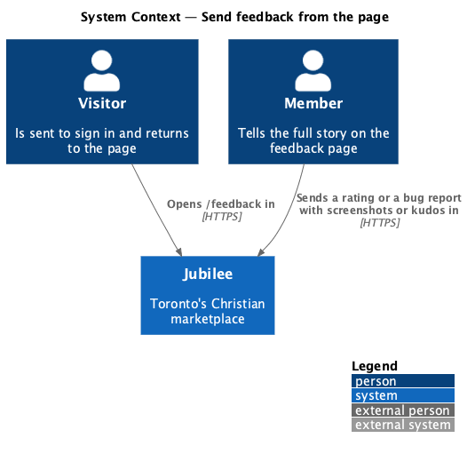
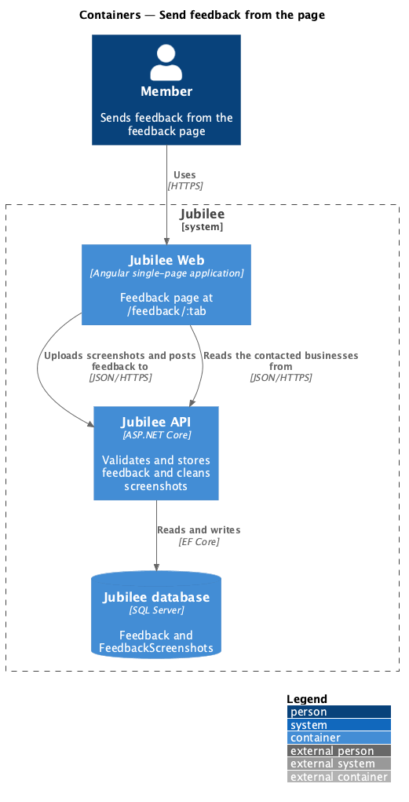
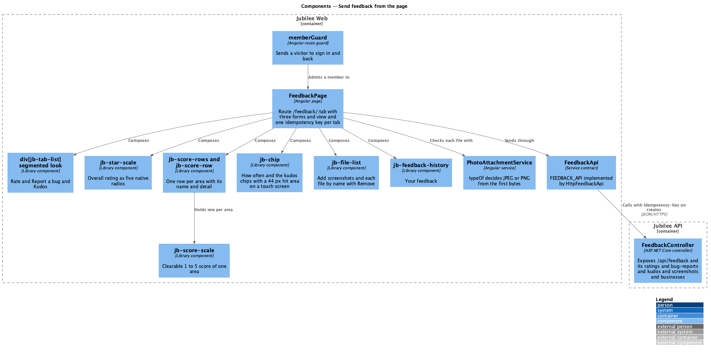
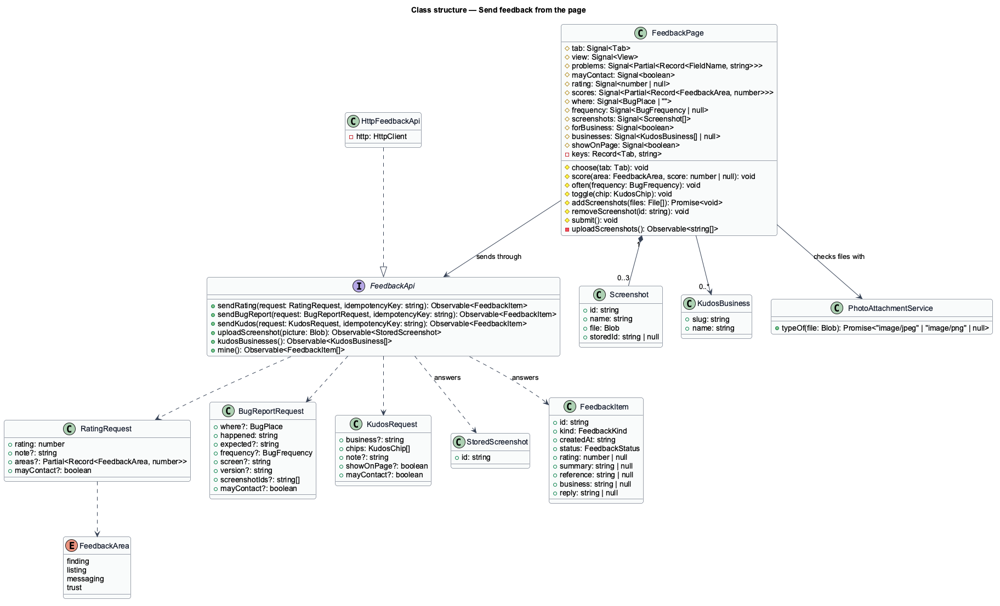
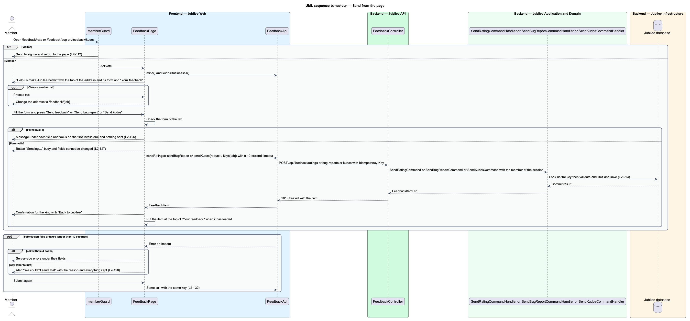
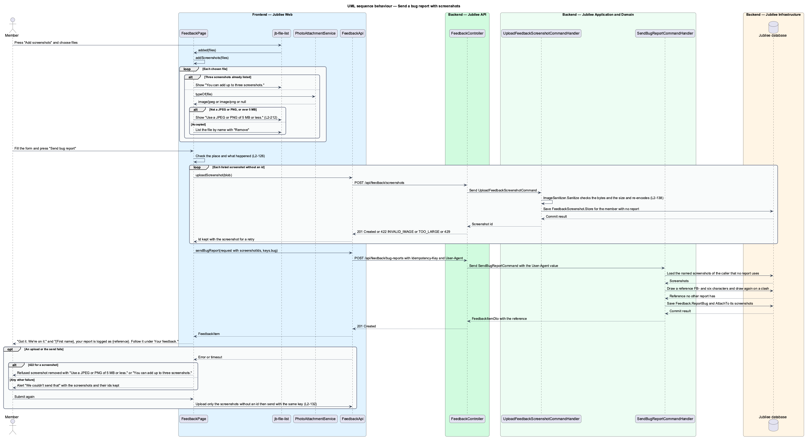
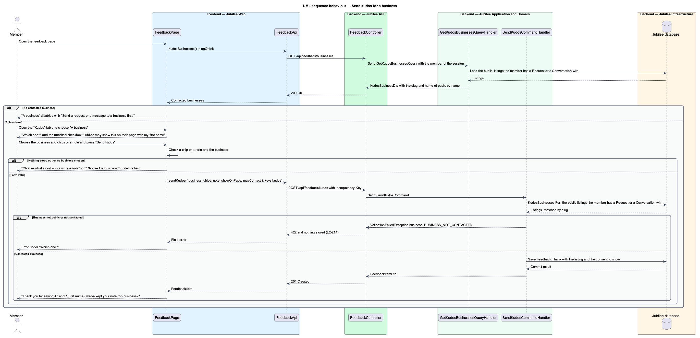

# Send feedback from the page

## Overview

Jubilee is Toronto's Christian marketplace. The panel on every screen takes a
few seconds of feedback; the feedback page is where a member tells the full
story. This feature covers the page at `/feedback/:tab`: a rating of each part
of Jubilee, a structured bug report with screenshots, and kudos for the Jubilee
team or for a business.

The terms below are local to this feature.

- **feedback page** — page "Help us make Jubilee better" at `/feedback/rate`, `/feedback/bug` and `/feedback/kudos`
- **area** — one of the four parts of Jubilee a rating may score: finding businesses, listing a business, messages and requests, trust and safety
- **place** — one of seven fixed answers to "Where did it happen?" in a bug report
- **frequency** — optional answer to "How often?": just once, sometimes or every time
- **screenshot** — JPEG or PNG picture of 5 MB or less that a member adds to a bug report; a report carries at most three
- **contacted business** — public business the member has sent a request or a message to; the only businesses kudos can name
- **consent to show** — checkbox "Jubilee may show this on their page with my first name", stored with kudos for a business
- **consent to contact** — checkbox "You can message me about this", stored with every item sent from the page

The page is behind `memberGuard`: a visitor is sent to sign in and returns to the
page (`L2-012`). The list "Your feedback" on the same page is described in
`follow-your-feedback` (`L2-213`). The API side is described in
`receive-and-store-feedback` (`L2-214`). The short form is the panel of
`send-feedback-from-panel` (`L2-210`), whose "Full form" link opens this page.
The decisions behind the page are recorded in ADR 0043.

Neither consent is ticked for the member (`L2-149`, ADR 0043). Kudos for a
business are stored with the consent; showing them on the business's page is a
later change, so the confirmation says the note was kept and promises nothing
more.

## Description

The feature is a vertical slice from the page to `FeedbackController`.

- **Routes** — `app.routes.ts` has `feedback/:tab` for the tabs `rate`, `bug`
  and `kudos`, loaded lazily, with `canActivate: [memberGuard]`, the data
  `shell: 'app'` and `page: 'feedback'`, and the title "Feedback · Jubilee".
  `/feedback` redirects to `/feedback/rate`, and an address that names no tab
  is replaced by `/feedback/rate`. The sent state is a state of the page, not an
  address.
- **`FeedbackPage`** — page of the app
  (`frontend/projects/jubilee/src/app/pages/feedback/`, `feedback.page.ts` and
  `feedback.page.html`, no stylesheet). It is a container: it holds the values
  of the three forms, the problems per field and the view (`form`, `busy`,
  `failed`, `sent`) as signals, holds one idempotency key per tab, and composes
  `jb-*` components (ADR 0035). It shows "Back" (`jb-back-link` to `/`), the
  heading "Help us make
  Jubilee better", the text "Rate it, tell us what's broken, or tell us what's
  working. Someone on our team in Toronto reads every note.", the tabs, the
  form of the selected tab and `section[jb-feedback-history]`. `App` shows no
  launcher on this page.
- **Tabs** — `div[jb-tab-list]` in its `segmented` look and `lg` size with the
  tabs "Rate",
  "Report a bug" and "Kudos". The tab of the address is selected. Choosing a tab
  navigates to its address.
- **Layout** — the form and "Your feedback" sit in the `split` layout utility:
  under 1024 px "Your feedback" follows the form; from 1024 px it sits beside it.
  Nothing scrolls sideways from 360 px (`L2-163`).
- **"Rate" form** — "Overall, how's Jubilee working for you?" with
  `fieldset[jb-star-scale]` in its `lg` size; "And each part of it" with "Skip
  any you haven't used." and a `ul[jb-score-rows]` with one `li[jb-score-row]`
  holding a `clearable` `fieldset[jb-score-scale]` for each of "Finding
  businesses" ("Browse, search and
  categories"), "Listing your business" ("Creating and editing a listing"),
  "Messages and requests" ("Meetings, quotes and order requests") and "Trust and
  safety" ("Reports and honest listings"); and the note "What
  would make it better?". Pressing the chosen score of an area again clears it.
  The submit button reads "Send feedback".
- **"Report a bug" form** — "Where did it happen?" as a `select[jb-select]` of
  the seven places (Browse and search; A business or product page; Listing a
  business; Messages; Requests; Signing in or joining; Somewhere else), "What
  happened?", "What did you expect?" (optional), "How often?" (Just once;
  Sometimes; Every time; optional) as `button[jb-chip]` toggles, where pressing
  the chosen one again clears it, and "Screenshots" with "Optional, but they
  help us fix it faster.", "Add screenshots" and "We'll also attach your browser
  and device and the app's version ({version})." The version is the
  `APP_VERSION` injection token, provided from `environment.version`. The submit
  button reads "Send bug report".
- **`div[jb-file-list]`** — component `FileList` of the `components` library
  (`file-list/`). It shows the button "Add screenshots", lists each chosen file
  by name with "Remove" and shows one message under the list. Its output
  `added` gives the files chosen and `removed` the id of the file removed; it
  reads no file itself.
- **Screenshot checks on the device** — for each chosen file
  `addScreenshots` calls `PhotoAttachmentService.typeOf`, which decides JPEG or
  PNG from the first bytes, and compares the size with `MAX_PHOTO_BYTES`. A file
  of another type, or one over 5 MB, is refused with "Use a JPEG
  or PNG of 5 MB or less." A fourth file is refused with "You can add up to
  three screenshots." (`L2-212` criterion 6). ADR 0043 names the shrinking of
  `PhotoAttachmentService`; `L2-212` refuses a file that is too large, and the
  page follows the requirement. The device check is for feedback only; the
  server decides again (`L2-138`).
- **"Kudos" form** — "Who's it for?" with two `jb-choice-card` choices, "The
  Jubilee team" ("Something about the app itself.") and "A business" ("Someone
  you hired or bought from.") in `jb-choice-cards`; "What stood out?" with the
  five chips of the panel, each pressed over at least 44 × 44 px on a touch
  screen (ADR 0059); and "Your note". Choosing "A business" shows "Which one?",
  a `select[jb-select]` of the contacted businesses by name, and the
  `jb-checkbox` "Jubilee may show this on their page with my first name", not
  ticked.
- **Contacted businesses** — the page calls `FeedbackApi.kudosBusinesses()`
  (`GET /api/feedback/businesses`) once, in `ngOnInit`, beside `mine()`. With an
  empty answer the choice "A business" is disabled with "Send a request or a
  message to a business first." When the list cannot be loaded, "A business"
  stays enabled and the server decides.
- **Consent to contact** — each form ends with the `jb-checkbox` "You can
  message me about this", not ticked, before its submit button.
- **Validation on the page** — "Rate" without an overall rating shows "Choose a
  rating from 1 to 5." under the stars. "Report a bug" shows "Choose where it
  happened." and "Tell us what happened." under their fields. "Kudos" shows
  "Choose what stood out or write a note." or "Choose the business." Each
  message sits under its field, focus moves to the first invalid field and
  nothing is sent (`L2-126`). Notes are held to 1,000 characters (`NOTE_MAX`)
  and "What happened?" and "What did you expect?" to 2,000 (`ANSWER_MAX`) by
  their fields.
- **Sending** — the button reads "Sending…" and is busy, and the fields cannot
  be changed (`L2-127`). A rating calls `sendRating`. Kudos calls `sendKudos`
  with the business's slug and the consent to show when a business is chosen.
  A bug report first uploads each screenshot that has no id yet with
  `uploadScreenshot` (`POST /api/feedback/screenshots`), then calls
  `sendBugReport` with the screenshot ids, the place, both answers, the
  frequency, the screen and the version. Each create call carries the tab's
  idempotency key from `newKey()` and the 10-second `timeout` of
  `SUBMIT_TIMEOUT_MS`.
- **Screen of a bug report sent from the page** — the route the member is on is
  the feedback page, so the page sends `feedback` as the screen. The place
  answers where the bug happened.
- **Sent view** — the form is replaced by a `jb-empty-state` confirmation with
  "Back to Jubilee", which navigates to `/`, the browse screen. A rating shows "Thanks for rating Jubilee." and
  "{First name}, we read every rating, and the lowest-scored parts are what we
  work on next." A bug report shows "Got it. We're on it." and "{First name},
  your report is logged as {reference}. Follow it under Your feedback." Kudos to
  the team shows "That made our day." and "{First name}, we share every kudos
  with the whole team. Thank you for saying it." Kudos to a business shows
  "Thank you for saying it." and "{First name}, we've kept your note for
  {business}." When "Your feedback" has loaded, the page puts the answered item
  at the top of it.
- **Failed view** — a `jb-alert` titled "We couldn't send that" gives the
  reason. Everything chosen and typed is kept, including the screenshots and the
  ids of those already uploaded. Submitting again reuses the idempotency key and
  the ids, so neither a screenshot nor the item is stored twice (`L2-128`,
  `L2-132`). An HTTP 422 answer places each server-side field error under its
  field, in the words of the page's table of codes. A screenshot the server
  refuses (`INVALID_IMAGE`, `TOO_LARGE`, or a `screenshots` code) is removed
  from the list with its message, so the report can be sent without it. The
  reason of any other failure comes from `feedbackFailure`, shared with the
  panel in `dialogs/feedback/feedback-words.ts`.
- **`FeedbackApi`** — service contract of the `api` library with the token
  `FEEDBACK_API`, implemented by `HttpFeedbackApi`. This feature uses
  `sendRating`, `sendBugReport`, `sendKudos`, `uploadScreenshot` and
  `kudosBusinesses`.
- **`FeedbackController`** — ASP.NET Core controller at `api/feedback` that
  sends `SendRatingCommand`, `SendBugReportCommand`, `SendKudosCommand`,
  `UploadFeedbackScreenshotCommand` and `GetKudosBusinessesQuery`
  (`receive-and-store-feedback`).
- **Tests** — `e2e/tests/feedback-page.spec.ts` drives the page through the
  page object `e2e/pages/feedback.page.ts` (`FeedbackPage`) and the screens of
  `e2e/pages/feedback.screens.ts`, with the stubs of `e2e/fixtures/feedback.ts`.
  Each library component has a parity spec in `e2e/tests/parity/` (ADR 0036).
  The Magic Patterns Feedback frame is not captured, so their specs declare
  their reference `absent`; `e2e/fixtures/parity.ts` then looks for
  `docs/design-reference/magic-patterns/components/<component>/<case>-<width>.png`
  and, once the owner saves one, compares that case with it at 3 % without the
  spec being edited (ADR 0059). The absent specs of this feature are `star-scale`,
  `score-scale` and `score-rows`; `chip` is compared with crops of captured
  frames.

## Requirements

The feature realizes the following level-2 (L2) requirements. Each L2
requirement refines a level-1 (L1) requirement, cited by identifier.

| L2 ID | Refines (L1) | Requirement |
|-------|--------------|-------------|
| `L2-212` | `L1-029` | The feedback page shall let a member send a rating of each part of Jubilee, a structured bug report with screenshots, or kudos for the team or for a business. |
| `L2-126` | `L1-018` | A form submitted with errors shall show each message under its field, shall move focus to the first invalid field, shall keep the values that the user typed, and the server shall enforce the same rules. |
| `L2-138` | `L1-019` | The server shall check each upload by its magic bytes, accept only JPEG and PNG up to 5 MB and 8,000 × 8,000 pixels, re-encode the image and strip metadata, and a file that fails any check shall be rejected and never served. |

## Diagrams

### System context

A member opens the feedback page and sends a rating, a bug report or kudos to
Jubilee. A visitor is sent to sign in first.

### Containers

`Jubilee Web` shows the page, uploads the screenshots and posts the feedback to
`Jubilee API`, which stores both in `Jubilee database`.

### Components

`FeedbackPage` composes the tab list, the two scales, `jb-score-rows`,
`jb-file-list`, `jb-feedback-history` and the reused fields. It checks screenshots with `PhotoAttachmentService` and reaches
`FeedbackController` through `FeedbackApi`.

### Class structure

`FeedbackApi` has one request type per kind. A bug report names its screenshots
by id, and kudos names a business by slug with the consent to show.

### Behaviour — send from the page

The page validates the form of the selected tab, sends it with the tab's
idempotency key, and shows the confirmation or the alert (`L2-126`, `L2-127`,
`L2-128`, `L2-132`).

### Behaviour — send a bug report with screenshots

The page checks each file on the device, uploads the screenshots when the report
is sent and names them by id. A retry reuses the ids and the key (`L2-138`,
`L2-132`).

### Behaviour — send kudos for a business

The page lists the contacted businesses, and the API refuses a business the
member has not contacted with `BUSINESS_NOT_CONTACTED` (`L2-214`).

